# How much does Nebula's 512-token cut throw away?

A measurement study on the full `dtrizna/quovadis-speakeasy` dataset (92,700
samples), using Nebula's own preprocessing code. Section 6 repeats it on a
second sandbox, the Avast-CTU Public CAPEv2 dataset (48,976 reports). A
two-level model built on these findings is in [`hier_nebula/`](hier_nebula/README.md).

> **Short answer.** Two out of three samples are longer than 512 tokens, and
> two thirds of all tokens are never seen by the model. What gets cut is
> almost only the API-call sequence. The reports are not very long, though:
> 99.8% of samples fit in eight 512-token chunks (4,096 tokens), because the
> emulator stopped most runs at 500 API calls. Also, 94.7% of samples have
> only **one** entry point, so chunking "by entry point / process" is in
> practice the same as cutting one long API sequence into pieces.

All numbers below were produced by `measure_lengths.py` and `analyze.py` in
this branch. The tables are pasted in automatically from
[`results/tables.md`](results/tables.md) by `build_report.py`. Raw counts are
in brackets next to every percentage.

---

## 1. Method

### 1.1 Exact preprocessing used

Nothing is re-implemented. `measure_lengths.py` imports these from a clone of
<https://github.com/dtrizna/nebula> at commit
`1343ae170ef32b01a75d2dd5fb906b5541f073df`:

| step | Nebula code |
|---|---|
| field filter | `nebula.preprocessing.tokenization.JSONFilter`, built inside `PEDynamicFeatureExtractor` with `nebula.constants.SPEAKEASY_RECORD_FIELDS` (file_access event/path, network_events.traffic server/port, registry_access event/path, apis api_name/args/ret_val). The script asserts that the filter really uses this field list. |
| record limit | `SPEAKEASY_RECORD_LIMITS = {"network_events.traffic": 256}` |
| normalisation + join | `PEDynamicFeatureExtractor.filter_and_normalize_report(entry_points)`: path and IP normalisation, non-alphanumeric characters removed from API args, then `joinRecordsToJSON()` |
| tokenizer | `JSONTokenizerBPE(vocab_size=50001, seq_len=512, model_path=nebula/objects/bpe_50000_sentencepiece.model, vocab=nebula/objects/bpe_50000_vocab.json)` |
| token count | `len(tokenizer.encode(report, pad=False)[0])`. This is the length *before* `pad_sequence()` keeps `encoded[:512]` (`tokenization.py:154-159`). |

To avoid importing torch through `nebula/__init__.py`, the script registers
empty package modules for `nebula`, `nebula.preprocessing` and
`nebula.models`, stubs `nebula.models.ember`, and builds `nebula.misc` with
only `get_alphanum_chars()`, copied word for word from the source file with
`ast` (details in [README.md](README.md)).

**Sanity check** on the example reports in `nebula/emulation/`
([log](results/logs/sanity.log)):

| report | tokens | expected |
|---|---|---|
| report_example_entrypoint_with_file | 551 | 551 |
| report_example_entrypoint_with_registry | 1,672 | 1,672 |
| report_example_entrypoint_withDNS | 1,811 | 1,811 |
| report_example_entrypoint_ransomware | 2,609 | 2,609 |
| report_example_full | 57 | 57 |

One note on `report_example_full.json`. It is a *full* Speakeasy report: a
dict with metadata and an `entry_points` list. The other four files are the
`entry_points` list itself. Passing the full dict to
`filter_and_normalize_report()` gives `{'apis': []}` = **1 token**, because
the filter finds no top-level fields. Passing `report["entry_points"]` gives
**57**, as expected. This is also what Nebula's own `emulate()` does
(`pe.py`: `self.filter_and_normalize_report(report["entry_points"])`). All
dataset files are plain lists, so this case never comes up in the dataset.

**Field order, checked in the code.** `joinRecordsToJSON()` loops over
`sorted(recordDict.keys(), reverse=True)` (`pe.py:147`). With the four field
keys this gives `registry_access` → `network_events.traffic` → `file_access`
→ `apis`, so `apis` is always last. I also checked this in the data: all
92,700 tokenized reports follow this order (table in §2.4).

**Per-field token attribution.** The tokenizer reads `str(report)`. I split
that string at the top-level `, '<key>':` boundaries, tokenized each piece
with the same `tokenizer.encode`, and **asserted** that the pieces' token
ids, joined together, equal the full report's token ids. This held for 100%
of samples (92,700 of 92,700). So the per-field counts are exact, not
estimates. A field's tokens include its own key name (for example
`file access`).

**Entry points.** Each entry point is tokenized alone with
`filter_and_normalize_report([ep])`. Chunk counts:
- **(a)** `ceil(tokens / 512)` on the whole report.
- **(b)** one chunk per entry point. An entry point over 512 tokens is split
  into 512-token pieces with 64-token overlap (stride 448), so it needs
  `1 + ceil((t-512)/448)` chunks.
- **(c)** an extra variant I added: like (b), but consecutive entry points
  shorter than 512 tokens are packed into one chunk.

### 1.2 Dataset and grouping key

`load_dataset("dtrizna/quovadis-speakeasy")` (streaming;
[log](results/logs/inspect_datasets.log)) shows:

- **Splits:** a single `train` split, built from 92,702 JSON files. The
  dataset's own train/test folders are **mixed together** in this view.
- **Columns** (first rows): `ep_type, start_addr, ep_args, apihash, apis,
  ret_val, error, network_events, dynamic_code_segments, file_access`.
  Features are reported as `None` (no fixed schema). Some raw entry points
  also have `registry_access`, `process_events`, `dropped_files` and
  `handled_exceptions` (key counts in the inspect log).
- **There is no label column and no sample-ID column.** Values are also
  type-coerced; for example `file_access` comes back as a list of JSON
  *strings*.
- **Row count:** 167,651 rows, by iterating the streaming view
  ([log](results/logs/datasets_stream_rowcount.log)). The non-streaming
  `load_dataset` **fails** with `DatasetGenerationError` (a pandas JSON parse
  error) ([log](results/logs/load_dataset_full.log)).
- Example rows 0 and 1 are printed in the
  [inspect log](results/logs/inspect_datasets.log). They are a
  `module_entry` and a `thread`.

**Grouping key = the source file path**
(`windows_emulation_{trainset,testset}/report_<family>/[<hex>/]<sha256>.json`).
The family label and the train/test split also come from this path. How I
checked it:

1. The dataset repository stores one JSON file per sample, and each file is a
   JSON **list of entry points**. That is 92,700 of 92,700 files; the
   dataset card says each file is a dict with `sha256` and `entry_points`,
   but no file has that form.
2. Adding up the entry points in all 92,700 sample files gives **167,548**.
   The two extra files at the repo root add the rest:
   `example-ransomware.json` (102 entry points) and `speakeasy-config.json`
   (an emulator config, which `datasets` turns into 1 row with no
   `ep_type`). 167,548 + 102 + 1 = **167,651**, exactly the `datasets` row
   count. The per-`ep_type` counts also match (module_entry +1, thread +101,
   None +1).
3. No column inside a row can serve as the key. `apihash` is a hash of one
   entry point's API sequence: only 6,699 distinct values exist, and 160,638
   entry points share theirs with another file.
4. No file stem (sha256) appears in more than one folder.
5. Nebula's own training pipeline (`read_and_filter_json_folders()` in
   `normalization.py`) also treats one file as one sample, takes the label
   from the folder name (`report_clean` and `report_windows_syswow64` are
   benign), and passes the whole file to `filter_and_normalize_report()`.

So I measured on the raw files (Git LFS clone of dataset revision
`fc2e98fac0b4d43a5557ccab70c877af6cce9f4d`) instead of on `datasets` rows.

### 1.3 Sample counts and what was skipped

| split    |    ok |
|:---------|------:|
| testset  | 17402 |
| trainset | 75298 |

Top-level JSON type of each file:

| split    |   list |
|:---------|-------:|
| testset  |  17402 |
| trainset |  75298 |

Samples measured (status ok): 92,700 of 92,700 files.

Field attribution exact (concatenated field token ids == full token ids): 100.0% (92,700)

- **Skipped:** 3 empty `.err` files (failed emulations). This is why the
  trainset has 75,298 samples, not the 75,301 in the dataset card's table.
  The two root-level example/config files were also left out.
- **Dropped by Nebula's filter** (`filter_and_normalize_report` returns
  `None`, the MSVBVM60 case): **0** samples.
- **No subsampling.** I first ran a pilot on 2,000 random files (seed 0;
  [tables](results/sample2000_tables.md)). The pilot gave the same median
  (1,069) and almost the same share above 512 (66.6% vs 66.0% on the full
  data).
  Then all 92,700 samples were measured: 21.8 min on 3 cores
  ([log](results/logs/measure_full.log)). Both splits are reported
  separately everywhere.

---

## 2. Results

### 2.1 Tokens per sample (no truncation)

| set | n | median | p75 | p90 | p99 | max | >512 | >1024 | >2048 | >4096 | >8192 | tokens dropped by 512 cut |
|---|---|---|---|---|---|---|---|---|---|---|---|---|
| all | 92,700 | 1,069 | 1,743 | 2,376 | 2,989 | 257,671 | 66.0% (61,207) | 50.5% (46,772) | 21.4% (19,833) | 0.2% (194) | 0.0% (22) | 66.6% (70,859,979 of 106,474,006) |
| testset | 17,402 | 1,026 | 1,877 | 2,277 | 2,794 | 5,255 | 63.5% (11,043) | 50.0% (8,707) | 22.2% (3,866) | 0.1% (12) | 0.0% (0) | 63.6% (11,799,879 of 18,562,891) |
| trainset | 75,298 | 1,069 | 1,733 | 2,386 | 2,991 | 257,671 | 66.6% (50,164) | 50.6% (38,065) | 21.2% (15,967) | 0.2% (182) | 0.0% (22) | 67.2% (59,060,100 of 87,911,115) |

Mean per-sample fraction of tokens dropped by the 512 cut: 40.5%; median per-sample fraction: 52.1%.

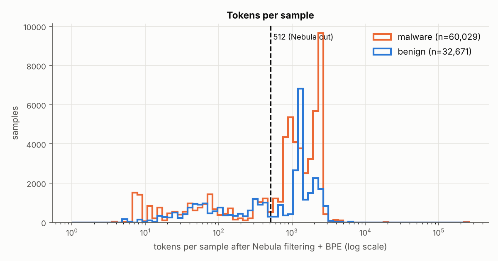

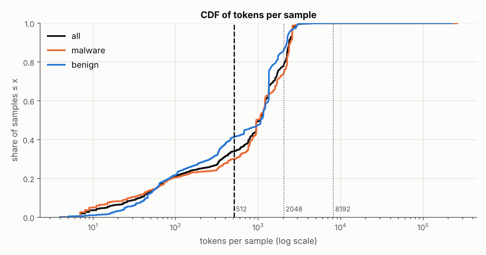

### 2.2 By family and split

#### testset
| family | n | median | p75 | p90 | p99 | max | >512 | >1024 | >2048 | >4096 | >8192 | tokens dropped by 512 cut |
|---|---|---|---|---|---|---|---|---|---|---|---|---|
| backdoor | 1,940 | 2,251 | 2,363 | 2,456 | 2,616 | 2,821 | 88.1% (1,709) | 70.7% (1,371) | 66.2% (1,285) | 0.0% (0) | 0.0% (0) | 73.8% (2,528,945 of 3,425,754) |
| clean | 7,944 | 1,048 | 1,632 | 2,269 | 2,705 | 5,255 | 56.6% (4,496) | 50.4% (4,003) | 16.1% (1,276) | 0.0% (2) | 0.0% (0) | 63.1% (4,867,784 of 7,719,845) |
| coinminer | 1,684 | 1,172 | 2,084 | 2,087 | 2,583 | 5,091 | 92.3% (1,554) | 65.0% (1,095) | 36.0% (607) | 0.1% (1) | 0.0% (0) | 65.2% (1,528,451 of 2,343,709) |
| dropper | 252 | 329 | 505 | 1,920 | 3,038 | 3,041 | 24.6% (62) | 19.8% (50) | 4.0% (10) | 0.0% (0) | 0.0% (0) | 49.5% (69,452 of 140,235) |
| keylogger | 1,041 | 372 | 382 | 1,132 | 2,306 | 2,778 | 17.1% (178) | 14.3% (149) | 3.7% (38) | 0.0% (0) | 0.0% (0) | 30.9% (153,519 of 496,710) |
| ransomware | 2,139 | 761 | 2,074 | 2,591 | 3,493 | 4,785 | 67.6% (1,445) | 41.1% (879) | 27.5% (589) | 0.2% (5) | 0.0% (0) | 67.3% (1,655,911 of 2,460,816) |
| rat | 1,258 | 1,169 | 1,172 | 1,347 | 2,388 | 2,849 | 90.8% (1,142) | 78.9% (993) | 2.8% (35) | 0.0% (0) | 0.0% (0) | 55.5% (742,835 of 1,338,242) |
| trojan | 1,085 | 402 | 758 | 1,355 | 2,254 | 4,534 | 41.8% (454) | 15.2% (165) | 2.4% (26) | 0.4% (4) | 0.0% (0) | 39.8% (250,537 of 629,583) |
| windows_syswow64 | 59 | 57 | 82 | 97 | 1,447 | 1,692 | 5.1% (3) | 3.4% (2) | 0.0% (0) | 0.0% (0) | 0.0% (0) | 30.6% (2,445 of 7,997) |

#### trainset
| family | n | median | p75 | p90 | p99 | max | >512 | >1024 | >2048 | >4096 | >8192 | tokens dropped by 512 cut |
|---|---|---|---|---|---|---|---|---|---|---|---|---|
| backdoor | 11,061 | 2,310 | 2,471 | 2,605 | 2,627 | 18,829 | 95.3% (10,537) | 83.9% (9,284) | 74.5% (8,240) | 0.5% (53) | 0.0% (4) | 76.1% (17,368,352 of 22,835,992) |
| clean | 24,433 | 1,124 | 1,356 | 2,214 | 2,991 | 223,877 | 60.0% (14,654) | 53.6% (13,093) | 12.9% (3,152) | 0.3% (77) | 0.0% (2) | 63.2% (15,571,861 of 24,640,750) |
| coinminer | 6,891 | 1,216 | 1,610 | 2,178 | 3,033 | 6,890 | 93.8% (6,465) | 73.2% (5,044) | 12.6% (869) | 0.0% (1) | 0.0% (0) | 62.1% (5,602,736 of 9,017,842) |
| dropper | 8,243 | 123 | 1,069 | 1,632 | 3,006 | 4,028 | 38.5% (3,177) | 30.7% (2,534) | 5.9% (490) | 0.0% (0) | 0.0% (0) | 55.4% (2,637,622 of 4,764,278) |
| keylogger | 4,378 | 1,676 | 1,708 | 1,787 | 2,562 | 3,049 | 83.9% (3,673) | 79.2% (3,468) | 7.7% (336) | 0.0% (0) | 0.0% (0) | 66.3% (3,831,314 of 5,780,189) |
| ransomware | 9,627 | 949 | 950 | 1,160 | 3,673 | 257,671 | 56.5% (5,441) | 10.7% (1,034) | 7.4% (717) | 0.2% (21) | 0.2% (16) | 73.1% (7,706,821 of 10,545,466) |
| rat | 1,697 | 1,132 | 1,215 | 1,221 | 2,487 | 3,736 | 85.5% (1,451) | 52.4% (889) | 2.7% (46) | 0.0% (0) | 0.0% (0) | 53.3% (863,866 of 1,621,641) |
| trojan | 8,733 | 562 | 1,818 | 2,601 | 2,609 | 4,647 | 54.5% (4,762) | 31.1% (2,715) | 24.2% (2,116) | 0.3% (30) | 0.0% (0) | 63.0% (5,472,972 of 8,682,804) |
| windows_syswow64 | 235 | 57 | 85 | 101 | 1,313 | 2,054 | 1.7% (4) | 1.7% (4) | 0.4% (1) | 0.0% (0) | 0.0% (0) | 20.6% (4,556 of 22,153) |

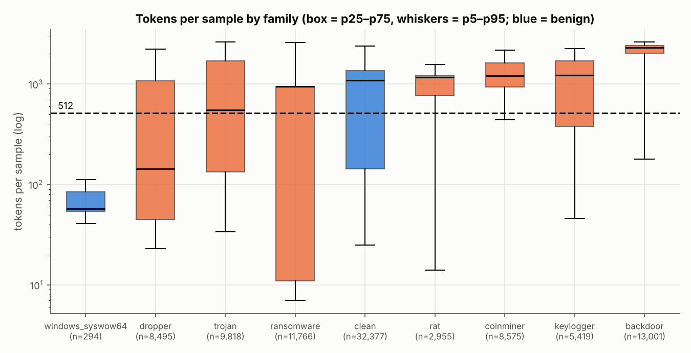

### 2.3 Malware vs benign

| split / class | n | median tokens | mean tokens | >512 | median entry points | median chunks (per-EP) |
|---|---|---|---|---|---|---|
| all / malware | 60,029 | 950 | 1,234 | 70.0% (42,050) | 1 | 3 |
| all / benign | 32,671 | 1,077 | 991 | 58.6% (19,157) | 1 | 3 |
| testset / malware | 9,399 | 1,028 | 1,153 | 69.6% (6,544) | 1 | 3 |
| testset / benign | 8,003 | 1,026 | 966 | 56.2% (4,499) | 1 | 3 |
| trainset / malware | 50,630 | 950 | 1,249 | 70.1% (35,506) | 1 | 3 |
| trainset / benign | 24,668 | 1,111 | 1,000 | 59.4% (14,658) | 1 | 3 |

ROC AUC of a classifier that uses ONLY the length (higher = malware); 0.5 = no signal:

| set | AUC(tokens) | AUC(min(tokens,512)) | AUC(n_entry_points) |
|---|---|---|---|
| all | 0.541 | 0.542 | 0.456 |
| testset | 0.567 | 0.574 | 0.487 |
| trainset | 0.535 | 0.535 | 0.448 |

Number of real (non-pad) tokens Nebula sees, min(tokens, 512):

| set | class | median | share of samples with < 512 real tokens (i.e. padded) |
|---|---|---|---|
| all | malware | 512 | 29.9% (17,977) |
| all | benign | 512 | 41.4% (13,514) |
| testset | malware | 512 | 30.4% (2,855) |
| testset | benign | 512 | 43.8% (3,504) |
| trainset | malware | 512 | 29.9% (15,122) |
| trainset | benign | 512 | 40.6% (10,010) |

#### Length as a shortcut, family by family
ROC AUC of raw token count for separating one family from `clean` (0.5 = no signal; values far from 0.5 in either direction mean length alone separates them).

| family | AUC trainset | AUC testset | AUC trainset, min(tokens,512) | AUC testset, min(tokens,512) |
|---|---|---|---|---|
| backdoor | 0.832 | 0.753 | 0.677 | 0.653 |
| coinminer | 0.617 | 0.645 | 0.673 | 0.678 |
| dropper | 0.325 | 0.377 | 0.361 | 0.375 |
| keylogger | 0.632 | 0.372 | 0.616 | 0.383 |
| ransomware | 0.309 | 0.530 | 0.401 | 0.528 |
| rat | 0.465 | 0.568 | 0.610 | 0.666 |
| trojan | 0.492 | 0.397 | 0.487 | 0.463 |
| windows_syswow64 | 0.162 | 0.195 | 0.162 | 0.198 |

### 2.4 Which fields survive the cut

Field order actually found in the tokenized reports (all distinct orders):

| field order (left = first in sequence) | samples |
|---|---|
| `apis` | 64,890 |
| `file_access|apis` | 17,691 |
| `registry_access|apis` | 7,206 |
| `registry_access|file_access|apis` | 2,216 |
| `network_events.traffic|file_access|apis` | 650 |
| `network_events.traffic|apis` | 24 |
| `registry_access|network_events.traffic|file_access|apis` | 17 |
| `registry_access|network_events.traffic|apis` | 6 |

| field | samples with field | tokens (all samples) | share of all tokens | median tokens (when present) | % of field tokens kept by 512 cut | samples where field fully kept | samples where field fully cut |
|---|---|---|---|---|---|---|---|
| registry_access | 10.2% (9,445) | 329,838 | 0.3% | 32 | 98.4% (324,485) | 100.0% (9,444) | 0.0% (0) |
| network_events.traffic | 0.8% (697) | 10,165 | 0.0% | 13 | 98.4% (10,005) | 99.4% (693) | 0.0% (0) |
| file_access | 22.2% (20,574) | 410,968 | 0.4% | 10 | 100.0% (410,968) | 100.0% (20,574) | 0.0% (0) |
| apis | 100.0% (92,700) | 105,723,035 | 99.3% | 1,069 | 33.0% (34,868,569) | 34.0% (31,493) | 0.0% (5) |

'samples where field fully kept / cut' are out of the samples that have the field. Field tokens include the field's own key name (e.g. `file access`).

Composition of the tokens Nebula actually keeps (sum over samples of the first ≤512 tokens):

| field | kept tokens | share of kept |
|---|---|---|
| registry_access | 324,485 | 0.9% |
| network_events.traffic | 10,005 | 0.0% |
| file_access | 410,968 | 1.2% |
| apis | 34,868,569 | 97.9% |

For the 61,207 samples longer than 512 tokens only:

| field | samples with field | % of field tokens kept | samples where field fully cut |
|---|---|---|---|
| registry_access | 10.6% (6,495) | 97.7% | 0.0% (0) |
| network_events.traffic | 1.1% (675) | 98.4% | 0.0% (0) |
| file_access | 30.0% (18,388) | 100.0% | 0.0% (0) |
| apis | 100.0% (61,207) | 30.2% | 0.0% (5) |

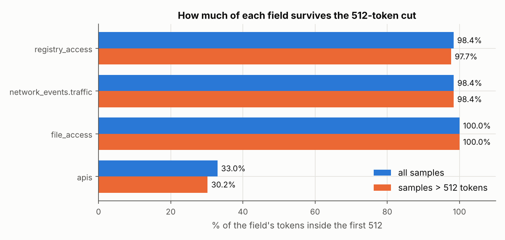

### 2.5 Entry points and chunking

Entry-point tokenization status:

| status   |   entry points |
|:---------|---------------:|
| ok       |         167548 |

| quantity | median | p75 | p90 | p99 | max | mean |
|---|---|---|---|---|---|---|
| entry points per sample | 1 | 1 | 1 | 5 | 102 | 1.8 |
| thread entry points per sample | 0 | 0 | 0 | 1 | 101 | 0.7 |
| tokens per entry point (tokenized alone) | 42 | 1,167 | 2,182 | 2,635 | 257,671 | 636.0 |
| tokens per module_entry | 993 | 1,712 | 2,368 | 2,957 | 257,671 | 1,128.0 |
| tokens per thread | 4 | 4 | 4 | 1,911 | 4,023 | 30.0 |
| sum of per-EP tokens per sample | 1,069 | 1,743 | 2,376 | 2,989 | 257,671 | 1,149.5 |
| chunks needed, (a) fixed 512 | 3 | 4 | 5 | 6 | 504 | 2.8 |
| chunks needed, (b) per-EP, 512/overlap 64 | 3 | 5 | 6 | 9 | 576 | 3.8 |

Samples with exactly one entry point: 94.7% (87,750); with more than one: 5.3% (4,950)

Sum over all samples of per-EP tokens = 106,554,960 vs whole-report tokens = 106,474,006 (+0.08%; tokenizing entry points separately repeats the field key names).

Entry points longer than 512 tokens: 36.6% (61,389) (module_entry: 65.3% (60,518); thread: 1.3% (863))

Samples with at least one entry point longer than 512 tokens: 66.0% (61,202)

Entry-point counts by family (all splits):

| family | samples | median EPs | p90 EPs | max EPs | samples with >1 EP |
|---|---|---|---|---|---|
| backdoor | 13,001 | 1 | 1 | 102 | 0.5% (67) |
| clean | 32,377 | 1 | 2 | 5 | 11.2% (3,629) |
| coinminer | 8,575 | 1 | 1 | 11 | 3.1% (270) |
| dropper | 8,495 | 1 | 1 | 5 | 0.8% (66) |
| keylogger | 5,419 | 1 | 1 | 4 | 1.4% (76) |
| ransomware | 11,766 | 1 | 1 | 102 | 6.1% (720) |
| rat | 2,955 | 1 | 1 | 4 | 0.3% (8) |
| trojan | 9,818 | 1 | 1 | 5 | 1.2% (113) |
| windows_syswow64 | 294 | 1 | 1 | 2 | 0.3% (1) |

Share of samples that fit within a given number of 512-token chunks:

| set | scheme | ≤8 chunks | ≤16 chunks | ≤32 chunks | ≤64 chunks |
|---|---|---|---|---|---|
| all | (a) fixed 512 | 99.8% (92,506) | 100.0% (92,678) | 100.0% (92,679) | 100.0% (92,683) |
| all | (b) per entry point | 98.9% (91,672) | 99.3% (92,027) | 99.3% (92,031) | 99.3% (92,031) |
| testset | (a) fixed 512 | 99.9% (17,390) | 100.0% (17,402) | 100.0% (17,402) | 100.0% (17,402) |
| testset | (b) per entry point | 97.4% (16,951) | 97.7% (16,994) | 97.7% (16,994) | 97.7% (16,994) |
| trainset | (a) fixed 512 | 99.8% (75,116) | 100.0% (75,276) | 100.0% (75,277) | 100.0% (75,281) |
| trainset | (b) per entry point | 99.2% (74,721) | 99.6% (75,033) | 99.7% (75,037) | 99.7% (75,037) |

Coverage if the model only reads the first K chunks (share of all tokens covered):

| scheme | K=1 (=Nebula) | K=4 | K=8 | K=16 | K=32 | K=64 |
|---|---|---|---|---|---|---|
| (a) fixed 512 | 33.4% | 88.7% | 95.9% | 96.1% | 96.3% | 96.5% |
| (b) per entry point | 31.9% | 83.8% | 95.5% | 95.9% | 96.0% | 96.4% |

(b) coverage is measured on the sum of per-EP tokens, in entry-point order; overlap tokens are not double counted.

Chunks needed by family (all splits):

| family | median (a) | p90 (a) | median (b) | p90 (b) | (b) ≤32 chunks |
|---|---|---|---|---|---|
| backdoor | 5 | 6 | 5 | 6 | 100.0% (12,997) |
| clean | 3 | 5 | 3 | 5 | 100.0% (32,376) |
| coinminer | 3 | 5 | 3 | 5 | 100.0% (8,575) |
| dropper | 1 | 4 | 1 | 4 | 100.0% (8,495) |
| keylogger | 3 | 4 | 3 | 4 | 100.0% (5,419) |
| ransomware | 2 | 5 | 2 | 5 | 94.4% (11,102) |
| rat | 3 | 3 | 3 | 3 | 100.0% (2,955) |
| trojan | 2 | 6 | 2 | 6 | 100.0% (9,818) |
| windows_syswow64 | 1 | 1 | 1 | 1 | 100.0% (294) |

#### Extra variant (c): packing small entry points
Same as (b), but consecutive entry points shorter than 512 tokens share one 512-token chunk (an entry point is never split unless it is longer than 512 tokens).

| set | median | p90 | p99 | max | ≤8 chunks | ≤16 chunks | ≤32 chunks | ≤64 chunks |
|---|---|---|---|---|---|---|---|---|
| all | 3 | 6 | 7 | 576 | 99.6% (92,344) | 100.0% (92,676) | 100.0% (92,679) | 100.0% (92,683) |
| testset | 3 | 5 | 7 | 13 | 99.8% (17,364) | 100.0% (17,402) | 100.0% (17,402) | 100.0% (17,402) |
| trainset | 3 | 6 | 7 | 576 | 99.6% (74,980) | 100.0% (75,274) | 100.0% (75,277) | 100.0% (75,281) |

#### What the extra entry points contain
- thread entry points: 66,704; with exactly 1 API call: 97.0% (64,678); with ≤4 tokens: 96.8% (64,601)
- samples with more than 64 entry points: 0.7% (652); their entry-point counts: {102: 652}; by split/family: {('testset', 'ransomware'): 408, ('trainset', 'backdoor'): 4, ('trainset', 'ransomware'): 240}
- samples longer than 8,192 tokens: 22, holding 4.1% of all tokens; by family: {'ransomware': 16, 'backdoor': 4, 'clean': 2}; raw API calls in them: median 36,906

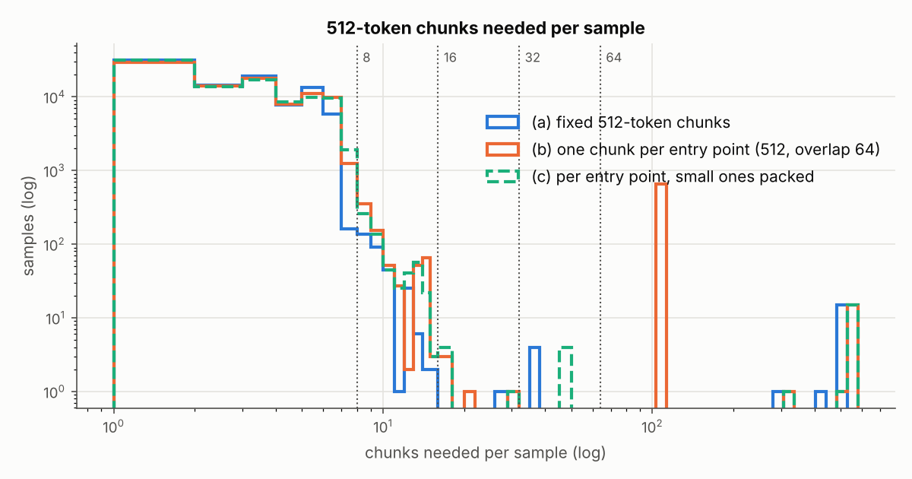

### 2.6 The emulator already truncated the reports

| set | samples that hit the API cap | median tokens (hit cap) | median tokens (no cap) | median raw API calls |
|---|---|---|---|---|
| all | 18.7% (17,327) | 2,364 | 798 | 180 |
| backdoor | 66.7% (8,675) | 2,372 | 848 | 499 |
| clean | 10.3% (3,333) | 2,292 | 767 | 179 |
| coinminer | 24.2% (2,079) | 1,614 | 1,198 | 239 |
| dropper | 3.1% (264) | 2,340 | 118 | 21 |
| keylogger | 0.9% (49) | 2,406 | 1,216 | 225 |
| ransomware | 5.5% (653) | 2,218 | 949 | 180 |
| rat | 0.9% (28) | 2,314 | 1,168 | 214 |
| trojan | 22.9% (2,246) | 2,599 | 402 | 93 |
| windows_syswow64 | 0.0% (0) | – | 57 | 8 |

Of the samples longer than 512 tokens, 28.0% (17,131) hit the emulation cap.

Tokens per raw API call (entry points with ≥1 API call): median 4.78, p10 4.00, p90 7.09. Entry points with ≥500 API calls: 6.3% (10,568).

Entry points whose `error.type` is `max_api_count`: 17,722; of these, 41.1% (7,276) have fewer than 500 API calls (the counter looks shared across a sample's entry points).

---

## 3. The five most important findings

1. **Most samples are cut, and most of the data is lost.** 66.0% of samples
   (61,207 of 92,700) are longer than 512 tokens. The median sample has
   1,069 tokens and loses 52.1% of them. Across the whole dataset the 512 cut
   throws away **66.6% of all tokens** (70,859,979 of 106,474,006). Train
   (67.2%) and test (63.6%) look the same.

2. **What is lost is almost only API calls. The other fields are always
   kept.** `joinRecordsToJSON()` puts `apis` last. API calls are 99.3% of
   all tokens, and only **33.0%** of API tokens survive the cut (30.2% for
   samples longer than 512). File, registry and network events come first,
   are small (medians 10, 32 and 13 tokens), and survive almost entirely
   (100.0%, 98.4%, 98.4%). Of what Nebula keeps, 97.9% is still API calls.
   An API call costs about 4.8 tokens (median 4.78), so the 512 window holds
   roughly the first ~100 API calls of a trace that can be up to 500 long.
   So your suspicion is correct: the cut removes the tail of the API
   sequence.

3. **The reports are long, but not very long, because the emulator stopped
   them.** The dataset's Speakeasy config sets `max_api_count = 500`. 18.7%
   of samples (17,327) hit this cap, and those samples have a median of
   2,364 tokens versus 798 for the rest. Because of the cap the tail is
   short: p99 is 2,989 tokens, only 0.2% (194) are above 4,096, and 99.8%
   (92,506) fit in eight 512-token chunks. The exceptions are 22 samples
   above 8,192 tokens (16 ransomware, 4 backdoor, 2 clean; median 36,906 API
   calls). They are only 0.02% of samples but hold 4.1% of all tokens. Many
   of them look like near-duplicates (same family, same size to within a few
   tokens).

4. **The "process / entry point" structure is thin.** 94.7% of samples
   (87,750) have exactly one entry point, the `module_entry`. Thread entry
   points are almost all trivial: 97.0% (64,678 of 66,704) contain exactly
   **one** API call (4 tokens, median). The long content sits inside the
   single `module_entry` (median 993 tokens; 65.3% are above 512). Only 1.3%
   of threads (863) are longer than 512. Scheme (b), one chunk per entry
   point, therefore wastes chunks. 652 samples (648 ransomware and 4
   backdoor) have exactly 102 entry points, and so need 102+ chunks under
   (b) but at most 13 when small entry points are packed (variant (c), test
   set max).

5. **Length is a weak malware-vs-benign signal, but a strong and unstable
   family signal.** Overall, malware has a *lower* median length than benign
   (950 vs 1,077). A classifier using only length gets ROC AUC 0.541 (test
   0.567), close to chance. But family by family, length separates a lot:
   backdoor vs clean AUC is 0.832 (train) / 0.753 (test). It also *drifts*
   between the January and April collections: keylogger vs clean goes from
   0.632 on train to 0.372 on test (median keylogger length 1,676 → 372).
   Nebula already sees part of this signal through padding: 41.4% of benign
   samples vs 29.9% of malware have fewer than 512 real tokens. A model that
   reads the whole report sees more length information than Nebula does.
   For backdoor vs clean, AUC is 0.677 on the truncated length versus 0.832
   on the full length (train).

---

## 4. Implications for the chunking idea

**Does the data support it?**

- **Yes, for reading past 512 tokens.** Two thirds of the API sequence,
  which is the main signal, is never seen today. A model that reads the
  rest has a lot of unused data to work with.
- **Only weakly, for using entry points / processes as the chunk unit.**
  In this dataset, 94.7% of samples have a single entry point. For them a
  "two-level model over entry points" is the same as a two-level model over
  fixed-size pieces of one API sequence. The extra entry points are almost
  all one-API-call threads. I would describe the idea as **a hierarchical
  Transformer over 512-token chunks of the report**, and use entry-point
  boundaries as extra information (for example a segment or
  entry-point-type embedding, or packing as in variant (c)). I would not use
  them as the main unit. One chunk per entry point (scheme (b)) is the worst
  option: it needs 102+ chunks for 652 samples that hold little content.

**Suggested settings**

| setting | suggestion | why (measured) |
|---|---|---|
| chunk size | **512 tokens** | Same as Nebula, so its pretrained encoder and tokenizer can be reused for the first level. |
| max chunks | **8** (= 4,096 tokens) | (a) covers 99.8% of samples completely (92,506) and 95.9% of all tokens; (c) covers 99.6% (92,344). Going to 16 adds almost nothing: 100.0% of samples, 96.1% of tokens. The tokens still missing are in the 22 outlier samples. |
| chunking scheme | fixed 512 (a), or entry-point-aware with packing (c) | (a) and (c) need the same median (3) and p90 (5 and 6) number of chunks. (b) has a p99 of 9 and a max of 576 chunks. |
| overlap | 64 if splitting inside an API sequence | Cheap: (c) still keeps 99.6% of samples within 8 chunks. |
| outliers | cap or remove the 22 samples > 8,192 tokens (and check them for duplicates) | They hold 4.1% of all tokens and would dominate any per-token loss. |

**Things to plan for before pitching**

- **A flat long-context baseline is necessary.** Because 99.8% of samples
  fit in 4,096 tokens, the obvious competitor is a plain Transformer (or
  Nebula itself) with `seq_len` 2,048 or 4,096, possibly with efficient
  attention. The hierarchical model's main advantage over it is cost: 8
  chunks of 512² attention is 1/8 of the attention work of one 4,096²
  sequence. The pitch should show either better accuracy at the same cost,
  or the same accuracy at lower cost.
- **Control for length.** Report results per family, and add a length-only
  baseline (the AUC table in §2.3 is a starting point). Consider evaluating
  on length-matched subsets, so a gain from reading more tokens is not just
  a gain from seeing the length.
- **The gain has a ceiling set by emulation.** With `max_api_count = 500`,
  even a perfect long-context model only sees about 6× more data than
  Nebula (p99 2,989 tokens). Re-emulating with a higher cap would make the
  long-context argument stronger, but that is a separate data effort.

---

## 5. Caveats

- **This dataset, this preprocessing.** All numbers are for
  quovadis-speakeasy with the field list, record limits and 50k BPE
  tokenizer in the Nebula repository at the commit above. A different field
  set or vocabulary would change the absolute lengths. The paper's ablations
  may have used other settings.
- **The reports are already cut by the emulator** (`max_api_count = 500`,
  60 s timeout). The lengths here describe this dataset, not real program
  behaviour. 28.0% of the samples longer than 512 tokens (17,131) hit the
  cap. Some entry points carry the `max_api_count` error with fewer than 500
  calls (count in §2.6), so the counter seems to be shared across a
  sample's entry points.
  Also, 16 ransomware samples went far past the cap (36,906 calls); I did
  not investigate why.
- **Labels and splits come from folder names**, as in Nebula's own pipeline.
  `report_windows_syswow64` (294 samples) counts as benign.
- **Entry points tokenized alone** add up to 0.08% more tokens than the
  whole report, because each one repeats the field key names. Chunk counts
  for (b) and (c) use these per-entry-point tokens.
- **Chunk counts are a simulation** of how many 512-token pieces each scheme
  needs. They say nothing about model accuracy.
- **Near-duplicates were not removed.** The 22 longest samples look like
  repeated variants of a few programs. Results that weight every token (the
  "share of tokens dropped") are affected by them. Results that weight every
  sample (medians, percentages of samples) are not much affected.
- **The `datasets` library view** was used only for the schema and the row
  count. The full non-streaming `load_dataset` fails on this repository (log
  linked in §1.2). All measurements use the raw JSON files at the same
  dataset revision, which is also how Nebula's own preprocessing reads them.

---

## 6. Second sandbox: Avast-CTU Public CAPEv2

Sections 1–5 cover Speakeasy, an emulator. This section repeats the 512-cut
measurement on reports from a real sandbox, CAPEv2. The data is the
**Avast-CTU Public CAPEv2 dataset**
(<https://github.com/avast/avast-ctu-cape-dataset>, repository commit
`b4210e5caf2829fbef13a49b40a7690d1b805ab5`), **reduced reports** version
(48,976 reports, MIT licence). A third sandbox ("mcd") is left for later.

### 6.1 Method, and how it differs from Speakeasy

**What the data contains.** Each reduced report has `behavior.summary` (13
lists: `keys`, `resolved_apis`, `executed_commands`, `write_keys`, `files`,
`read_files`, `started_services`, `created_services`, `write_files`,
`delete_keys`, `read_keys`, `delete_files`, `mutexes`) and `static.pe`.
Labels (family, type, detection date) come from `public_labels.csv`.
Compared with Speakeasy:

- **Every report is malware** (10 families). There is no benign class, so
  the malware-vs-benign comparison cannot be made. Length as a shortcut is
  checked family against family instead.
- **There is no time-ordered API trace and no process tree.**
  `resolved_apis` is the *set* of API names the program looked up.
  Per-process calls exist only in the full reports (13 GB download), so the
  entry-point / per-process chunking analysis (§2.5) **cannot be repeated on
  this data**. Only fixed 512-token chunks are measured.

**Preprocessing.** Nebula has no finished Avast pipeline (no Avast tokenizer
ships in `nebula/objects/`). The study follows the two pieces of Avast code
that Nebula does have:

| step | source in Nebula | used here |
|---|---|---|
| fields | `scripts/concept-testing/preprocessing/avast_1_preprocessing/initial.ipynb` keeps `behavior.summary.resolved_apis` and `.mutexes`, each value lower-cased | **variant A**, same fields, same order (`resolved_apis` first) |
| train/test split | same notebook: detection date before `2019-08-01` = train | same: 37,512 train / 11,464 test |
| tokenizer | `preprocess_nebula_avast()` in `nebula/preprocessing/wrappers.py` trains a new `JSONTokenizerBPE` (vocab 50,000, `JSON_CLEANUP_SYMBOLS`, `stopwords=[]`) on the training split | same call, `JSONTokenizerBPE.train()`, on all 37,512 training records (variant A) |
| cut | `pad_sequence()` keeps the first 512 tokens | same |

**Variant B** is my own sensitivity check, not Nebula code. It keeps all 13
summary lists (lower-cased, in the order they are stored in the reports),
with its own 50k BPE tokenizer. That tokenizer was trained on 5,000 random
training reports (seed 0), to keep SentencePiece's training time and memory
manageable: the 13 lists are much larger than the two in variant A. Variant B shows how
much the answer depends on the field choice.

The Nebula notebook was written as concept testing, and Nebula's README warns
that those files may not match the paper. So treat the Avast numbers as
"Nebula-style", not as an exact reproduction of the paper's Avast setup.

Scripts: `measure_avast.py` (tokenizer training + measurement),
`analyze_avast.py` (tables, plots, Speakeasy comparison),
`make_avast_examples.py` (example reports in `examples/avast/`).
Tables: [`results/avast/tables.md`](results/avast/tables.md).

Example reports (one per split and family, raw + record + tokens):
[`examples/avast/`](examples/avast/README.md).

### 6.2 Avast results

| split    |    ok |
|:---------|------:|
| testset  | 11464 |
| trainset | 37512 |

Reports measured (status ok): 48,976 of 48,976. Split by detection date (< 2019-08-01 = trainset), as in Nebula's Avast notebook.

Variant A: field attribution exact for 100.0% (48,976)

Variant B: field attribution exact for 100.0% (48,976)

#### Tokens per report (no truncation)
| variant / set | n | median | p75 | p90 | p99 | max | >512 | >1024 | >2048 | >4096 | >8192 | tokens dropped by 512 cut |
|---|---|---|---|---|---|---|---|---|---|---|---|---|
| A / all | 48,976 | 422 | 716 | 1,135 | 1,884 | 6,994 | 37.4% (18,306) | 12.9% (6,312) | 0.4% (201) | 0.0% (13) | 0.0% (0) | 30.9% (8,532,504 of 27,631,746) |
| A / trainset | 37,512 | 422 | 758 | 1,283 | 1,903 | 6,994 | 39.8% (14,920) | 15.0% (5,630) | 0.5% (179) | 0.0% (10) | 0.0% (0) | 33.5% (7,400,338 of 22,116,169) |
| A / testset | 11,464 | 422 | 561 | 852 | 1,737 | 5,259 | 29.5% (3,386) | 5.9% (682) | 0.2% (22) | 0.0% (3) | 0.0% (0) | 20.5% (1,132,166 of 5,515,577) |
| B / all | 48,976 | 4,917 | 8,650 | 21,081 | 75,368 | 881,128 | 93.8% (45,954) | 85.9% (42,063) | 76.9% (37,649) | 57.9% (28,352) | 37.4% (18,312) | 94.3% (400,183,677 of 424,489,052) |
| B / trainset | 37,512 | 4,814 | 8,650 | 21,641 | 78,405 | 849,461 | 94.2% (35,333) | 87.4% (32,786) | 78.3% (29,376) | 57.4% (21,549) | 36.1% (13,524) | 94.4% (318,013,007 of 336,740,776) |
| B / testset | 11,464 | 5,170 | 8,650 | 19,227 | 54,438 | 881,128 | 92.6% (10,621) | 80.9% (9,277) | 72.2% (8,273) | 59.3% (6,803) | 41.8% (4,788) | 93.6% (82,170,670 of 87,748,276) |

Variant A: mean per-sample fraction dropped 14.6%, median 0.0%.

Variant B: mean per-sample fraction dropped 78.9%, median 89.6%.

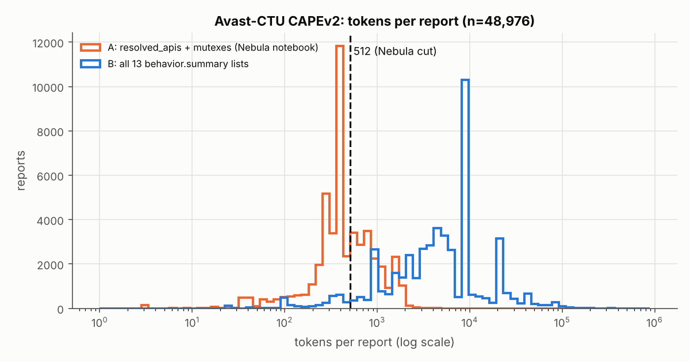

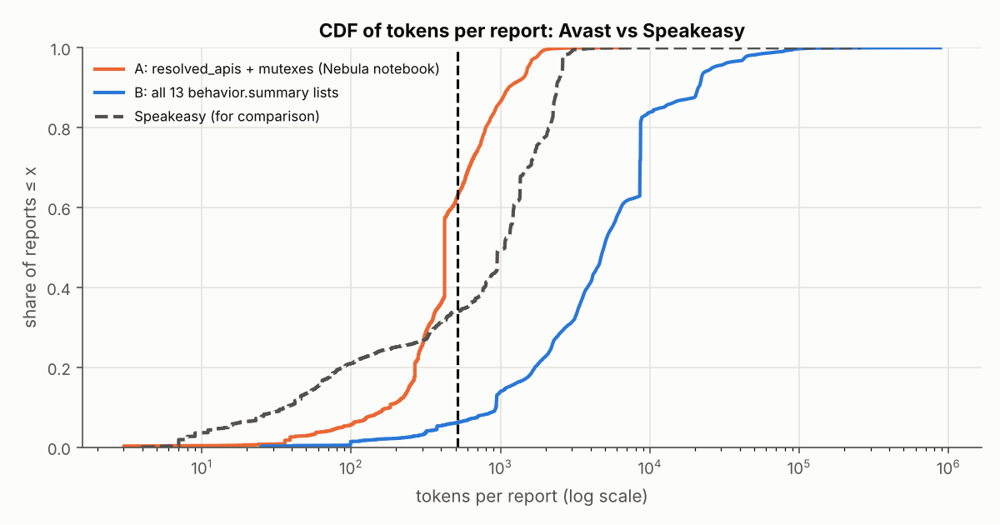

#### By family (variant A)

trainset:
| family | n | median | p75 | p90 | p99 | max | >512 | >1024 | >2048 | >4096 | >8192 | tokens dropped by 512 cut |
|---|---|---|---|---|---|---|---|---|---|---|---|---|
| Adload | 699 | 295 | 316 | 390 | 579 | 2,214 | 1.7% (12) | 0.4% (3) | 0.3% (2) | 0.0% (0) | 0.0% (0) | 2.0% (4,405 of 215,301) |
| Emotet | 10,900 | 331 | 565 | 664 | 982 | 3,366 | 30.5% (3,324) | 0.6% (66) | 0.0% (1) | 0.0% (0) | 0.0% (0) | 11.8% (505,921 of 4,281,355) |
| HarHar | 586 | 183 | 715 | 923 | 923 | 923 | 28.0% (164) | 0.0% (0) | 0.0% (0) | 0.0% (0) | 0.0% (0) | 25.2% (53,938 of 213,872) |
| Lokibot | 3,506 | 349 | 513 | 961 | 2,128 | 3,554 | 25.0% (878) | 9.4% (331) | 1.3% (46) | 0.0% (0) | 0.0% (0) | 26.0% (435,874 of 1,678,324) |
| Qakbot | 4,502 | 1,467 | 1,591 | 1,805 | 1,956 | 2,447 | 98.6% (4,441) | 68.4% (3,080) | 0.4% (19) | 0.0% (0) | 0.0% (0) | 60.5% (3,511,895 of 5,801,184) |
| Swisyn | 8,333 | 422 | 422 | 471 | 1,249 | 4,535 | 8.0% (667) | 2.0% (164) | 0.2% (16) | 0.0% (1) | 0.0% (0) | 8.2% (304,775 of 3,731,290) |
| Trickbot | 2,866 | 361 | 785 | 1,040 | 1,124 | 1,808 | 39.7% (1,139) | 11.3% (325) | 0.0% (0) | 0.0% (0) | 0.0% (0) | 29.6% (388,599 of 1,312,855) |
| Ursnif | 841 | 745 | 999 | 1,271 | 2,282 | 3,148 | 86.4% (727) | 21.6% (182) | 2.0% (17) | 0.0% (0) | 0.0% (0) | 42.2% (299,739 of 710,487) |
| Zeus | 2,450 | 588 | 851 | 1,158 | 1,908 | 2,722 | 53.2% (1,304) | 15.6% (382) | 0.5% (13) | 0.0% (0) | 0.0% (0) | 38.2% (570,607 of 1,493,211) |
| njRAT | 2,829 | 902 | 1,211 | 1,542 | 2,667 | 6,994 | 80.0% (2,264) | 38.8% (1,097) | 2.3% (65) | 0.3% (9) | 0.0% (0) | 49.5% (1,324,585 of 2,678,290) |

testset:
| family | n | median | p75 | p90 | p99 | max | >512 | >1024 | >2048 | >4096 | >8192 | tokens dropped by 512 cut |
|---|---|---|---|---|---|---|---|---|---|---|---|---|
| Adload | 5 | 307 | 312 | 458 | 546 | 556 | 20.0% (1) | 0.0% (0) | 0.0% (0) | 0.0% (0) | 0.0% (0) | 2.5% (44 of 1,777) |
| Emotet | 3,529 | 499 | 612 | 804 | 984 | 1,099 | 48.6% (1,716) | 0.7% (26) | 0.0% (0) | 0.0% (0) | 0.0% (0) | 16.1% (262,009 of 1,629,948) |
| HarHar | 69 | 765 | 795 | 795 | 843 | 944 | 88.4% (61) | 0.0% (0) | 0.0% (0) | 0.0% (0) | 0.0% (0) | 33.3% (16,166 of 48,574) |
| Lokibot | 685 | 460 | 530 | 807 | 1,581 | 2,645 | 26.6% (182) | 4.8% (33) | 0.4% (3) | 0.0% (0) | 0.0% (0) | 16.3% (51,118 of 313,586) |
| Qakbot | 393 | 1,484 | 1,605 | 1,824 | 1,978 | 2,036 | 99.0% (389) | 75.6% (297) | 0.0% (0) | 0.0% (0) | 0.0% (0) | 62.3% (330,803 of 530,968) |
| Swisyn | 4,258 | 422 | 422 | 422 | 1,259 | 3,120 | 5.8% (249) | 2.0% (86) | 0.2% (7) | 0.0% (0) | 0.0% (0) | 6.7% (122,860 of 1,839,515) |
| Trickbot | 1,336 | 104 | 352 | 427 | 788 | 1,839 | 2.3% (31) | 0.4% (6) | 0.0% (0) | 0.0% (0) | 0.0% (0) | 3.6% (9,782 of 271,937) |
| Ursnif | 502 | 516 | 732 | 780 | 871 | 5,259 | 50.8% (255) | 1.0% (5) | 0.2% (1) | 0.2% (1) | 0.0% (0) | 19.3% (55,292 of 286,827) |
| Zeus | 144 | 433 | 828 | 1,436 | 2,388 | 2,760 | 41.0% (59) | 20.8% (30) | 4.2% (6) | 0.0% (0) | 0.0% (0) | 43.6% (37,523 of 86,107) |
| njRAT | 543 | 883 | 1,184 | 1,484 | 2,008 | 5,101 | 81.6% (443) | 36.6% (199) | 0.9% (5) | 0.4% (2) | 0.0% (0) | 48.7% (246,569 of 506,338) |

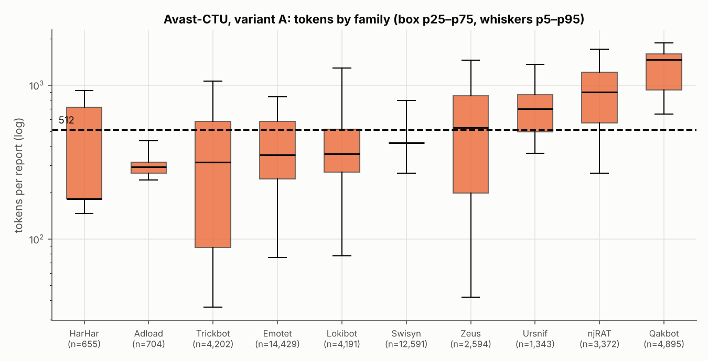

Variant B, all splits:
| family | n | median | p75 | p90 | p99 | max | >512 | >1024 | >2048 | >4096 | >8192 | tokens dropped by 512 cut |
|---|---|---|---|---|---|---|---|---|---|---|---|---|
| Adload | 704 | 1,679 | 1,810 | 4,634 | 4,826 | 312,461 | 98.6% (694) | 97.0% (683) | 22.0% (155) | 14.9% (105) | 0.6% (4) | 81.7% (1,597,610 of 1,955,861) |
| Emotet | 14,429 | 4,555 | 5,766 | 21,722 | 23,341 | 115,942 | 92.3% (13,321) | 87.5% (12,632) | 83.4% (12,034) | 53.2% (7,674) | 19.1% (2,751) | 92.9% (93,836,453 of 100,958,551) |
| HarHar | 655 | 375 | 928 | 1,063 | 1,155 | 55,912 | 34.4% (225) | 19.1% (125) | 0.2% (1) | 0.2% (1) | 0.2% (1) | 37.3% (163,407 of 437,526) |
| Lokibot | 4,191 | 4,113 | 4,598 | 6,328 | 81,133 | 777,697 | 99.4% (4,165) | 95.9% (4,018) | 88.4% (3,706) | 52.3% (2,193) | 6.9% (290) | 92.4% (25,888,877 of 28,029,580) |
| Qakbot | 4,895 | 5,413 | 6,165 | 6,748 | 24,491 | 336,348 | 99.3% (4,861) | 99.1% (4,851) | 90.5% (4,428) | 56.0% (2,740) | 5.3% (257) | 90.5% (23,739,789 of 26,237,669) |
| Swisyn | 12,591 | 8,625 | 8,654 | 8,807 | 34,643 | 881,128 | 100.0% (12,587) | 86.5% (10,885) | 85.7% (10,795) | 85.4% (10,747) | 84.6% (10,647) | 94.0% (100,462,510 of 106,908,422) |
| Trickbot | 4,202 | 1,614 | 25,606 | 42,516 | 64,743 | 116,607 | 76.4% (3,211) | 63.2% (2,655) | 36.4% (1,529) | 30.9% (1,297) | 30.0% (1,261) | 96.2% (47,306,927 of 49,152,585) |
| Ursnif | 1,343 | 1,934 | 2,598 | 14,945 | 101,813 | 330,067 | 94.9% (1,275) | 88.9% (1,194) | 45.0% (605) | 18.1% (243) | 12.8% (172) | 92.0% (7,750,239 of 8,422,311) |
| Zeus | 2,594 | 2,876 | 3,996 | 19,622 | 91,397 | 413,831 | 89.6% (2,325) | 70.5% (1,830) | 56.6% (1,467) | 24.3% (630) | 11.8% (305) | 93.9% (19,132,576 of 20,370,966) |
| njRAT | 3,372 | 14,735 | 28,730 | 66,931 | 109,745 | 424,953 | 97.6% (3,290) | 94.6% (3,190) | 86.9% (2,929) | 80.7% (2,722) | 77.8% (2,624) | 97.9% (80,305,289 of 82,015,581) |

#### Which fields survive the cut

Variant A:
Field order in the sequence: `resolved_apis → mutexes`.

| field | samples with field | median list length | tokens (all samples) | share of all tokens | % of field tokens kept by 512 cut | samples where field fully cut |
|---|---|---|---|---|---|---|
| resolved_apis | 99.6% (48,784) | 136 | 27,063,669 | 97.9% | 69.9% | 0.0% (0) |
| mutexes | 64.6% (31,620) | 3 | 568,077 | 2.1% | 30.3% | 53.4% (16,885) |

Field tokens include the field's key name; a field with an empty list still costs its key name.

Variant B:
Field order in the sequence: `keys → resolved_apis → executed_commands → write_keys → files → read_files → started_services → created_services → write_files → delete_keys → read_keys → delete_files → mutexes`.

| field | samples with field | median list length | tokens (all samples) | share of all tokens | % of field tokens kept by 512 cut | samples where field fully cut |
|---|---|---|---|---|---|---|
| keys | 100.0% (48,975) | 197 | 202,128,484 | 47.6% | 11.0% | 0.0% (0) |
| resolved_apis | 99.6% (48,784) | 136 | 27,187,353 | 6.4% | 6.1% | 80.4% (39,232) |
| executed_commands | 88.8% (43,471) | 2 | 1,864,779 | 0.4% | 2.4% | 95.2% (41,391) |
| write_keys | 68.7% (33,647) | 2 | 7,359,001 | 1.7% | 0.2% | 98.7% (33,226) |
| files | 97.8% (47,923) | 30 | 40,128,000 | 9.5% | 0.6% | 93.1% (44,616) |
| read_files | 97.7% (47,838) | 17 | 7,739,895 | 1.8% | 0.8% | 95.0% (45,460) |
| started_services | 8.1% (3,961) | 1 | 101,960 | 0.0% | 6.6% | 99.9% (3,956) |
| created_services | 0.0% (23) | 2 | 98,090 | 0.0% | 6.8% | 100.0% (23) |
| write_files | 84.8% (41,521) | 2 | 1,865,671 | 0.4% | 0.5% | 99.5% (41,324) |
| delete_keys | 4.4% (2,169) | 2 | 159,229 | 0.0% | 4.2% | 100.0% (2,169) |
| read_keys | 100.0% (48,975) | 102 | 133,459,522 | 31.4% | 0.1% | 93.2% (45,648) |
| delete_files | 76.4% (37,394) | 2 | 1,684,691 | 0.4% | 0.5% | 99.2% (37,092) |
| mutexes | 64.6% (31,620) | 3 | 712,377 | 0.2% | 1.5% | 97.5% (30,831) |

Field tokens include the field's key name; a field with an empty list still costs its key name.

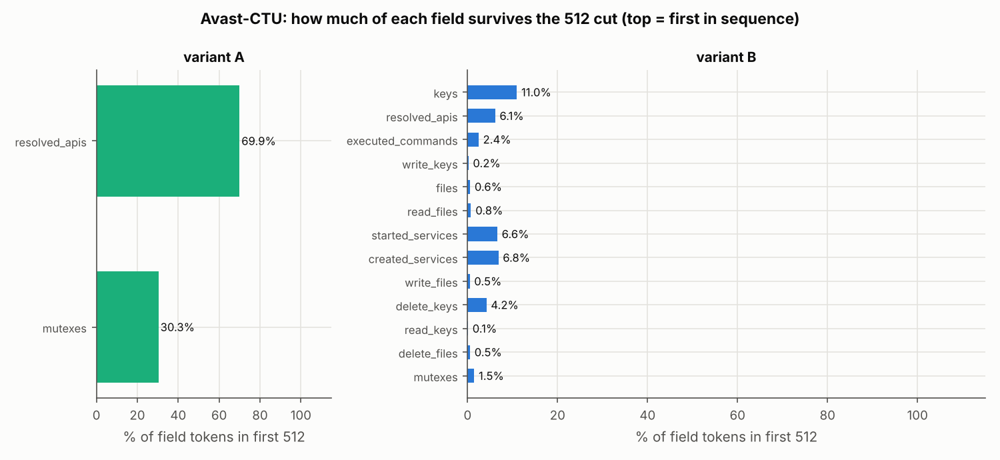

#### Chunks needed
| variant | median | p90 | p99 | max | ≤8 chunks | ≤16 chunks | ≤32 chunks | ≤64 chunks |
|---|---|---|---|---|---|---|---|---|
| A | 1 | 3 | 4 | 14 | 100.0% (48,963) | 100.0% (48,976) | 100.0% (48,976) | 100.0% (48,976) |
| B | 10 | 42 | 148 | 1,721 | 42.1% (20,624) | 62.6% (30,664) | 86.9% (42,571) | 96.2% (47,123) |

Share of all tokens covered by the first K chunks:

| variant | K=1 (=Nebula) | K=4 | K=8 | K=16 | K=32 |
|---|---|---|---|---|---|
| A | 69.1% | 99.6% | 100.0% | 100.0% | 100.0% |
| B | 5.7% | 20.8% | 36.6% | 57.3% | 72.4% |

The reduced reports have no process tree and no per-process call sequence, so the entry-point / per-process chunking of the Speakeasy study cannot be measured on them.

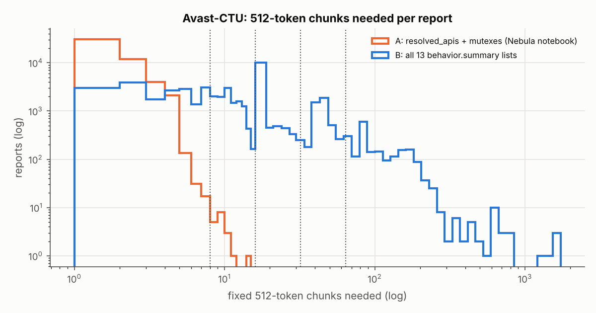

#### Length as a family shortcut
There are no benign samples. ROC AUC of token count for one family vs all other families (0.5 = no signal; far from 0.5 either way = length alone separates the family).

| family | n | median A tokens train | median A tokens test | AUC(A tokens) train | AUC(A tokens) test | AUC(min(A,512)) test | AUC(B tokens) test |
|---|---|---|---|---|---|---|---|
| Adload | 704 | 295 | 307 | 0.259 | 0.353 | 0.375 | 0.315 |
| Emotet | 14,429 | 331 | 499 | 0.323 | 0.526 | 0.557 | 0.501 |
| HarHar | 655 | 183 | 765 | 0.287 | 0.786 | 0.767 | 0.186 |
| Lokibot | 4,191 | 349 | 460 | 0.391 | 0.491 | 0.498 | 0.434 |
| Qakbot | 4,895 | 1,467 | 1,484 | 0.923 | 0.960 | 0.858 | 0.443 |
| Swisyn | 12,591 | 422 | 422 | 0.452 | 0.463 | 0.458 | 0.719 |
| Trickbot | 4,202 | 361 | 104 | 0.399 | 0.163 | 0.163 | 0.101 |
| Ursnif | 1,343 | 745 | 516 | 0.737 | 0.663 | 0.672 | 0.235 |
| Zeus | 2,594 | 588 | 433 | 0.523 | 0.512 | 0.494 | 0.223 |
| njRAT | 3,372 | 902 | 883 | 0.751 | 0.822 | 0.766 | 0.760 |

`nan` = the family has no samples in that split.

#### Speakeasy vs Avast side by side
| dataset / preprocessing | samples | median tokens | p90 | p99 | >512 | tokens dropped by 512 cut | fixed chunks p99 | ≤8 chunks |
|---|---|---|---|---|---|---|---|---|
| Speakeasy (quovadis), Nebula pipeline | 92,700 | 1,069 | 2,376 | 2,989 | 66.0% (61,207) | 66.6% | 6 | 99.8% (92,506) |
| Avast-CTU CAPEv2, variant A | 48,976 | 422 | 1,135 | 1,884 | 37.4% (18,306) | 30.9% | 4 | 100.0% (48,963) |
| Avast-CTU CAPEv2, variant B | 48,976 | 4,917 | 21,081 | 75,368 | 93.8% (45,954) | 94.3% | 148 | 42.1% (20,624) |

### 6.3 What Avast adds to the picture

1. **With Nebula's field choice, Avast reports are shorter than
   Speakeasy's.** Variant A has a median of 422 tokens (Speakeasy: 1,069).
   37.4% of reports (18,306 of 48,976) are longer than 512, and the cut
   drops 30.9% of all tokens (Speakeasy: 66.0% of samples and 66.6% of
   tokens). Four 512-token chunks already cover 99.6% of all variant-A
   tokens, and 8 chunks cover 100.0% of reports (48,963 of 48,976). The
   train split is longer than the test split (33.5% vs 20.5% of tokens
   dropped).
2. **The cut removes the mutexes.** `resolved_apis` comes first and
   makes up 97.9% of the tokens, so `mutexes`, the only other field, is
   placed after it. Only 30.3% of mutex tokens survive, and in **53.4% of
   the reports that have mutexes (16,885 of 31,620) all of them are cut**.
   This mirrors Speakeasy, where the field that comes last (`apis`) is the
   one that gets cut.
3. **The answer depends heavily on which fields you keep.** Keeping all 13
   summary lists (variant B) gives a median of 4,917 tokens. 93.8% of
   reports are above 512, 94.3% of tokens are dropped, and the p99 report
   needs 148 chunks. Even 32 chunks cover only 72.4% of the tokens.
   Variant B's first 512 tokens are mostly registry `keys` (47.6% of all
   tokens, and the first field), so the `resolved_apis` that Nebula relies
   on are fully cut in 80.4% of reports. For a richer CAPE representation
   the chunking idea becomes necessary, not optional, but it would need a
   field order or field budget, not just more chunks.
4. **Length is a strong family signal on Avast too.** Qakbot is longer than
   every other family (one-vs-rest AUC from length alone: 0.960 on test),
   and njRAT too (0.822). Trickbot gets *shorter* between train and test
   (median 361 → 104 tokens), so length also drifts over time. A model that
   reads more chunks gets more of this signal, so per-family evaluation
   matters here as well.
5. **Per-process chunking cannot be tested on this data.** The reduced
   reports keep no process tree or call order. The full reports (13 GB
   download) would be needed for that, and they were not used.

**For the chunking design:** on Nebula-style Avast input, 512-token chunks
with **max 4–8 chunks** are enough (4 chunks cover 99.6% of tokens). On
Speakeasy, 8 are needed. One setting of **chunk size 512 and max 8 chunks**
therefore covers both datasets with Nebula's field choices.

---

## 7. First test of the two-level model

Based on §4 and §6, I built the model with **fixed 512-token chunks (max 8)
and a second-level Transformer** rather than one chunk per process. It is in
[`hier_nebula/`](hier_nebula/README.md). Level 1 is Nebula itself
(`TransformerEncoderChunks` with the released `bpe_50000_torch.model`
weights), run on each chunk. Level 2 is a 2-layer Transformer over the
chunk vectors with a [CLS] vector. A test checks that level 1 on the first
chunk, followed by Nebula's own head, reproduces Nebula's original output
exactly.

**Setup.** Speakeasy only (no Nebula model was released for Avast). Training
used the dataset's trainset (67,769 samples), with 10% held out (7,529, seed
0) for choosing the best epoch, and evaluation on the testset (17,402). Two
ways of training, each with K = 1 and K = 8 chunks:

- **frozen:** Nebula's chunk vectors are fixed, and only level 2 is trained
  (15 epochs, about 3–8 s per epoch on CPU);
- **finetune:** both levels are trained end to end from the released weights
  (2 epochs, batch 32, AdamW lr 3e-4, CPU: about 20 min per epoch for K = 1
  and 52 min for K = 8).

K = 1 is the fair comparison for K = 8: same model, same training, only the
number of chunks differs. Logs are in `results/hier/logs/`.

### 7.1 Results (test set)

Test samples: 17,402 (9,399 malware, 8,003 benign). All models see the same samples. Generated by `hier_nebula/summarize.py`.

| model | AUC | TPR @ FPR 0.1% | TPR @ FPR 1% | TPR @ FPR 10% | F1 @ 0.5 |
|---|---|---|---|---|---|
| Nebula (released weights, first 512 tokens) | 0.9586 | 0.5171 | 0.7498 | 0.8948 | 0.8854 |
| length only (number of tokens) | 0.5669 | 0.0038 | 0.0116 | 0.1455 | – |
| two-level, frozen level 1, K=1 chunks | 0.9590 | 0.4780 | 0.7585 | 0.9068 | 0.8904 |
| two-level, frozen level 1, K=8 chunks | 0.9582 | 0.4580 | 0.7585 | 0.9045 | 0.8947 |
| two-level, finetune level 1, K=1 chunks | 0.9467 | 0.4968 | 0.7603 | 0.8495 | 0.8941 |
| two-level, finetune level 1, K=8 chunks | 0.9639 | 0.5427 | 0.7467 | 0.8686 | 0.8814 |

Each resample draws test samples with replacement; both models are scored on the same draw. 95% interval = 2.5th–97.5th percentile of the difference. An interval that contains 0 means the difference is within test-set noise. This does not cover training randomness (one seed per run).

| comparison | metric | difference | 95% interval |
|---|---|---|---|
| two-level, finetune level 1, K=8 chunks **minus** two-level, finetune level 1, K=1 chunks | AUC | +0.0172 | [+0.0151, +0.0192] |
| two-level, finetune level 1, K=8 chunks **minus** two-level, finetune level 1, K=1 chunks | TPR @ FPR 0.1% | +0.0460 | [-0.0295, +0.1270] |
| two-level, finetune level 1, K=8 chunks **minus** two-level, finetune level 1, K=1 chunks | TPR @ FPR 1% | -0.0136 | [-0.0417, +0.0075] |
| two-level, finetune level 1, K=8 chunks **minus** Nebula (released weights, first 512 tokens) | AUC | +0.0053 | [+0.0034, +0.0073] |
| two-level, finetune level 1, K=8 chunks **minus** Nebula (released weights, first 512 tokens) | TPR @ FPR 0.1% | +0.0256 | [-0.0686, +0.5428] |
| two-level, finetune level 1, K=8 chunks **minus** Nebula (released weights, first 512 tokens) | TPR @ FPR 1% | -0.0031 | [-0.0354, +0.0193] |
| two-level, frozen level 1, K=8 chunks **minus** two-level, frozen level 1, K=1 chunks | AUC | -0.0008 | [-0.0016, +0.0001] |
| two-level, frozen level 1, K=8 chunks **minus** two-level, frozen level 1, K=1 chunks | TPR @ FPR 0.1% | -0.0200 | [-0.0813, +0.0883] |
| two-level, frozen level 1, K=8 chunks **minus** two-level, frozen level 1, K=1 chunks | TPR @ FPR 1% | +0.0000 | [-0.0203, +0.0133] |

#### Where the gain comes from
| chunks | n | malware share | Nebula (released weights, first 512 tokens) | two-level, frozen level 1, K=1 chunks | two-level, frozen level 1, K=8 chunks | two-level, finetune level 1, K=1 chunks | two-level, finetune level 1, K=8 chunks |
|---|---|---|---|---|---|---|---|
| 1 (fits in 512) | 6,359 | 44.9% | 0.9556 | 0.9663 | 0.9629 | 0.9702 | 0.9726 |
| 2–3 | 6,077 | 60.5% | 0.9833 | 0.9830 | 0.9826 | 0.9763 | 0.9817 |
| 4–8 | 4,966 | 57.8% | 0.9288 | 0.9256 | 0.9220 | 0.9112 | 0.9358 |

Threshold chosen on the test benign samples so that 1% of them are flagged; cell = share of that family's test samples flagged (raw count). `clean`/`windows_syswow64` rows show the false-positive rate.

| family | n | Nebula (released weights, first 512 tokens) | two-level, frozen level 1, K=1 chunks | two-level, frozen level 1, K=8 chunks | two-level, finetune level 1, K=1 chunks | two-level, finetune level 1, K=8 chunks |
|---|---|---|---|---|---|---|
| backdoor | 1,940 | 82.9% (1,608) | 82.2% (1,595) | 83.8% (1,626) | 83.9% (1,628) | 80.0% (1,552) |
| clean | 7,944 | 1.0% (80) | 1.0% (80) | 1.0% (80) | 1.0% (80) | 1.0% (80) |
| coinminer | 1,684 | 81.9% (1,380) | 79.5% (1,339) | 80.7% (1,359) | 66.7% (1,123) | 66.3% (1,116) |
| dropper | 252 | 73.4% (185) | 71.8% (181) | 73.0% (184) | 78.6% (198) | 77.4% (195) |
| keylogger | 1,041 | 52.2% (543) | 64.4% (670) | 58.3% (607) | 84.4% (879) | 88.1% (917) |
| ransomware | 2,139 | 66.8% (1,428) | 66.5% (1,422) | 67.6% (1,446) | 63.4% (1,356) | 60.4% (1,293) |
| rat | 1,258 | 85.5% (1,076) | 83.9% (1,056) | 83.9% (1,055) | 86.6% (1,089) | 84.8% (1,067) |
| trojan | 1,085 | 76.2% (827) | 79.8% (866) | 78.5% (852) | 80.5% (873) | 80.9% (878) |
| windows_syswow64 | 59 | 0.0% (0) | 0.0% (0) | 0.0% (0) | 0.0% (0) | 0.0% (0) |

### 7.2 What this shows

1. **Extra chunks help only when level 1 is trained too.** With frozen
   Nebula vectors, K = 8 and K = 1 are the same (AUC difference −0.0008,
   95% interval [−0.0016, +0.0001]). Nebula was trained only on the start of
   reports, so its vectors for later chunks carry little extra information
   until it is fine-tuned.
2. **With fine-tuning, reading 8 chunks raises AUC.** Fine-tuned K = 8 beats
   fine-tuned K = 1 by +0.0172 AUC [+0.0151, +0.0192], and the released
   Nebula by +0.0053 [+0.0034, +0.0073]. The gain is largest on long reports
   (4–8 chunks: AUC 0.9358 vs 0.9112 for K = 1 and 0.9288 for Nebula), which
   is where the extra chunks have content.
3. **Detection at low false-positive rates did not clearly improve.** At FPR
   1% and 0.1%, all bootstrap intervals include 0. At FPR 1%, all models
   detect 74.7%–76.0% of malware. TPR at FPR 0.1% depends on fewer than 10
   benign samples and is very noisy (the K = 8 vs Nebula interval is
   [−0.07, +0.54]).
4. **Fine-tuning itself moves families around more than the chunk count
   does.** Keylogger detection at FPR 1% goes from 52.2% (Nebula) to 84.4%
   (fine-tuned, K = 1) and 88.1% (K = 8). Coinminer drops from 81.9% to
   66.7% and 66.3%. These changes appear with both K = 1 and K = 8, so they
   come from training on the January data, not from reading more chunks.
5. **Length alone is weak here** (AUC 0.567), so the gain in point 2 is not
   simply the model counting chunks. But per-family length effects (§2.3)
   still apply, and should be checked with more runs.

### 7.3 Limits of this first test

- **One training run per setting, only 2 fine-tune epochs, on CPU.** The
  bootstrap intervals cover test-set sampling, not training randomness. The
  fine-tuned K = 1 run ended *below* the released Nebula on AUC (0.9467 vs
  0.9586), which shows training variation is large. Before claiming a
  result, repeat each setting with 3–5 seeds and more epochs on a GPU (the
  commands are in `hier_nebula/README.md`).
- **Validation AUC is about 0.999 in every run.** The released Nebula was
  presumably trained on these training samples, so validation cannot rank
  models well. Choose epochs with a time-based validation split, or by
  validation loss.
- **Only binary malware/benign on Speakeasy was run.** Multi-class
  (`--task multiclass`) and Avast (`--scratch --mode finetune`) are
  implemented but not yet run.

---

## 8. Data-flow links between calls

Is there information that one 512-token chunk needs from another? One concrete
kind is **data flow**: a call returns a handle or address, and a later call
passes it back as an argument (`LoadLibraryA` → `GetProcAddress`,
`HeapAlloc` → `HeapFree`). This section counts such links in the Speakeasy
reports, and how often they cross chunk boundaries. It is evidence for (or
against) adding "data-flow links between chunks" to the two-level model in
§7.

### 8.1 Method

Scripts: `measure_links.py` (measurement) and `analyze_links.py` (tables and
plot); all tables are in [`results/links/tables.md`](results/links/tables.md).

- **Address-like value:** a string matching `^0x[0-9a-fA-F]+$` whose value is
  ≥ `0x10000`.
- **Link:** call *j* has an argument equal to the address-like return value of
  an earlier call *i* (*i* < *j*). The producer is the **first** call that
  returned the value, and each matching argument counts as one link.
- **API sequence:** exactly what Nebula sees after
  `filter_and_normalize_report()` (all entry points merged, same order). This
  merged list is the entry points' calls joined in order, which is asserted
  for every sample. Links are also counted inside each entry point
  separately.
- **Chunk of a call:** the 512-token chunk holding the call's first token in
  Nebula's tokenized report. The report string is cut into the part before the
  API list plus one piece per call. Each piece is tokenized with Nebula's own
  `tokenizer.encode`, and it is **asserted** that the pieces' ids, joined,
  equal the full report's ids. This held for **all 92,700 samples**, so the
  character-offset fallback was never used. The two-level model reads chunks
  0–7. A link with an end in a later chunk (only possible in the 194 reports
  over 8 chunks) is counted separately, not as cross-chunk.
- **Cross-chunk link:** both ends in chunks 0–7, in different chunks.
  "Leaving chunk 0" means the producer is in Nebula's 512-token window and
  the user is not.
- **Checks:**
  - *Sanity:* on the 21 example reports, counting by call index inside entry
    points with ≥ 20 calls reproduces the reference counts exactly
    ([log](results/logs/links_sanity.log)): 728 links in 19 entry points, 157
    produced in the first 100 calls and used after them, and 124 spanning
    more than 100 calls.
  - *False-link check:* the counts are repeated with only producers from
    handle-creating APIs (`Create*`, `Open*`, `Alloc*`, `LoadLibrary*`,
    `GetProcAddress`, `GetModuleHandle*`, `RegOpen*`, `RegCreate*`, `socket`,
    `connect`).
  - *Chance baseline:* each sample's calls are put in a random order (one
    fixed shuffle per sample), and links and token positions are recomputed.
- **Runs:** a 2,000-sample pilot (seed 0;
  [tables](results/links/pilot2000_tables.md)), then all 92,700 samples (12
  min on 4 cores; [log](results/logs/links_full.log)).

### 8.2 Main results

Merged = over the API list as Nebula sees it (entry points merged, same order).

| set | samples | links | links per sample (mean) | cross-chunk links | links leaving chunk 0 | links with an end beyond chunk 7 | samples with ≥1 link | samples with ≥1 cross-chunk link |
|---|---|---|---|---|---|---|---|---|
| all | 92,700 | 3,500,779 | 37.8 | 26.3% (920,330) | 22.4% (784,680) | 0.1% (2,667) | 82.8% (76,711) | 42.3% (39,253) |
| trainset | 75,298 | 2,893,084 | 38.4 | 25.9% (748,495) | 21.7% (627,976) | 0.1% (2,618) | 82.3% (61,998) | 42.4% (31,947) |
| testset | 17,402 | 607,695 | 34.9 | 28.3% (171,835) | 25.8% (156,704) | 0.0% (49) | 84.5% (14,713) | 42.0% (7,306) |

Within each entry point (links restarted in every entry point):

| set | samples | links | links per sample (mean) | cross-chunk links | links leaving chunk 0 | links with an end beyond chunk 7 | samples with ≥1 link | samples with ≥1 cross-chunk link |
|---|---|---|---|---|---|---|---|---|
| all | 92,700 | 3,500,500 | 37.8 | 26.3% (920,051) | 22.4% (784,515) | 0.1% (2,612) | 82.8% (76,711) | 42.3% (39,244) |
| trainset | 75,298 | 2,892,907 | 38.4 | 25.9% (748,277) | 21.7% (627,811) | 0.1% (2,604) | 82.3% (61,998) | 42.4% (31,939) |
| testset | 17,402 | 607,593 | 34.9 | 28.3% (171,774) | 25.8% (156,704) | 0.0% (8) | 84.5% (14,713) | 42.0% (7,305) |

Merged links whose producer and user are in different entry points: 0.0% (659).

By report length:
| chunks | samples | links | links per sample (mean) | cross-chunk links | links leaving chunk 0 | links with an end beyond chunk 7 | samples with ≥1 link | samples with ≥1 cross-chunk link |
|---|---|---|---|---|---|---|---|---|
| 1 | 31,493 | 118,247 | 3.8 | 0.0% (0) | 0.0% (0) | 0.0% (0) | 50.1% (15,772) | 0.0% (0) |
| 2–3 | 33,543 | 1,980,317 | 59.0 | 22.5% (446,070) | 21.0% (415,587) | 0.0% (0) | 99.7% (33,439) | 69.8% (23,402) |
| 4–8 | 27,470 | 1,379,154 | 50.2 | 33.7% (464,489) | 26.5% (365,486) | 0.0% (0) | 99.4% (27,308) | 57.1% (15,688) |
| >8 | 194 | 23,061 | 118.9 | 42.4% (9,771) | 15.6% (3,607) | 11.6% (2,667) | 99.0% (192) | 84.0% (163) |

Reports that fit in one chunk cannot have cross-chunk links by definition.

How far the cross-chunk links reach:
| distance (chunks) | links | share of cross-chunk links |
|---|---|---|
| 1 | 622,823 | 67.7% |
| 2 | 263,144 | 28.6% |
| 3 | 22,472 | 2.4% |
| 4 | 9,612 | 1.0% |
| 5 | 1,367 | 0.1% |
| 6 | 633 | 0.1% |
| 7 | 279 | 0.0% |

Within 1–2 chunks: 96.3% of cross-chunk links.

Max chunk distance per sample: median 2 among samples with a cross-chunk link.

What they are (top 20 producer → user pairs):
| # | producer API | user API | links | share of cross-chunk links | samples |
|---|---|---|---|---|---|
| 1 | `KERNEL32.LoadLibraryA` | `KERNEL32.GetProcAddress` | 206,129 | 22.4% | 4,410 |
| 2 | `KERNEL32.LoadLibraryExW` | `KERNEL32.GetProcAddress` | 182,702 | 19.9% | 11,881 |
| 3 | `kernel32.LoadLibraryA` | `kernel32.GetProcAddress` | 104,448 | 11.3% | 5,593 |
| 4 | `kernel32.GetModuleHandleW` | `user32.LoadStringW` | 73,707 | 8.0% | 1,893 |
| 5 | `kernel32.GetModuleHandleA` | `kernel32.GetProcAddress` | 59,285 | 6.4% | 508 |
| 6 | `kernel32.GetModuleHandleA` | `user32.LoadStringA` | 58,498 | 6.4% | 1,627 |
| 7 | `KERNEL32.GetModuleHandleA` | `KERNEL32.GetProcAddress` | 47,045 | 5.1% | 2,778 |
| 8 | `KERNEL32.GetModuleHandleW` | `KERNEL32.GetProcAddress` | 38,993 | 4.2% | 4,953 |
| 9 | `KERNEL32.GetModuleHandleA` | `kernel32.GetProcAddress` | 23,070 | 2.5% | 1,653 |
| 10 | `USER32.CharNextA` | `USER32.CharNextA` | 18,405 | 2.0% | 417 |
| 11 | `USER32.CharNextW` | `USER32.CharNextW` | 18,265 | 2.0% | 643 |
| 12 | `kernel32.EncodePointer` | `kernel32.DecodePointer` | 10,669 | 1.2% | 1,741 |
| 13 | `KERNEL32.LoadLibraryA` | `kernel32.GetProcAddress` | 9,615 | 1.0% | 1,090 |
| 14 | `KERNEL32.GetModuleHandleA` | `user32.LoadStringA` | 6,866 | 0.7% | 191 |
| 15 | `KERNEL32.HeapAlloc` | `KERNEL32._lread` | 6,525 | 0.7% | 25 |
| 16 | `KERNEL32.HeapAlloc` | `KERNEL32.HeapFree` | 6,186 | 0.7% | 1,348 |
| 17 | `KERNEL32.InterlockedDecrement` | `KERNEL32.MultiByteToWideChar` | 5,972 | 0.6% | 608 |
| 18 | `KERNEL32.InterlockedDecrement` | `KERNEL32.WideCharToMultiByte` | 4,049 | 0.4% | 287 |
| 19 | `KERNEL32.HeapAlloc` | `KERNEL32.EnterCriticalSection` | 3,420 | 0.4% | 285 |
| 20 | `KERNEL32.HeapAlloc` | `KERNEL32.LeaveCriticalSection` | 3,135 | 0.3% | 285 |

Import resolution (`LoadLibrary*` or `GetModuleHandle*` → `GetProcAddress`): 73.5% of cross-chunk links (676,271). Any producer → `GetProcAddress`: 73.5%.

The top 20 pairs cover 96.4% of cross-chunk links; 327 distinct pairs in total.

False-link check:
Producer API name (without its DLL) starts with `Create`, `Open`, `Alloc`, `LoadLibrary`, `GetProcAddress`, `GetModuleHandle`, `RegOpen` or `RegCreate`, or is `socket` / `connect`.

| version | samples | links | links per sample (mean) | cross-chunk links | links leaving chunk 0 | links with an end beyond chunk 7 | samples with ≥1 link | samples with ≥1 cross-chunk link |
|---|---|---|---|---|---|---|---|---|
| all links (as in §1) | 92,700 | 3,500,779 | 37.8 | 26.3% (920,330) | 22.4% (784,680) | 0.1% (2,667) | 82.8% (76,711) | 42.3% (39,253) |
| handle-creating producers only | 92,700 | 3,104,992 | 33.5 | 26.6% (826,555) | 23.9% (741,912) | 0.0% (26) | 79.2% (73,377) | 37.7% (34,931) |

Share of all links that have a handle-creating producer: 88.7% (3,104,992).

Per split, handle-creating producers only:

| set | samples | links | links per sample (mean) | cross-chunk links | links leaving chunk 0 | links with an end beyond chunk 7 | samples with ≥1 link | samples with ≥1 cross-chunk link |
|---|---|---|---|---|---|---|---|---|
| trainset | 75,298 | 2,541,502 | 33.8 | 26.0% (661,336) | 23.2% (588,728) | 0.0% (19) | 79.2% (59,620) | 37.3% (28,106) |
| testset | 17,402 | 563,490 | 32.4 | 29.3% (165,219) | 27.2% (153,184) | 0.0% (7) | 79.1% (13,757) | 39.2% (6,825) |

Chance baseline:
Each sample's API calls are put in a random order (one fixed shuffle per sample); links and token positions are recomputed. Ratio = real / shuffled. A ratio below 1 means real links cross chunks *less* often than in a random order, i.e. data flow is more local than chance.

| version | real links | shuffled links | real cross-chunk links | shuffled cross-chunk links | ratio (count) | real cross-chunk share | shuffled cross-chunk share | ratio (share) | real leaving chunk 0 | shuffled leaving chunk 0 |
|---|---|---|---|---|---|---|---|---|---|---|
| all links, all | 3,500,779 | 2,224,135 | 920,330 | 1,425,717 | 0.65 | 26.3% | 64.1% | 0.41 | 22.4% | 53.1% |
| all links, trainset | 2,893,084 | 1,827,915 | 748,495 | 1,166,506 | 0.64 | 25.9% | 63.8% | 0.41 | 21.7% | 52.5% |
| all links, testset | 607,695 | 396,220 | 171,835 | 259,211 | 0.66 | 28.3% | 65.4% | 0.43 | 25.8% | 55.5% |
| handle-creating producers, all | 3,104,992 | 1,900,225 | 826,555 | 1,223,706 | 0.68 | 26.6% | 64.4% | 0.41 | 23.9% | 53.7% |
| handle-creating producers, trainset | 2,541,502 | 1,541,245 | 661,336 | 991,561 | 0.67 | 26.0% | 64.3% | 0.40 | 23.2% | 53.0% |
| handle-creating producers, testset | 563,490 | 358,980 | 165,219 | 232,145 | 0.71 | 29.3% | 64.7% | 0.45 | 27.2% | 56.7% |

Shuffling removes 36.5% of the links (a value can only link to a later call): in the real order, producers come before their users far more often than chance.

Among reports longer than one chunk only (where crossing is possible):

| version | samples | real cross-chunk share | shuffled cross-chunk share | ratio (share) |
|---|---|---|---|---|
| all links | 61,207 | 27.2% | 66.4% | 0.41 |
| handle-creating producers | 61,207 | 27.5% | 66.7% | 0.41 |

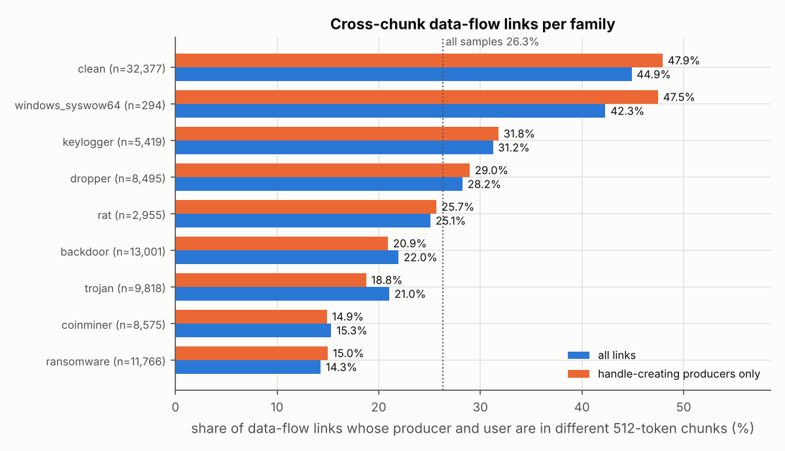

Per-family numbers are in
[`results/links/tables.md`](results/links/tables.md) (§2a).

### 8.3 Findings

1. **Data-flow links are common, and a quarter of them cross a chunk
   boundary.** 82.8% of samples have at least one link, with 37.8 links per
   sample on average (3.5 million in total). 26.3% of links cross a 512-token
   chunk boundary, and 22.4% start inside Nebula's 512-token window and are
   used outside it. 42.3% of all samples have at least one cross-chunk link: 69.8% of the
   2–3-chunk reports, 57.1% of the 4–8-chunk reports and 84.0% of the 194
   longer ones.
2. **Most cross-chunk links are one thing: resolving imports.**
   `LoadLibrary*` / `GetModuleHandle*` → `GetProcAddress` makes up 73.5% of
   cross-chunk links, and the top 20 pairs cover 96.4%. These are real
   handle uses, not artifacts, and keeping only handle-creating producers
   (88.7% of links) gives the same picture (26.6% cross-chunk). A few top
   pairs look like value coincidences rather than handle passing (for
   example `InterlockedDecrement` → `MultiByteToWideChar`, under 1% each).
3. **Links are short-range and follow the real call order.** 67.7% of
   cross-chunk links go to the very next chunk, and 96.3% stay within two
   chunks. In a shuffled order, 64.1% of links would cross chunks; in the
   real order only 26.3% do (ratio 0.41). So data flow is much more local
   than chance. Shuffling also removes 36.5% of the links, which shows the
   links depend on the real order and are not random value matches.
4. **The share differs a lot by class.** Benign reports have the most
   cross-chunk links (clean 44.9%, syswow64 42.3%). Malware families range
   from 14.3% (ransomware) to 31.2% (keylogger). Any feature built on these
   links can therefore also act as a class signal, much like length does
   (§2.3).
5. **Entry points do not matter here.** Counting inside each entry point
   gives almost the same numbers (only 659 of 3.5 million merged links join
   two different entry points), as expected with 94.7% single-entry-point
   reports (§2.5).

**For the two-level model:** the data supports *some* cross-chunk
communication, but the need is narrow. About a quarter of links cross,
almost all of them into the next one or two chunks, and three quarters are
import resolution, whose meaning is largely visible in the API names
themselves. A cheap mechanism would cover most of it: letting each chunk see the next
one covers 67.7% of cross-chunk links, and reaching two chunks away covers
96.3%. I would try that (for example overlapping chunks, or attention
between neighbouring chunks in level 2) before building an explicit link
graph between chunks.

### 8.4 Caveats

- **Matching is by value only.** An address-like return value that happens
  to reappear as an argument (a counter, PID or size ≥ `0x10000`) counts as
  a link. The handle-producer check and the shuffle baseline limit this, but
  do not remove it.
- **Out-parameters are invisible.** Many APIs return a handle through a
  pointer argument (for example `RegOpenKeyExA` returns a status code and
  writes the key handle into memory). Those handles are never a `ret_val`,
  so their links are missed. Registry and similar links are undercounted.
- **Reuse of the same address.** If memory is freed and the same address is
  returned again, the link is credited to the *first* producer, as the
  definition says. This can lengthen some links.
- **The handle-producer list is literal.** `Alloc*` is a prefix, so
  `VirtualAlloc` and `HeapAlloc` are not handle producers in check 5. Their
  links are still in the main counts.
- **Emulator cap and dataset.** Speakeasy stopped runs at 500 API calls
  (§2.6), and these numbers are for this dataset's Speakeasy reports and
  Nebula's tokenization only.
- **One shuffle per sample** in the chance baseline. With 92,700 samples the
  totals are stable, but per-sample values are noisy.

---

## 9. Why ransomware and coinminer are missed

§7 showed that the fine-tuned two-level model (`finetune_k8`) detects fewer
April ransomware and coinminer reports than the released Nebula behaviour
(`frozen_k1`). A first analysis outside this repository, which used only the
CSV files, proposed five explanations. This section checks them against the
raw reports and explains the misses.

### 9.1 Method

Script: `analyze_misses.py` (tables in
[`results/misses/tables.md`](results/misses/tables.md), logs in
`results/logs/misses_*.log`).

- **Collect:** one pass over all 92,700 raw reports with Nebula's own
  preprocessing. For each report it records:
  - an **exact hash** of Nebula's filtered report
    (`filter_and_normalize_report()` output, JSON with sorted keys);
  - a hash of the **API-name sequence only**;
  - each entry point's emulator `error.type` and unsupported API name;
  - which of the fields that Nebula drops are present;
  - the full API-name sequence.
- **Scores and rows:** the scores in `results/hier/<run>/test_scores.csv` are
  joined to reports through `meta.csv`. The order was also rebuilt
  independently from `list_files()`; both agree for all 92,700 reports.
  Labels match for all 17,402 test rows, and `finetune_k8` gives AUC 0.9639
  and the per-length AUCs of §7 exactly.
- **Missed / caught:** a report is caught when its score is above the
  threshold that flags 1% of the 8,003 April benign reports (`finetune_k8`
  0.99896, `frozen_k1` 0.87452).
- **Stop reason** of a report is the error type of its first entry point,
  grouped into five categories (raw types are in the tables).

### 9.2 The five preliminary findings, recomputed as they were defined

Same data and definitions as the first analysis (`results/samples.csv` columns and the coarse fingerprint); exact-hash versions follow in later sections.

| finding | quantity | preliminary | recomputed |
|---|---|---|---|
| 1 | misses of finetune_k8 | 2,381 | 2,381 |
| 1 | ransomware + coinminer share of misses | 59% | 59.4% |
| 1 | ransomware detection finetune_k8 vs frozen_k1 | 60.4% vs 66.5% | 60.4% vs 66.5% |
| 1 | coinminer detection finetune_k8 vs frozen_k1 | 66.3% vs 79.5% | 66.3% vs 79.5% |
| 2 | ransomware file_access present, missed vs caught (tok_file_access > 0) | 1.4% vs 36.3% | 1.4% vs 36.3% |
| 2 | ransomware >1 entry point, missed vs caught | 0.1% vs 33.6% | 0.1% vs 33.6% |
| 2 | ransomware median API calls (n_apis_raw), missed vs caught | about 140 both | 142 vs 142 |
| 3 | largest coarse fingerprint among coinminer misses | 265 of 568 (47%) | 265 of 568 (47%); fingerprint `939|175|0|0|9|930|1` |
| 3 | that fingerprint in January | none | 0 |
| 3 | mean finetune_k8 score (missed reports of that fingerprint) | 0.997 | 0.9971 |
| 4 | 1% FPR threshold finetune_k8 / frozen_k1 | 0.99896 / 0.8745 | 0.99896 / 0.8745 |
| 4 | April benign scoring > 0.9, finetune_k8 / frozen_k1 | 675 / 73 | 675 / 73 |
| 4 | API calls of the 20 highest-scoring benign reports | 1 to 13 | 1 to 219 |
| 5 | fingerprints with both labels / reports / median API calls | 609 / 21,215 / 12 | 609 / 21,215 / 12 |
| 5 | April malware in such groups | 26.5% | 26.5% |
| 5 | finetune_k8 misses in such groups | 33.5% | 33.5% |

### 9.3 Exact duplicates and label conflicts

Exact hash = SHA-1 of Nebula's filtered report (`filter_and_normalize_report()` output) serialised with sorted keys. Second check: SHA-1 of the API-name sequence only. Groups are over all 92,700 reports.

| grouping | groups | reports with a duplicate in the same split | April reports with a duplicate in January | groups with both labels | reports in those groups | median API calls in those groups | April malware in those groups | finetune_k8 misses in those groups |
|---|---|---|---|---|---|---|---|---|
| filtered report | 74,925 | 21.1% (19,527) | 6.8% (1,192) | 45 | 1.7% (1,545) | 10 | 1.7% (159) | 6.3% (151) |
| API-name sequence | 8,643 | 93.8% (86,925) | 36.4% (6,329) | 194 | 15.2% (14,117) | 188 | 27.3% (2,564) | 29.3% (697) |
| coarse fingerprint (preliminary) | 14,579 | 89.5% (82,968) | 32.1% (5,582) | 609 | 22.9% (21,215) | 12 | 26.5% (2,490) | 33.5% (797) |

Families of the reports in exact-hash groups with both labels (all splits):

| family     |   testset |   trainset |   all |
|:-----------|----------:|-----------:|------:|
| clean      |       293 |        481 |   774 |
| coinminer  |        38 |        313 |   351 |
| dropper    |        13 |        217 |   230 |
| ransomware |        82 |         35 |   117 |
| keylogger  |        10 |         31 |    41 |
| trojan     |         8 |         15 |    23 |
| rat        |         7 |          0 |     7 |
| backdoor   |         1 |          1 |     2 |

Exact-hash groups with both labels: 45; size median 10, max 321; API calls per report in them: median 10, p90 242.

Largest exact-hash groups with both labels:

| hash_report | size | malware | benign | calls | API names (first 6) |
|---|---|---|---|---|---|
| 8b15f05bba | 321 | 320 | 1 | 242 | SetErrorMode, GetVersion, GetModuleHandleA, GetProcAddress, SetDefaultDllDirectories, GetSystemDirectoryW |
| 638451c38d | 187 | 25 | 162 | 10 | GetModuleHandleA, GetCommandLineA, GetModuleHandleA, GetVersion, GetProcAddress, SetDefaultDllDirectories |
| b3a8e94c70 | 152 | 151 | 1 | 7 | __set_app_type, __p__fmode, __p__commode, _controlfp, _initterm, __wgetmainargs |
| de665fd57f | 131 | 82 | 49 | 55 | SetErrorMode, GetVersion, GetModuleHandleA, GetProcAddress, SetDefaultDllDirectories, GetSystemDirectoryW |
| 6469d90962 | 129 | 6 | 123 | 9 | GetModuleHandleA, GetCommandLineA, GetModuleHandleA, GetProcAddress, SetDllDirectoryW, GetProcAddress |
| ca22dbf32e | 91 | 13 | 78 | 7 | GetModuleHandleA, GetCommandLineA, GetModuleHandleA, GetVersion, GetProcAddress, SetDefaultDllDirectories |
| 568755fa31 | 82 | 5 | 77 | 6 | GetModuleHandleA, GetCommandLineA, GetModuleHandleA, GetProcAddress, SetDllDirectoryW, GetProcAddress |
| b7a11b32b2 | 60 | 8 | 52 | 3 | LoadLibraryA, GetProcAddress, ExitProcess |
| cc478ff6e9 | 38 | 35 | 3 | 238 | SetErrorMode, GetVersion, GetModuleHandleA, GetProcAddress, SetDefaultDllDirectories, GetSystemDirectoryA |
| f1f54492bd | 31 | 19 | 12 | 192 | ordinal_17, SetErrorMode, OleInitialize, GetModuleHandleA, LoadLibraryA, SHGetFileInfoA |

Largest API-name-sequence groups with both labels (194 groups, 14,117 reports; groups where one label is ≥ 99% of the reports: 9, holding 40.5% (5,722) of their reports):

| hash_apis | size | malware | benign | calls | families | first API names |
|---|---|---|---|---|---|---|
| c271f36a4b | 2292 | 2288 | 4 | 225 | keylogger 1,063, rat 665, coinminer 558 | GetSystemTimeAsFileTime, GetCurrentThreadId, GetCurrentProcessId, QueryPerformanceCounter, GetStartupInfoW, GetProcessHeap |
| 0fcca0c42a | 1098 | 1095 | 3 | 231 | keylogger 1,095, clean 3 | GetModuleHandleW, InitializeCriticalSection, InitializeCriticalSection, GetVersion, GetModuleHandleW, GetProcAddress |
| 5884e65612 | 864 | 862 | 2 | 219 | rat 549, coinminer 277, keylogger 36 | GetSystemTimeAsFileTime, GetCurrentThreadId, GetCurrentProcessId, QueryPerformanceCounter, GetStartupInfoW, GetProcessHeap |
| 9947cd115e | 634 | 623 | 11 | 500 | coinminer 620, clean 11, keylogger 3 | GetSystemTimeAsFileTime, GetCurrentProcessId, GetCurrentThreadId, GetTickCount, QueryPerformanceCounter, GetStartupInfoA |
| 0e9c897007 | 614 | 611 | 3 | 32 | keylogger 611, clean 3 | GetModuleHandleW, InitializeCriticalSection, InitializeCriticalSection, GetVersion, GetModuleHandleW, GetProcAddress |
| 7038a53a8f | 512 | 176 | 336 | 33 | clean 336, trojan 173, coinminer 1 | GetModuleHandleW, SetThreadLocale, InitializeCriticalSection, GetVersion, GetModuleHandleW, GetProcAddress |
| 1b5f31db73 | 511 | 221 | 290 | 10 | clean 290, keylogger 220, backdoor 1 | GetSystemTimeAsFileTime, GetCurrentProcessId, GetCurrentThreadId, GetTickCount, QueryPerformanceCounter, GetStartupInfoA |
| 941998dd87 | 500 | 333 | 167 | 242 | coinminer 217, clean 167, dropper 69 | SetErrorMode, GetVersion, GetModuleHandleA, GetProcAddress, SetDefaultDllDirectories, GetSystemDirectoryW |
| d8bc798838 | 411 | 247 | 164 | 16 | keylogger 238, clean 164, coinminer 7 | GetModuleHandleW, GetSystemInfo, GetKeyboardType, GetCommandLineW, GetStartupInfoA, GetACP |
| 9b55df4641 | 380 | 133 | 247 | 5 | clean 247, dropper 61, trojan 39 | __set_app_type, SetUnhandledExceptionFilter, __getmainargs, __p__fmode, __p__environ |
| 26af352f43 | 267 | 232 | 35 | 192 | coinminer 218, clean 35, dropper 5 | ordinal_17, SetErrorMode, OleInitialize, GetModuleHandleA, LoadLibraryA, SHGetFileInfoA |
| 0459938b31 | 252 | 10 | 242 | 11 | clean 242, dropper 8, rat 1 | GetSystemTimeAsFileTime, GetCurrentProcessId, GetCurrentThreadId, GetTickCount, QueryPerformanceCounter, GetStartupInfoW |

### 9.4 Why emulation stopped

Stop reason of a report = `error.type` of its first entry point (the module entry), grouped into categories; raw types are in the second table. "No error recorded" means the entry point returned (or ended without an error record).

| April group (finetune_k8) | n | no error recorded | invalid memory / CPU fault | max_api_count (500-call cap) | unsupported API | emulator internal error |
|---|---|---|---|---|---|---|
| ransomware missed | 846 | 38.8% (328) | 1.3% (11) | 3.9% (33) | 54.5% (461) | 1.5% (13) |
| ransomware caught | 1,293 | 36.0% (466) | 4.3% (55) | 10.2% (132) | 49.5% (640) | 0.0% (0) |
| coinminer missed | 568 | 45.1% (256) | 34.0% (193) | 3.0% (17) | 17.3% (98) | 0.7% (4) |
| coinminer caught | 1,116 | 11.6% (129) | 6.4% (71) | 2.5% (28) | 79.6% (888) | 0.0% (0) |

Most common raw error types (module entry), April ransomware and coinminer:

| group | n | top error types |
|---|---|---|
| ransomware missed | 846 | `unsupported_api` 54.5% (461); `none` 38.8% (328); `max_api_count` 3.9% (33); `Unsupported information class: 0x0` 1.4% (12) |
| ransomware caught | 1,293 | `unsupported_api` 49.5% (640); `none` 36.0% (466); `max_api_count` 10.2% (132); `invalid_read` 2.3% (30) |
| coinminer missed | 568 | `none` 45.1% (256); `invalid_read` 31.9% (181); `unsupported_api` 17.3% (98); `max_api_count` 3.0% (17) |
| coinminer caught | 1,116 | `unsupported_api` 79.6% (888); `none` 11.6% (129); `Invalid memory read (UC_ERR_READ_UNMAPPED)` 5.5% (61); `max_api_count` 2.5% (28) |

Unsupported API names (any entry point), April ransomware and coinminer:

| group | reports with an unsupported API | top unsupported APIs |
|---|---|---|
| ransomware missed | 54.6% (462) | `KERNEL32.HeapValidate` (255); `shlwapi.ordinal_437` (80); `gdi32.GetSystemPaletteEntries` (43); `MSVCR80.setlocale` (39); `USER32.GetShellWindow` (9) |
| ransomware caught | 83.0% (1,073) | `msvcrt.__p___initenv` (478); `iphlpapi.GetAdaptersInfo` (407); `KERNEL32.HeapValidate` (100); `USER32.SetMenuInfo` (43); `PSAPI.EnumDeviceDrivers` (26) |
| coinminer missed | 18.3% (104) | `COMCTL32.ordinal_17` (16); `kernel32.SetSearchPathMode` (15); `KERNEL32.GetProcessAffinityMask` (12); `USER32.RegisterClipboardFormatA` (8); `KERNEL32.OpenFileMappingA` (7) |
| coinminer caught | 80.4% (897) | `KERNEL32.GetProcessAffinityMask` (560); `USER32.MapVirtualKeyW` (278); `imagehlp.ImageDirectoryEntryToData` (29); `ADVAPI32.RegCreateKeyExA` (6); `kernel32.FreeResource` (5) |

Stop reason per family, January (trainset) vs April (testset):

| family | split | n | no error recorded | invalid memory / CPU fault | max_api_count (500-call cap) | unsupported API | emulator internal error |
|---|---|---|---|---|---|---|---|
| backdoor | Jan | 11,061 | 30.8% (3,404) | 1.1% (125) | 67.9% (7,512) | 0.0% (0) | 0.2% (20) |
| backdoor | Apr | 1,940 | 23.7% (460) | 0.6% (12) | 59.5% (1,154) | 14.4% (279) | 1.8% (35) |
| clean | Jan | 24,433 | 51.8% (12,653) | 38.6% (9,430) | 9.0% (2,209) | 0.0% (0) | 0.6% (141) |
| clean | Apr | 7,944 | 32.5% (2,584) | 6.1% (482) | 8.4% (670) | 51.9% (4,121) | 1.1% (87) |
| coinminer | Jan | 6,891 | 28.5% (1,965) | 41.3% (2,846) | 29.5% (2,033) | 0.0% (0) | 0.7% (47) |
| coinminer | Apr | 1,684 | 22.9% (385) | 15.7% (264) | 2.7% (45) | 58.6% (986) | 0.2% (4) |
| dropper | Jan | 8,243 | 52.9% (4,363) | 40.5% (3,342) | 3.1% (256) | 0.0% (0) | 3.4% (282) |
| dropper | Apr | 252 | 37.3% (94) | 28.6% (72) | 3.2% (8) | 28.6% (72) | 2.4% (6) |
| keylogger | Jan | 4,378 | 16.3% (714) | 82.6% (3,617) | 1.0% (43) | 0.0% (0) | 0.1% (4) |
| keylogger | Apr | 1,041 | 19.4% (202) | 4.1% (43) | 0.6% (6) | 75.9% (790) | 0.0% (0) |
| ransomware | Jan | 9,627 | 74.1% (7,137) | 20.8% (1,999) | 5.1% (488) | 0.0% (0) | 0.0% (3) |
| ransomware | Apr | 2,139 | 37.1% (794) | 3.1% (66) | 7.7% (165) | 51.5% (1,101) | 0.6% (13) |
| rat | Jan | 1,697 | 14.7% (249) | 84.0% (1,425) | 1.0% (17) | 0.0% (0) | 0.4% (6) |
| rat | Apr | 1,258 | 22.2% (279) | 1.9% (24) | 0.8% (10) | 74.2% (933) | 1.0% (12) |
| trojan | Jan | 8,733 | 37.2% (3,251) | 37.3% (3,260) | 25.1% (2,191) | 0.0% (0) | 0.4% (31) |
| trojan | Apr | 1,085 | 25.5% (277) | 9.1% (99) | 2.0% (22) | 62.9% (683) | 0.4% (4) |
| windows_syswow64 | Jan | 235 | 9.8% (23) | 0.9% (2) | 0.0% (0) | 89.4% (210) | 0.0% (0) |
| windows_syswow64 | Apr | 59 | 13.6% (8) | 0.0% (0) | 0.0% (0) | 86.4% (51) | 0.0% (0) |

### 9.5 What the missed ransomware does

Missed/caught = `finetune_k8` at 1% FPR. Shares are of the reports in each group.

| group | n | median API calls | file_access | registry_access | network traffic | >1 entry point | raw `process_events` | raw `dropped_files` | raw `dynamic_code_segments` | raw `handled_exceptions` |
|---|---|---|---|---|---|---|---|---|---|---|
| Apr missed | 846 | 142 | 1.4% (12) | 5.6% (47) | 0.4% (3) | 0.1% (1) | 0.2% (2) | 0.0% (0) | 0.0% (0) | 0.5% (4) |
| Apr caught | 1,293 | 142 | 36.3% (469) | 3.6% (46) | 31.8% (411) | 33.6% (434) | 0.0% (0) | 0.0% (0) | 0.2% (2) | 0.2% (3) |
| Jan (all) | 9,627 | 180 | 3.1% (302) | 0.8% (75) | 2.6% (246) | 3.0% (285) | 0.1% (9) | 0.1% (6) | 0.1% (10) | 4.0% (385) |

File-encryption related APIs (share of reports that call it at least once):

| API | Apr missed | Apr caught | Jan (all) |
|---|---|---|---|
| `CryptEncrypt` | 0.0% (0) | 0.0% (0) | 0.0% (0) |
| `CryptAcquireContext*` | 0.2% (2) | 31.6% (409) | 3.0% (284) |
| `BCrypt*` | 0.0% (0) | 0.0% (0) | 0.0% (1) |
| `FindFirstFile*` | 0.0% (0) | 0.0% (0) | 0.0% (0) |
| `FindNextFile*` | 0.0% (0) | 0.0% (0) | 0.0% (0) |
| `CreateFile*` | 1.4% (12) | 36.3% (469) | 3.1% (302) |
| `WriteFile` | 0.2% (2) | 0.0% (0) | 0.1% (6) |
| `MoveFile*` | 0.0% (0) | 0.0% (0) | 0.0% (0) |
| `DeleteFile*` | 0.0% (0) | 0.0% (0) | 0.0% (0) |
| `any FindFirst/FindNext + Write/Move` | 0.0% (0) | 0.0% (0) | 0.0% (0) |

Anti-analysis or delay APIs:

| API | Apr missed | Apr caught | Jan (all) |
|---|---|---|---|
| `IsDebuggerPresent` | 0.0% (0) | 0.0% (0) | 0.0% (0) |
| `CheckRemoteDebuggerPresent` | 0.0% (0) | 0.0% (0) | 0.0% (0) |
| `GetTickCount*` | 77.1% (652) | 41.1% (532) | 7.8% (753) |
| `QueryPerformanceCounter` | 78.7% (666) | 18.9% (244) | 7.6% (728) |
| `Sleep*` | 0.1% (1) | 33.5% (433) | 2.9% (279) |
| `GetSystemMetrics` | 0.9% (8) | 0.0% (0) | 0.0% (3) |
| `GetCursorPos` | 0.7% (6) | 0.0% (0) | 0.0% (2) |

Top 15 API names by document frequency (lower-case, without DLL):

| group | top APIs |
|---|---|
| Apr missed | `getprocaddress` 93%; `getcurrentthreadid` 85%; `queryperformancecounter` 79%; `getcurrentprocessid` 78%; `getsystemtimeasfiletime` 78%; `gettickcount` 77%; `heapalloc` 76%; `interlockedincrement` 76%; `getstdhandle` 74%; `getenvironmentstringsw` 74%; `getfiletype` 74%; `freeenvironmentstringsw` 74%; `entercriticalsection` 74%; `leavecriticalsection` 74%; `flsalloc` 74% |
| Apr caught | `_controlfp` 75%; `__p__fmode` 75%; `__p__commode` 75%; `__set_app_type` 75%; `__getmainargs` 75%; `_initterm` 75%; `getstartupinfoa` 47%; `getmodulefilenamea` 42%; `gettickcount` 41%; `getmodulehandlea` 39%; `__setusermatherr` 37%; `readfile` 36%; `closehandle` 33%; `sleep` 33%; `__p___argc` 33% |
| Jan (all) | `getprocaddress` 54%; `getvolumeinformation` 46%; `getversionex` 46%; `virtualalloc` 46%; `loadlibrarya` 46%; `getenvironmentvariablew` 45%; `localalloc` 45%; `initializesecuritydescriptor` 45%; `setsecuritydescriptordacl` 45%; `getcurrentthreadid` 9%; `getcurrentprocessid` 9%; `getlasterror` 9%; `getstartupinfoa` 8%; `getmodulehandlew` 8%; `gettickcount` 8% |

APIs whose document frequency differs most, Apr missed (n=846) vs Apr caught (n=1,293); log-odds with +0.5 smoothing, APIs in ≥20 reports:

| direction | API | Apr missed | Apr caught | log-odds |
|---|---|---|---|---|
| more in Apr missed | `loadlibraryw` | 31.1% (263) | 0.1% (1) | +5.96 |
| more in Apr missed | `getsystemdirectoryw` | 9.5% (80) | 0.0% (0) | +5.60 |
| more in Apr missed | `heapsetinformation` | 29.8% (252) | 0.2% (2) | +5.39 |
| more in Apr missed | `getversionexa` | 6.4% (54) | 0.0% (0) | +5.18 |
| more in Apr missed | `localalloc` | 6.1% (52) | 0.0% (0) | +5.14 |
| more in Apr missed | `createeventa` | 6.0% (51) | 0.0% (0) | +5.12 |
| more in Apr missed | `regopenkeyexa` | 5.6% (47) | 0.0% (0) | +5.03 |
| more in Apr missed | `lstrcpyna` | 5.6% (47) | 0.0% (0) | +5.03 |
| more in Apr missed | `loadstringa` | 5.6% (47) | 0.0% (0) | +5.03 |
| more in Apr missed | `getlocaleinfoa` | 5.6% (47) | 0.0% (0) | +5.03 |
| more in Apr caught | `__getmainargs` | 0.2% (2) | 75.3% (974) | -6.94 |
| more in Apr caught | `_controlfp` | 0.2% (2) | 75.3% (974) | -6.94 |
| more in Apr caught | `__setusermatherr` | 0.0% (0) | 37.1% (480) | -6.91 |
| more in Apr caught | `__p__commode` | 0.4% (3) | 75.3% (974) | -6.60 |
| more in Apr caught | `__p__fmode` | 0.4% (3) | 75.3% (974) | -6.60 |
| more in Apr caught | `__set_app_type` | 0.4% (3) | 75.3% (974) | -6.60 |
| more in Apr caught | `readfile` | 0.1% (1) | 36.2% (468) | -5.77 |
| more in Apr caught | `sleep` | 0.1% (1) | 33.5% (433) | -5.65 |
| more in Apr caught | `__p___argc` | 0.1% (1) | 33.1% (428) | -5.63 |
| more in Apr caught | `exit` | 0.1% (1) | 31.8% (411) | -5.57 |

APIs whose document frequency differs most, Apr missed (n=846) vs Jan (all) (n=9,627); log-odds with +0.5 smoothing, APIs in ≥20 reports:

| direction | API | Apr missed | Jan (all) | log-odds |
|---|---|---|---|---|
| more in Apr missed | `loadlibraryw` | 31.1% (263) | 0.2% (16) | +5.57 |
| more in Apr missed | `heapsetinformation` | 29.8% (252) | 0.2% (22) | +5.20 |
| more in Apr missed | `interlockedexchange` | 4.6% (39) | 0.1% (6) | +4.28 |
| more in Apr missed | `interlockedcompareexchange` | 4.6% (39) | 0.1% (6) | +4.28 |
| more in Apr missed | `_initterm_e` | 4.6% (39) | 0.1% (7) | +4.14 |
| more in Apr missed | `interlockedincrement` | 76.1% (644) | 5.4% (519) | +4.02 |
| more in Apr missed | `getcurrentthreadid` | 84.8% (717) | 9.3% (898) | +3.99 |
| more in Apr missed | `tlssetvalue` | 71.9% (608) | 5.1% (493) | +3.85 |
| more in Apr missed | `heapcreate` | 71.9% (608) | 5.1% (493) | +3.85 |
| more in Apr missed | `initializecriticalsectionandspincount` | 72.7% (615) | 5.3% (513) | +3.85 |
| more in Jan (all) | `getversionex` | 0.0% (0) | 46.5% (4,476) | -7.29 |
| more in Jan (all) | `getvolumeinformation` | 0.0% (0) | 46.5% (4,476) | -7.29 |
| more in Jan (all) | `initializesecuritydescriptor` | 0.0% (0) | 45.2% (4,349) | -7.24 |
| more in Jan (all) | `setsecuritydescriptordacl` | 0.0% (0) | 45.1% (4,345) | -7.24 |
| more in Jan (all) | `getenvironmentvariablew` | 0.1% (1) | 45.5% (4,379) | -6.15 |
| more in Jan (all) | `getconsolewindow` | 0.0% (0) | 6.0% (582) | -4.69 |
| more in Jan (all) | `getadaptersinfo` | 0.0% (0) | 2.5% (240) | -3.77 |
| more in Jan (all) | `getdoubleclicktime` | 0.0% (0) | 1.9% (184) | -3.50 |
| more in Jan (all) | `getmessageextrainfo` | 0.0% (0) | 1.7% (165) | -3.39 |
| more in Jan (all) | `getclipboardviewer` | 0.0% (0) | 1.6% (155) | -3.32 |

Most common last 5 API calls (endings), per group:

| group | last 5 calls | reports |
|---|---|---|
| Apr missed | `heapsize → encodepointer → encodepointer → leavecriticalsection → loadlibraryw` | 17.1% (145) |
| Apr missed | `heapalloc → leavecriticalsection → multibytetowidechar → getstringtypew → entercriticalsection` | 16.3% (138) |
| Apr missed | `leavecriticalsection → heapalloc → entercriticalsection → heapalloc → leavecriticalsection` | 13.8% (117) |
| Apr missed | `getlasterror → tlsgetvalue → flsgetvalue → setlasterror → loadlibraryw` | 11.9% (101) |
| Apr caught | `__setusermatherr → _controlfp → _initterm → __getmainargs → _initterm` | 37.0% (478) |
| Apr caught | `gettickcount → gettickcount → gettickcount → gettickcount → gettickcount` | 31.5% (407) |
| Apr caught | `leavecriticalsection → heapalloc → entercriticalsection → heapalloc → leavecriticalsection` | 4.8% (62) |
| Apr caught | `memcmp → memcmp → memcmp → memcmp → memcmp` | 4.7% (61) |
| Jan (all) | `virtualalloc → virtualalloc → virtualalloc → virtualalloc → getenvironmentvariablew` | 45.1% (4,345) |
| Jan (all) | `gettickcount → gettickcount → gettickcount → gettickcount → gettickcount` | 2.5% (241) |
| Jan (all) | `getuserdefaultuilanguage → getuserdefaultuilanguage` | 2.2% (215) |
| Jan (all) | `getconsolewindow → getconsolewindow` | 2.2% (208) |

Exact-hash structure of the missed ransomware: 746 distinct filtered reports among 846; the largest exact group holds 75; 9.7% (82) sit in a group that also has benign reports.

### 9.6 The big coinminer group

Coinminer misses (`finetune_k8`): 568. Largest coarse fingerprint `939|175|0|0|9|930|1` (tokens|API calls|registry|network|file|apis tokens|entry points) holds 46.7% (265) of them.

- Distinct exact filtered-report hashes in that group: 1 (largest: 265 reports).
- Distinct API-name sequences: 1 (largest: 265).
- All April reports with that fingerprint: 265 ({'coinminer': np.int64(265)}); January reports with it: 0; January reports with the same exact filtered-report hash as the largest exact group: 0.
- `finetune_k8` on the whole fingerprint group: mean score 0.9971, median 0.9971, flagged 0.0% (0) (threshold 0.99896).
- `frozen_k1` on the whole fingerprint group: mean score 0.9991, median 0.9991, flagged 100.0% (265) (threshold 0.87452).

Closest January coinminer by edit distance over API-name sequences (lower-case; 257 distinct January coinminer sequences searched): `4bcbd50b4ede1e3716f4c8560050243d82583af1a074d024840cddf999ca84a1`, distance **14** (175 vs 178 calls; 1 reports share that January sequence).

Minimal edit script (14 edits; `delete` = only in April, `insert` = only in January), consecutive edits merged:

| edit | at April call | April calls | January calls |
|---|---|---|---|
| replace | 120 | loadlibrarya | getprocaddress |
| replace | 127 | loadlibrarya | getprocaddress |
| replace | 131 | loadlibrarya | getprocaddress |
| replace | 137 | loadlibrarya | getprocaddress |
| replace | 145 | loadlibrarya | getprocaddress |
| replace | 147 | loadlibrarya | getprocaddress |
| replace | 149 | loadlibrarya | getprocaddress |
| replace | 151 | loadlibrarya | getprocaddress |
| insert | 165 | – | loadlibrarya |
| insert | 172 | – | getprocaddress, getprocaddress |
| replace | 172 | virtualprotect, virtualprotect, createfilea | getprocaddress, getprocaddress, getprocaddress |

Last 6 calls: April `getprocaddress → getprocaddress → getprocaddress → virtualprotect → virtualprotect → createfilea`; January `getprocaddress → getprocaddress → getprocaddress → getprocaddress → getprocaddress → getprocaddress`.

The full API-name list of the April report is in [`coinminer_group_example.txt`](coinminer_group_example.txt); its whole filtered report is in [`coinminer_group_example_filtered.json`](coinminer_group_example_filtered.json). Its non-API fields: {"file_access": [{"event": "create", "path": "<drive>\\windows\\mshlpda32.dll"}]}

### 9.7 Score calibration

| model | benign score > | April benign reports | median API calls | ≤10 API calls | median exact-group size | in a group with malware | same API-name sequence as some malware | median malware share of their group |
|---|---|---|---|---|---|---|---|---|
| finetune_k8 | 0.9 | 8.4% (675) | 359 | 9.5% (64) | 1 | 0.6% (4) | 11.7% (79) | 0.00 |
| finetune_k8 | 0.99 | 2.2% (176) | 42 | 30.1% (53) | 1 | 1.7% (3) | 35.2% (62) | 0.00 |
| finetune_k8 | 0.999 | 0.9% (76) | 10 | 52.6% (40) | 1 | 1.3% (1) | 47.4% (36) | 0.00 |
| frozen_k1 | 0.9 | 0.9% (73) | 40 | 39.7% (29) | 1 | 1.4% (1) | 31.5% (23) | 0.00 |
| frozen_k1 | 0.99 | 0.4% (33) | 9 | 57.6% (19) | 1 | 3.0% (1) | 36.4% (12) | 0.00 |
| frozen_k1 | 0.999 | 0.2% (16) | 6 | 75.0% (12) | 1 | 6.2% (1) | 31.2% (5) | 0.00 |

`finetune_k8`: highest test score 0.99953; 7,066 reports within 0.0005 of it (73 benign, 6,993 malware). The 1% FPR threshold 0.99896 is 0.00057 below the highest score.

`frozen_k1`: highest test score 0.99984; 5,041 reports within 0.0005 of it (13 benign, 5,028 malware). The 1% FPR threshold 0.87452 is 0.12532 below the highest score.

The 10 highest-scoring April benign reports (`finetune_k8`):

| family | finetune_k8 | frozen_k1 | API calls | exact group: malware / size | API-sequence group: malware / size | API names |
|---|---|---|---|---|---|---|
| clean | 0.99951 | 0.9998 | 219 | 0 / 1 | 862 / 864 | GetSystemTimeAsFileTime, GetCurrentThreadId, GetCurrentProcessId, QueryPerformanceCounter, GetStartupInfoW, GetProcessHeap, EncodePointer, EncodePointer |
| clean | 0.99951 | 0.9994 | 219 | 0 / 1 | 862 / 864 | GetSystemTimeAsFileTime, GetCurrentThreadId, GetCurrentProcessId, QueryPerformanceCounter, GetStartupInfoW, GetProcessHeap, EncodePointer, EncodePointer |
| clean | 0.99948 | 0.9998 | 47 | 0 / 1 | 0 / 1 | GetCommandLineA, GetVersionExA, InitializeCriticalSection, EnterCriticalSection, GetProcessHeap, GetSystemTimeAsFileTime, GetCurrentProcessId, GetCurrentThreadId |
| clean | 0.99947 | 0.9966 | 48 | 0 / 1 | 0 / 1 | GetVersion, HeapCreate, HeapAlloc, HeapAlloc, VirtualAlloc, VirtualAlloc, GetStartupInfoA, GetStdHandle |
| clean | 0.99947 | 0.0698 | 9 | 0 / 1 | 72 / 119 | __set_app_type, __p__fmode, __p__commode, _controlfp, _initterm, __getmainargs, _initterm, GetStartupInfoA |
| clean | 0.99947 | 0.9998 | 7 | 0 / 1 | 10 / 28 | __set_app_type, __p__fmode, __p__commode, _controlfp, _initterm, __getmainargs, _initterm |
| clean | 0.99947 | 0.4432 | 9 | 0 / 1 | 72 / 119 | __set_app_type, __p__fmode, __p__commode, _controlfp, _initterm, __getmainargs, _initterm, GetStartupInfoA |
| clean | 0.99947 | 0.9975 | 9 | 0 / 1 | 72 / 119 | __set_app_type, __p__fmode, __p__commode, _controlfp, _initterm, __getmainargs, _initterm, GetStartupInfoA |
| clean | 0.99946 | 0.9983 | 7 | 0 / 1 | 10 / 28 | __set_app_type, __p__fmode, __p__commode, _controlfp, _initterm, __getmainargs, _initterm |
| clean | 0.99946 | 0.9998 | 1 | 0 / 1 | 0 / 3 | LoadLibraryA |

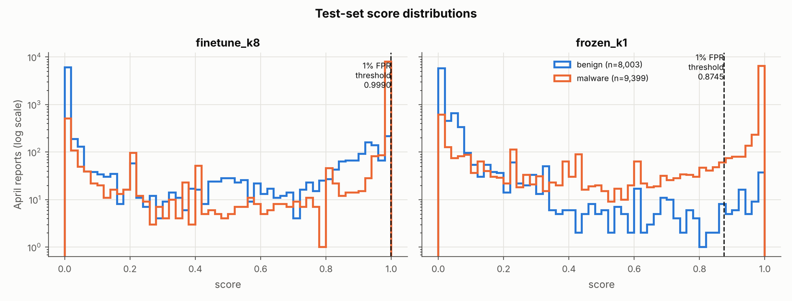

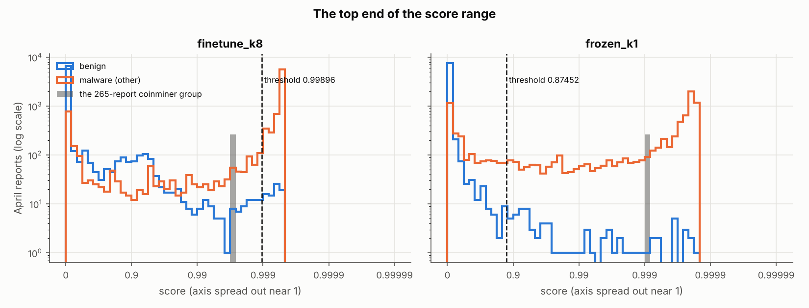

### 9.8 Removing reports that cannot be learned (analysis only)

TPR per family at 1% FPR, with the threshold recomputed on the April benign reports that remain. (a) removes every April report in an exact-hash group that contains both labels (groups over all splits); (b) removes reports with 10 or fewer API calls; (a+b) both.

| subset | benign kept | malware kept | model | all malware | ransomware | coinminer | backdoor | dropper | keylogger | rat | trojan |
|---|---|---|---|---|---|---|---|---|---|---|---|
| all | 8,003 | 9,399 | finetune_k8 | 74.7% (7,018) | 60.4% (1,293/2,139) | 66.3% (1,116/1,684) | 80.0% (1,552/1,940) | 77.4% (195/252) | 88.1% (917/1,041) | 84.8% (1,067/1,258) | 80.9% (878/1,085) |
| all | 8,003 | 9,399 | frozen_k1 | 75.8% (7,129) | 66.5% (1,422/2,139) | 79.5% (1,339/1,684) | 82.2% (1,595/1,940) | 71.8% (181/252) | 64.4% (670/1,041) | 83.9% (1,056/1,258) | 79.8% (866/1,085) |
| (a) no label-conflict groups | 7,710 | 9,240 | finetune_k8 | 75.8% (7,005) | 62.7% (1,289/2,057) | 67.8% (1,116/1,646) | 80.0% (1,552/1,939) | 78.2% (187/239) | 88.8% (916/1,031) | 85.3% (1,067/1,251) | 81.5% (878/1,077) |
| (a) no label-conflict groups | 7,710 | 9,240 | frozen_k1 | 77.0% (7,113) | 68.8% (1,416/2,057) | 81.3% (1,339/1,646) | 82.3% (1,595/1,939) | 72.4% (173/239) | 65.0% (670/1,031) | 84.3% (1,055/1,251) | 80.3% (865/1,077) |
| (b) > 10 API calls | 6,486 | 8,266 | finetune_k8 | 76.8% (6,347) | 54.3% (854/1,573) | 69.7% (1,139/1,635) | 83.5% (1,523/1,825) | 77.3% (143/185) | 89.9% (830/923) | 89.7% (1,064/1,186) | 84.6% (794/939) |
| (b) > 10 API calls | 6,486 | 8,266 | frozen_k1 | 79.0% (6,533) | 61.7% (971/1,573) | 83.2% (1,360/1,635) | 83.1% (1,516/1,825) | 70.8% (131/185) | 74.2% (685/923) | 90.8% (1,077/1,186) | 84.5% (793/939) |
| (a+b) | 6,403 | 8,145 | finetune_k8 | 77.9% (6,347) | 57.3% (854/1,491) | 70.6% (1,139/1,614) | 83.5% (1,523/1,825) | 79.4% (143/180) | 90.6% (830/916) | 90.2% (1,064/1,180) | 84.6% (794/939) |
| (a+b) | 6,403 | 8,145 | frozen_k1 | 80.2% (6,533) | 65.1% (971/1,491) | 84.3% (1,360/1,614) | 83.1% (1,516/1,825) | 72.8% (131/180) | 74.8% (685/916) | 91.3% (1,077/1,180) | 84.5% (793/939) |

### 9.9 Findings

1. **The preliminary numbers reproduce, but the coarse fingerprint misleads.**
   With the first analysis's definitions, every number reproduces exactly
   except one: the 20 highest-scoring benign reports have 1 to 219 API calls,
   not 1 to 13. With **exact** hashes, reports that are identical but carry
   both labels are rare: 45 groups with 1,545 reports, holding 1.7% of April
   malware (159) and 6.3% of the `finetune_k8` misses (151). The coarse
   fingerprint gave 609 groups, 26.5% and 33.5%. Most of those "conflicts"
   were different reports with the same counts.
2. **What malware and benign really share is code that runs before the
   payload.** 194 API-name sequences (ignoring arguments) occur with both
   labels. They cover 27.3% of April malware (2,564) and 29.3% of the misses
   (697), and they are not short (median 188 calls). The largest look like
   compiler run-time start-up code (MSVC `GetSystemTimeAsFileTime,
   GetCurrentThreadId, …`, Delphi-style `GetModuleHandleW,
   InitializeCriticalSection, …`) and installer stubs (`SetErrorMode,
   GetVersion, … SetDefaultDllDirectories`). So the trace is not empty: the
   emulator recorded the start-up code or wrapper, and stopped before the part
   that differs. Nine of the 194 groups are lopsided (one label ≥ 99%; the
   largest has 2,288 malware and 4 benign reports) and hold 40.5% (5,722) of
   their reports. In the other 185 groups the same trace genuinely appears
   with both labels.
3. **Missed ransomware stops before its payload.** It looks like C-runtime
   start-up (`FlsAlloc`, `HeapCreate`, `TlsSetValue`, …):
   - 54.5% (461 of 846) stop on an unsupported API (`HeapValidate` alone in
     255), and 38.8% (328) end without an error record;
   - only 1.4% (12) touch a file, 0.2% (2) create a crypto context, and none
     search for files.
   Its `GetTickCount` and `QueryPerformanceCounter` calls (77–79%) are part of
   that start-up code, not anti-analysis: `IsDebuggerPresent` and
   `CheckRemoteDebuggerPresent` appear in no ransomware report. The caught April ransomware gets further: file access 36.3%
   (469), `CryptAcquireContext*` 31.6% (409), network 31.8% (411), and more
   than one entry point 33.6% (434). Still, **no ransomware report in the
   whole dataset reaches `CryptEncrypt` or a `FindFirstFile`/`FindNextFile`
   loop.** Detection always rests on behaviour before encryption.
4. **The coinminer misses are one report repeated, and they are a threshold
   problem, not a recognition problem.** The 265 reports share a single
   exact hash, and that report never appears in January. Its closest January
   coinminer differs by 14 API-name edits; the April version goes slightly
   further (`VirtualProtect` twice, then `CreateFileA` creating
   `<drive>\windows\mshlpda32.dll`). `frozen_k1` flags all 265 (score 0.9991
   vs threshold 0.8745). `finetune_k8` scores them 0.9971 and misses them all,
   because its threshold is 0.99896.
5. **The fine-tuned model's scores pile up just below 1.** 7,066 April
   reports (73 benign) score within 0.0005 of its highest score (0.99953),
   and the 1% FPR threshold sits 0.00057 below that maximum. 675 benign
   reports score above 0.9 (`frozen_k1`: 73). With exact hashes, they are not
   copies of malware reports (only 4 of the 675 are in a group with malware),
   but 11.7% (79) share an API-name sequence with malware, rising to 47.4% of
   those above 0.999. At this end of the scale, ranking is almost a coin toss
   among near-identical scores.
6. **April reports were emulated differently.** In January, no report in any
   family stops on an unsupported API, except `windows_syswow64`. In April
   14.4%–75.9% of each malware family do, and 51.9% of clean reports
   (4,121). The emulator setup
   apparently changed between the two collections. Models trained on January
   therefore meet April traces that are cut short in a new way.
7. **Removing "unlearnable" reports changes little.** Without label-conflict
   groups, `finetune_k8` detects 62.7% of ransomware (was 60.4%) and 67.8% of
   coinminer (was 66.3%). Without reports of ≤ 10 API calls, ransomware
   detection *drops* to 54.3%: short reports are not where ransomware is
   missed.

**What this means:** the coinminer gap is mostly calibration. A
temperature-scaled or rank-based threshold, or simply choosing the epoch by
low-FPR validation metrics, should recover it, because `frozen_k1` already
separates that group. The ransomware gap is mostly the data. The emulator
stopped those samples in start-up code that looks like benign software, so
no model that reads only these traces can be expected to catch them
reliably.

### 9.10 Caveats

- **One model run.** Missed/caught comes from one `finetune_k8` run (one
  seed, 2 epochs on CPU). Another run may move individual reports across
  the threshold.
- **The stop reason uses the first entry point only.** "No error recorded"
  cannot tell a normal exit from a timeout.
- **The emulator version is not in the reports.** The January/April
  difference in stop reasons is an inference from the error types, not a
  recorded fact.
- **The API-name-sequence hash ignores arguments.** Reports in the same
  sequence group can still differ in what they touch.
- **API-name matching in §9.5 is case-insensitive and ignores the DLL.**
  The exact hashes are case-sensitive.
- **The log-odds lists are descriptive.** They are not tested for
  significance, and they only include APIs seen in at least 20 reports.
- **The closest-January search covered only the 257 distinct January
  coinminer API sequences,** not other families.
- **§9.8 recomputes the threshold for each subset.** It is not a headline
  result.
