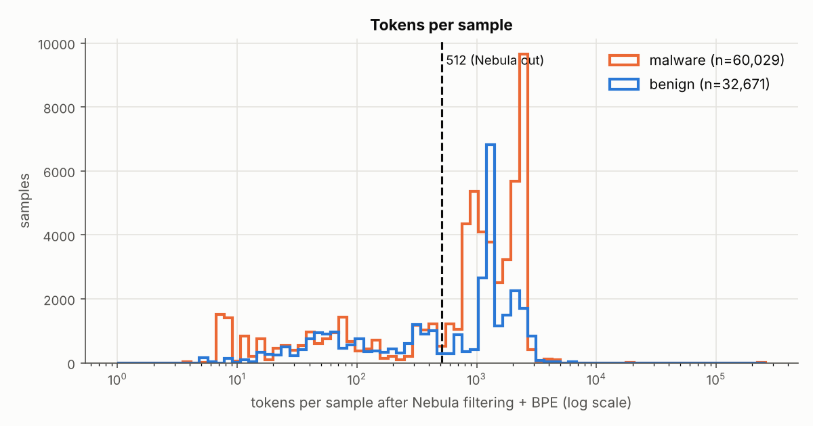
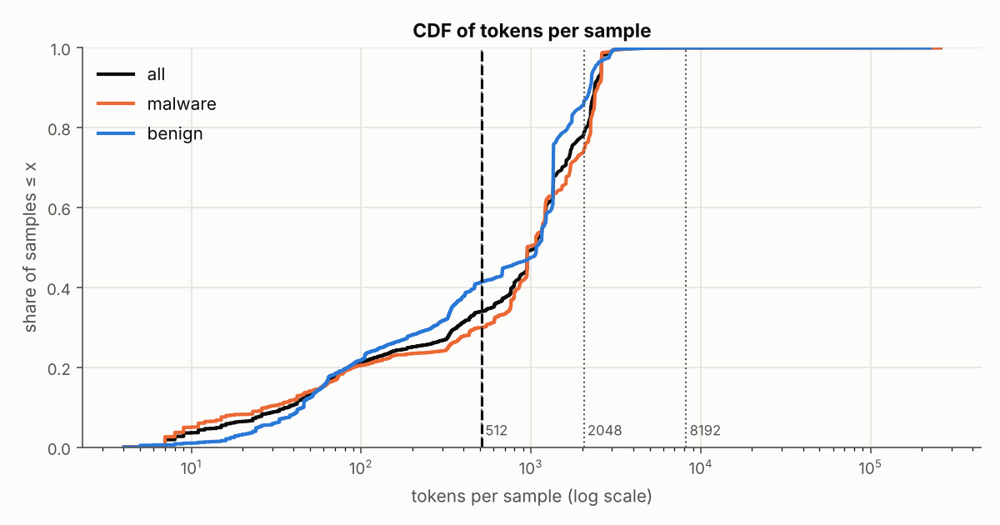
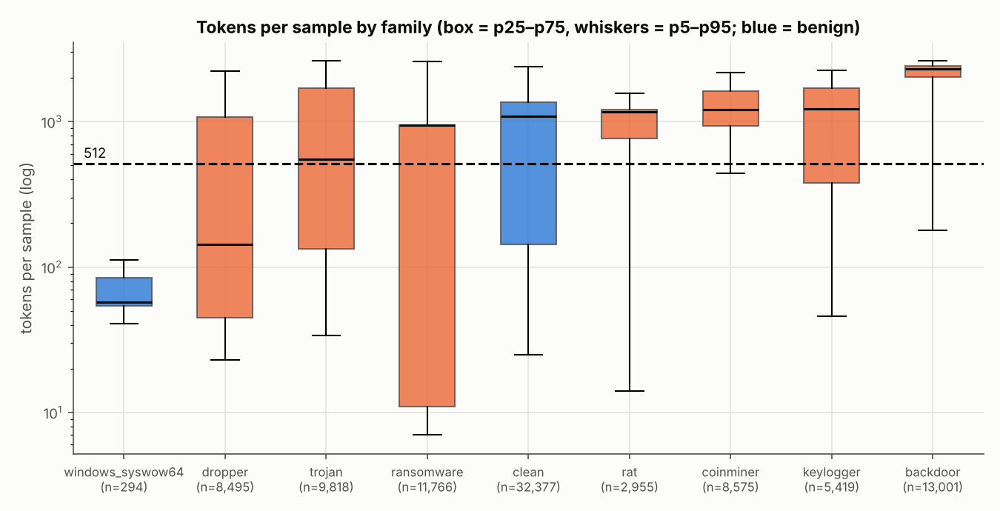
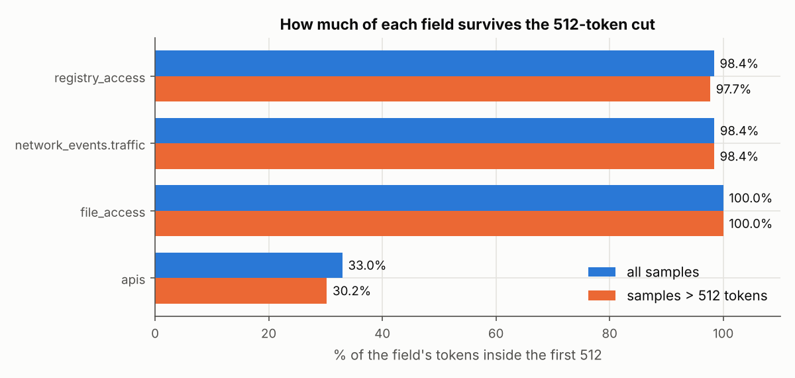
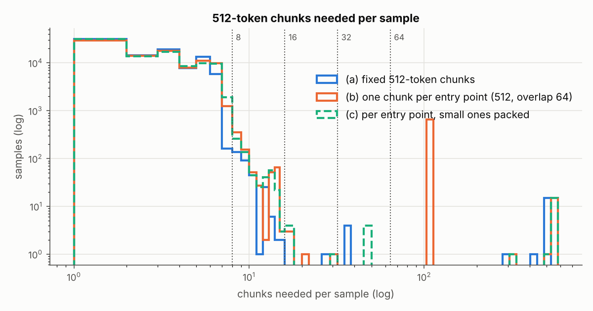
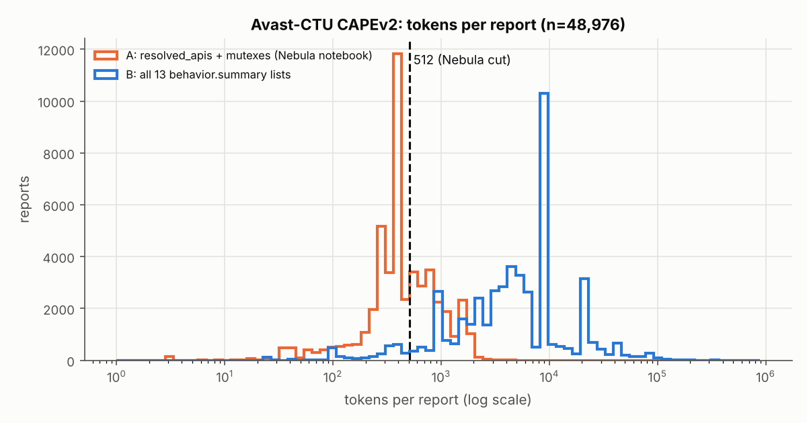
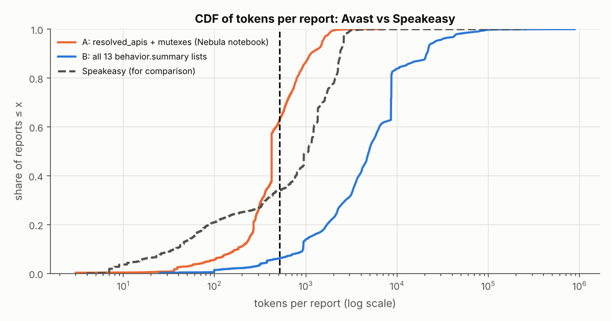
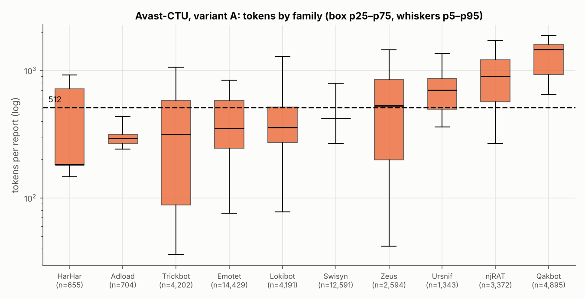
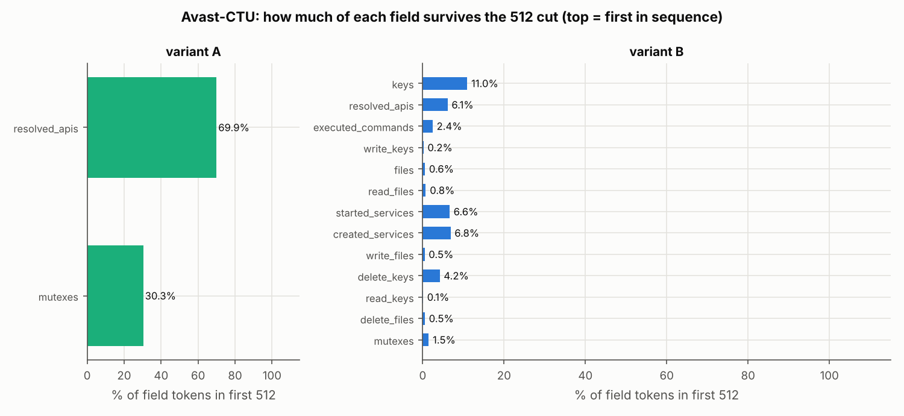
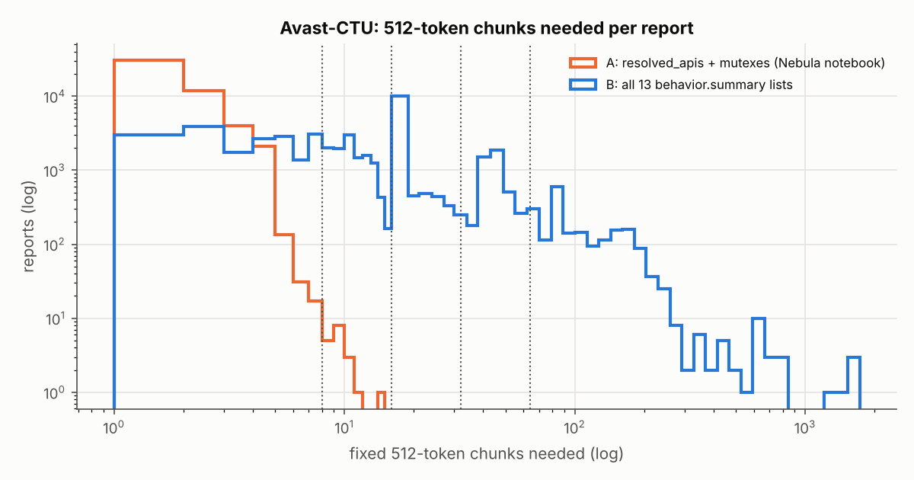

# How much does Nebula's 512-token cut throw away?

A measurement study on the full `dtrizna/quovadis-speakeasy` dataset (92,700
samples), using Nebula's own preprocessing code. Section 6 repeats it on a
second sandbox, the Avast-CTU Public CAPEv2 dataset (48,976 reports). A
two-level model built on these findings is in [`hier_nebula/`](hier_nebula/README.md).

> **Short answer.** Two out of three samples are longer than 512 tokens, and
> two thirds of all tokens are never seen by the model. What gets cut is
> almost only the API-call sequence. The reports are not very long, though:
> 99.8% of samples fit in eight 512-token chunks (4,096 tokens), because the
> emulator stopped most runs at 500 API calls. Also, 94.7% of samples have
> only **one** entry point, so chunking "by entry point / process" is in
> practice the same as cutting one long API sequence into pieces.

All numbers below were produced by `measure_lengths.py` and `analyze.py` in
this branch. The tables are pasted in automatically from
[`results/tables.md`](results/tables.md) by `build_report.py`. Raw counts are
in brackets next to every percentage.

---

## 1. Method

### 1.1 Exact preprocessing used

Nothing is re-implemented. `measure_lengths.py` imports these from a clone of
<https://github.com/dtrizna/nebula> at commit
`1343ae170ef32b01a75d2dd5fb906b5541f073df`:

| step | Nebula code |
|---|---|
| field filter | `nebula.preprocessing.tokenization.JSONFilter`, built inside `PEDynamicFeatureExtractor` with `nebula.constants.SPEAKEASY_RECORD_FIELDS` (file_access event/path, network_events.traffic server/port, registry_access event/path, apis api_name/args/ret_val). The script asserts that the filter really uses this field list. |
| record limit | `SPEAKEASY_RECORD_LIMITS = {"network_events.traffic": 256}` |
| normalisation + join | `PEDynamicFeatureExtractor.filter_and_normalize_report(entry_points)`: path and IP normalisation, non-alphanumeric characters removed from API args, then `joinRecordsToJSON()` |
| tokenizer | `JSONTokenizerBPE(vocab_size=50001, seq_len=512, model_path=nebula/objects/bpe_50000_sentencepiece.model, vocab=nebula/objects/bpe_50000_vocab.json)` |
| token count | `len(tokenizer.encode(report, pad=False)[0])`. This is the length *before* `pad_sequence()` keeps `encoded[:512]` (`tokenization.py:154-159`). |

To avoid importing torch through `nebula/__init__.py`, the script registers
empty package modules for `nebula`, `nebula.preprocessing` and
`nebula.models`, stubs `nebula.models.ember`, and builds `nebula.misc` with
only `get_alphanum_chars()`, copied word for word from the source file with
`ast` (details in [README.md](README.md)).

**Sanity check** on the example reports in `nebula/emulation/`
([log](results/logs/sanity.log)):

| report | tokens | expected |
|---|---|---|
| report_example_entrypoint_with_file | 551 | 551 |
| report_example_entrypoint_with_registry | 1,672 | 1,672 |
| report_example_entrypoint_withDNS | 1,811 | 1,811 |
| report_example_entrypoint_ransomware | 2,609 | 2,609 |
| report_example_full | 57 | 57 |

One note on `report_example_full.json`. It is a *full* Speakeasy report: a
dict with metadata and an `entry_points` list. The other four files are the
`entry_points` list itself. Passing the full dict to
`filter_and_normalize_report()` gives `{'apis': []}` = **1 token**, because
the filter finds no top-level fields. Passing `report["entry_points"]` gives
**57**, as expected. This is also what Nebula's own `emulate()` does
(`pe.py`: `self.filter_and_normalize_report(report["entry_points"])`). All
dataset files are plain lists, so this case never comes up in the dataset.

**Field order, checked in the code.** `joinRecordsToJSON()` loops over
`sorted(recordDict.keys(), reverse=True)` (`pe.py:147`). With the four field
keys this gives `registry_access` → `network_events.traffic` → `file_access`
→ `apis`, so `apis` is always last. I also checked this in the data: all
92,700 tokenized reports follow this order (table in §2.4).

**Per-field token attribution.** The tokenizer reads `str(report)`. I split
that string at the top-level `, '<key>':` boundaries, tokenized each piece
with the same `tokenizer.encode`, and **asserted** that the pieces' token
ids, joined together, equal the full report's token ids. This held for 100%
of samples (92,700 of 92,700). So the per-field counts are exact, not
estimates. A field's tokens include its own key name (for example
`file access`).

**Entry points.** Each entry point is tokenized alone with
`filter_and_normalize_report([ep])`. Chunk counts:
- **(a)** `ceil(tokens / 512)` on the whole report.
- **(b)** one chunk per entry point. An entry point over 512 tokens is split
  into 512-token pieces with 64-token overlap (stride 448), so it needs
  `1 + ceil((t-512)/448)` chunks.
- **(c)** an extra variant I added: like (b), but consecutive entry points
  shorter than 512 tokens are packed into one chunk.

### 1.2 Dataset and grouping key

`load_dataset("dtrizna/quovadis-speakeasy")` (streaming;
[log](results/logs/inspect_datasets.log)) shows:

- **Splits:** a single `train` split, built from 92,702 JSON files. The
  dataset's own train/test folders are **mixed together** in this view.
- **Columns** (first rows): `ep_type, start_addr, ep_args, apihash, apis,
  ret_val, error, network_events, dynamic_code_segments, file_access`.
  Features are reported as `None` (no fixed schema). Some raw entry points
  also have `registry_access`, `process_events`, `dropped_files` and
  `handled_exceptions` (key counts in the inspect log).
- **There is no label column and no sample-ID column.** Values are also
  type-coerced; for example `file_access` comes back as a list of JSON
  *strings*.
- **Row count:** 167,651 rows, by iterating the streaming view
  ([log](results/logs/datasets_stream_rowcount.log)). The non-streaming
  `load_dataset` **fails** with `DatasetGenerationError` (a pandas JSON parse
  error) ([log](results/logs/load_dataset_full.log)).
- Example rows 0 and 1 are printed in the
  [inspect log](results/logs/inspect_datasets.log). They are a
  `module_entry` and a `thread`.

**Grouping key = the source file path**
(`windows_emulation_{trainset,testset}/report_<family>/[<hex>/]<sha256>.json`).
The family label and the train/test split also come from this path. How I
checked it:

1. The dataset repository stores one JSON file per sample, and each file is a
   JSON **list of entry points**. That is 92,700 of 92,700 files; the
   dataset card says each file is a dict with `sha256` and `entry_points`,
   but no file has that form.
2. Adding up the entry points in all 92,700 sample files gives **167,548**.
   The two extra files at the repo root add the rest:
   `example-ransomware.json` (102 entry points) and `speakeasy-config.json`
   (an emulator config, which `datasets` turns into 1 row with no
   `ep_type`). 167,548 + 102 + 1 = **167,651**, exactly the `datasets` row
   count. The per-`ep_type` counts also match (module_entry +1, thread +101,
   None +1).
3. No column inside a row can serve as the key. `apihash` is a hash of one
   entry point's API sequence: only 6,699 distinct values exist, and 160,638
   entry points share theirs with another file.
4. No file stem (sha256) appears in more than one folder.
5. Nebula's own training pipeline (`read_and_filter_json_folders()` in
   `normalization.py`) also treats one file as one sample, takes the label
   from the folder name (`report_clean` and `report_windows_syswow64` are
   benign), and passes the whole file to `filter_and_normalize_report()`.

So I measured on the raw files (Git LFS clone of dataset revision
`fc2e98fac0b4d43a5557ccab70c877af6cce9f4d`) instead of on `datasets` rows.

### 1.3 Sample counts and what was skipped

<!-- include: Sample accounting -->

- **Skipped:** 3 empty `.err` files (failed emulations). This is why the
  trainset has 75,298 samples, not the 75,301 in the dataset card's table.
  The two root-level example/config files were also left out.
- **Dropped by Nebula's filter** (`filter_and_normalize_report` returns
  `None`, the MSVBVM60 case): **0** samples.
- **No subsampling.** I first ran a pilot on 2,000 random files (seed 0;
  [tables](results/sample2000_tables.md)). The pilot gave the same median
  (1,069) and almost the same share above 512 (66.6% vs 66.0% on the full
  data).
  Then all 92,700 samples were measured: 21.8 min on 3 cores
  ([log](results/logs/measure_full.log)). Both splits are reported
  separately everywhere.

---

## 2. Results

### 2.1 Tokens per sample (no truncation)

<!-- include: Tokens per sample (Nebula preprocessing, no truncation) -->

### 2.2 By family and split

#### testset
<!-- include: testset -->

#### trainset
<!-- include: trainset -->

### 2.3 Malware vs benign

<!-- include: Malware vs benign -->

#### Length as a shortcut, family by family
<!-- include: Length as a shortcut: each family vs clean -->

### 2.4 Which fields survive the cut

<!-- include: Which fields survive the 512 cut -->

### 2.5 Entry points and chunking

<!-- include: Entry points -->

#### Extra variant (c): packing small entry points
<!-- include: Extra variant (c): entry-point chunks with packing -->

#### What the extra entry points contain
<!-- include: What the thread entry points contain -->

### 2.6 The emulator already truncated the reports

<!-- include: Emulation cap (Speakeasy `max_api_count` = 500 in the dataset's config) -->

---

## 3. The five most important findings

1. **Most samples are cut, and most of the data is lost.** 66.0% of samples
   (61,207 of 92,700) are longer than 512 tokens. The median sample has
   1,069 tokens and loses 52.1% of them. Across the whole dataset the 512 cut
   throws away **66.6% of all tokens** (70,859,979 of 106,474,006). Train
   (67.2%) and test (63.6%) look the same.

2. **What is lost is almost only API calls. The other fields are always
   kept.** `joinRecordsToJSON()` puts `apis` last. API calls are 99.3% of
   all tokens, and only **33.0%** of API tokens survive the cut (30.2% for
   samples longer than 512). File, registry and network events come first,
   are small (medians 10, 32 and 13 tokens), and survive almost entirely
   (100.0%, 98.4%, 98.4%). Of what Nebula keeps, 97.9% is still API calls.
   An API call costs about 4.8 tokens (median 4.78), so the 512 window holds
   roughly the first ~100 API calls of a trace that can be up to 500 long.
   So your suspicion is correct: the cut removes the tail of the API
   sequence.

3. **The reports are long, but not very long, because the emulator stopped
   them.** The dataset's Speakeasy config sets `max_api_count = 500`. 18.7%
   of samples (17,327) hit this cap, and those samples have a median of
   2,364 tokens versus 798 for the rest. Because of the cap the tail is
   short: p99 is 2,989 tokens, only 0.2% (194) are above 4,096, and 99.8%
   (92,506) fit in eight 512-token chunks. The exceptions are 22 samples
   above 8,192 tokens (16 ransomware, 4 backdoor, 2 clean; median 36,906 API
   calls). They are only 0.02% of samples but hold 4.1% of all tokens. Many
   of them look like near-duplicates (same family, same size to within a few
   tokens).

4. **The "process / entry point" structure is thin.** 94.7% of samples
   (87,750) have exactly one entry point, the `module_entry`. Thread entry
   points are almost all trivial: 97.0% (64,678 of 66,704) contain exactly
   **one** API call (4 tokens, median). The long content sits inside the
   single `module_entry` (median 993 tokens; 65.3% are above 512). Only 1.3%
   of threads (863) are longer than 512. Scheme (b), one chunk per entry
   point, therefore wastes chunks. 652 samples (648 ransomware and 4
   backdoor) have exactly 102 entry points, and so need 102+ chunks under
   (b) but at most 13 when small entry points are packed (variant (c), test
   set max).

5. **Length is a weak malware-vs-benign signal, but a strong and unstable
   family signal.** Overall, malware has a *lower* median length than benign
   (950 vs 1,077). A classifier using only length gets ROC AUC 0.541 (test
   0.567), close to chance. But family by family, length separates a lot:
   backdoor vs clean AUC is 0.832 (train) / 0.753 (test). It also *drifts*
   between the January and April collections: keylogger vs clean goes from
   0.632 on train to 0.372 on test (median keylogger length 1,676 → 372).
   Nebula already sees part of this signal through padding: 41.4% of benign
   samples vs 29.9% of malware have fewer than 512 real tokens. A model that
   reads the whole report sees more length information than Nebula does.
   For backdoor vs clean, AUC is 0.677 on the truncated length versus 0.832
   on the full length (train).

---

## 4. Implications for the chunking idea

**Does the data support it?**

- **Yes, for reading past 512 tokens.** Two thirds of the API sequence,
  which is the main signal, is never seen today. A model that reads the
  rest has a lot of unused data to work with.
- **Only weakly, for using entry points / processes as the chunk unit.**
  In this dataset, 94.7% of samples have a single entry point. For them a
  "two-level model over entry points" is the same as a two-level model over
  fixed-size pieces of one API sequence. The extra entry points are almost
  all one-API-call threads. I would describe the idea as **a hierarchical
  Transformer over 512-token chunks of the report**, and use entry-point
  boundaries as extra information (for example a segment or
  entry-point-type embedding, or packing as in variant (c)). I would not use
  them as the main unit. One chunk per entry point (scheme (b)) is the worst
  option: it needs 102+ chunks for 652 samples that hold little content.

**Suggested settings**

| setting | suggestion | why (measured) |
|---|---|---|
| chunk size | **512 tokens** | Same as Nebula, so its pretrained encoder and tokenizer can be reused for the first level. |
| max chunks | **8** (= 4,096 tokens) | (a) covers 99.8% of samples completely (92,506) and 95.9% of all tokens; (c) covers 99.6% (92,344). Going to 16 adds almost nothing: 100.0% of samples, 96.1% of tokens. The tokens still missing are in the 22 outlier samples. |
| chunking scheme | fixed 512 (a), or entry-point-aware with packing (c) | (a) and (c) need the same median (3) and p90 (5 and 6) number of chunks. (b) has a p99 of 9 and a max of 576 chunks. |
| overlap | 64 if splitting inside an API sequence | Cheap: (c) still keeps 99.6% of samples within 8 chunks. |
| outliers | cap or remove the 22 samples > 8,192 tokens (and check them for duplicates) | They hold 4.1% of all tokens and would dominate any per-token loss. |

**Things to plan for before pitching**

- **A flat long-context baseline is necessary.** Because 99.8% of samples
  fit in 4,096 tokens, the obvious competitor is a plain Transformer (or
  Nebula itself) with `seq_len` 2,048 or 4,096, possibly with efficient
  attention. The hierarchical model's main advantage over it is cost: 8
  chunks of 512² attention is 1/8 of the attention work of one 4,096²
  sequence. The pitch should show either better accuracy at the same cost,
  or the same accuracy at lower cost.
- **Control for length.** Report results per family, and add a length-only
  baseline (the AUC table in §2.3 is a starting point). Consider evaluating
  on length-matched subsets, so a gain from reading more tokens is not just
  a gain from seeing the length.
- **The gain has a ceiling set by emulation.** With `max_api_count = 500`,
  even a perfect long-context model only sees about 6× more data than
  Nebula (p99 2,989 tokens). Re-emulating with a higher cap would make the
  long-context argument stronger, but that is a separate data effort.

---

## 5. Caveats

- **This dataset, this preprocessing.** All numbers are for
  quovadis-speakeasy with the field list, record limits and 50k BPE
  tokenizer in the Nebula repository at the commit above. A different field
  set or vocabulary would change the absolute lengths. The paper's ablations
  may have used other settings.
- **The reports are already cut by the emulator** (`max_api_count = 500`,
  60 s timeout). The lengths here describe this dataset, not real program
  behaviour. 28.0% of the samples longer than 512 tokens (17,131) hit the
  cap. Some entry points carry the `max_api_count` error with fewer than 500
  calls (count in §2.6), so the counter seems to be shared across a
  sample's entry points.
  Also, 16 ransomware samples went far past the cap (36,906 calls); I did
  not investigate why.
- **Labels and splits come from folder names**, as in Nebula's own pipeline.
  `report_windows_syswow64` (294 samples) counts as benign.
- **Entry points tokenized alone** add up to 0.08% more tokens than the
  whole report, because each one repeats the field key names. Chunk counts
  for (b) and (c) use these per-entry-point tokens.
- **Chunk counts are a simulation** of how many 512-token pieces each scheme
  needs. They say nothing about model accuracy.
- **Near-duplicates were not removed.** The 22 longest samples look like
  repeated variants of a few programs. Results that weight every token (the
  "share of tokens dropped") are affected by them. Results that weight every
  sample (medians, percentages of samples) are not much affected.
- **The `datasets` library view** was used only for the schema and the row
  count. The full non-streaming `load_dataset` fails on this repository (log
  linked in §1.2). All measurements use the raw JSON files at the same
  dataset revision, which is also how Nebula's own preprocessing reads them.

---

## 6. Second sandbox: Avast-CTU Public CAPEv2

Sections 1–5 cover Speakeasy, an emulator. This section repeats the 512-cut
measurement on reports from a real sandbox, CAPEv2. The data is the
**Avast-CTU Public CAPEv2 dataset**
(<https://github.com/avast/avast-ctu-cape-dataset>, repository commit
`b4210e5caf2829fbef13a49b40a7690d1b805ab5`), **reduced reports** version
(48,976 reports, MIT licence). A third sandbox ("mcd") is left for later.

### 6.1 Method, and how it differs from Speakeasy

**What the data contains.** Each reduced report has `behavior.summary` (13
lists: `keys`, `resolved_apis`, `executed_commands`, `write_keys`, `files`,
`read_files`, `started_services`, `created_services`, `write_files`,
`delete_keys`, `read_keys`, `delete_files`, `mutexes`) and `static.pe`.
Labels (family, type, detection date) come from `public_labels.csv`.
Compared with Speakeasy:

- **Every report is malware** (10 families). There is no benign class, so
  the malware-vs-benign comparison cannot be made. Length as a shortcut is
  checked family against family instead.
- **There is no time-ordered API trace and no process tree.**
  `resolved_apis` is the *set* of API names the program looked up.
  Per-process calls exist only in the full reports (13 GB download), so the
  entry-point / per-process chunking analysis (§2.5) **cannot be repeated on
  this data**. Only fixed 512-token chunks are measured.

**Preprocessing.** Nebula has no finished Avast pipeline (no Avast tokenizer
ships in `nebula/objects/`). The study follows the two pieces of Avast code
that Nebula does have:

| step | source in Nebula | used here |
|---|---|---|
| fields | `scripts/concept-testing/preprocessing/avast_1_preprocessing/initial.ipynb` keeps `behavior.summary.resolved_apis` and `.mutexes`, each value lower-cased | **variant A**, same fields, same order (`resolved_apis` first) |
| train/test split | same notebook: detection date before `2019-08-01` = train | same: 37,512 train / 11,464 test |
| tokenizer | `preprocess_nebula_avast()` in `nebula/preprocessing/wrappers.py` trains a new `JSONTokenizerBPE` (vocab 50,000, `JSON_CLEANUP_SYMBOLS`, `stopwords=[]`) on the training split | same call, `JSONTokenizerBPE.train()`, on all 37,512 training records (variant A) |
| cut | `pad_sequence()` keeps the first 512 tokens | same |

**Variant B** is my own sensitivity check, not Nebula code. It keeps all 13
summary lists (lower-cased, in the order they are stored in the reports),
with its own 50k BPE tokenizer. That tokenizer was trained on 5,000 random
training reports (seed 0), to keep SentencePiece's training time and memory
manageable: the 13 lists are much larger than the two in variant A. Variant B shows how
much the answer depends on the field choice.

The Nebula notebook was written as concept testing, and Nebula's README warns
that those files may not match the paper. So treat the Avast numbers as
"Nebula-style", not as an exact reproduction of the paper's Avast setup.

Scripts: `measure_avast.py` (tokenizer training + measurement),
`analyze_avast.py` (tables, plots, Speakeasy comparison),
`make_avast_examples.py` (example reports in `examples/avast/`).
Tables: [`results/avast/tables.md`](results/avast/tables.md).

Example reports (one per split and family, raw + record + tokens):
[`examples/avast/`](examples/avast/README.md).

### 6.2 Avast results

<!-- include: avast: Avast sample accounting -->

#### Tokens per report (no truncation)
<!-- include: avast: Avast tokens per sample (no truncation) -->

#### By family (variant A)

trainset:
<!-- include: avast: Avast trainset (variant A) -->

testset:
<!-- include: avast: Avast testset (variant A) -->

Variant B, all splits:
<!-- include: avast: Avast tokens per sample by family (variant B, all splits) -->

#### Which fields survive the cut

Variant A:
<!-- include: avast: Avast fields, variant A -->

Variant B:
<!-- include: avast: Avast fields, variant B -->

#### Chunks needed
<!-- include: avast: Avast: fixed 512-token chunks needed -->

#### Length as a family shortcut
<!-- include: avast: Avast: length as a family shortcut -->

#### Speakeasy vs Avast side by side
<!-- include: avast: Sandbox comparison -->

### 6.3 What Avast adds to the picture

1. **With Nebula's field choice, Avast reports are shorter than
   Speakeasy's.** Variant A has a median of 422 tokens (Speakeasy: 1,069).
   37.4% of reports (18,306 of 48,976) are longer than 512, and the cut
   drops 30.9% of all tokens (Speakeasy: 66.0% of samples and 66.6% of
   tokens). Four 512-token chunks already cover 99.6% of all variant-A
   tokens, and 8 chunks cover 100.0% of reports (48,963 of 48,976). The
   train split is longer than the test split (33.5% vs 20.5% of tokens
   dropped).
2. **The cut removes the mutexes.** `resolved_apis` comes first and
   makes up 97.9% of the tokens, so `mutexes`, the only other field, is
   placed after it. Only 30.3% of mutex tokens survive, and in **53.4% of
   the reports that have mutexes (16,885 of 31,620) all of them are cut**.
   This mirrors Speakeasy, where the field that comes last (`apis`) is the
   one that gets cut.
3. **The answer depends heavily on which fields you keep.** Keeping all 13
   summary lists (variant B) gives a median of 4,917 tokens. 93.8% of
   reports are above 512, 94.3% of tokens are dropped, and the p99 report
   needs 148 chunks. Even 32 chunks cover only 72.4% of the tokens.
   Variant B's first 512 tokens are mostly registry `keys` (47.6% of all
   tokens, and the first field), so the `resolved_apis` that Nebula relies
   on are fully cut in 80.4% of reports. For a richer CAPE representation
   the chunking idea becomes necessary, not optional, but it would need a
   field order or field budget, not just more chunks.
4. **Length is a strong family signal on Avast too.** Qakbot is longer than
   every other family (one-vs-rest AUC from length alone: 0.960 on test),
   and njRAT too (0.822). Trickbot gets *shorter* between train and test
   (median 361 → 104 tokens), so length also drifts over time. A model that
   reads more chunks gets more of this signal, so per-family evaluation
   matters here as well.
5. **Per-process chunking cannot be tested on this data.** The reduced
   reports keep no process tree or call order. The full reports (13 GB
   download) would be needed for that, and they were not used.

**For the chunking design:** on Nebula-style Avast input, 512-token chunks
with **max 4–8 chunks** are enough (4 chunks cover 99.6% of tokens). On
Speakeasy, 8 are needed. One setting of **chunk size 512 and max 8 chunks**
therefore covers both datasets with Nebula's field choices.
