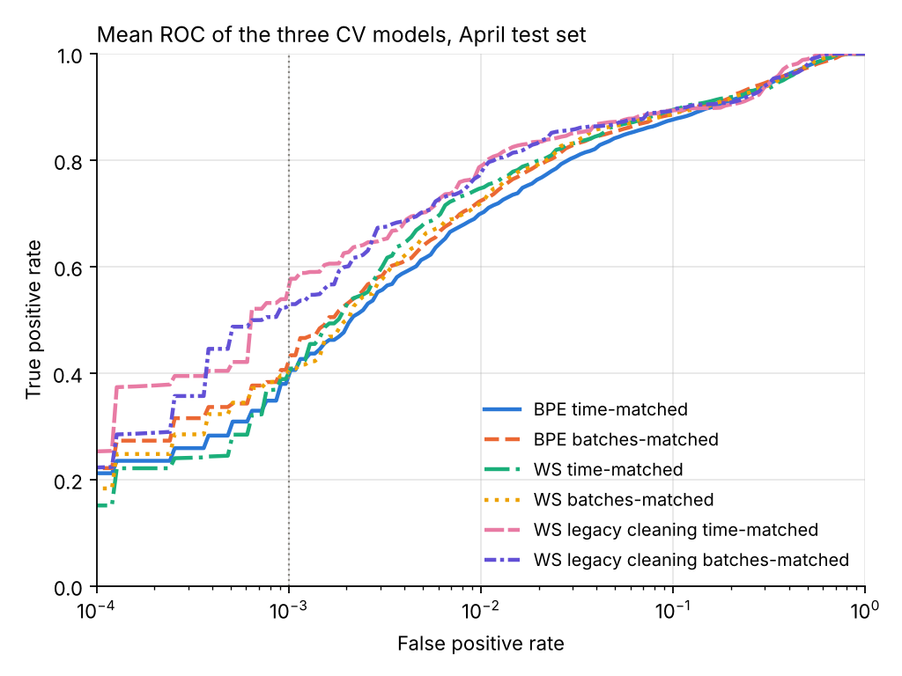

# Reproducing Nebula (Trizna et al., arXiv 2310.10664v2) with the authors' code: baseline report

**Status: final for the experiments A, B, C, E and most of D (the raw-JSON ablation of the paper's Table 5 was not run, §6).
All tables are generated by `python -m baseline.report` into `results/baseline/tables.md`; this file copies the important ones.**

The goal is a trusted baseline: trained models and numbers that can be compared with the paper, using the authors' own code,
including self-supervised pre-training, on Kaggle GPUs. Faithfulness to the paper matters more than clean code. Within ±2–3
percentage points counts as a match.

## 1. What was run

| item | value |
|---|---|
| Authors' code | <https://github.com/dtrizna/nebula>, commit **`1343ae170ef32b01a75d2dd5fb906b5541f073df`** (git submodule `third_party/nebula`) |
| Patches to their code | 4 one-line library-compatibility fixes in `nebula/lit_utils.py` (`patches/0001..0004`, §3). No logic changed |
| Data | Kaggle `dmitrijstrizna/quo-vadis-malware-emulation` (id 3231810): train = January 2022 (75,298 reports), test = April 2022 (17,402 reports). **Not** the 98,966 / 27,500 of the paper's Table 3 (§6) |
| Preprocessed data | private Kaggle dataset `msingh9365/nebula-baseline-tokens` |
| Trained models | private Kaggle dataset `msingh9365/nebula-baseline-models` (105 models, about 1.7 GB); tokenizers, manifest, loader and the AR-pre-trained encoders (before fine-tuning, 5 seeds) are in `baseline_models/` in git |
| GPU | Kaggle NVIDIA T4 (x2 per session); the paper used a Quadro T2000 |
| Seeds | detection: the same 3-fold CV (`KFold(3, shuffle=True, random_state=1763)`) repeated with training seeds 0, 1, 2 (9 fold models per row); classification and ablations: seed 0 (3 fold models); self-supervised: 5 seeds (0 to 4), each with its own stratified 80/20 split |
| Environment | Python 3.13 (Kaggle), package versions are logged in every `results/baseline/*/metrics.json` (`env`) |

## 2. What is theirs and what is ours

| step | theirs (called, not rewritten) | ours (new code in `baseline/`) |
|---|---|---|
| Report reading and labels | `read_and_filter_json_folders` | driver that runs it once per folder in parallel (`preprocess.py`) |
| Field filter, normalization | `PEDynamicFeatureExtractor.filter_and_normalize_report` | none |
| Tokenizers | `JSONTokenizerBPE`, `JSONTokenizerNaive` (train and encode) | none; fit on the training split only |
| Model | `TransformerEncoderChunks`, `TransformerEncoderModel` (incl. `causal_attention`, `pretrain_layers`) | `CausalLastTokenClassifier` (reads the last non-pad token) |
| Supervised training | `ModelTrainer` (AdamW, BCE / cross-entropy, time budget, clipping) | the 3-fold loop with test evaluation and the exact-N-batches stop (`cv.py`) |
| Metrics | `get_tpr_at_fpr` | F1/accuracy at 0.5, per-class F1, ROC on a log grid, aggregation (`common.py`) |
| MLM pre-training | `MaskedLanguageModelTrainer`, `LitTrainerWrapper`, `PyTorchLightningModelLM` | validation-loss callback; per-position BERT MLM as a second variant |
| AR pre-training | `AutoRegressiveModelTrainer` (unfinished in their repo), causal `TransformerEncoderModel` | full-512-token, padding-ignoring subclass |
| Fine-tuning | `LitTrainerWrapper` | weight transfer + checksum proof; the 80/20 stratified split |
| Reports, plots, loader | none | `report.py`, `package_models.py`, `baseline_models/load_baseline.py` |

Unit tests (`baseline/tests/`, all pass): masking is 15% with an 80/10/10 split for their MLM trainer and ours; the causal model cannot
see later tokens (with a control that shows the test can fail); the LM loss at the start is about ln V = 9.0; fine-tuning really
starts from the pre-trained weights (encoder checksum equal, distance to the pre-trained weights 0); the CV loop stops after exactly N
batches and the time budget stops training; the preprocessing driver gives **bit-identical token arrays and labels** to their wrapper
`preprocess_nebula_speakeasy` (BPE and Whitespace).

## 3. Patches to their code

See `NOTES.md` §5 for the full list with the errors they fix. All four are in `nebula/lit_utils.py` and are needed for Lightning ≥ 2.1:
`lightning.lite` → `lightning.fabric` import; `accumulate_grad_batches=None` → `1`; `optimizer_zero_grad(..., optimizer_idx)` made
optional; the masked-LM multi-hot target is no longer cast to int64. Found but not patched: the older `SelfSupervisedPretraining`
pipeline passes `forward_pass=` to `ModelTrainer` (it expects `modelForwardPass`), and their example `train_example_lit_mlm_eval.py`
uses `pooling=None`, which cannot run.

## 4. How to read the numbers

- **Metric.** TPR at FPR 1e-3 uses the authors' `get_tpr_at_fpr`. The April test set has 8,003 benign reports, so FPR 1e-3 allows
  8 false alarms and the number moves in steps of 1/8,003. F1 and accuracy are at threshold 0.5 (the paper's F1 0.9136 cannot be an F1 at
  the FPR-1e-3 threshold next to TPR 0.52; we also give that F1 in `tables.md`).
- **Float32 saturation (ours, important).** After the sigmoid in float32, 22 to 105 benign and thousands of malware reports score exactly 1.0.
  More than 8 benign in the top tie means the ROC has no point at FPR ≤ 1e-3, and their function returns **0.0**. This is an
  output-precision artifact, not a property of the model. We therefore rank by the **logit** (same forward pass, no sigmoid) and call
  this the headline number. The literal numbers are kept in every `metrics.json` as `test_p32` and in the tables (column "literal float32").
- **Mean ± std** is over the fold models (population std, like their CV code). Detection rows pool 3 CV repeats (9 models); the
  paper has one CV (3 models) and does not give a std for the test numbers. A single CV of ours (3 models) can differ from the pooled mean
  by a few points (§5.1 shows the spread).
- **Time-matched** = 5 minutes per fold with their `time_budget`. A T4 is much faster than the paper's Quadro T2000, so it sees about 5,000
  batches, not 2,116. **Batch-matched** = exactly 2,116 (BPE) or 2,159 (Whitespace) batches (verified by an assertion in the code).
- Settings of all runs: batch 96, AdamW, lr 2.5e-4, weight decay 1e-2, static lr, dropout 0.3, gradient clipping 0.5 (inside their trainer).
  The fold models are the final weights; nothing is selected on the test set.

## 5. Results

### 5.1 Experiment A: detection (paper Table 7)

Paper values are the authors' own; "ours" is the pooled mean over 3 CV repeats (9 fold models) on the **published** April test set (17,402
reports), which is **not the paper's test set** (§6.1). GPU: Tesla T4 (1 GPU per run).

| run | batches / fold | test TPR@1e-3 | test AUC | test F1 | test Acc | val F1 |
|---|---|---|---|---|---|---|
| **paper** Nebula BPE (2,116 batches, Quadro T2000) | 2,116 | **0.5213** | 0.9657 | 0.9136 | 0.9104 | 0.9847 |
| ours BPE, time-matched (5 min) | 5,023 (4,976 to 5,081) | 0.406 ± 0.073 | 0.9521 ± 0.0091 | 0.8967 ± 0.0170 | 0.8929 ± 0.0180 | 0.9839 |
| ours BPE, batch-matched | 2,116 | 0.434 ± 0.073 | 0.9546 ± 0.0066 | 0.8967 ± 0.0132 | 0.8921 ± 0.0150 | 0.9837 |
| **paper** Nebula Whitespace (2,159 batches) | 2,159 | **0.5703** | 0.9664 | 0.9058 | 0.9053 | 0.987 |
| ours Whitespace, pinned-repo cleaning, time-matched | 5,017 | 0.409 ± 0.113 | 0.9553 ± 0.0112 | 0.8930 ± 0.0197 | 0.8932 ± 0.0178 | 0.9888 |
| ours Whitespace, pinned-repo cleaning, batch-matched | 2,159 | 0.408 ± 0.083 | 0.9555 ± 0.0099 | 0.9047 ± 0.0050 | 0.9031 ± 0.0045 | 0.9864 |
| ours Whitespace, **legacy cleaning** (ours, inferred), time-matched | 5,027 | **0.577 ± 0.022** | 0.9601 ± 0.0040 | 0.9055 ± 0.0184 | 0.9045 ± 0.0169 | 0.9889 |
| ours Whitespace, legacy cleaning, batch-matched | 2,159 | 0.530 ± 0.050 | 0.9584 ± 0.0030 | 0.9067 ± 0.0110 | 0.9036 ± 0.0115 | 0.9855 |

(The legacy rows are one CV repeat, 3 models.) ROC curves (mean of the fold models, log FPR axis, April test set):
`results/baseline/plots/roc_detection.png`.

**Match or not (±2 to 3 points):**

| metric | BPE | Whitespace, legacy cleaning | Whitespace, pinned cleaning |
|---|---|---|---|
| AUC | match (−1.4 points, time-matched) | match (−0.6) | match (−1.1) |
| F1, accuracy (0.5) | match (−1.7 / −1.8) | match (0.0 / 0.0) | match (−1.3 / −1.2) |
| validation F1 | match (−0.1) | match (+0.2) | match (+0.2) |
| **TPR@1e-3** | **not a match: −11.5 points (time), −8.8 (batches)** | match time-matched (+0.7); batch-matched −4.1, just outside | **not a match: −16 points** |

Where the single CV repeats stand: for BPE time-matched the three repeats give 0.396, 0.453, 0.369 (mean of 3 models each); for batch-matched
0.371, 0.507, 0.423. Single fold models range from 0.28 to 0.54, so the paper's 0.5213 is inside the range of single models but above
most of them. The authors' own released BPE model, scored on our test set with the same code, gives **0.5185** (§5.5), which is close to
their 0.5213. TPR@1e-3 is the noisiest metric of the paper: it is the TPR at 8 false alarms.

### 5.2 Experiment B: self-supervised pre-training (paper Fig. 6)

BPE vocabulary 8,192; training January split 80/20 by family (stratified); 5 seeds; mean ± std over seeds on the April test set (logit-ranked).
Pre-training: 3 epochs on the unlabeled 80% (98%/2% train/validation, LM validation loss logged); fine-tuning 10 epochs on the labeled 20%.
Upper bound: 100% supervised, same 10 epochs. Lower bound: the 20% only, no pre-training.

| run | seeds | TPR@1e-3 | TPR@1e-2 | TPR@1e-1 | AUC | F1 |
|---|---|---|---|---|---|---|
| upper bound (100% supervised) | 5 | 0.387 ± 0.061 | 0.761 | 0.900 | 0.9635 | 0.9085 |
| lower bound (20% supervised) | 5 | 0.350 ± 0.069 | 0.622 | 0.866 | 0.9456 | 0.8845 |
| MLM, authors' multi-hot target | 5 | 0.350 ± 0.035 | 0.648 | 0.880 | 0.9505 | 0.8884 |
| MLM, per-position BERT (ours) | 5 | 0.412 ± 0.057 | 0.669 | 0.899 | 0.9578 | 0.8835 |
| AR, flatten classifier | 5 | 0.358 ± 0.025 | 0.645 | 0.832 | 0.9352 | 0.8452 |
| AR, last-non-pad-token classifier | 5 | 0.420 ± 0.055 | 0.665 | 0.906 | 0.9622 | 0.8862 |
| control: full attention, 20%, no pre-training | 5 | 0.351 ± 0.057 | 0.659 | 0.843 | 0.9422 | 0.8513 |
| control: full attention, 100%, no pre-training | 5 | 0.424 ± 0.052 | 0.749 | 0.842 | 0.9500 | 0.8757 |

Fig. 6 replica (mean ROC over the 5 seeds): `results/baseline/plots/fig6_replica.png`.

What this shows, and what it does not:

- **The paper's headline gap is not reproduced at FPR 1e-3.** The upper bound is only 3.6 points above the lower bound here (paper: about 15),
  and the seed-to-seed std is 6 to 7 points, so at 1e-3 **no ordering of the runs can be claimed**. All pre-trained runs are inside the noise
  of both bounds.
- **At FPR 1e-2 and 1e-1 the order is clear and matches the paper's story:** upper bound 0.76 > pre-trained runs 0.645 to 0.669 > lower bound 0.62
  (TPR@1e-2); AUC upper 0.964, per-position MLM 0.958, AR last-token 0.962, lower 0.946. In AUC, per-position MLM closes about 70% of the gap between the
  bounds and AR last-token about 93%; their multi-hot MLM closes about 27% and AR flatten none. No pre-trained run reaches the upper bound at 1e-2.
- **Their MLM (multi-hot target)** is about as good as the lower bound (0.350 against 0.350), while **per-position BERT MLM (ours)** and the
  **AR last-token classifier** are better than the lower bound by 6 to 7 points at 1e-3 and by about 5 points in TPR@1e-2.
  The AR flatten classifier is the weakest pre-trained run (AUC 0.935, below the full-attention lower-bound control at 1e-1).
- The pre-training does learn: validation LM loss of AR goes from about 1.95 (end of epoch 1) to 1.31 to 1.37 (epoch 3), depending on the seed; per-position
  MLM from 4.1 to 3.5. (Their multi-hot MLM loss is a sum over the vocabulary and is not comparable to ln V.) The first AR value is
  already well below ln 8192 = 9.01 because it is measured at the end of epoch 1; the unit test checks the loss at step 0 (≈ ln V).
- **Weight transfer is proven in every run** (`weight_proof` in each `metrics.json`): the pre-trained encoder has the same checksum after loading
  into the downstream model (abs-sum 226,297.527 and the same sha256 prefix, distance to the pre-trained weights 45.6 before loading and
  0.0 after).

### 5.3 Experiment C: classification (paper Table 9, "Table 12b" in the task text)

Per-class F1, mean of the 3 fold models, April test set (one CV, seed 0). The paper has no macro numbers.

| | clean | backdoor | coinminer | dropper | keylogger | ransomware | rat | trojan |
|---|---|---|---|---|---|---|---|---|
| **paper** BPE | 0.853 | 0.855 | 0.630 | 0.285 | 0.130 | 0.742 | 0.368 | 0.683 |
| ours BPE, time-matched | 0.894 | 0.884 | 0.669 | 0.392 | 0.598 | 0.734 | 0.518 | 0.686 |
| ours BPE, batch-matched | 0.880 | 0.830 | 0.637 | 0.361 | 0.314 | 0.719 | 0.525 | 0.678 |
| **paper** Whitespace | 0.824 | 0.832 | 0.621 | 0.462 | 0.118 | 0.652 | 0.185 | 0.649 |
| ours Whitespace (pinned), time-matched | 0.870 | 0.847 | 0.627 | 0.203 | 0.201 | 0.713 | 0.223 | 0.671 |
| ours Whitespace (legacy), time-matched | 0.873 | 0.894 | 0.634 | 0.445 | 0.344 | 0.722 | 0.463 | 0.749 |

Macro F1 (ours): BPE 0.672 (time) / 0.618 (batches); Whitespace pinned 0.544 / 0.527; Whitespace legacy 0.640 / 0.626. Full table: `tables.md` §C.

- The large classes (clean, backdoor, coinminer, ransomware, trojan) are within about ±4 points of the paper for BPE: a match. Our clean
  and backdoor are 3 to 4 points higher.
- The small classes are not reliable. The test set has few droppers, keyloggers and RATs (§6.1), so one fold model can change the class F1 by
  10 to 30 points. Keylogger F1 is 0.598 (time-matched), 0.314 (batch-matched) and 0.13 in the paper. We do **not** claim a match for these
  classes. Ours is higher than the paper for dropper, keylogger and RAT with BPE. With the pinned Whitespace cleaning, dropper and RAT
  drop to 0.20 and 0.22 (BPE: 0.39 and 0.52); with the legacy cleaning they are 0.45 and 0.46.

### 5.4 Experiment D: ablations (lowest priority)

Vocabulary size (paper Table 4, validation metrics, seed 0, time-matched): validation AUC and F1 match the paper to within 1 point for all five
sizes (for example 50k: AUC 0.9965 / F1 0.9839 against 0.9976 / 0.9856). Validation TPR@1e-3 is **lower than the paper**
(0.58 to 0.72 against 0.78 to 0.86; 10 to 26 points lower), and the std over 3 folds is 7 to 17 points: no ordering of vocabulary sizes can be read from our runs.

Sequence length (paper Fig. 3c, fixed 5-minute budget): validation F1 rises from 0.962 (N=64) to 0.985 (N=1024) and is flat from 512 to 2048
(0.984, 0.985, 0.983); test F1 0.859 (64), 0.874 (128), 0.882 (256), then a **plateau at 0.897 for 512, 1024 and 2048**. The paper's peak at
512 is not visible: longer inputs are not worse here, but they are not better either, and they see fewer batches (5,023 at 512, 1,331 at 2048).

Tokenizer (paper Table 6): Whitespace legacy cleaning (TPR 0.577, AUC 0.960) > Wordpunct (0.480, 0.953) > BPE (0.406, 0.952) ≈ Whitespace with the
pinned cleaning (0.409, 0.955). The paper has Whitespace 0.570 ≈ Wordpunct 0.554 > BPE 0.521. AUC and F1 agree with the paper within 2 to 3 points
for all three tokenizers; the TPR@1e-3 differences are the noisy metric of §5.1.

Not run: the paper's Table 5 (raw JSON against filtered input), because it needs a tokenizer trained on the full raw corpus.

### 5.5 Experiment E: the authors' released checkpoints on our April test set

Same cleaning and tokenizer files as the released objects (`nebula/objects/`), same code, no retraining.

| model | TPR@1e-3 | AUC | F1 (0.5) | Acc (0.5) | AUC on the January training reports |
|---|---|---|---|---|---|
| released Nebula BPE | **0.5185** | 0.9586 | 0.8854 | 0.8857 | 0.9981 |
| released Nebula Whitespace, pinned-repo tokenizer | 0.0205 | 0.7401 | 0.7554 | 0.6974 | 0.7807 |
| released Nebula Whitespace, legacy cleaning (ours, inferred) | 0.2060 | 0.9247 | 0.8439 | 0.8494 | 0.9865 |

The released BPE checkpoint behaves as the paper says (TPR@1e-3 0.5185 against 0.5213, AUC 0.959 against 0.966): **the pipeline, the checkpoint and
our April test set are consistent with the paper to within 1 to 2 points on AUC.** It also reaches AUC 0.998 on the January reports, because it was trained on
them. The released Whitespace checkpoint only works with the old cleaning (AUC 0.925), not with the pinned repo's tokenizer (AUC 0.74): §6.2.

### 5.6 Compute

| item | value |
|---|---|
| GPU | Tesla T4, 14.6 GB (Kaggle, one process per GPU; sessions have 2 GPUs) |
| Batches seen per fold | time-matched: BPE 5,023 (4,976 to 5,081), Whitespace 5,017 (4,941 to 5,091), legacy 5,027; batch-matched: exactly 2,116 / 2,159 (asserted). Sequence-length runs: 23,699 (N=64) down to 1,331 (N=2048) |
| Epochs per fold | about 9.6 epochs at 5,023 batches (50,199 training reports per fold, 523 batches per epoch); 4.0 epochs at 2,116 batches |
| Training GPU-time (sum of per-model training seconds) | detection 2.5 h, classification 1.1 h, ablations 2.5 h, self-supervised fine-tuning 4.1 h, pre-training 1.2 h = **11.4 h** |
| Kaggle quota used | **10.85 h of 30 h this week** by the whole account (including 3.4 h before this study); 19.15 h left. Two GPUs were used in parallel, which is why quota time (about 7.5 h for this study) is lower than the sum of training times |

`NOTES.md` §8 has the per-job log.

## 6. Differences from the paper, with likely causes

### 6.1 The data is not the paper's data
The published dataset has 75,298 training and 17,402 test reports. The paper's Table 3 has 98,966 and 27,500, with a different test mix (for example
252 droppers here against 2,500 in the paper, 7,944 benign against 10,000), and the paper's own text says "approximately 93,500". The published April
set is therefore not the set of the paper, and exact agreement is not expected. Rare classes (dropper, keylogger, RAT) are the most affected (§5.3).

### 6.2 The Whitespace tokenizer in the repo cannot reproduce the released Whitespace model
The released vocabulary contains `apiname`, `retval`, `kernel32getprocaddress` and keeps `args`, `event`, `path`: punctuation was **deleted** and stopwords were
**kept**. The pinned `JSONTokenizerNaive` turns punctuation into spaces and removes stopwords. We run Whitespace both ways (`ws50k` = pinned code, `ws50k_legacy`
= our inferred cleaning, in `baseline/preprocess.py`). With the legacy cleaning our Whitespace numbers match the paper (TPR 0.577 against 0.570, F1 0.9055
against 0.9058, AUC 0.960 against 0.966) and the released Whitespace checkpoint works (AUC 0.925 against 0.74). With the pinned code they do not. **This is a finding about their repo,
not about the method.** The legacy cleaning is inferred from the vocabulary, not copied from their code.

### 6.3 BPE TPR@1e-3 is lower than the paper (open)
Ours is 0.41 (time) / 0.43 (batches) against 0.521. Everything else for BPE is within tolerance. What we know: the released BPE checkpoint reaches 0.5185 on our
test set, so the data and the metric are not the cause; single fold models range from 0.28 to 0.54 and one repeat (batch-matched, seed 1) averages 0.507; the metric has
only 8 allowed false alarms. Likely causes, **not tested**: (a) a different training set (§6.1: 23,000 fewer training reports than in the paper, including different families) and a
different test mix; (b) the released model was trained longer or on more data than the 5-minute recipe; (c) the paper's single CV might be a favorable draw; (d) T4 against T2000
(same recipe, but non-deterministic kernels and a different number of batches). We did not find a bug on our side: preprocessing is bit-identical to their wrapper (unit test),
the batch counts are enforced, and the TPR function is theirs. The gap is reported as it is.

### 6.4 Float32 saturation of the TPR@1e-3 metric
Described in §4. With their metric as written, our BPE models would score 0.0 on TPR@1e-3 (column "literal float32" in `tables.md`). The released BPE checkpoint, in contrast, gives
0.5171 literal and 0.5185 logit-ranked: its output is less saturated. The paper's number may have been computed on less saturated outputs (for example fewer epochs, different dropout, or
a CPU float64 path); we cannot tell.

### 6.5 Self-supervised results at FPR 1e-3
Paper: pre-training gives a clear gain at 1e-3 (upper − lower about 15 points). Ours: upper − lower is 3.6 points with a seed std of 6 to 7 points, so the comparison is not resolved at that
operating point (§5.2). At 1e-2 and 1e-1 it is clear. Likely causes: our pre-training budget (3 epochs; the paper does not give one), the size of our labeled 20% (15,060 reports, because
our January set is smaller than the paper's), and the noise of a metric defined by 8 benign reports. Other differences in the setup, all from their code and documented in `NOTES.md` §4: their MLM predicts
which token ids were masked (a multi-hot target) instead of the token at each masked position; their AR trainer is unfinished and we wrote the full-length padding-ignoring variant (ours);
their evaluation framework picks checkpoints on the test set and splits without stratification, so we do not use it.

### 6.6 Classification of small classes
Keylogger, dropper and RAT F1 vary by 10 to 30 points between time- and batch-matched runs and between tokenizers (§5.3), because the test set has few examples. We do not claim a match for them.

### 6.7 Smaller points
- Parameters: 5.397 M in their code against "about 5.6 M" in the paper.
- Domain normalization (`<domain>`) is described in the paper but their code never calls it; BPE has no byte fallback in the code although the paper says so. We follow the code.
- Batch size 96, 5-minute budget and batch counts are in the paper but not in the repo; we use the paper's values.
- Table numbering: the task text calls the classification table "Table 12b"; it is Table 9 in arXiv v2. Whitespace F1 is 0.9068 in the paper's Table 6 and 0.9058 in Table 7.
- The sequence-length ablation does not show the paper's peak at 512 (a plateau instead, §5.4).
- Not run: raw-JSON ablation (Table 5).

## 7. Files

| what | where |
|---|---|
| This report, the map of their repo, the gaps | `REPRODUCTION_REPORT.md`, `NOTES.md` |
| Metrics (JSON, per fold, with config, environment, batches seen) | `results/A_detection/`, `results/B_selfsup/`, `results/C_classification/`, `results/D_ablations/`, `results/E_released/` |
| Tables, ROC plots, Fig. 6 replica | `results/baseline/tables.md`, `results/baseline/plots/` |
| Logs | `results/baseline_logs/` |
| Models and loader | `baseline_models/` (git), private Kaggle dataset `msingh9365/nebula-baseline-models` (weights) |
| Code | `baseline/` (ours), `third_party/nebula` (theirs, pinned) + `patches/` |
| Tests | `baseline/tests/` (`python -m pytest baseline/tests`) |
