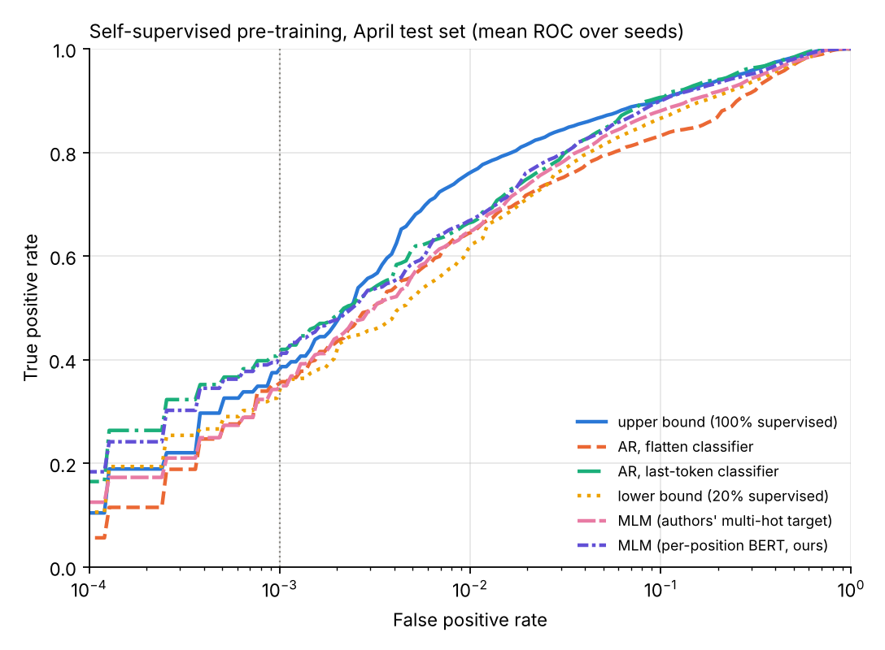
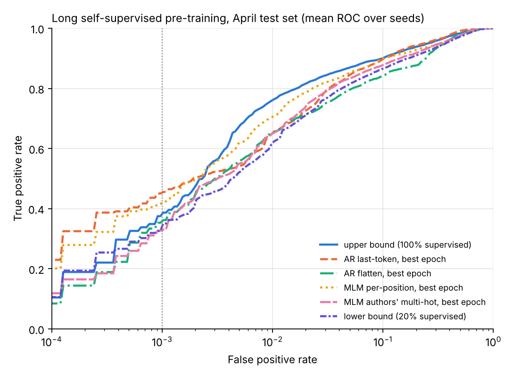
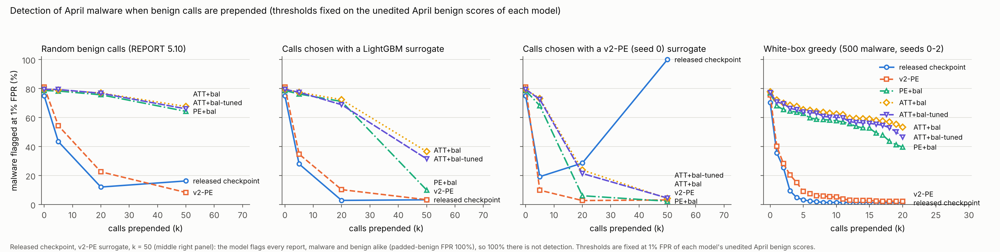

# Reproducing Nebula (Trizna et al., arXiv 2310.10664v2) with the authors' code: baseline report

**Status: final for the experiments A, B, B2 (longer pre-training), B3 (Fig. 6 with the v2 recipe, §5.2c), F (closing the gap to the released model, §5.7), the low-FPR metric and the evaluation protocol (§5.8, `EVAL_PROTOCOL.md`), the v2-PE baseline (§5.9), ATT+bal and the padding test (§5.10), C, E and most of D (the raw-JSON ablation of the paper's Table 5 was not run, §6).
All tables are generated by `python -m baseline.report` into `results/baseline/tables.md`; this file copies the important ones.
Follow-up B2 (§5.2b): pre-training up to 15 epochs does **not** reproduce the paper's Fig. 6 gap at FPR 1e-3 (the bounds themselves are
3.6 points apart, CI [−2.6, +11.5]); at FPR 1e-2 the bounds are 13.8 points apart and pre-training closes part of that gap, mostly already at 3 epochs.
Follow-up F (§5.7, §6.3): the released model's advantage (TPR@1e-3 0.52 against our 0.41) came from the training recipe (learning rate and over-training), not from data, tokenizer or evaluation. **The baseline from now on is baseline v2**
(`load_baseline("bpe_v2", seed=k)`: lr 2e-3, 90% of January, 2 epochs, chosen on a validation slice only): April TPR@1e-3 **0.561 ± 0.043**, TPR@1e-2 0.793 ± 0.034, AUC 0.9602 ± 0.0051, F1 0.893 ± 0.017 (5 seeds, logit-ranked), against the released model's 0.518 / 0.750 / 0.9586 / 0.885
and the previous recipe's 0.406 / 0.700 / 0.9521 / 0.897. The experiments B, B2, C, D still use the previous recipe.
**Update (§5.8): baseline v2 now has 10 seeds, and the 10-seed numbers are the ones to use:** TPR@1e-3 **0.527 ± 0.082** (the 5-seed 0.561 ± 0.043 was on the lucky side; the two halves agree within seed noise, Welch p 0.22), TPR@1e-2 0.788 ± 0.026, AUC 0.9624 ± 0.0050, F1 0.901 ± 0.016, and the new primary low-FPR metric **pAUC@1e-2 0.690 ± 0.036** (released model 0.659, previous recipe 0.577 ± 0.058; v2 − previous +0.114, CI [+0.093, +0.132]; v2 − released +0.031, CI [−0.011, +0.070], not resolved).
pAUC@1e-2 has a 1.5 to 4 times smaller relative per-seed spread than TPR@1e-3. Under pAUC@1e-2 the B3 conclusions keep their direction and sharpen (bounds +12.7 points, AR closes about 55% and beats its causal control in 4 of 5 seeds, AR is clearly below the upper bound: +5.8, CI [+3.3, +8.2]). The evaluation protocol for the thesis experiments is `EVAL_PROTOCOL.md`.
Follow-up B3 (§5.2c, §6.5): with the v2 recipe the self-supervised experiment (Fig. 6) can be tested: **the bounds separate at FPR 1e-3 (upper − lower +15.3 points, CI [+10.9, +18.7]; paper ≈ 15)** and at 1e-2 (+10.7). AR last-token pre-training closes about 62% of the gap at 1e-3 (+9.5, resolved) and 42% at 1e-2; per-position MLM 24% (not resolved) and 29%.
**AR is not shown to be within 3 points of the upper bound:** +5.8 at 1e-3 (CI [−0.1, +9.5], inconclusive) and +6.2 at 1e-2 (not within 3). Seed ensembles shrink the 1e-3 gap to +1.7 (not resolved).**

The goal is a trusted baseline: trained models and numbers that can be compared with the paper, using the authors' own code,
including self-supervised pre-training, on Kaggle GPUs. Faithfulness to the paper matters more than clean code. Within ±2–3
percentage points counts as a match.

## 1. What was run

| item | value |
|---|---|
| Authors' code | <https://github.com/dtrizna/nebula>, commit **`1343ae170ef32b01a75d2dd5fb906b5541f073df`** (git submodule `third_party/nebula`) |
| Patches to their code | 4 one-line library-compatibility fixes in `nebula/lit_utils.py` (`patches/0001..0004`, §3). No logic changed |
| Data | Kaggle `dmitrijstrizna/quo-vadis-malware-emulation` (id 3231810): train = January 2022 (75,298 reports), test = April 2022 (17,402 reports). **Not** the 98,966 / 27,500 of the paper's Table 3 (§6) |
| Preprocessed data | private Kaggle dataset `msingh9365/nebula-baseline-tokens` |
| Trained models | private Kaggle dataset `msingh9365/nebula-baseline-models` (about 1.9 GB; includes the 10 baseline-v2 models `detection/bpe50k/v2/seed0-9`); tokenizers, manifest, loader and the AR-pre-trained encoders (before fine-tuning, 5 seeds) are in `baseline_models/` in git |
| GPU | Kaggle NVIDIA T4 (x2 per session); the paper used a Quadro T2000 |
| Seeds | detection: the same 3-fold CV (`KFold(3, shuffle=True, random_state=1763)`) repeated with training seeds 0, 1, 2 (9 fold models per row); classification and ablations: seed 0 (3 fold models); self-supervised: 5 seeds (0 to 4), each with its own stratified 80/20 split |
| Environment | Python 3.13 (Kaggle), package versions are logged in every `results/baseline/*/metrics.json` (`env`) |

## 2. What is theirs and what is ours

| step | theirs (called, not rewritten) | ours (new code in `baseline/`) |
|---|---|---|
| Report reading and labels | `read_and_filter_json_folders` | driver that runs it once per folder in parallel (`preprocess.py`) |
| Field filter, normalization | `PEDynamicFeatureExtractor.filter_and_normalize_report` | none |
| Tokenizers | `JSONTokenizerBPE`, `JSONTokenizerNaive` (train and encode) | none; fit on the training split only |
| Model | `TransformerEncoderChunks`, `TransformerEncoderModel` (incl. `causal_attention`, `pretrain_layers`) | `CausalLastTokenClassifier` (reads the last non-pad token) |
| Supervised training | `ModelTrainer` (AdamW, BCE / cross-entropy, time budget, clipping) | the 3-fold loop with test evaluation and the exact-N-batches stop (`cv.py`) |
| Metrics | `get_tpr_at_fpr` | F1/accuracy at 0.5, per-class F1, ROC on a log grid, aggregation (`common.py`) |
| MLM pre-training | `MaskedLanguageModelTrainer`, `LitTrainerWrapper`, `PyTorchLightningModelLM` | validation-loss callback; per-position BERT MLM as a second variant |
| AR pre-training | `AutoRegressiveModelTrainer` (unfinished in their repo), causal `TransformerEncoderModel` | full-512-token, padding-ignoring subclass |
| Fine-tuning | `LitTrainerWrapper` | weight transfer + checksum proof; the 80/20 stratified split |
| Reports, plots, loader | none | `report.py`, `package_models.py`, `baseline_models/load_baseline.py` |

Unit tests (`baseline/tests/`, all pass): masking is 15% with an 80/10/10 split for their MLM trainer and ours; the causal model cannot
see later tokens (with a control that shows the test can fail); the LM loss at the start is about ln V = 9.0; fine-tuning really
starts from the pre-trained weights (encoder checksum equal, distance to the pre-trained weights 0); the CV loop stops after exactly N
batches and the time budget stops training; the preprocessing driver gives **bit-identical token arrays and labels** to their wrapper
`preprocess_nebula_speakeasy` (BPE and Whitespace).

## 3. Patches to their code

See `NOTES.md` §5 for the full list with the errors they fix. All four are in `nebula/lit_utils.py` and are needed for Lightning ≥ 2.1:
`lightning.lite` → `lightning.fabric` import; `accumulate_grad_batches=None` → `1`; `optimizer_zero_grad(..., optimizer_idx)` made
optional; the masked-LM multi-hot target is no longer cast to int64. Found but not patched: the older `SelfSupervisedPretraining`
pipeline passes `forward_pass=` to `ModelTrainer` (it expects `modelForwardPass`), and their example `train_example_lit_mlm_eval.py`
uses `pooling=None`, which cannot run.

## 4. How to read the numbers

<!-- audit-pointer -->- **Known issues found in the audit (§5.9a, §5.13).** 94.2% of the validation slice shares its API sequence with the training slice (April: 36.4%), so every choice made on it measures memorisation of seen sequences to a large degree; the unknown id of the tokenizer equals the padding id; confidence intervals that treat reports as independent are too narrow (2,509 distinct API sequences in 17,402 April reports). April was used in 13 scoring rounds (§5.13 d).

- **Metric.** TPR at FPR 1e-3 uses the authors' `get_tpr_at_fpr`. The April test set has 8,003 benign reports, so FPR 1e-3 allows
  8 false alarms and the number moves in steps of 1/8,003. F1 and accuracy are at threshold 0.5 (the paper's F1 0.9136 cannot be an F1 at
  the FPR-1e-3 threshold next to TPR 0.52; we also give that F1 in `tables.md`).
- **Partial AUC (the low-FPR metric of the evaluation protocol, §5.8).** pAUC@1e-2 (primary) and pAUC@1e-3 = the area under the ROC curve for FPR in [0, max_fpr], the curve interpolated at exactly max_fpr, divided by max_fpr (= the mean TPR over FPR in [0, max_fpr]; random ranking max_fpr / 2), on logits; sklearn's McClish-standardized form is stored next to it. It is used because TPR@1e-3 (8 false alarms) is too noisy to be the basis of comparisons (`EVAL_PROTOCOL.md`).
- **Float32 saturation (ours, important).** After the sigmoid in float32, 22 to 105 benign and thousands of malware reports score exactly 1.0.
  More than 8 benign in the top tie means the ROC has no point at FPR ≤ 1e-3, and their function returns **0.0**. This is an
  output-precision artifact, not a property of the model. We therefore rank by the **logit** (same forward pass, no sigmoid) and call
  this the headline number. The literal numbers are kept in every `metrics.json` as `test_p32` and in the tables (column "literal float32").
- **Mean ± std** is over the fold models (population std, like their CV code). Detection rows pool 3 CV repeats (9 models); the
  paper has one CV (3 models) and does not give a std for the test numbers. A single CV of ours (3 models) can differ from the pooled mean
  by a few points (§5.1 shows the spread).
- **Time-matched** = 5 minutes per fold with their `time_budget`. A T4 is much faster than the paper's Quadro T2000, so it sees about 5,000
  batches, not 2,116. **Batch-matched** = exactly 2,116 (BPE) or 2,159 (Whitespace) batches (verified by an assertion in the code).
- Settings of all runs: batch 96, AdamW, lr 2.5e-4, weight decay 1e-2, static lr, dropout 0.3, gradient clipping 0.5 (inside their trainer).
  The fold models are the final weights; nothing is selected on the test set.

## 5. Results

### 5.1 Experiment A: detection (paper Table 7)

Paper values are the authors' own; "ours" is the pooled mean over 3 CV repeats (9 fold models) on the **published** April test set (17,402
reports), which is **not the paper's test set** (§6.1). GPU: Tesla T4 (1 GPU per run).

| run | batches / fold | test TPR@1e-3 | test AUC | test F1 | test Acc | val F1 |
|---|---|---|---|---|---|---|
| **paper** Nebula BPE (2,116 batches, Quadro T2000) | 2,116 | **0.5213** | 0.9657 | 0.9136 | 0.9104 | 0.9847 |
| ours BPE, time-matched (5 min) | 5,023 (4,976 to 5,081) | 0.406 ± 0.073 | 0.9521 ± 0.0091 | 0.8967 ± 0.0170 | 0.8929 ± 0.0180 | 0.9839 |
| ours BPE, batch-matched | 2,116 | 0.434 ± 0.073 | 0.9546 ± 0.0066 | 0.8967 ± 0.0132 | 0.8921 ± 0.0150 | 0.9837 |
| **paper** Nebula Whitespace (2,159 batches) | 2,159 | **0.5703** | 0.9664 | 0.9058 | 0.9053 | 0.987 |
| ours Whitespace, pinned-repo cleaning, time-matched | 5,017 | 0.409 ± 0.113 | 0.9553 ± 0.0112 | 0.8930 ± 0.0197 | 0.8932 ± 0.0178 | 0.9888 |
| ours Whitespace, pinned-repo cleaning, batch-matched | 2,159 | 0.408 ± 0.083 | 0.9555 ± 0.0099 | 0.9047 ± 0.0050 | 0.9031 ± 0.0045 | 0.9864 |
| ours Whitespace, **legacy cleaning** (ours, inferred), time-matched | 5,027 | **0.577 ± 0.022** | 0.9601 ± 0.0040 | 0.9055 ± 0.0184 | 0.9045 ± 0.0169 | 0.9889 |
| ours Whitespace, legacy cleaning, batch-matched | 2,159 | 0.530 ± 0.050 | 0.9584 ± 0.0030 | 0.9067 ± 0.0110 | 0.9036 ± 0.0115 | 0.9855 |

(The legacy rows are one CV repeat, 3 models.) ROC curves (mean of the fold models, log FPR axis, April test set):
`results/baseline/plots/roc_detection.png`.

**Match or not (±2 to 3 points):**

| metric | BPE | Whitespace, legacy cleaning | Whitespace, pinned cleaning |
|---|---|---|---|
| AUC | match (−1.4 points, time-matched) | match (−0.6) | match (−1.1) |
| F1, accuracy (0.5) | match (−1.7 / −1.8) | match (0.0 / 0.0) | match (−1.3 / −1.2) |
| validation F1 | match (−0.1) | match (+0.2) | match (+0.2) |
| **TPR@1e-3** | **not a match: −11.5 points (time), −8.8 (batches)** | match time-matched (+0.7); batch-matched −4.1, just outside | **not a match: −16 points** |

Where the single CV repeats stand: for BPE time-matched the three repeats give 0.396, 0.453, 0.369 (mean of 3 models each); for batch-matched
0.371, 0.507, 0.423. Single fold models range from 0.28 to 0.54, so the paper's 0.5213 is inside the range of single models but above
most of them. The authors' own released BPE model, scored on our test set with the same code, gives **0.5185** (§5.5), which is close to
their 0.5213. TPR@1e-3 is the noisiest metric of the paper: it is the TPR at 8 false alarms.

### 5.2 Experiment B: self-supervised pre-training (paper Fig. 6)

BPE vocabulary 8,192; training January split 80/20 by family (stratified); 5 seeds; mean ± std over seeds on the April test set (logit-ranked).
Pre-training: 3 epochs on the unlabeled 80% (98%/2% train/validation, LM validation loss logged); fine-tuning 10 epochs on the labeled 20%.
Upper bound: 100% supervised, same 10 epochs. Lower bound: the 20% only, no pre-training.

| run | seeds | TPR@1e-3 | TPR@1e-2 | TPR@1e-1 | AUC | F1 |
|---|---|---|---|---|---|---|
| upper bound (100% supervised) | 5 | 0.387 ± 0.061 | 0.761 | 0.900 | 0.9635 | 0.9085 |
| lower bound (20% supervised) | 5 | 0.350 ± 0.069 | 0.622 | 0.866 | 0.9456 | 0.8845 |
| MLM, authors' multi-hot target | 5 | 0.350 ± 0.035 | 0.648 | 0.880 | 0.9505 | 0.8884 |
| MLM, per-position BERT (ours) | 5 | 0.412 ± 0.057 | 0.669 | 0.899 | 0.9578 | 0.8835 |
| AR, flatten classifier | 5 | 0.358 ± 0.025 | 0.645 | 0.832 | 0.9352 | 0.8452 |
| AR, last-non-pad-token classifier | 5 | 0.420 ± 0.055 | 0.665 | 0.906 | 0.9622 | 0.8862 |
| control: full attention, 20%, no pre-training | 5 | 0.351 ± 0.057 | 0.659 | 0.843 | 0.9422 | 0.8513 |
| control: full attention, 100%, no pre-training | 5 | 0.424 ± 0.052 | 0.749 | 0.842 | 0.9500 | 0.8757 |

Fig. 6 replica (mean ROC over the 5 seeds): `results/baseline/plots/fig6_replica.png`.

What this shows, and what it does not:

- **The paper's headline gap is not reproduced at FPR 1e-3.** The upper bound is only 3.6 points above the lower bound here (paper: about 15),
  and the seed-to-seed std is 6 to 7 points, so at 1e-3 **no ordering of the runs can be claimed**. All pre-trained runs are inside the noise
  of both bounds.
- **At FPR 1e-2 and 1e-1 the order is clear and matches the paper's story:** upper bound 0.76 > pre-trained runs 0.645 to 0.669 > lower bound 0.62
  (TPR@1e-2); AUC upper 0.964, per-position MLM 0.958, AR last-token 0.962, lower 0.946. In AUC, per-position MLM closes about 70% of the gap between the
  bounds and AR last-token about 93%; their multi-hot MLM closes about 27% and AR flatten none. No pre-trained run reaches the upper bound at 1e-2.
- **Their MLM (multi-hot target)** is about as good as the lower bound (0.350 against 0.350), while **per-position BERT MLM (ours)** and the
  **AR last-token classifier** are better than the lower bound by 6 to 7 points at 1e-3 and by about 5 points in TPR@1e-2.
  The AR flatten classifier is the weakest pre-trained run (AUC 0.935, below the full-attention lower-bound control at 1e-1).
- The pre-training does learn: validation LM loss of AR goes from about 1.95 (end of epoch 1) to 1.31 to 1.37 (epoch 3), depending on the seed; per-position
  MLM from 4.1 to 3.5. (Their multi-hot MLM loss is a sum over the vocabulary and is not comparable to ln V.) The first AR value is
  already well below ln 8192 = 9.01 because it is measured at the end of epoch 1; the unit test checks the loss at step 0 (≈ ln V).
- **Weight transfer is proven in every run** (`weight_proof` in each `metrics.json`): the pre-trained encoder has the same checksum after loading
  into the downstream model (abs-sum 226,297.527 and the same sha256 prefix, distance to the pre-trained weights 45.6 before loading and
  0.0 after).

### 5.2b Experiment B2: longer pre-training (follow-up)

**Question.** In B the pre-training lasted 3 epochs and the AR validation loss was still falling. Does longer pre-training open the gap of the paper's
Fig. 6 (upper − lower ≈ 15 points TPR@1e-3, AR within about 3 points of the upper bound)?

**Setup (everything else identical to B).** Same tokens, same 5 seeds, the same stratified 80/20 split per seed (asserted in the kernel against the hashes of
the published `splits.json`, which `make_splits` regenerates bit for bit), same fine-tuning (10 epochs on the labeled 20%, AdamW 2.5e-4, batch 96, final weights, nothing
selected on the test set), same RNG order. Only the pre-training changes: up to **15 epochs**, early stopping on the validation LM loss (patience 2, min delta 0.01,
best epoch restored). Upper bound, lower bound and the full-attention controls are the runs of B, not retrained (same seeds, splits, budget).
AR last-token was fine-tuned from the checkpoints of epochs 3, 6, 10 and the best epoch; the other methods from the best epoch.
**One addition to the plan:** a control without pre-training for the AR last-token model (`lower_lasttoken`: the same causal last-token classifier fine-tuned on
the same 20%), because that model is not the chunked Nebula of the lower bound, so "AR last-token minus lower bound" mixes the effect of pre-training with the effect of the architecture.
Checks: epoch 3 of the long run reproduces B (validation LM loss at epoch 3 agrees to ±0.01 for every seed; AR last-token TPR@1e-3 0.412 against 0.420, per-seed difference −0.8 ± 3.6 points).

**Pre-training itself.** The AR loss kept falling to the last epoch in all 5 seeds (validation 1.93–1.99 after epoch 1, 0.84–0.92 after epoch 15; best epoch = 15 everywhere,
early stopping never fired), and so did the per-position MLM (4.1 → 2.94–2.99). The authors' multi-hot MLM stopped early in every seed (best epoch 4: its validation loss rises from epoch 5
while the training loss keeps falling). So the AR and per-position runs were limited by the 15-epoch cap, not converged; the authors' MLM was not limited by length (`plots/lm_loss_curves.png`).

**Absolute numbers** (mean ± std over 5 seeds, April test set, logit-ranked; bounds and controls from B):

| run | TPR@1e-3 | TPR@1e-2 | AUC |
|---|---|---|---|
| upper bound (100% supervised) | 0.387 ± 0.061 | 0.760 ± 0.011 | 0.9635 ± 0.0033 |
| lower bound (20% supervised) | 0.350 ± 0.069 | 0.622 ± 0.022 | 0.9456 ± 0.0071 |
| control: causal last-token model, 20%, no pre-training (new) | 0.392 ± 0.056 | 0.591 ± 0.040 | 0.9327 ± 0.0128 |
| AR last-token, 3 epochs (B) | 0.420 ± 0.055 | 0.665 ± 0.041 | 0.9622 ± 0.0062 |
| AR last-token, epoch 3 / 6 / 10 / **15 (best)** (long run) | 0.412 / 0.450 / 0.436 / **0.455** (± 0.035 to 0.043) | 0.670 / 0.677 / 0.657 / **0.651** (± 0.022 to 0.040) | 0.9599 / 0.9614 / 0.9622 / **0.9622** (± 0.004 to 0.006) |
| AR flatten, best epoch (15) | 0.362 ± 0.094 | 0.653 ± 0.024 | 0.9416 ± 0.0103 |
| MLM per-position (ours), best epoch (15) | 0.424 ± 0.062 | 0.706 ± 0.044 | 0.9558 ± 0.0079 |
| MLM authors' multi-hot, best epoch (4) | 0.330 ± 0.032 | 0.651 ± 0.049 | 0.9520 ± 0.0063 |

**Paired differences (same seed, same split), in points.** "Bootstrap CI" = 95% interval over the April test reports (1,000 stratified resamples, same resample for all runs and seeds) of the
mean over the seeds of each seed's TPR; **resolved** = the CI excludes 0. The CI covers test-set sampling noise, the ± covers training noise (5 seeds); both are given because at FPR 1e-3 the TPR rests on 8 benign reports.
(`tables.md` also gives the bootstrap for the 5-seed ensemble score, which lifts the low-FPR TPR of every run, the lower bound most, and therefore gives smaller differences.)

TPR@1e-3:

| comparison | per seed (mean ± std, seeds > 0) | bootstrap CI | resolved? |
|---|---|---|---|
| upper − lower | +3.6 ± 6.0 (3/5) | [−2.6, +11.5] | **no** (paper: about +15, outside the CI) |
| AR last-token, best − lower | +10.5 ± 4.5 (5/5) | [+6.9, +14.9] | yes |
| AR last-token, epoch 3 / 6 / 10 − lower | +6.2 / +10.0 / +8.5 | [+2.7, +12.2] / [+5.2, +14.5] / [+5.1, +12.9] | yes (all three) |
| AR last-token, best − **its control** (no pre-training) | +6.3 ± 8.3 (4/5) | [+0.9, +9.4] | yes, barely |
| AR last-token, epoch 3 / 6 / 10 − its control | +2.0 ± 8.8 (3/5) / +5.8 ± 7.6 (3/5) / +4.3 ± 7.5 (3/5) | [−3.3, +6.8] / [−0.2, +9.1] / [−0.8, +7.4] | **no** (all three) |
| AR last-token, upper − run | −6.9 ± 4.8 (run above upper) | [−12.8, +1.0] | no |
| MLM per-position, best − lower | +7.3 ± 9.5 (4/5) | [+4.5, +12.9] | yes |
| AR flatten, best − lower | +1.1 ± 8.1 (3/5) | [−3.6, +7.4] | no |
| MLM authors', best − lower | −2.0 ± 5.5 (3/5) | [−6.9, +7.5] | no |
| **length effect**: AR last-token, 15 epochs − 3 epochs (B) | +3.6 ± 7.8 (3/5) | not bootstrapped (seed-paired only) | no (3 of 5 seeds) |

TPR@1e-2:

| comparison | per seed | bootstrap CI | resolved? |
|---|---|---|---|
| upper − lower | **+13.8 ± 1.2 (5/5)** | [+12.5, +16.9] | **yes** |
| MLM per-position, best − lower | +8.3 ± 5.1 (5/5) | [+7.1, +11.5] | yes; still below upper by 5.5 [+3.4, +7.2] |
| AR last-token, best − lower | +2.8 ± 4.4 (3/5) | [+0.2, +6.1] | yes, barely |
| AR last-token, epoch 3 / 6 / 10 − lower | +4.7 / +5.4 / +3.5 | [+2.9, +7.9] / [+3.7, +8.5] / [+1.6, +6.5] | yes |
| AR last-token, epoch 3 / 6 / 10 / 15 − its control | +7.9 / +8.6 / +6.6 / +5.9 (5/5 each) | [+4.4, +9.5] / [+5.2, +9.9] / [+3.1, +7.8] / [+1.9, +7.7] | yes (all four) |
| AR last-token, upper − run (best) | +11.0 ± 3.2 | [+9.0, +14.4] | yes: **not** within 3 points of upper |
| AR flatten / MLM authors', best − lower | +3.1 ± 2.3 / +2.9 ± 6.0 | [+1.1, +6.2] / [+1.3, +5.7] | yes (small) |
| **length effect**: AR last-token, 15 − 3 epochs | −1.4 ± 3.6 (3/5) | not bootstrapped | no |

AUC: the AR last-token runs are within 0.13 to 0.36 points of the upper bound at every epoch (epoch 3 already: −0.36 ± 0.49), 1.4 to 1.7 points above the lower bound (5/5 seeds), and 2.7 to 2.9
above their control (5/5); the length effect is 0.00 ± 1.13 points.

**Does longer pre-training reproduce the paper's Fig. 6 result?**

- **At FPR 1e-3: no, and it cannot be tested with this data.** The premise of Fig. 6 is a large gap between the bounds. Here the bounds are +3.6 ± 6.0 points apart (3 of 5 seeds, CI [−2.6, +11.5], not resolved);
  the paper's ≈15 lies outside our interval (which covers test-set noise only; the seed std is 6). With no resolved gap there is nothing for pre-training to close. AR last-token does end up numerically *above* the upper bound
  (−6.9 ± 4.8, CI [−12.8, +1.0]), so "within about 3 points of the upper bound" is met, but only because the upper bound is not higher than the lower bound; this is not the paper's claim.
  What is resolved: AR last-token (+10.5, CI [+6.9, +14.9]) and per-position MLM (+7.3, [+4.5, +12.9]) beat the chunked lower bound at 1e-3. Against its own control without pre-training, AR last-token gains
  +6.3 ([+0.9, +9.4]) at 15 epochs, but **not** at 3, 6 or 10 epochs (+2.0, +5.8, +4.3; none resolved), and the 3 → 15 epoch difference is +3.6 ± 7.8 in 3 of 5 seeds, not resolved. So there is a
  small hint that more AR pre-training helps at 1e-3, which these 5 seeds cannot confirm. The authors' multi-hot MLM and AR flatten are not better than the lower bound at 1e-3.
- **At FPR 1e-2: partly.** The bounds are clearly separated here (+13.8, 5 of 5 seeds, CI [+12.5, +16.9]), about the size the paper reports at 1e-3. Pre-training closes part of that gap: per-position MLM about 60% (+8.3, upper still
  5.5 above), AR last-token only about 20% (+2.8) relative to the chunked lower bound, or +5.9 to +8.6 relative to its own control, which is resolved at every epoch. **But longer pre-training does not help:** the AR effect is
  already there at 3 epochs (+7.9 over its control) and does not grow (+5.9 at 15 epochs; 3 → 15: −1.4 ± 3.6), while the LM loss falls by a third. AR last-token stays 11 points below the upper bound (CI [+9.0, +14.4]), not within 3.
- **At AUC** AR last-token already matches the upper bound at 3 epochs; longer pre-training changes nothing (0.00 ± 1.13).

**Caveats.** (1) The AR and per-position MLM runs hit the 15-epoch cap with the loss still falling, so nothing is known about longer than 15 epochs. (2) The 80/20 split gives 15,060 labeled reports; the paper's labeled share may be larger,
and the fine-tuning budget (10 epochs) is ours. (3) Five seeds: the seed std at 1e-3 is 4 to 9 points, so the length effect of about 4 points cannot be resolved without many more seeds. (4) The bootstrap resamples test reports only; it does not
include training noise, which is why per-seed numbers are shown next to it. (5) AR flatten and last-token are different classifiers (bidirectional flatten against causal last token); the last-token one is the better one here.

### 5.2c Experiment B3: Fig. 6 re-run with the baseline-v2 recipe (follow-up)

**Question.** B and B2 used the old supervised recipe (lr 2.5e-4, fixed budget), which §5.7 showed to be over-trained and weak at FPR 1e-3; the bounds were only 3.6 points apart. With the **v2 recipe**: do the bounds separate at FPR 1e-3? Does AR or per-position MLM pre-training close the gap? Is AR within 3 points of the upper bound? (paper: upper − lower ≈ 15 points, AR within ≈ 3)

**Setup (new and clean; `NOTES.md` §11 has the plan and the rule, written before any run).**
- Follow-up F's held-out 10% January **validation slice** (7,530 reports, hash asserted in every run) is used for every choice and is never trained on. In the other 90% (67,768 reports), for each seed 0 to 4, a family-stratified 80/20 split: 54,214 unlabeled (pre-training), 13,554 labeled (fine-tuning); indices hashed in `baseline/b3_split_hashes.json` and asserted in every run.
- **Tokenizer: BPE V = 8192 refit on the 90% only** (variant `bpe8k_v2`; the `bpe8k` of B and B2 was fit on all of January, validation slice included). The refit used 67,768 reports (CPU kernel, no GPU quota).
  **Consequence for follow-up F (§5.7):** its BPE-50k tokenizer was also fit on all of January, so F's validation slice influenced the vocabulary (no labels involved). F's R3 (the released tokenizer, no effect) suggests the influence is negligible; the F test numbers do not depend on it.
- Runs (5 seeds each, same seeds and splits): **upper** (supervised on the 90%), **lower** (labeled 20% only), **control** (the causal last-token classifier on the 20%, no pre-training), **AR** (full-attention causal LM on the 80%, then the last-token classifier on the 20%), **MLM** (per-position BERT MLM on the 80%, then the chunked classifier on the 20%).
  Addendum runs (same rule, run after the main results were final): AR flatten (the same AR weights with the bidirectional flatten classifier) and the authors' multi-hot MLM; they are at the end of this section.
- Pre-training: B2's LM settings (AdamW lr 2.5e-4, batch 96), **6 epochs**, early stopping on the validation-slice LM loss (patience 2, min delta 0.01); fine-tuning starts from the lowest-validation-loss epoch (checksum-verified: distance to the pre-trained weights 0 after loading). **All 10 pre-trainings ran all 6 epochs, the validation LM loss was still falling**
  (AR 2.04 → 1.12 to 1.20, MLM 4.2 → 3.3); we did not train longer (specified; B2 showed no gain from more epochs).
- Supervised and fine-tuning: the v2 recipe (authors' `ModelTrainer`, AdamW weight decay 1e-2, batch 96, dropout 0.3, clip 0.5), up to 6 epochs, **lr 2e-3 and 1e-3 both run for every run type**, validation metrics after every epoch. **(lr, epoch) of each run type chosen on validation only** by the rule written in `NOTES.md` 11.4 (highest mean validation TPR@1e-3; ties within one SE → fewer epochs, then lower validation loss;
  collapse guard). No lr collapsed. The April test logits were stored after every epoch and not looked at until the settings were chosen (the test numbers of the three supervised run types were read once, after their settings were fixed and before the pre-training kernel had finished; this changed no later choice). Ranked by logit; literal float32 column kept.

**Settings chosen on the validation slice (rule: NOTES.md 11.4)**

| run type | lr | epoch | val TPR@1e-3 | val TPR@1e-2 | val AUC | val loss | cells tied | collapsed |
|---|---|---|---|---|---|---|---|---|
| upper bound (90% labeled) | 0.002 | 3 | 0.910 ± 0.013 (SE) | 0.977 | 0.9980 | 0.093 | 2 | none |
| lower bound (20% labeled) | 0.002 | 3 | 0.693 ± 0.026 (SE) | 0.922 | 0.9942 | 0.175 | 3 | none |
| control: causal last-token, 20%, no pre-training | 0.001 | 3 | 0.747 ± 0.032 (SE) | 0.916 | 0.9950 | 0.129 | 4 | none |
| AR pre-training + last-token | 0.002 | 3 | 0.791 ± 0.028 (SE) | 0.927 | 0.9950 | 0.107 | 3 | none |
| per-position MLM pre-training | 0.002 | 6 | 0.796 ± 0.020 (SE) | 0.928 | 0.9947 | 0.259 | 1 | none |
| AR pre-training + flatten classifier | 0.001 | 6 | 0.804 ± 0.017 (SE) | 0.935 | 0.9951 | 0.205 | 1 | none |
| the authors' multi-hot MLM pre-training | 0.001 | 3 | 0.731 ± 0.022 (SE) | 0.926 | 0.9948 | 0.131 | 2 | none |

**April test set at the chosen settings (logit-ranked; mean ± std over 5 seeds; bootstrap 95% CI of the per-seed mean)**

| run | TPR@1e-3 | 95% CI (pts) | TPR@1e-2 | 95% CI (pts) | AUC | F1 (0.5) | TPR@1e-3 literal float32 |
|---|---|---|---|---|---|---|---|
| upper bound (90% labeled) | 0.522 ± 0.092 | [46.9, 57.0] | 0.772 ± 0.024 | [75.8, 79.0] | 0.9666 ± 0.0035 | 0.907 ± 0.003 | 0.336 ± 0.315 |
| lower bound (20% labeled) | 0.368 ± 0.075 | [33.9, 41.9] | 0.666 ± 0.028 | [64.9, 68.1] | 0.9530 ± 0.0096 | 0.873 ± 0.027 | 0.213 ± 0.197 |
| control: causal last-token, 20%, no pre-training | 0.412 ± 0.055 | [34.2, 43.8] | 0.650 ± 0.012 | [63.2, 66.5] | 0.9487 ± 0.0106 | 0.862 ± 0.013 | 0.412 ± 0.055 |
| AR pre-training + last-token | 0.463 ± 0.072 | [43.4, 52.6] | 0.711 ± 0.051 | [69.4, 72.1] | 0.9617 ± 0.0038 | 0.887 ± 0.010 | 0.388 ± 0.223 |
| per-position MLM pre-training | 0.404 ± 0.037 | [37.0, 45.2] | 0.696 ± 0.040 | [68.1, 71.1] | 0.9566 ± 0.0087 | 0.882 ± 0.019 | 0.000 ± 0.000 |
| AR pre-training + flatten classifier | 0.407 ± 0.081 | [37.8, 47.7] | 0.681 ± 0.041 | [66.7, 69.7] | 0.9581 ± 0.0086 | 0.876 ± 0.017 | 0.000 ± 0.000 |
| the authors' multi-hot MLM pre-training | 0.360 ± 0.127 | [32.0, 42.7] | 0.673 ± 0.032 | [64.7, 69.6] | 0.9548 ± 0.0055 | 0.890 ± 0.012 | 0.324 ± 0.193 |

**Paired per-seed differences in points (mean ± std over 5 seeds; positive in n of 5 seeds) and bootstrap 95% CI of the difference of the seed means**

| difference | metric | per-seed mean ± std | seeds > 0 | bootstrap 95% CI [pts] |
|---|---|---|---|---|
| upper − lower | TPR@1e-3 | +15.3 ± 10.3 | 4/5 | +15.3 [+10.9, +18.7] **resolved** |
| upper − lower | TPR@1e-2 | +10.7 ± 4.5 | 5/5 | +10.7 [+9.7, +12.3] **resolved** |
| upper − lower | AUC | +1.36 ± 1.01 | 5/5 | +1.4 [+1.2, +1.5] **resolved** |
| AR − lower | TPR@1e-3 | +9.5 ± 4.0 | 5/5 | +9.5 [+6.1, +14.6] **resolved** |
| AR − lower | TPR@1e-2 | +4.5 ± 5.5 | 3/5 | +4.5 [+3.0, +5.7] **resolved** |
| AR − lower | AUC | +0.87 ± 0.89 | 3/5 | +0.9 [+0.7, +1.0] **resolved** |
| MLM − lower | TPR@1e-3 | +3.6 ± 7.1 | 3/5 | +3.6 [-0.6, +7.6] not resolved |
| MLM − lower | TPR@1e-2 | +3.1 ± 4.8 | 4/5 | +3.1 [+1.9, +4.3] **resolved** |
| MLM − lower | AUC | +0.36 ± 0.97 | 3/5 | +0.4 [+0.3, +0.5] **resolved** |
| AR − its causal control | TPR@1e-3 | +5.1 ± 10.3 | 2/5 | +5.1 [+3.0, +12.3] **resolved** |
| AR − its causal control | TPR@1e-2 | +6.1 ± 5.2 | 4/5 | +6.1 [+4.6, +7.4] **resolved** |
| AR − its causal control | AUC | +1.30 ± 0.81 | 5/5 | +1.3 [+1.2, +1.4] **resolved** |
| upper − AR | TPR@1e-3 | +5.8 ± 12.6 | 3/5 | +5.8 [-0.1, +9.5] not resolved |
| upper − AR | TPR@1e-2 | +6.2 ± 5.3 | 4/5 | +6.2 [+5.1, +8.1] **resolved** |
| upper − AR | AUC | +0.49 ± 0.33 | 5/5 | +0.5 [+0.4, +0.6] **resolved** |
| upper − MLM | TPR@1e-3 | +11.8 ± 11.0 | 5/5 | +11.8 [+6.7, +16.0] **resolved** |
| upper − MLM | TPR@1e-2 | +7.6 ± 2.7 | 5/5 | +7.6 [+6.5, +9.2] **resolved** |
| upper − MLM | AUC | +1.00 ± 0.62 | 5/5 | +1.0 [+0.9, +1.1] **resolved** |
| AR flatten − lower | TPR@1e-3 | +3.9 ± 10.4 | 2/5 | +3.9 [+0.0, +9.8] **resolved** |
| AR flatten − lower | TPR@1e-2 | +1.6 ± 4.5 | 3/5 | +1.6 [+0.3, +2.9] **resolved** |
| AR flatten − lower | AUC | +0.51 ± 1.34 | 3/5 | +0.5 [+0.4, +0.7] **resolved** |
| MLM (authors') − lower | TPR@1e-3 | -0.8 ± 17.9 | 2/5 | -0.8 [-4.8, +4.7] not resolved |
| MLM (authors') − lower | TPR@1e-2 | +0.7 ± 3.9 | 3/5 | +0.7 [-1.1, +2.4] not resolved |
| MLM (authors') − lower | AUC | +0.18 ± 0.80 | 3/5 | +0.2 [+0.1, +0.3] **resolved** |
| upper − AR flatten | TPR@1e-3 | +11.4 ± 12.2 | 4/5 | +11.4 [+5.5, +14.7] **resolved** |
| upper − AR flatten | TPR@1e-2 | +9.1 ± 4.0 | 5/5 | +9.1 [+7.8, +10.9] **resolved** |
| upper − AR flatten | AUC | +0.85 ± 0.87 | 4/5 | +0.8 [+0.7, +1.0] **resolved** |
| upper − MLM (authors') | TPR@1e-3 | +16.1 ± 13.1 | 5/5 | +16.1 [+10.0, +20.0] **resolved** |
| upper − MLM (authors') | TPR@1e-2 | +10.0 ± 3.6 | 5/5 | +10.0 [+8.3, +12.3] **resolved** |
| upper − MLM (authors') | AUC | +1.18 ± 0.67 | 5/5 | +1.2 [+1.1, +1.3] **resolved** |

(AUC differences are in points of AUC x 100.) Seed-ensemble flavour of the CI (mean logit over the 5 seeds) is in `bootstrap.json` (`ens`).

**Addendum: AR flatten and the authors' multi-hot MLM** (run after the main results were final, same rule, same seeds and splits, rows in the tables above; chosen on validation: AR flatten lr 1e-3 epoch 6, the authors' MLM lr 1e-3 epoch 3). Neither changes the conclusions:
AR flatten = 0.407 ± 0.081 at 1e-3, only **+3.9 points over the lower bound** (CI [+0.0, +9.8], borderline, 2 of 5 seeds positive; +1.6 at 1e-2, resolved) and 11.4 below the upper bound ([+5.5, +14.7]); the authors' multi-hot MLM = 0.360 ± 0.127, **−0.8** against the lower bound (CI [−4.8, +4.7], no effect; +0.7 at 1e-2, not resolved), 16.1 below the upper bound. This agrees with B2: the AR weights are useful with the causal last-token classifier (+9.5) and much less with the flatten classifier (+3.9);
the authors' MLM variant gives no measurable gain. For the authors' MLM the literal float32 TPR@1e-3 is 0.324 against 0.360 logit-ranked; for AR flatten it is 0.000 against 0.407.

Plots: `results/baseline/plots/fig6_v2.png` (mean ROC over 5 seeds, log-x), `b3_val_curves.png` (validation per fine-tuning epoch, chosen settings circled).

**Answers (April test set, single models: mean over the 5 seeds, bootstrap CI over the test reports; "resolved" = CI excludes 0).**
1. **Do the bounds separate at FPR 1e-3? Yes, for single models.** upper − lower = **+15.3 points** (per-seed ± 10.3, positive in 4 of 5 seeds; bootstrap CI [+10.9, +18.7], resolved) at 1e-3, **+10.7** at 1e-2 (5 of 5 seeds, [+9.7, +12.3]), +1.4 AUC points. This matches the paper's ≈ 15. The v2 recipe is what makes it visible: the upper bound is
   now strong at 1e-3 (0.522 ± 0.092; seeds 0.44 to 0.68), the lower bound 0.368 ± 0.075. **Caveat (seed ensembles).** If the 5 seeds of a run are averaged into one ensemble (mean logit), the gap at 1e-3 shrinks to +1.7 points ([−0.4, +12.2], not resolved; upper 0.581, lower 0.564), because ensembling lifts the noisy low-FPR tail of the lower bound most
   (`bootstrap.json`, "ens"); at 1e-2 it is +4.4 ([+3.4, +9.0]). The 15-point gap is therefore a statement about one trained model, not about the best achievable from 20% of the labels.
2. **Does pre-training close the gap? Partly, and only AR at FPR 1e-3.** AR − lower = **+9.5 points** at 1e-3 (5 of 5 seeds, CI [+6.1, +14.6], resolved) = **about 62% of the gap**; at 1e-2 +4.5 (3 of 5 seeds, resolved) = 42%. Per-position MLM: +3.6 at 1e-3 (3 of 5 seeds, CI [−0.6, +7.6], **not resolved**; 24% of the gap), +3.1 at 1e-2 (4 of 5, resolved; 29%).
   Part of the AR gain is the architecture: the causal last-token control without pre-training is already +4.4 points above the chunked lower bound at 1e-3 (0.412 against 0.368; 29% of the gap). AR against that control: **+5.1 points at 1e-3 (CI [+3.0, +12.3], resolved by the bootstrap, but positive in only 2 of 5 seeds, per-seed std 10 points)** and +6.1 at 1e-2 (4 of 5 seeds, [+4.6, +7.4]).
   So the evidence that AR pre-training itself helps is clear at 1e-2 and AUC (+1.3 points, 5 of 5) and weaker at 1e-3 (the test-set noise is resolved, the seed-to-seed noise is not). With seed ensembles: AR − control +6.8 [+0.2, +17.9] at 1e-3, +2.6 at 1e-2; AR − lower at 1e-2 is −3.8 [−5.6, +0.3].
3. **Is AR within 3 points of the upper bound? Not shown, and at 1e-2 no.** upper − AR = **+5.8 points at 1e-3 (CI [−0.1, +9.5])**: the point estimate is about twice the paper's 3, but the interval contains both 0 and 3, so neither "within 3" nor "not within 3" is established at that operating point (3 of 5 seeds positive; per-seed std 12.6). At **1e-2: +6.2 ([+5.1, +8.1]), clearly not within 3.** MLM is further away (upper − MLM +11.8 [+6.7, +16.0] at 1e-3, +7.6 at 1e-2).
   AR is the better of the two pre-trainings on every test metric (TPR@1e-3, TPR@1e-2, AUC, F1); MLM had the slightly higher validation TPR@1e-3.

**What changed compared with B2 (§5.2b).** The conclusion "the bounds are 3.6 points apart at 1e-3" was an artifact of the weak old supervised recipe: with the v2 recipe the bounds are 15 points apart, as in the paper. AR last-token pre-training closes about 60% of that gap at 1e-3 (B2: it beat the old lower bound by +10.5 but the old gap was 3.6, i.e. the lower bound there was too strong
relative to the upper bound). The ranking AR > MLM (per-position) > control ≈ lower agrees with B2. Longer pre-training than 6 epochs was not retested here.
**Float32 saturation again:** the literal float32 TPR@1e-3 is 0.000 in all 5 seeds for the MLM runs and also lower than the logit-ranked value for the upper (0.336 against 0.522), lower (0.213 against 0.368) and AR (0.388 against 0.463); only the control is unaffected. Rank by logit.
**Limits.** 5 seeds; the TPR@1e-3 per-seed std is 4 to 9 points (8 allowed false alarms on the April set); the (lr, epoch) of each run type was selected on a validation slice with 2 allowed false alarms at 1e-3, which selects some noise in every run type alike; the pre-trainings were stopped at 6 epochs with the loss still falling.
Pre-trained encoders (best epoch = 6 for all 10): `baseline_models/ssl/ar_pretrained_v2_seed{k}.pt`, `mlm_pretrained_v2_seed{k}.pt`, tokenizer `baseline_models/tokenizers/bpe8k_v2`, manifest keys `ssl/ar_pretrained_v2/seed{k}`, `ssl/mlm_pretrained_v2/seed{k}`.

**Appendix: the full grid of B3 on the April test set. NOT used for selection** (every choice was made on the validation slice):

| run | lr | epoch | TPR@1e-3 | TPR@1e-2 | AUC | F1 (0.5) |
|---|---|---|---|---|---|---|
| upper bound (90% labeled) | 0.002 | 1 | 0.458 ± 0.090 | 0.746 ± 0.021 | 0.9674 ± 0.0060 | 0.898 ± 0.014 |
| upper bound (90% labeled) | 0.002 | 2 | 0.527 ± 0.079 | 0.776 ± 0.011 | 0.9677 ± 0.0076 | 0.905 ± 0.011 |
| upper bound (90% labeled) | 0.002 | 3 | 0.522 ± 0.092 | 0.772 ± 0.024 | 0.9666 ± 0.0035 | 0.907 ± 0.003 |
| upper bound (90% labeled) | 0.002 | 4 | 0.522 ± 0.044 | 0.776 ± 0.020 | 0.9673 ± 0.0055 | 0.913 ± 0.008 |
| upper bound (90% labeled) | 0.002 | 5 | 0.520 ± 0.097 | 0.786 ± 0.029 | 0.9671 ± 0.0035 | 0.914 ± 0.009 |
| upper bound (90% labeled) | 0.002 | 6 | 0.516 ± 0.064 | 0.799 ± 0.005 | 0.9683 ± 0.0018 | 0.909 ± 0.002 |
| upper bound (90% labeled) | 0.001 | 1 | 0.474 ± 0.037 | 0.712 ± 0.037 | 0.9586 ± 0.0093 | 0.897 ± 0.014 |
| upper bound (90% labeled) | 0.001 | 2 | 0.494 ± 0.123 | 0.780 ± 0.036 | 0.9610 ± 0.0103 | 0.908 ± 0.011 |
| upper bound (90% labeled) | 0.001 | 3 | 0.511 ± 0.034 | 0.785 ± 0.016 | 0.9622 ± 0.0043 | 0.909 ± 0.004 |
| upper bound (90% labeled) | 0.001 | 4 | 0.464 ± 0.100 | 0.788 ± 0.015 | 0.9603 ± 0.0062 | 0.907 ± 0.005 |
| upper bound (90% labeled) | 0.001 | 5 | 0.515 ± 0.098 | 0.780 ± 0.021 | 0.9677 ± 0.0050 | 0.912 ± 0.005 |
| upper bound (90% labeled) | 0.001 | 6 | 0.516 ± 0.070 | 0.787 ± 0.018 | 0.9647 ± 0.0087 | 0.914 ± 0.003 |
| lower bound (20% labeled) | 0.002 | 1 | 0.321 ± 0.054 | 0.558 ± 0.075 | 0.9363 ± 0.0154 | 0.849 ± 0.034 |
| lower bound (20% labeled) | 0.002 | 2 | 0.392 ± 0.051 | 0.640 ± 0.019 | 0.9535 ± 0.0085 | 0.872 ± 0.020 |
| lower bound (20% labeled) | 0.002 | 3 | 0.368 ± 0.075 | 0.666 ± 0.028 | 0.9530 ± 0.0096 | 0.873 ± 0.027 |
| lower bound (20% labeled) | 0.002 | 4 | 0.430 ± 0.060 | 0.661 ± 0.067 | 0.9532 ± 0.0111 | 0.888 ± 0.021 |
| lower bound (20% labeled) | 0.002 | 5 | 0.376 ± 0.067 | 0.642 ± 0.062 | 0.9474 ± 0.0175 | 0.872 ± 0.043 |
| lower bound (20% labeled) | 0.002 | 6 | 0.382 ± 0.068 | 0.622 ± 0.072 | 0.9522 ± 0.0209 | 0.869 ± 0.037 |
| lower bound (20% labeled) | 0.001 | 1 | 0.290 ± 0.116 | 0.456 ± 0.117 | 0.9069 ± 0.0349 | 0.768 ± 0.108 |
| lower bound (20% labeled) | 0.001 | 2 | 0.315 ± 0.073 | 0.576 ± 0.020 | 0.9435 ± 0.0089 | 0.876 ± 0.012 |
| lower bound (20% labeled) | 0.001 | 3 | 0.333 ± 0.119 | 0.614 ± 0.116 | 0.9477 ± 0.0158 | 0.890 ± 0.018 |
| lower bound (20% labeled) | 0.001 | 4 | 0.294 ± 0.061 | 0.655 ± 0.042 | 0.9508 ± 0.0046 | 0.890 ± 0.009 |
| lower bound (20% labeled) | 0.001 | 5 | 0.384 ± 0.063 | 0.640 ± 0.076 | 0.9528 ± 0.0078 | 0.896 ± 0.009 |
| lower bound (20% labeled) | 0.001 | 6 | 0.402 ± 0.084 | 0.627 ± 0.071 | 0.9531 ± 0.0130 | 0.895 ± 0.023 |
| control: causal last-token, 20%, no pre-training | 0.002 | 1 | 0.279 ± 0.034 | 0.588 ± 0.056 | 0.9522 ± 0.0069 | 0.849 ± 0.038 |
| control: causal last-token, 20%, no pre-training | 0.002 | 2 | 0.269 ± 0.086 | 0.606 ± 0.054 | 0.9532 ± 0.0074 | 0.866 ± 0.023 |
| control: causal last-token, 20%, no pre-training | 0.002 | 3 | 0.300 ± 0.103 | 0.614 ± 0.046 | 0.9474 ± 0.0038 | 0.870 ± 0.018 |
| control: causal last-token, 20%, no pre-training | 0.002 | 4 | 0.289 ± 0.094 | 0.601 ± 0.028 | 0.9438 ± 0.0047 | 0.867 ± 0.014 |
| control: causal last-token, 20%, no pre-training | 0.002 | 5 | 0.285 ± 0.083 | 0.609 ± 0.030 | 0.9408 ± 0.0088 | 0.862 ± 0.023 |
| control: causal last-token, 20%, no pre-training | 0.002 | 6 | 0.266 ± 0.077 | 0.584 ± 0.060 | 0.9338 ± 0.0096 | 0.865 ± 0.012 |
| control: causal last-token, 20%, no pre-training | 0.001 | 1 | 0.340 ± 0.044 | 0.581 ± 0.044 | 0.9550 ± 0.0040 | 0.853 ± 0.028 |
| control: causal last-token, 20%, no pre-training | 0.001 | 2 | 0.374 ± 0.079 | 0.640 ± 0.014 | 0.9537 ± 0.0075 | 0.875 ± 0.026 |
| control: causal last-token, 20%, no pre-training | 0.001 | 3 | 0.412 ± 0.055 | 0.650 ± 0.012 | 0.9487 ± 0.0106 | 0.862 ± 0.013 |
| control: causal last-token, 20%, no pre-training | 0.001 | 4 | 0.370 ± 0.071 | 0.627 ± 0.033 | 0.9452 ± 0.0122 | 0.855 ± 0.024 |
| control: causal last-token, 20%, no pre-training | 0.001 | 5 | 0.358 ± 0.059 | 0.608 ± 0.030 | 0.9388 ± 0.0124 | 0.853 ± 0.020 |
| control: causal last-token, 20%, no pre-training | 0.001 | 6 | 0.356 ± 0.064 | 0.615 ± 0.034 | 0.9364 ± 0.0115 | 0.857 ± 0.020 |
| AR pre-training + last-token | 0.002 | 1 | 0.347 ± 0.086 | 0.565 ± 0.057 | 0.9497 ± 0.0074 | 0.834 ± 0.024 |
| AR pre-training + last-token | 0.002 | 2 | 0.409 ± 0.071 | 0.670 ± 0.045 | 0.9577 ± 0.0064 | 0.876 ± 0.015 |
| AR pre-training + last-token | 0.002 | 3 | 0.463 ± 0.072 | 0.711 ± 0.051 | 0.9617 ± 0.0038 | 0.887 ± 0.010 |
| AR pre-training + last-token | 0.002 | 4 | 0.474 ± 0.056 | 0.718 ± 0.021 | 0.9612 ± 0.0063 | 0.896 ± 0.007 |
| AR pre-training + last-token | 0.002 | 5 | 0.434 ± 0.072 | 0.700 ± 0.017 | 0.9580 ± 0.0078 | 0.893 ± 0.007 |
| AR pre-training + last-token | 0.002 | 6 | 0.465 ± 0.109 | 0.708 ± 0.025 | 0.9611 ± 0.0065 | 0.898 ± 0.009 |
| AR pre-training + last-token | 0.001 | 1 | 0.225 ± 0.148 | 0.442 ± 0.102 | 0.9244 ± 0.0119 | 0.835 ± 0.031 |
| AR pre-training + last-token | 0.001 | 2 | 0.423 ± 0.046 | 0.633 ± 0.047 | 0.9578 ± 0.0055 | 0.857 ± 0.026 |
| AR pre-training + last-token | 0.001 | 3 | 0.444 ± 0.113 | 0.697 ± 0.039 | 0.9599 ± 0.0114 | 0.879 ± 0.025 |
| AR pre-training + last-token | 0.001 | 4 | 0.450 ± 0.094 | 0.690 ± 0.024 | 0.9621 ± 0.0071 | 0.894 ± 0.012 |
| AR pre-training + last-token | 0.001 | 5 | 0.423 ± 0.065 | 0.703 ± 0.045 | 0.9607 ± 0.0073 | 0.887 ± 0.017 |
| AR pre-training + last-token | 0.001 | 6 | 0.473 ± 0.033 | 0.724 ± 0.031 | 0.9573 ± 0.0117 | 0.887 ± 0.027 |
| per-position MLM pre-training | 0.002 | 1 | 0.309 ± 0.046 | 0.488 ± 0.036 | 0.8900 ± 0.0477 | 0.769 ± 0.055 |
| per-position MLM pre-training | 0.002 | 2 | 0.342 ± 0.140 | 0.579 ± 0.059 | 0.9302 ± 0.0234 | 0.851 ± 0.035 |
| per-position MLM pre-training | 0.002 | 3 | 0.318 ± 0.104 | 0.603 ± 0.042 | 0.9428 ± 0.0097 | 0.840 ± 0.043 |
| per-position MLM pre-training | 0.002 | 4 | 0.394 ± 0.061 | 0.657 ± 0.034 | 0.9515 ± 0.0090 | 0.865 ± 0.008 |
| per-position MLM pre-training | 0.002 | 5 | 0.431 ± 0.108 | 0.672 ± 0.041 | 0.9423 ± 0.0139 | 0.860 ± 0.016 |
| per-position MLM pre-training | 0.002 | 6 | 0.404 ± 0.037 | 0.696 ± 0.040 | 0.9566 ± 0.0087 | 0.882 ± 0.019 |
| per-position MLM pre-training | 0.001 | 1 | 0.285 ± 0.075 | 0.490 ± 0.068 | 0.9313 ± 0.0114 | 0.842 ± 0.029 |
| per-position MLM pre-training | 0.001 | 2 | 0.367 ± 0.065 | 0.603 ± 0.043 | 0.9409 ± 0.0037 | 0.849 ± 0.010 |
| per-position MLM pre-training | 0.001 | 3 | 0.361 ± 0.062 | 0.630 ± 0.046 | 0.9374 ± 0.0095 | 0.834 ± 0.039 |
| per-position MLM pre-training | 0.001 | 4 | 0.393 ± 0.043 | 0.622 ± 0.029 | 0.9477 ± 0.0092 | 0.869 ± 0.016 |
| per-position MLM pre-training | 0.001 | 5 | 0.400 ± 0.088 | 0.641 ± 0.081 | 0.9484 ± 0.0099 | 0.875 ± 0.019 |
| per-position MLM pre-training | 0.001 | 6 | 0.357 ± 0.061 | 0.641 ± 0.035 | 0.9521 ± 0.0119 | 0.881 ± 0.022 |
| AR pre-training + flatten classifier | 0.002 | 1 | 0.348 ± 0.063 | 0.536 ± 0.064 | 0.9039 ± 0.0767 | 0.813 ± 0.089 |
| AR pre-training + flatten classifier | 0.002 | 2 | 0.337 ± 0.073 | 0.585 ± 0.068 | 0.9389 ± 0.0294 | 0.850 ± 0.049 |
| AR pre-training + flatten classifier | 0.002 | 3 | 0.410 ± 0.033 | 0.624 ± 0.063 | 0.9442 ± 0.0215 | 0.853 ± 0.044 |
| AR pre-training + flatten classifier | 0.002 | 4 | 0.357 ± 0.039 | 0.635 ± 0.059 | 0.9340 ± 0.0431 | 0.846 ± 0.060 |
| AR pre-training + flatten classifier | 0.002 | 5 | 0.340 ± 0.126 | 0.648 ± 0.089 | 0.9523 ± 0.0184 | 0.875 ± 0.057 |
| AR pre-training + flatten classifier | 0.002 | 6 | 0.378 ± 0.081 | 0.679 ± 0.053 | 0.9493 ± 0.0108 | 0.851 ± 0.042 |
| AR pre-training + flatten classifier | 0.001 | 1 | 0.346 ± 0.075 | 0.522 ± 0.032 | 0.9341 ± 0.0057 | 0.825 ± 0.059 |
| AR pre-training + flatten classifier | 0.001 | 2 | 0.358 ± 0.058 | 0.611 ± 0.027 | 0.9435 ± 0.0108 | 0.851 ± 0.031 |
| AR pre-training + flatten classifier | 0.001 | 3 | 0.404 ± 0.064 | 0.691 ± 0.027 | 0.9540 ± 0.0062 | 0.880 ± 0.024 |
| AR pre-training + flatten classifier | 0.001 | 4 | 0.427 ± 0.060 | 0.653 ± 0.036 | 0.9571 ± 0.0086 | 0.885 ± 0.021 |
| AR pre-training + flatten classifier | 0.001 | 5 | 0.437 ± 0.074 | 0.673 ± 0.057 | 0.9567 ± 0.0109 | 0.864 ± 0.026 |
| AR pre-training + flatten classifier | 0.001 | 6 | 0.407 ± 0.081 | 0.681 ± 0.041 | 0.9581 ± 0.0086 | 0.876 ± 0.017 |
| the authors' multi-hot MLM pre-training | 0.002 | 1 | 0.282 ± 0.062 | 0.626 ± 0.055 | 0.9467 ± 0.0167 | 0.862 ± 0.039 |
| the authors' multi-hot MLM pre-training | 0.002 | 2 | 0.311 ± 0.100 | 0.637 ± 0.052 | 0.9535 ± 0.0079 | 0.891 ± 0.011 |
| the authors' multi-hot MLM pre-training | 0.002 | 3 | 0.379 ± 0.101 | 0.643 ± 0.045 | 0.9603 ± 0.0044 | 0.898 ± 0.007 |
| the authors' multi-hot MLM pre-training | 0.002 | 4 | 0.366 ± 0.107 | 0.665 ± 0.051 | 0.9563 ± 0.0052 | 0.893 ± 0.012 |
| the authors' multi-hot MLM pre-training | 0.002 | 5 | 0.394 ± 0.033 | 0.667 ± 0.024 | 0.9601 ± 0.0068 | 0.898 ± 0.006 |
| the authors' multi-hot MLM pre-training | 0.002 | 6 | 0.308 ± 0.066 | 0.646 ± 0.057 | 0.9567 ± 0.0050 | 0.890 ± 0.008 |
| the authors' multi-hot MLM pre-training | 0.001 | 1 | 0.300 ± 0.049 | 0.575 ± 0.059 | 0.9473 ± 0.0097 | 0.858 ± 0.027 |
| the authors' multi-hot MLM pre-training | 0.001 | 2 | 0.361 ± 0.056 | 0.651 ± 0.021 | 0.9541 ± 0.0084 | 0.879 ± 0.019 |
| the authors' multi-hot MLM pre-training | 0.001 | 3 | 0.360 ± 0.127 | 0.673 ± 0.032 | 0.9548 ± 0.0055 | 0.890 ± 0.012 |
| the authors' multi-hot MLM pre-training | 0.001 | 4 | 0.401 ± 0.084 | 0.666 ± 0.038 | 0.9587 ± 0.0062 | 0.900 ± 0.006 |
| the authors' multi-hot MLM pre-training | 0.001 | 5 | 0.417 ± 0.070 | 0.669 ± 0.049 | 0.9611 ± 0.0019 | 0.903 ± 0.003 |
| the authors' multi-hot MLM pre-training | 0.001 | 6 | 0.370 ± 0.057 | 0.647 ± 0.048 | 0.9602 ± 0.0062 | 0.900 ± 0.006 |

### 5.3 Experiment C: classification (paper Table 9, "Table 12b" in the task text)

Per-class F1, mean of the 3 fold models, April test set (one CV, seed 0). The paper has no macro numbers.

| | clean | backdoor | coinminer | dropper | keylogger | ransomware | rat | trojan |
|---|---|---|---|---|---|---|---|---|
| **paper** BPE | 0.853 | 0.855 | 0.630 | 0.285 | 0.130 | 0.742 | 0.368 | 0.683 |
| ours BPE, time-matched | 0.894 | 0.884 | 0.669 | 0.392 | 0.598 | 0.734 | 0.518 | 0.686 |
| ours BPE, batch-matched | 0.880 | 0.830 | 0.637 | 0.361 | 0.314 | 0.719 | 0.525 | 0.678 |
| **paper** Whitespace | 0.824 | 0.832 | 0.621 | 0.462 | 0.118 | 0.652 | 0.185 | 0.649 |
| ours Whitespace (pinned), time-matched | 0.870 | 0.847 | 0.627 | 0.203 | 0.201 | 0.713 | 0.223 | 0.671 |
| ours Whitespace (legacy), time-matched | 0.873 | 0.894 | 0.634 | 0.445 | 0.344 | 0.722 | 0.463 | 0.749 |

Macro F1 (ours): BPE 0.672 (time) / 0.618 (batches); Whitespace pinned 0.544 / 0.527; Whitespace legacy 0.640 / 0.626. Full table: `tables.md` §C.

- The large classes (clean, backdoor, coinminer, ransomware, trojan) are within about ±4 points of the paper for BPE: a match. Our clean
  and backdoor are 3 to 4 points higher.
- The small classes are not reliable. The test set has few droppers, keyloggers and RATs (§6.1), so one fold model can change the class F1 by
  10 to 30 points. Keylogger F1 is 0.598 (time-matched), 0.314 (batch-matched) and 0.13 in the paper. We do **not** claim a match for these
  classes. Ours is higher than the paper for dropper, keylogger and RAT with BPE. With the pinned Whitespace cleaning, dropper and RAT
  drop to 0.20 and 0.22 (BPE: 0.39 and 0.52); with the legacy cleaning they are 0.45 and 0.46.

### 5.4 Experiment D: ablations (lowest priority)

Vocabulary size (paper Table 4, validation metrics, seed 0, time-matched): validation AUC and F1 match the paper to within 1 point for all five
sizes (for example 50k: AUC 0.9965 / F1 0.9839 against 0.9976 / 0.9856). Validation TPR@1e-3 is **lower than the paper**
(0.58 to 0.72 against 0.78 to 0.86; 10 to 26 points lower), and the std over 3 folds is 7 to 17 points: no ordering of vocabulary sizes can be read from our runs.

Sequence length (paper Fig. 3c, fixed 5-minute budget): validation F1 rises from 0.962 (N=64) to 0.985 (N=1024) and is flat from 512 to 2048
(0.984, 0.985, 0.983); test F1 0.859 (64), 0.874 (128), 0.882 (256), then a **plateau at 0.897 for 512, 1024 and 2048**. The paper's peak at
512 is not visible: longer inputs are not worse here, but they are not better either, and they see fewer batches (5,023 at 512, 1,331 at 2048).

Tokenizer (paper Table 6): Whitespace legacy cleaning (TPR 0.577, AUC 0.960) > Wordpunct (0.480, 0.953) > BPE (0.406, 0.952) ≈ Whitespace with the
pinned cleaning (0.409, 0.955). The paper has Whitespace 0.570 ≈ Wordpunct 0.554 > BPE 0.521. AUC and F1 agree with the paper within 2 to 3 points
for all three tokenizers; the TPR@1e-3 differences are the noisy metric of §5.1.

Not run: the paper's Table 5 (raw JSON against filtered input), because it needs a tokenizer trained on the full raw corpus.

### 5.5 Experiment E: the authors' released checkpoints on our April test set

Same cleaning and tokenizer files as the released objects (`nebula/objects/`), same code, no retraining.

| model | TPR@1e-3 | AUC | F1 (0.5) | Acc (0.5) | AUC on the January training reports |
|---|---|---|---|---|---|
| released Nebula BPE | **0.5185** | 0.9586 | 0.8854 | 0.8857 | 0.9981 |
| released Nebula Whitespace, pinned-repo tokenizer | 0.0205 | 0.7401 | 0.7554 | 0.6974 | 0.7807 |
| released Nebula Whitespace, legacy cleaning (ours, inferred) | 0.2060 | 0.9247 | 0.8439 | 0.8494 | 0.9865 |

The released BPE checkpoint behaves as the paper says (TPR@1e-3 0.5185 against 0.5213, AUC 0.959 against 0.966): **the pipeline, the checkpoint and
our April test set are consistent with the paper to within 1 to 2 points on AUC.** It also reaches AUC 0.998 on the January reports, because it was trained on
them. The released Whitespace checkpoint only works with the old cleaning (AUC 0.925), not with the pinned repo's tokenizer (AUC 0.74): §6.2.

### 5.6 Compute

| item | value |
|---|---|
| GPU | Tesla T4, 14.6 GB (Kaggle, one process per GPU; sessions have 2 GPUs) |
| Batches seen per fold | time-matched: BPE 5,023 (4,976 to 5,081), Whitespace 5,017 (4,941 to 5,091), legacy 5,027; batch-matched: exactly 2,116 / 2,159 (asserted). Sequence-length runs: 23,699 (N=64) down to 1,331 (N=2048) |
| Epochs per fold | about 9.6 epochs at 5,023 batches (50,199 training reports per fold, 523 batches per epoch); 4.0 epochs at 2,116 batches |
| Training GPU-time (sum of per-model training seconds) | detection 2.5 h, classification 1.1 h, ablations 2.5 h, self-supervised fine-tuning 4.1 h, pre-training 1.2 h = **11.4 h** |
| Kaggle quota used | **10.85 h of 30 h this week** by the whole account (including 3.4 h before this study); 19.15 h left. Two GPUs were used in parallel, which is why quota time (about 7.5 h for this study) is lower than the sum of training times |

**Follow-up B2 (§5.2b):** 3 Kaggle kernels on 2 × T4: AR (135 min wall plus a 3-minute failed first attempt, **+4.57 h** quota), MLMs and AR flatten (102 min wall, **+2.08 h**),
the extra control (about 12 min wall, **+0.21 h**) = **6.86 h of quota** (the counter went from 10.85 h to 17.71 h; the follow-up budget was 15 h). Kaggle charges for both GPUs of a session. The first AR kernel
failed after about 3 minutes because of a packaging mistake (a file missing from the kernel payload); its cost is inside the +4.57 h.

**Follow-up B3 (§5.2c):** one CPU kernel (tokenizer refit, 53 min, no GPU quota) and two GPU kernels on 2 × T4 run in parallel: supervised runs 1 to 3 (52 min wall, 15 units) and AR + MLM pre-training with fine-tuning (82 min wall, 10 units); the quota counter went from 20.89 h to **23.15 h = 2.26 h** for the main results (estimate 4.3 h, limit 6 h; measured per kernel: about 0.9 h and 1.4 h, i.e. close to the wall time of each session, which is less than the estimate that charged both GPUs).

**Follow-up pAUC / protocol / v2 seeds 5 to 9 (§5.8):** one GPU kernel (5 seeds of R8, 2 epochs, 6 min wall): quota 24.20 h → 24.32 h = **0.12 h** (limit 1.5 h); the re-scoring is CPU only.

**Follow-up F (§5.7):** 5 Kaggle kernels on 2 × T4: rounds 1a to 1d (validation grid of 10 recipes × 5 seeds) +0.80 h, +1.09 h, +0.88 h, +0.30 h and the final retrain of baseline v2 +0.11 h = **3.18 h of quota**
(the counter went from 17.71 h to 20.89 h; limit set for this follow-up 8 h, estimate 5 h). 9.11 h of the 30 h are left (resets 2026-11-21).

`NOTES.md` §8 has the per-job log.

### 5.7 Closing the gap to the released model (follow-up F)

**Question.** The authors' released BPE checkpoint reaches TPR@1e-3 0.52 on our April test set, our retrained models 0.41. Why, and can we train a baseline that is as good?
**Rule.** Every choice (recipe, epoch count, early stopping) was made on a held-out, family-stratified 10% slice of January (7,530 reports, 2,467 benign, seed 2025; indices and hash in
`baseline/gap_split_hash.json`, asserted in every run), mean over 5 seeds per recipe. April test numbers were computed and stored at every epoch but **only looked at for the final recipe**; the full grid is in the appendix below, marked "not used for selection".
The selection rule was written down before any test number was looked at (`NOTES.md` §10.10): highest mean validation TPR@1e-3 at the picked epoch, ties within one standard error go to the recipe with fewer changes and then to the lower validation loss.
Selection has noise: the validation slice allows 2 false alarms at FPR 1e-3 (seed std 0.04 to 0.19), so TPR@1e-2, AUC and the validation loss were read next to it.

**What the evidence said before any training (Step 1, CPU, `NOTES.md` §10.1 to 10.5).** (1) The released weights are the 2 June 2023 file; nothing in their repository trains it. The CV runs behind the paper are in their `research` branch: batch 96, 5 minutes, AdamW, lr 3e-4, clipping 1.0, about 76,000 training reports.
(2) The gap is already there on in-distribution January validation data (the authors' own CV validation TPR@1e-3 0.85 to 0.92, ours 0.61 at the same AUC), so it is not drift to April. (3) The released weights moved about five times further from their initialization than ours, and its outputs are far less over-confident (mean |logit| 16.6, ours 33.7).
(4) The tokenizers share 84.7% of their pieces and give the same token lengths; the evaluation path gives the same logits for the same model (3e-5); the published data is the authors' own ≈76k set.

| # | hypothesis | experiment (one change from R0, 5 seeds, validation) | effect | verdict |
|---|---|---|---|---|
| H2 | our models are **over-trained** (5-minute budget = 9.6 epochs; the released file is called "5ep") | R0 by epoch (12 epochs, per-epoch validation) | val TPR@1e-3 0.79 at epoch 2 → 0.62 at epoch 12; val loss 0.099 → 0.30; best epoch 2 for every recipe, early stopping on validation loss agrees | **confirmed**: stop after 2 epochs |
| H5 | the **learning rate** of the authors' training was larger (weights moved 5×) | lr 2.5e-4 → 1e-3 → 2e-3 → 3e-3 (R0, R1, R8, R4) | val TPR@1e-3 at epoch 2: 0.794 → 0.867 → 0.898 → 0.899; TPR@1e-2 0.971 → 0.984 → 0.985 → 0.982; AUC 0.9977 → 0.9985 → 0.9984 → 0.9984. lr 5e-3 collapses to a constant predictor in 3 of 5 seeds and lr 1e-2 in all 5 | **confirmed**: the main cause. 2e-3 chosen (as good as 3e-3, which sits next to the collapse, and the lowest validation loss) |
| H1 | training data size (2/3 of January against all) | R5 (R0 on a random 2/3 of January) against R0 (90%) | val TPR@1e-3 0.734 against 0.794, TPR@1e-2 0.959 against 0.971 | small positive effect of more data, not the cause |
| H3 | the tokenizer | R3: our recipe on the released tokenizer's tokens | val TPR@1e-3 0.785 (epoch 3) against 0.794, loss 0.093 against 0.099 | **rejected** |
| H4 | the authors' documented CV recipe (lr 3e-4, clip 1.0) | R2 | val TPR@1e-3 0.77 against 0.79, loss 0.097 against 0.099 | **rejected**: not the recipe of the released model |
| – | clipping 1.0 at a high lr | R7 (lr 3e-3, clip 1.0) against R4 | paired difference −0.002 ± 0.009 (SE) | no effect |

Validation curves: `results/baseline/plots/gap_val_curves.png`. All per-seed, per-epoch validation and (stored, unused) test metrics: `results/F_gap/gap/<recipe>/seed*.json`.

**Baseline v2 = R8:** lr 2e-3, clipping 0.5 (their default), dropout 0.3, batch 96, AdamW weight decay 1e-2, our BPE-50k tokenizer, trained on the 90% January slice, **stopped after 2 epochs (1,412 batches)**, 5 seeds (0 to 4), the authors' `ModelTrainer`. It is a re-run of
the grid's R8 (it gave the same test numbers as the grid run, so training is deterministic on this setup) with the models saved.

**April test set, final recipe only** (`python -m baseline.gap_final`, `results/F_gap/final_table.md`, `final_stats.json`; logit-ranked; mean ± std over models; bootstrap: 1,000 stratified resamples of the test reports, the B2 method):

| model | n | TPR@1e-3 | TPR@1e-2 | AUC | F1 (0.5) | TPR@1e-3 literal float32 |
|---|---|---|---|---|---|---|
| released checkpoint (authors) | 1 | 0.518 [0.411, 0.616] | 0.750 [0.733, 0.764] | 0.9586 [0.9562, 0.9613] | 0.885 | 0.517 |
| ours, previous recipe (A: lr 2.5e-4, 2/3 of January, fixed budget; 9 fold models) | 9 | 0.406 ± 0.078 [0.341, 0.446] | 0.700 ± 0.045 | 0.9521 ± 0.0096 | 0.897 ± 0.018 | 0.000 |
| **baseline v2** (5 seeds) | 5 | **0.561 ± 0.043** [0.413, 0.633] | **0.793 ± 0.034** [0.780, 0.812] | **0.9602 ± 0.0051** [0.9581, 0.9628] | 0.893 ± 0.017 | 0.444 ± 0.252 |

Paired bootstrap differences (same resample; per-model means), 95% CI; **resolved** = CI excludes 0:

| difference | TPR@1e-3 | TPR@1e-2 | AUC |
|---|---|---|---|
| v2 − previous recipe | +0.155 [+0.051, +0.221] **resolved** | +0.093 [+0.080, +0.109] **resolved** | +0.0082 [+0.0065, +0.0097] **resolved** |
| v2 − released | +0.043 [−0.141, +0.183] not resolved | +0.043 [+0.027, +0.066] **resolved** | +0.0016 [−0.0000, +0.0033] borderline |
| released − previous recipe | +0.113 [−0.004, +0.236] not resolved | +0.050 [+0.029, +0.068] **resolved** | +0.0066 [+0.0043, +0.0087] **resolved** |

Ensembles (mean logit over the group's models, `final_stats.json`, "ens"): v2 0.658 [0.437, 0.698] at TPR@1e-3 against 0.569 for the 9 previous-recipe models; the single released model has no ensemble.

**Verdict: the gap is closed.** v2 is above the previous recipe on all three ranking metrics with CIs that exclude 0, and it is **not distinguishable from the released model at TPR@1e-3** (+4 points, CI −14 to +18; one model against five, 8 allowed false alarms), above it at TPR@1e-2 (+4 points, resolved) and
equal at AUC and F1. The 5 seeds of v2 range from 0.515 to 0.605 at TPR@1e-3: the released model's 0.518 is at the bottom of that range, so one seed of ours is as good as it, and four are better.
Supporting evidence (not used for selection): the output scale of v2 now matches the released model's (mean |logit| 15.4 against 16.6 and 33.7 for the previous recipe; benign logit p99 3.4 against 2.5 and 18.4; 44% of malware above logit 16.6 against 42% and 71%), and the total weight norm is 420 against 424 (previous recipe 405).
**Remaining caveat (float32).** v2 is still affected by the saturation artifact: 4 of 5 seeds have literal float32 TPR@1e-3 equal to the logit-ranked value, **seed 1 scores 0.0 literally** (more than 8 benign reports tied at p = 1.0), hence 0.444 ± 0.252. Rank by logit (`score_logit`).
**Not shown by this experiment:** why the released model, trained outside the repository, has this exact calibration; we show that a recipe with lr 2e-3 and 2 epochs reproduces its operating point, not that it is the authors' recipe. The re-run of the B2 upper and lower bounds with the v2 recipe (lowest priority in the task) was **not run**
(about 1 to 1.5 h of quota; the budget allowed it): §5.1 to §5.4 and B/B2 still use the previous recipe, and their fine-tuning comparisons may be affected by the same over-training and learning-rate effect.

**Update with 10 seeds (§5.8):** seeds 5 to 9 give TPR@1e-3 0.492 ± 0.102, so the 10-seed mean is 0.527 ± 0.082 (pAUC@1e-2 0.690 ± 0.036); the 5-seed numbers above are the first half of the same distribution (Welch p = 0.18 to 0.61 for the four metrics). Against the released model the 10-seed v2 is +0.8 points at TPR@1e-3 (CI [−14.0, +14.3], not resolved), +3.8 at TPR@1e-2 (resolved) and +3.1 points of pAUC@1e-2 (CI [−1.1, +7.0], not resolved).

**Which model is THE baseline from now on.** **Baseline v2** (`load_baseline("bpe_v2", seed=k)`, k = 0 to 4; recipe in `baseline_models/README.md`), judged on TPR@1e-3, TPR@1e-2, AUC and F1 together, ranked by logit, mean ± std over the 5 seeds with the bootstrap above. The previous models (§5.1) stay in the repository as the
reproduction of the paper's time- and batch-matched protocol and as the reference for B, B2, C and D.

Plots: `gap_logit_hist.png` (logit distributions: released, previous recipe, v2), `gap_val_curves.png`, `gap_roc.png` (mean ROC, log-x) in `results/baseline/plots/`.

**Appendix: full grid (April test). NOT USED FOR SELECTION.**

| recipe | epoch (picked on validation) | val TPR@1e-3 | test TPR@1e-3 | test TPR@1e-2 | test AUC | test F1@0.5 |
|---|---|---|---|---|---|---|
| R0 | 2 | 0.794 ± 0.129 | 0.427 ± 0.105 | 0.757 ± 0.054 | 0.9543 ± 0.0103 | 0.887 ± 0.019 |
| R1_lr1e-3 | 2 | 0.867 ± 0.129 | 0.541 ± 0.060 | 0.813 ± 0.024 | 0.9670 ± 0.0077 | 0.919 ± 0.008 |
| R2_lr3e-4_clip1 | 2 | 0.766 ± 0.135 | 0.489 ± 0.054 | 0.779 ± 0.038 | 0.9545 ± 0.0085 | 0.893 ± 0.024 |
| R3_released_tok | 3 | 0.785 ± 0.127 | 0.449 ± 0.129 | 0.761 ± 0.060 | 0.9561 ± 0.0075 | 0.896 ± 0.017 |
| R4_lr3e-3 | 2 | 0.899 ± 0.042 | 0.483 ± 0.035 | 0.791 ± 0.029 | 0.9694 ± 0.0060 | 0.910 ± 0.011 |
| R5_data_2of3 | 2 | 0.734 ± 0.080 | 0.400 ± 0.074 | 0.703 ± 0.059 | 0.9502 ± 0.0100 | 0.872 ± 0.028 |
| R6_lr1e-2 | 1 | 0.000 ± 0.000 | 0.000 ± 0.000 | 0.000 ± 0.000 | 0.5000 ± 0.0000 | 0.701 ± 0.000 |
| R7_lr3e-3_clip1 | 5 | 0.916 ± 0.025 | 0.468 ± 0.096 | 0.776 ± 0.028 | 0.9592 ± 0.0049 | 0.892 ± 0.017 |
| R8_lr2e-3 | 2 | 0.898 ± 0.088 | 0.561 ± 0.043 | 0.793 ± 0.034 | 0.9602 ± 0.0051 | 0.893 ± 0.017 |
| R9_lr5e-3 | 4 | 0.367 ± 0.502 | 0.216 ± 0.307 | 0.295 ± 0.405 | 0.6707 ± 0.2360 | 0.775 ± 0.102 |

(R6 and R9: collapsed at lr 1e-2 and 5e-3. The picked epoch of R1, R4, R7 on validation differs from the epoch where the test number would be highest; the test curve of every recipe is in the per-seed JSON.)

### 5.8 Low-FPR metric: partial AUC (follow-up)

**Why.** TPR@1e-3 on the April set rests on 8 allowed false alarms; its per-seed std is 4 to 9 points, so it is too noisy to carry comparisons. A stabler low-FPR metric is the **partial AUC**:
`pauc(y, logits, max_fpr)` (`baseline/common.py`) = the area under the ROC curve for FPR in [0, max_fpr], the curve interpolated linearly at exactly `max_fpr`, **divided by `max_fpr`**, so it is the mean TPR over FPR in [0, max_fpr] and ranges from 0 to 1 (random ranking: `max_fpr / 2`; unit tests: hand example, perfect/random/tied rankings, relation to sklearn).
It is computed on logits and reported at **1e-2 (primary)** and 1e-3; sklearn's McClish-standardized value (`pauc_mcclish@...`) is stored next to it. It is part of `binary_metrics`, so every new experiment reports it, and of the bootstrap code (`long_stats.bootstrap`: TPR@1e-3, TPR@1e-2, AUC, pAUC@1e-2, pAUC@1e-3, with the same 1,000 resamples: the earlier TPR and AUC CIs are reproduced exactly).
**Re-scoring only, from the stored logits** (`python -m baseline.pauc_report`; logits in `results/logits/`, 4 MB): nothing was retrained, nothing re-selected (v2's recipe and B3's lr/epoch are as chosen on validation TPR@1e-3; the script asserts that the choice is unchanged). The evaluation protocol for new experiments is `EVAL_PROTOCOL.md`.
**Baseline v2 now has 10 seeds** (seeds 5 to 9 trained with the same recipe, data, validation slice (hash asserted) and tokenizer; +0.12 h of quota; models in the Kaggle dataset, `load_baseline("bpe_v2", seed=0..9)`).

**Test set (April), logit-ranked, mean ± std over models:**

| model | n | TPR@1e-3 | TPR@1e-2 | AUC | F1 | **pAUC@1e-2** | pAUC@1e-3 | McClish pAUC@1e-2 | TPR@1e-3 literal f32 |
|---|---|---|---|---|---|---|---|---|---|
| released checkpoint (authors, 1 model) | 1 | 0.518 | 0.750 | 0.9586 | 0.885 | 0.659 | 0.372 | 0.829 | 0.517 |
| previous recipe A (9 fold models) | 9 | 0.406 ± 0.078 | 0.700 ± 0.045 | 0.9521 ± 0.0096 | 0.897 ± 0.018 | 0.577 ± 0.058 | 0.294 ± 0.099 | 0.787 ± 0.029 | 0.000 ± 0.000 |
| **baseline v2, seeds 0-4** | 5 | 0.561 ± 0.043 | 0.793 ± 0.034 | 0.9602 ± 0.0051 | 0.893 ± 0.017 | 0.702 ± 0.034 | 0.398 ± 0.092 | 0.850 ± 0.017 | 0.444 ± 0.252 |
| **baseline v2, seeds 0-9** | 10 | 0.527 ± 0.082 | 0.788 ± 0.026 | 0.9624 ± 0.0050 | 0.901 ± 0.016 | 0.690 ± 0.036 | 0.381 ± 0.110 | 0.844 ± 0.018 | 0.317 ± 0.280 |
| v2 seeds 0-4 (half 1) | 5 | 0.561 ± 0.043 | 0.793 ± 0.034 | 0.9602 ± 0.0051 | 0.893 ± 0.017 | 0.702 ± 0.034 | 0.398 ± 0.092 | 0.850 ± 0.017 | 0.444 ± 0.252 |
| v2 seeds 5-9 (half 2) | 5 | 0.492 ± 0.102 | 0.784 ± 0.019 | 0.9646 ± 0.0042 | 0.909 ± 0.011 | 0.679 ± 0.037 | 0.363 ± 0.135 | 0.839 ± 0.019 | 0.190 ± 0.269 |
| B3: upper bound (90% labeled) (lr 0.002, ep 3) | 5 | 0.522 ± 0.092 | 0.772 ± 0.024 | 0.9666 ± 0.0035 | 0.907 ± 0.003 | 0.666 ± 0.054 | 0.433 ± 0.100 | 0.832 ± 0.027 | 0.336 ± 0.315 |
| B3: lower bound (20% labeled) (lr 0.002, ep 3) | 5 | 0.368 ± 0.075 | 0.666 ± 0.028 | 0.9530 ± 0.0096 | 0.873 ± 0.027 | 0.539 ± 0.037 | 0.282 ± 0.068 | 0.768 ± 0.019 | 0.213 ± 0.197 |
| B3: control: causal last-token, 20%, no pre-training (lr 0.001, ep 3) | 5 | 0.412 ± 0.055 | 0.650 ± 0.012 | 0.9487 ± 0.0106 | 0.862 ± 0.013 | 0.545 ± 0.019 | 0.307 ± 0.027 | 0.772 ± 0.009 | 0.412 ± 0.055 |
| B3: AR pre-training + last-token (lr 0.002, ep 3) | 5 | 0.463 ± 0.072 | 0.711 ± 0.051 | 0.9617 ± 0.0038 | 0.887 ± 0.010 | 0.608 ± 0.044 | 0.369 ± 0.075 | 0.803 ± 0.022 | 0.388 ± 0.223 |
| B3: per-position MLM pre-training (lr 0.002, ep 6) | 5 | 0.404 ± 0.037 | 0.696 ± 0.040 | 0.9566 ± 0.0087 | 0.882 ± 0.019 | 0.574 ± 0.035 | 0.318 ± 0.064 | 0.786 ± 0.018 | 0.000 ± 0.000 |
| B3: AR pre-training + flatten classifier (lr 0.001, ep 6) | 5 | 0.407 ± 0.081 | 0.681 ± 0.041 | 0.9581 ± 0.0086 | 0.876 ± 0.017 | 0.578 ± 0.041 | 0.321 ± 0.056 | 0.788 ± 0.021 | 0.000 ± 0.000 |
| B3: the authors' multi-hot MLM pre-training (lr 0.001, ep 3) | 5 | 0.360 ± 0.127 | 0.673 ± 0.032 | 0.9548 ± 0.0055 | 0.890 ± 0.012 | 0.541 ± 0.047 | 0.271 ± 0.090 | 0.769 ± 0.024 | 0.324 ± 0.193 |

Validation slice (clean for v2 and B3; the released model was trained on it and the previous recipe's folds overlapped it, so they have no validation row):

| model | n | TPR@1e-3 | TPR@1e-2 | AUC | F1 | **pAUC@1e-2** | pAUC@1e-3 |
|---|---|---|---|---|---|---|---|
| **baseline v2, seeds 0-4** | 5 | 0.898 ± 0.088 | 0.985 ± 0.004 | 0.9984 ± 0.0003 | 0.990 ± 0.001 | 0.950 ± 0.019 | 0.777 ± 0.122 |
| **baseline v2, seeds 0-9** | 10 | 0.896 ± 0.061 | 0.983 ± 0.005 | 0.9984 ± 0.0003 | 0.990 ± 0.002 | 0.947 ± 0.015 | 0.773 ± 0.112 |
| B3: upper bound (90% labeled) | 5 | 0.910 ± 0.029 | 0.977 ± 0.004 | 0.9980 ± 0.0003 | 0.989 ± 0.001 | 0.951 ± 0.010 | 0.887 ± 0.032 |
| B3: lower bound (20% labeled) | 5 | 0.693 ± 0.058 | 0.922 ± 0.011 | 0.9942 ± 0.0009 | 0.973 ± 0.005 | 0.839 ± 0.024 | 0.566 ± 0.123 |
| B3: control: causal last-token, 20%, no pre-training | 5 | 0.747 ± 0.071 | 0.916 ± 0.010 | 0.9950 ± 0.0004 | 0.977 ± 0.002 | 0.843 ± 0.024 | 0.647 ± 0.103 |
| B3: AR pre-training + last-token | 5 | 0.791 ± 0.063 | 0.927 ± 0.011 | 0.9950 ± 0.0009 | 0.977 ± 0.002 | 0.867 ± 0.020 | 0.645 ± 0.075 |
| B3: per-position MLM pre-training | 5 | 0.796 ± 0.045 | 0.928 ± 0.004 | 0.9947 ± 0.0006 | 0.976 ± 0.002 | 0.866 ± 0.016 | 0.664 ± 0.057 |
| B3: AR pre-training + flatten classifier | 5 | 0.804 ± 0.039 | 0.935 ± 0.007 | 0.9951 ± 0.0009 | 0.977 ± 0.002 | 0.873 ± 0.015 | 0.685 ± 0.064 |
| B3: the authors' multi-hot MLM pre-training | 5 | 0.731 ± 0.050 | 0.926 ± 0.005 | 0.9948 ± 0.0006 | 0.977 ± 0.002 | 0.836 ± 0.032 | 0.566 ± 0.100 |

**Baseline v2 over 10 seeds against over the first 5.** TPR@1e-3 is **0.527 ± 0.082 over 10 seeds against 0.561 ± 0.043 over seeds 0 to 4** (seeds 5 to 9: 0.492 ± 0.102); pAUC@1e-2 0.690 ± 0.036 against 0.702 ± 0.034 (0.679 ± 0.037); AUC 0.9624 against 0.9602. The two halves **agree within seed noise** (Welch t-test on the per-seed values:
pAUC@1e-2 p = 0.35, TPR@1e-3 p = 0.22, TPR@1e-2 p = 0.61, AUC p = 0.18), but the first five seeds were on the lucky side: the §5.7 headline TPR@1e-3 of 0.561 (5 seeds) is 0.527 with 10 seeds, and its std doubles. **Use the 10-seed numbers from now on.**
(A bootstrap over the April test reports also "resolves" some half-to-half differences, for example pAUC@1e-2 −0.022; that interval covers only the finite test set and not the choice of seeds, so the Welch test is the right agreement test.)

**Baseline v2 against the released model and the previous recipe** (paired bootstrap over the test reports, 1,000 stratified resamples, per-model means):

| difference | metric | difference of means, 95% CI |
|---|---|---|
| v2_5 - released | pAUC@1e-2 | +0.043 [-0.002, +0.082] not resolved |
| v2_5 - released | TPR@1e-3 | +0.043 [-0.141, +0.183] not resolved |
| v2_5 - prev_A | pAUC@1e-2 | +0.125 [+0.103, +0.144] **resolved** |
| v2_5 - prev_A | TPR@1e-3 | +0.155 [+0.051, +0.221] **resolved** |
| released - prev_A | pAUC@1e-2 | +0.082 [+0.043, +0.121] **resolved** |
| released - prev_A | TPR@1e-3 | +0.113 [-0.004, +0.236] not resolved |
| v2_10 - released | pAUC@1e-2 | +0.031 [-0.011, +0.070] not resolved |
| v2_10 - released | TPR@1e-3 | +0.008 [-0.140, +0.143] not resolved |
| v2_10 - prev_A | pAUC@1e-2 | +0.114 [+0.093, +0.132] **resolved** |
| v2_10 - prev_A | TPR@1e-3 | +0.121 [+0.052, +0.184] **resolved** |
| v2_s5_9 - v2_s0_4 | pAUC@1e-2 | -0.022 [-0.035, -0.008] **resolved** |
| v2_s5_9 - v2_s0_4 | TPR@1e-3 | -0.069 [-0.112, +0.020] not resolved |

Agreement of the two independent halves of the v2 seeds (seeds 0-4 against 5-9; Welch t-test on the per-seed values; the bootstrap row `v2_s5_9 - v2_s0_4` above is the test-set view):

|---|---|---|---|---|
| pAUC@1e-2 | 0.702 | 0.679 | -0.022 | 0.35 |
| TPR@1e-3 | 0.561 | 0.492 | -0.069 | 0.22 |

**How much more stable is the primary metric?** Per-model std and coefficient of variation (std / mean) on the test set:

| model | n | std TPR@1e-3 | std pAUC@1e-2 | CV TPR@1e-3 | CV pAUC@1e-2 | CV ratio |
|---|---|---|---|---|---|---|
| previous recipe A (9 fold models) | 9 | 0.078 | 0.058 | 0.19 | 0.10 | 1.9x |
| **baseline v2, seeds 0-4** | 5 | 0.043 | 0.034 | 0.08 | 0.05 | 1.6x |
| **baseline v2, seeds 0-9** | 10 | 0.082 | 0.036 | 0.16 | 0.05 | 3.0x |
| upper bound (90% labeled) | 5 | 0.092 | 0.054 | 0.18 | 0.08 | 2.2x |
| lower bound (20% labeled) | 5 | 0.075 | 0.037 | 0.20 | 0.07 | 2.9x |
| control: causal last-token, 20%, no pre-training | 5 | 0.055 | 0.019 | 0.13 | 0.03 | 3.9x |
| AR pre-training + last-token | 5 | 0.072 | 0.044 | 0.15 | 0.07 | 2.1x |
| per-position MLM pre-training | 5 | 0.037 | 0.035 | 0.09 | 0.06 | 1.5x |
| AR pre-training + flatten classifier | 5 | 0.081 | 0.041 | 0.20 | 0.07 | 2.8x |
| the authors' multi-hot MLM pre-training | 5 | 0.127 | 0.047 | 0.35 | 0.09 | 4.1x |

pAUC@1e-2 has a 1.5 to 4 times smaller coefficient of variation than TPR@1e-3 in every row (over the 10 v2 seeds: std 0.036 against 0.082, relative 0.05 against 0.16). It is not noise-free: a std of 0.03 to 0.05 is still large against some differences of interest.

**B3 under the partial AUC** (paired per-seed differences and bootstrap CIs, points x 100; the same table for TPR and AUC is in §5.2c):

| difference | metric | per-seed mean ± std | seeds > 0 | bootstrap 95% CI (points) |
|---|---|---|---|---|
| upper − lower | **pAUC@1e-2** | +12.71 ± 7.10 | 5/5 | +12.71 [+10.88, +14.56] **resolved** |
| upper − lower | pAUC@1e-3 | +15.09 ± 12.17 | 5/5 | +15.09 [+10.32, +20.05] **resolved** |
| AR − lower | **pAUC@1e-2** | +6.94 ± 4.19 | 5/5 | +6.94 [+4.65, +9.07] **resolved** |
| AR − lower | pAUC@1e-3 | +8.68 ± 2.43 | 5/5 | +8.68 [+3.62, +13.11] **resolved** |
| AR − its causal control | **pAUC@1e-2** | +6.29 ± 5.49 | 4/5 | +6.29 [+4.30, +8.20] **resolved** |
| AR − its causal control | pAUC@1e-3 | +6.15 ± 8.76 | 4/5 | +6.15 [+0.14, +12.75] **resolved** |
| upper − AR | **pAUC@1e-2** | +5.77 ± 6.89 | 3/5 | +5.77 [+3.28, +8.23] **resolved** |
| upper − AR | pAUC@1e-3 | +6.41 ± 13.43 | 3/5 | +6.41 [-0.08, +12.44] not resolved |
| MLM − lower | **pAUC@1e-2** | +3.51 ± 4.27 | 3/5 | +3.51 [+1.54, +5.48] **resolved** |
| MLM − lower | pAUC@1e-3 | +3.65 ± 3.07 | 4/5 | +3.65 [-1.09, +8.57] not resolved |
| upper − MLM | **pAUC@1e-2** | +9.20 ± 4.69 | 5/5 | +9.20 [+7.06, +11.25] **resolved** |
| upper − MLM | pAUC@1e-3 | +11.44 ± 12.55 | 4/5 | +11.44 [+6.51, +16.86] **resolved** |
| AR flatten − lower | **pAUC@1e-2** | +3.95 ± 4.56 | 4/5 | +3.95 [+1.93, +5.92] **resolved** |
| AR flatten − lower | pAUC@1e-3 | +3.92 ± 7.06 | 3/5 | +3.92 [-0.41, +8.37] not resolved |
| MLM (authors') − lower | **pAUC@1e-2** | +0.19 ± 6.64 | 3/5 | +0.19 [-1.73, +2.08] not resolved |
| MLM (authors') − lower | pAUC@1e-3 | -1.11 ± 13.72 | 3/5 | -1.11 [-4.33, +3.16] not resolved |

Seed-ensemble flavour (mean logit over the 5 seeds) of the pAUC@1e-2 differences:

| difference | pAUC@1e-2 (ensemble), 95% CI (points) |
|---|---|
| upper − lower | +7.91 [+6.10, +9.63] **resolved** |
| AR − lower | +1.63 [-0.71, +4.05] not resolved |
| AR − its causal control | +5.06 [+3.01, +7.19] **resolved** |
| upper − AR | +6.28 [+3.78, +8.58] **resolved** |
| MLM − lower | +1.71 [-0.23, +3.70] not resolved |
| upper − MLM | +6.20 [+4.17, +8.40] **resolved** |
| AR flatten − lower | +1.07 [-1.03, +3.09] not resolved |
| MLM (authors') − lower | -2.43 [-4.41, -0.56] **resolved** |

**Do the B3 conclusions change under pAUC@1e-2? Not in direction, but they sharpen:** the bounds separate (upper − lower +12.7 points, 5 of 5 seeds), AR pre-training closes about 55% of the gap (+6.9, 5 of 5 seeds; 62% at TPR@1e-3) and now clearly beats its causal control (+6.3, 4 of 5 seeds; at TPR@1e-3 only 2 of 5 seeds), per-position MLM gives a small resolved gain (+3.5, 3 of 5),
the authors' multi-hot MLM none (+0.2, not resolved), and AR is **not** within 3 points of the upper bound (+5.8, CI [+3.3, +8.2], which was inconclusive at TPR@1e-3: +5.8 [−0.1, +9.5]). **Caveat (seed ensembles):** with the 5 seeds averaged into one model, the upper − lower gap is +7.9 ([+6.1, +9.6]), AR − lower only +1.6 (not resolved) and the authors' MLM is −2.4 (resolved, worse than the lower bound).
The 7-of-10-seeds claim rule of `EVAL_PROTOCOL.md` cannot be applied to B3 (5 seeds), and B3 was not re-selected on pAUC.

### 5.9 Baseline v2-PE: baseline v2 with the positional encoding that the paper describes (follow-up)

**Why.** Paper §3.3, Eq. (1)-(2): `PE(pos, 2i) = sin(pos / 10000^(2i/d))`, `PE(pos, 2i+1) = cos(...)`, the encoding "of the token at position pos in the sequence", added to the embedded vectors (sequence length N = 512, spans of S = 64).
The released code does not do that: `PositionalEncoding.forward` (batch-first) adds `self.pe[:1]`, **the vector of position 0 at every token** (commit `8bb17bd`; before it `self.pe[:x.size(0)]`, one vector per batch slot), and `TransformerEncoderChunks.embed` calls it once per 64-token chunk.
So the released checkpoint, baseline v2 and everything before them have no per-token position signal (only the chunk partition and the flatten pooling carry order).

**The change** (own code, `baseline/pe.py`; `third_party/nebula` and `patches/` untouched): a subclass `TransformerEncoderChunksPE(pe_mode="released" | "paper")`.
`"released"` is the current behaviour (the parent's `embed`). `"paper"` adds to `sqrt(d) * Embedding(x_t)` the vector `PE(g_t)` of the **global** position `g_t = 64c + j` (chunk c = 0..7, offset j = 0..63; so chunk c gets positions 64c .. 64c+63, not 0..63), then the same dropout.
The table is the model's own `pos_encoder.pe` buffer (Eq. 1-2 with d = 64). **Padding tokens get their position too** (the equation is per position of the sequence; nothing masks padding in the released model either). Positions are **0-based** like the buffer (`pos_offset=1` gives the 1-based reading of the paper's `e = [e_1..e_N]`; tested, not used).
The state dict has the same keys and shapes in both modes and, for the same seed, the same initial weights (the table is a buffer).

**Tests** (`baseline/tests/test_pe.py`, 5 tests, all pass): (a) in paper mode two positions inside one chunk, and the same within-chunk position in two chunks, get different vectors (all 512 positions are different), in released mode all positions get the same vector;
(b) in released mode the logits equal the unmodified released code **bit for bit on 50 real April reports** (released tokenizer, the released checkpoint's weights; as a batch of 50 and one by one); (c) the vector at global position p equals Eq. 1-2 evaluated independently in numpy for p = 0..511 (and with offset 1).
Training check (smoke kernel): the driver in released mode reproduces the existing baseline-v2 seed-0 logits exactly (April and validation logits identical, max difference 0.0), so the wrapper changes nothing and training is deterministic.

**Recipe: baseline v2, unchanged; nothing selected on April.** AdamW lr 2e-3, weight decay 1e-2, batch 96, clip 0.5, dropout 0.3, the authors' `ModelTrainer`, BPE-50k, the 90% January slice (hash asserted), flatten pooling, **2 epochs (the epoch count of v2, not re-tuned)**, seeds 0 to 9 (same seed = same initial weights and data order as v2, so the per-seed differences are paired).
The April logits of epoch 2 were stored and not looked at until all 10 seeds had finished. Cost 0.22 h of quota (smoke 0.04 h, full 0.18 h; 26.84 h → 27.06 h). Code `baseline/v2pe.py`, evaluation `baseline/v2pe_report.py`, outputs `results/v2_pe/`, logits `results/logits/v2_pe.npz`.

**Results (April test set, logit-ranked, EVAL_PROTOCOL.md; per-seed mean ± std):**

| model | n | TPR@1e-3 | TPR@1e-2 | AUC | F1 | **pAUC@1e-2** | pAUC@1e-3 | McClish pAUC@1e-2 | TPR@1e-3 literal f32 |
|---|---|---|---|---|---|---|---|---|---|
| released checkpoint (1 model) | 1 | 0.518 | 0.750 | 0.9586 | 0.885 | 0.659 | 0.372 | 0.829 | 0.517 |
| baseline v2 (released code), 10 seeds | 10 | 0.527 ± 0.082 | 0.788 ± 0.026 | 0.9624 ± 0.0050 | 0.901 ± 0.016 | 0.690 ± 0.036 | 0.381 ± 0.110 | 0.844 ± 0.018 | 0.317 ± 0.280 |
| **baseline v2-PE (paper positional encoding), 10 seeds** | 10 | 0.543 ± 0.063 | 0.811 ± 0.023 | 0.9644 ± 0.0093 | 0.915 ± 0.012 | 0.705 ± 0.031 | 0.444 ± 0.076 | 0.852 ± 0.016 | 0.060 ± 0.191 |

10-seed ensemble (mean logit over the seeds):

| model | TPR@1e-3 | TPR@1e-2 | AUC | F1 | **pAUC@1e-2** | pAUC@1e-3 |
|---|---|---|---|---|---|---|
| baseline v2 (released code), 10 seeds | 0.636 | 0.852 | 0.9722 | 0.920 | **0.762** | 0.431 |
| **baseline v2-PE (paper positional encoding), 10 seeds** | 0.606 | 0.851 | 0.9705 | 0.927 | **0.768** | 0.546 |

**Validation slice** (7,530 reports; clean for v2 and v2-PE, in-sample for the released checkpoint): per-seed mean ± std

| model | n | TPR@1e-3 | TPR@1e-2 | AUC | F1 | **pAUC@1e-2** | pAUC@1e-3 |
|---|---|---|---|---|---|---|---|
| baseline v2 (released code), 10 seeds | 10 | 0.896 ± 0.061 | 0.983 ± 0.005 | 0.9984 ± 0.0003 | 0.990 ± 0.002 | 0.947 ± 0.015 | 0.773 ± 0.112 |
| **baseline v2-PE (paper positional encoding), 10 seeds** | 10 | 0.916 ± 0.060 | 0.984 ± 0.004 | 0.9985 ± 0.0002 | 0.990 ± 0.002 | 0.962 ± 0.013 | 0.858 ± 0.098 |
| released checkpoint (in-sample: trained on this slice) | 1 | 0.898 | 0.962 | 0.9986 | 0.984 | 0.941 | 0.890 |

**Differences** (stratified bootstrap over the April test reports, 1,000 resamples, numpy seed 0, the same resamples as everywhere; 95% CI; points = x 100):

| difference | statistic | metric | difference in points, 95% CI |
|---|---|---|---|
| v2_pe - v2 | per-seed means | **pAUC@1e-2** | +1.45 [+0.14, +2.79] **resolved** |
| v2_pe - v2 | per-seed means | TPR@1e-3 | +1.61 [-3.05, +9.33] not resolved |
| v2_pe - v2 | per-seed means | TPR@1e-2 | +2.28 [+1.29, +3.02] **resolved** |
| v2_pe - v2 | per-seed means | AUC | +0.20 [+0.14, +0.27] **resolved** |
| v2_pe - v2 | per-seed means | pAUC@1e-3 | +6.31 [-0.85, +11.90] not resolved |
| v2_pe - v2 | 10-seed ensembles | **pAUC@1e-2** | +0.67 [-0.90, +2.39] not resolved |
| v2_pe - v2 | 10-seed ensembles | TPR@1e-3 | -3.00 [-7.48, +16.52] not resolved |
| v2_pe - v2 | 10-seed ensembles | TPR@1e-2 | -0.05 [-1.40, +0.64] not resolved |
| v2_pe - v2 | 10-seed ensembles | AUC | -0.17 [-0.25, -0.09] **resolved** |
| v2_pe - v2 | 10-seed ensembles | pAUC@1e-3 | +11.55 [-1.27, +21.22] not resolved |
| v2_pe - released | per-seed means | **pAUC@1e-2** | +4.59 [+0.73, +8.12] **resolved** |
| v2_pe - released | per-seed means | TPR@1e-3 | +2.44 [-6.97, +13.49] not resolved |
| v2_pe - released | per-seed means | TPR@1e-2 | +6.13 [+4.45, +7.97] **resolved** |
| v2_pe - released | per-seed means | AUC | +0.58 [+0.41, +0.73] **resolved** |
| v2_pe - released | per-seed means | pAUC@1e-3 | +7.15 [-4.83, +21.45] not resolved |
| v2_pe - released | 10-seed ensembles | **pAUC@1e-2** | +10.95 [+7.25, +14.47] **resolved** |
| v2_pe - released | 10-seed ensembles | TPR@1e-3 | +8.72 [-2.35, +20.57] not resolved |
| v2_pe - released | 10-seed ensembles | TPR@1e-2 | +10.15 [+8.00, +11.85] **resolved** |
| v2_pe - released | 10-seed ensembles | AUC | +1.18 [+1.02, +1.34] **resolved** |
| v2_pe - released | 10-seed ensembles | pAUC@1e-3 | +17.41 [+5.38, +31.55] **resolved** |

Per-seed paired differences v2-PE − v2 (points x 100):

| metric | s0 | s1 | s2 | s3 | s4 | s5 | s6 | s7 | s8 | s9 | mean ± std | seeds > 0 |
|---|---|---|---|---|---|---|---|---|---|---|---|---|
| **pAUC@1e-2** | +4.1 | -0.7 | -8.0 | +2.1 | -3.9 | +2.4 | +5.3 | +5.3 | +7.9 | -0.1 | +1.45 ± 4.77 | 6/10 |
| TPR@1e-3 | +3.8 | -6.1 | -10.9 | +8.1 | -1.3 | +4.0 | +16.0 | +5.9 | +6.1 | -9.3 | +1.61 ± 8.44 | 6/10 |
| TPR@1e-2 | +6.8 | +1.1 | -3.1 | +2.2 | -3.9 | +3.1 | +1.8 | +5.4 | +8.6 | +0.7 | +2.28 ± 3.98 | 8/10 |
| AUC | +1.3 | -0.2 | -0.8 | -0.7 | +0.3 | +1.1 | +0.7 | +0.1 | -0.3 | +0.4 | +0.20 ± 0.71 | 6/10 |
| pAUC@1e-3 | +10.7 | +2.7 | -9.1 | +25.1 | +6.0 | -0.0 | +18.2 | +10.4 | +7.8 | -8.7 | +6.31 ± 10.80 | 7/10 |

**Claim rule of EVAL_PROTOCOL.md §5 (CI of the primary metric excludes 0 AND the same sign in at least 7 of the 10 seeds):**
- **v2-PE against v2, pAUC@1e-2: not resolved.** +1.45 points, bootstrap CI [+0.14, +2.79] (excludes 0), but positive in only **6 of 10 seeds** (per-seed differences from −8.0 to +7.9, std 4.8). The same holds for TPR@1e-3 (+1.6, CI [−3.1, +9.3], 6/10), AUC (+0.20, CI excludes 0, 6/10) and pAUC@1e-3 (+6.3, CI [−0.9, +11.9], 7/10).
  Secondary and descriptive only: TPR@1e-2 +2.3 points (CI [+1.3, +3.0], 8 of 10 seeds). With 10-seed ensembles the pAUC@1e-2 difference is +0.7 ([−0.9, +2.4], not resolved) and the AUC difference is −0.17 (resolved, negative), so the direction is not stable across the single-model and ensemble views.
- **v2-PE against the released checkpoint, pAUC@1e-2: resolved, v2-PE better.** +4.6 points, CI [+0.7, +8.1], and each of 9 of the 10 v2-PE seeds is above the released model (v2 against the released model was +3.1, CI [−1.2, +7.0], not resolved). Also resolved: TPR@1e-2 +6.1, AUC +0.58; not resolved: TPR@1e-3 (+2.4, CI [−7.0, +13.5]).

**Output scale and float32 (a caveat for the thesis).** v2-PE's logits are larger: mean |logit| 28.5 against 17.7 (v2) and 16.6 (released); 68% of the malware reports lie above logit 16.6, where the float32 sigmoid saturates (49% for v2, 42% for the released model); benign logit p99 5.6 against 3.8 and 2.5; the total weight norm is 414.7 (v2 420.0, released 424.0).
Consequence: the literal float32 TPR@1e-3 is **0.060 ± 0.191 for v2-PE against 0.317 ± 0.280 for v2** (9 of 10 seeds score exactly 0.0 literally) although the logit-ranked value is 0.543. All numbers above are logit-ranked; the literal float32 metric of the authors' code is not usable with this model.

**Limits.** The epoch count (2) and the learning rate are those of v2 and were not tuned for the new encoding (the validation pAUC@1e-2 rose from 0.945 at epoch 1 to 0.962 at epoch 2, so 2 epochs is not obviously wrong, but a different optimum is possible). The 0-based/1-based reading of the paper's `pos` was not tested for an effect. 10 seeds: the per-seed std of pAUC@1e-2 is 0.031 for v2-PE (0.036 for v2), larger than the difference between the two means (0.015).
The validation slice shows the same direction as the test set (v2-PE − v2: pAUC@1e-2 +1.5 points, TPR@1e-3 +2.0).

**Which model is the thesis baseline from now on: baseline v2-PE** (`load_baseline("bpe_v2_pe", seed=k)`, k = 0 to 9; 10 models, Kaggle dataset `msingh9365/nebula-baseline-models`, `detection/bpe50k/v2_pe/`), because it follows the paper's positional encoding; baseline v2 stays as the reproduction of the released code. This is a choice of fidelity to the paper: **by the claim rule of the protocol, v2-PE is not shown to be better than v2** (it is shown to be better than the released checkpoint at pAUC@1e-2).

### 5.9a Tokenizer note: unknown pieces get id 0, which is also the padding id (audit)

The SentencePiece models of both tokenizers have `<unk>` = 0 and no padding piece (pad id -1); the Nebula pipeline pads with 0. So a piece that is not in the vocabulary is mapped to **the same id as padding**. The letter "j" is not covered by the vocabulary: in a sample of 1,500 January reports 3,805 of the 3,811 unknown pieces (99.8%) are a single "j" (the rest: "jj" and two rare strings). Real tokens with id 0 among the first 512 tokens of a report (counted on all January and April reports; `baseline/tokenizer_counts.py`):

| tokenizer | part | reports | tokens in the first 512 | id-0 tokens | reports with at least one | per report: mean / median / p95 / max |
|---|---|---|---|---|---|---|
| our BPE-50k | January | 75,298 | 28,783,947 | 53,466 (0.186%) | 24,539 (32.6%) | 0.71 / 0 / 4 / 45 |
| our BPE-50k | April | 17,402 | 6,736,560 | 11,286 (0.168%) | 3,768 (21.7%) | 0.65 / 0 / 4 / 28 |
| released checkpoint tokenizer | January | 75,298 | 28,851,015 | 52,853 (0.183%) | 24,415 (32.4%) | 0.70 / 0 / 4 / 45 |
| released checkpoint tokenizer | April | 17,402 | 6,763,012 | 10,841 (0.160%) | 3,736 (21.5%) | 0.62 / 0 / 4 / 26 |

Consequences, next to the positional-encoding issue of §5.9: (1) `nn.Embedding(vocab, d)` has no `padding_idx`, so id 0 is one learned vector shared by padding and by unknown pieces; (2) the models of the released code read padding as ordinary tokens; (3) in the attention pooling of §5.10 (ours) the mask is `id != 0`, so real unknown tokens ("j") are treated as padding and get weight 0 in the pooled vector, and the same holds for the "fits in 512" accounting only through token counts, not through ids; (4) a padding attack that inserts pieces containing "j" would be invisible to an id-0 mask. The effect on the numbers is small in size (0.17 to 0.19% of the tokens; 21.7% of April reports have at least one such token) but it is a property of the tokenizer, not of the models; it was not changed here (`unk_fix`: map unknown pieces to a separate id) and is part of the plan of NOTES 17.

### 5.10 ATT+bal on top of baseline v2-PE: attention pooling and balanced padding (follow-up)

**What was run** (all models: the v2 recipe unchanged, `pe_mode="paper"` (§5.9), BPE-50k, the 90% January slice with the asserted hash, 2 epochs, seeds 0 to 9; nothing selected on April; same seed = same data order as v2-PE and the same initial weights except the head):
**ATT** = v2-PE + attention pooling (plain data); **ATT+bal** = ATT + balanced padding; **PE+bal** = v2-PE (flatten pooling) + balanced padding (this separates the effect of the padding from that of the pooling).

**Attention pooling** (ported from nebula-length-study, `hier_nebula/pooling_variants.py`, variant ATTx; `baseline/pe.py`, `pool_mode="attn"`): one learned query (64 values, initialised at 0), scores `(x · q) / sqrt(64)` over the token vectors after the Transformer, softmax over the real tokens only (id != 0), weighted sum, then the same head (first layer 64 → 64 instead of 32,768 → 64). With q = 0 it is the masked mean. Tests: q = 0 gives the masked mean, padding gets exactly zero weight, a report without any real token is finite, the models of §5.9 still load and reproduce their stored logits (`baseline/tests/test_pe.py`, 9 tests).
**Balanced padding** (as nebula-length-study round 4b; `baseline/make_pad.py`): for every training report of the 90% slice, malware and benign alike, with probability 0.5: k ~ U{1..50} calls added, "insert" at k random places or "prepend" before the first call (50/50); each added call is a random call of a random report of the **TRAIN pool = the 22,201 benign reports with at least one call of the 90% slice (never the validation slice, never April)**;
the edited report is re-tokenised with our BPE-50k and cut to the first 512 tokens. One array per seed and epoch (20 arrays, about 33.9k edited reports each, mean k 25.4 to 25.8, 49 to 51% prepend), built **on this machine in 20.4 minutes** from the Nebula-filtered reports cached by the length study (the row mapping was verified: the unedited reports re-tokenise to exactly the stored `x_train`/`x_test` rows, 600 of 600), then uploaded. The padded run fits the authors' `ModelTrainer` one epoch at a time on that epoch's array (checked: epoch-by-epoch fitting on unchanged data reproduces the single `fit(epochs=2)` logits bit for bit; `baseline/tests/test_v2pe.py`).
Costs: ATT 0.18 h, ATT+bal and PE+bal 0.35 h together, padding-test scoring 0.11 h, plus 0.07 h for a first launch that failed in 90 seconds (the padding dataset is mounted under `/kaggle/input/datasets/<owner>/<slug>/`, not under the slug; no training happened): **0.71 h in total** (quota 27.06 h → 27.77 h; 2.23 h left).

**Results on the April test set** (logit-ranked, EVAL_PROTOCOL.md; per-seed mean ± std, 10 seeds):

| model | n | TPR@1e-3 | TPR@1e-2 | AUC | F1 | **pAUC@1e-2** | pAUC@1e-3 | McClish pAUC@1e-2 | TPR@1e-3 literal f32 |
|---|---|---|---|---|---|---|---|---|---|
| released checkpoint (1 model) | 1 | 0.518 | 0.750 | 0.9586 | 0.885 | 0.659 | 0.372 | 0.829 | 0.517 |
| baseline v2 (released code) | 10 | 0.527 ± 0.082 | 0.788 ± 0.026 | 0.9624 ± 0.0050 | 0.901 ± 0.016 | 0.690 ± 0.036 | 0.381 ± 0.110 | 0.844 ± 0.018 | 0.317 ± 0.280 |
| **baseline v2-PE** (the baseline) | 10 | 0.543 ± 0.063 | 0.811 ± 0.023 | 0.9644 ± 0.0093 | 0.915 ± 0.012 | 0.705 ± 0.031 | 0.444 ± 0.076 | 0.852 ± 0.016 | 0.060 ± 0.191 |
| v2-PE + attention pooling (ATT) | 10 | 0.495 ± 0.044 | 0.712 ± 0.077 | 0.9518 ± 0.0108 | 0.867 ± 0.037 | 0.613 ± 0.048 | 0.369 ± 0.057 | 0.806 ± 0.024 | 0.495 ± 0.044 |
| **ATT+bal** (attention pooling + balanced padding) | 10 | 0.572 ± 0.061 | 0.795 ± 0.020 | 0.9713 ± 0.0066 | 0.913 ± 0.017 | 0.707 ± 0.017 | 0.457 ± 0.041 | 0.853 ± 0.008 | 0.511 ± 0.192 |
| v2-PE + balanced padding (PE+bal, flatten) | 10 | 0.551 ± 0.053 | 0.787 ± 0.016 | 0.9553 ± 0.0110 | 0.898 ± 0.015 | 0.699 ± 0.022 | 0.437 ± 0.070 | 0.848 ± 0.011 | 0.000 ± 0.000 |

10-seed ensembles (mean logit over the seeds):

| model | TPR@1e-3 | TPR@1e-2 | AUC | F1 | **pAUC@1e-2** | pAUC@1e-3 |
|---|---|---|---|---|---|---|
| baseline v2 (released code) | 0.636 | 0.852 | 0.9722 | 0.920 | **0.762** | 0.431 |
| **baseline v2-PE** (the baseline) | 0.606 | 0.851 | 0.9705 | 0.927 | **0.768** | 0.546 |
| v2-PE + attention pooling (ATT) | 0.543 | 0.752 | 0.9604 | 0.864 | **0.661** | 0.445 |
| **ATT+bal** (attention pooling + balanced padding) | 0.583 | 0.814 | 0.9780 | 0.926 | **0.734** | 0.503 |
| v2-PE + balanced padding (PE+bal, flatten) | 0.592 | 0.805 | 0.9651 | 0.919 | **0.735** | 0.526 |

**Validation slice** (clean for all but the released checkpoint):

| model | n | TPR@1e-3 | TPR@1e-2 | AUC | F1 | **pAUC@1e-2** | pAUC@1e-3 |
|---|---|---|---|---|---|---|---|
| released checkpoint (1 model) (in-sample) | 1 | 0.898 | 0.962 | 0.9986 | 0.984 | 0.941 | 0.890 |
| baseline v2 (released code) | 10 | 0.896 ± 0.061 | 0.983 ± 0.005 | 0.9984 ± 0.0003 | 0.990 ± 0.002 | 0.947 ± 0.015 | 0.773 ± 0.112 |
| **baseline v2-PE** (the baseline) | 10 | 0.916 ± 0.060 | 0.984 ± 0.004 | 0.9985 ± 0.0002 | 0.990 ± 0.002 | 0.962 ± 0.013 | 0.858 ± 0.098 |
| v2-PE + attention pooling (ATT) | 10 | 0.949 ± 0.008 | 0.986 ± 0.002 | 0.9987 ± 0.0001 | 0.991 ± 0.000 | 0.969 ± 0.005 | 0.914 ± 0.045 |
| **ATT+bal** (attention pooling + balanced padding) | 10 | 0.911 ± 0.024 | 0.981 ± 0.003 | 0.9984 ± 0.0002 | 0.990 ± 0.001 | 0.955 ± 0.007 | 0.876 ± 0.033 |
| v2-PE + balanced padding (PE+bal, flatten) | 10 | 0.885 ± 0.032 | 0.980 ± 0.004 | 0.9977 ± 0.0003 | 0.987 ± 0.003 | 0.947 ± 0.009 | 0.815 ± 0.054 |

**Differences** (stratified bootstrap over the April test reports, 1,000 resamples, numpy seed 0, the same resamples as everywhere; 95% CI; points = x 100; the full set of comparisons is in `results/att_bal/tables.md`):

| difference | statistic | metric | difference in points, 95% CI |
|---|---|---|---|
| att − v2_pe | per-seed means | **pAUC@1e-2** | -9.19 [-10.96, -7.44] **resolved** |
| att − v2_pe | 10-seed ensembles | **pAUC@1e-2** | -10.71 [-12.81, -8.78] **resolved** |
| att − v2 | per-seed means | **pAUC@1e-2** | -7.74 [-10.06, -5.44] **resolved** |
| att − v2 | 10-seed ensembles | **pAUC@1e-2** | -10.03 [-12.64, -7.29] **resolved** |
| att − released | per-seed means | **pAUC@1e-2** | -4.60 [-8.35, -1.06] **resolved** |
| att − released | 10-seed ensembles | **pAUC@1e-2** | +0.24 [-3.89, +3.91] not resolved |
| attbal − v2_pe | per-seed means | **pAUC@1e-2** | +0.23 [-1.70, +2.09] not resolved |
| attbal − v2_pe | 10-seed ensembles | **pAUC@1e-2** | -3.42 [-5.37, -1.55] **resolved** |
| attbal − v2 | per-seed means | **pAUC@1e-2** | +1.68 [-0.31, +3.65] not resolved |
| attbal − v2 | 10-seed ensembles | **pAUC@1e-2** | -2.75 [-4.98, -0.48] **resolved** |
| attbal − released | per-seed means | **pAUC@1e-2** | +4.82 [+0.72, +8.60] **resolved** |
| attbal − released | 10-seed ensembles | **pAUC@1e-2** | +7.52 [+3.30, +11.28] **resolved** |
| pebal − v2_pe | per-seed means | **pAUC@1e-2** | -0.64 [-2.14, +0.76] not resolved |
| pebal − v2_pe | 10-seed ensembles | **pAUC@1e-2** | -3.34 [-4.72, -2.02] **resolved** |
| pebal − v2 | per-seed means | **pAUC@1e-2** | +0.81 [-0.86, +2.44] not resolved |
| pebal − v2 | 10-seed ensembles | **pAUC@1e-2** | -2.67 [-4.75, -0.45] **resolved** |
| pebal − released | per-seed means | **pAUC@1e-2** | +3.95 [+0.32, +7.67] **resolved** |
| pebal − released | 10-seed ensembles | **pAUC@1e-2** | +7.60 [+3.87, +11.35] **resolved** |
| attbal − att | per-seed means | **pAUC@1e-2** | +9.42 [+7.53, +11.36] **resolved** |
| attbal − att | 10-seed ensembles | **pAUC@1e-2** | +7.28 [+5.12, +9.39] **resolved** |
| attbal − pebal | per-seed means | **pAUC@1e-2** | +0.87 [-0.55, +2.33] not resolved |
| attbal − pebal | 10-seed ensembles | **pAUC@1e-2** | -0.08 [-1.67, +1.54] not resolved |

**Claim rule of EVAL_PROTOCOL.md §5 on pAUC@1e-2** (CI of the per-seed means excludes 0 AND the same sign in at least 7 of the 10 seeds):

- att vs v2_pe: **RESOLVED, att worse** (CI excludes 0; negative in 8/10 seeds)
- att vs v2: **RESOLVED, att worse** (CI excludes 0; negative in 9/10 seeds)
- att vs released: **RESOLVED, att worse** (CI excludes 0; negative in 9/10 seeds)
- attbal vs v2_pe: not resolved (CI contains 0; positive in 4/10, negative in 6/10 seeds)
- attbal vs v2: not resolved (CI contains 0; positive in 6/10, negative in 4/10 seeds)
- attbal vs released: **RESOLVED, attbal better** (CI excludes 0; positive in 10/10 seeds)
- pebal vs v2_pe: not resolved (CI contains 0; positive in 3/10, negative in 7/10 seeds)
- pebal vs v2: not resolved (CI contains 0; positive in 7/10, negative in 3/10 seeds)
- pebal vs released: **RESOLVED, pebal better** (CI excludes 0; positive in 9/10 seeds)
- attbal vs att: **RESOLVED, attbal better** (CI excludes 0; positive in 10/10 seeds)
- attbal vs pebal: not resolved (CI contains 0; positive in 6/10, negative in 4/10 seeds)

**Duplicate-aware note (audit, §5.13).** With a cluster bootstrap over the hash_apis groups the verdict "attbal vs released" above does not meet the claim rule ("pebal vs released" and the comparisons with att were not recomputed): v2-PE − released +4.59 (CI [-2.48, +13.20], above in 9 of 10 seeds); ATT+bal − released +4.82 (CI [-4.64, +15.28], above in 10 of 10 seeds). ATT+bal − v2-PE stays unresolved: +0.23 (CI [-4.78, +4.29], above in 4 of 10 seeds).

| model | mean abs(logit) | benign logit mean | benign logit p99 | malware above logit 16.6 |
|---|---|---|---|---|
| released checkpoint (1 model) | 16.6 | -16.4 | 2.5 | 42% |
| baseline v2 (released code) | 17.7 | -16.4 | 3.8 | 49% |
| **baseline v2-PE** (the baseline) | 28.5 | -22.8 | 5.6 | 68% |
| v2-PE + attention pooling (ATT) | 9.4 | -8.7 | 3.7 | 12% |
| **ATT+bal** (attention pooling + balanced padding) | 12.1 | -9.5 | 4.3 | 40% |
| v2-PE + balanced padding (PE+bal, flatten) | 33.2 | -21.3 | 7.2 | 72% |

**Random benign padding test (thresholds fixed at 1% FPR on the unedited April benign reports; per-seed mean ± std over 10 seeds)**

April malware reports (9,399) and 2,000 random benign April reports padded with k random calls (k = 5, 20, 50) of the EVAL pool (benign reports of the validation slice), prepended or inserted at random places. Cells: share of padded malware reports still flagged (TPR) / share of padded benign reports flagged (FPR).

| model | unedited TPR / FPR | insert 5 | insert 20 | insert 50 | prepend 5 | prepend 20 | prepend 50 | mean of the 6 edits |
|---|---|---|---|---|---|---|---|---|
| baseline v2 (released code) | 0.788 ± 0.026 / 0.010 ± 0.001 | 0.713 ± 0.028 / 0.013 ± 0.005 | 0.529 ± 0.043 / 0.023 ± 0.017 | 0.416 ± 0.047 / 0.043 ± 0.041 | 0.517 ± 0.079 / 0.025 ± 0.016 | 0.208 ± 0.084 / 0.043 ± 0.047 | 0.106 ± 0.068 / 0.094 ± 0.095 | 0.415 ± 0.041 / 0.040 ± 0.034 |
| **baseline v2-PE** (the baseline) | 0.811 ± 0.023 / 0.011 ± 0.001 | 0.738 ± 0.027 / 0.009 ± 0.002 | 0.557 ± 0.045 / 0.007 ± 0.003 | 0.414 ± 0.043 / 0.007 ± 0.005 | 0.544 ± 0.078 / 0.010 ± 0.002 | 0.225 ± 0.082 / 0.012 ± 0.012 | 0.083 ± 0.035 / 0.011 ± 0.019 | 0.427 ± 0.039 / 0.010 ± 0.006 |
| v2-PE + attention pooling (ATT) | 0.712 ± 0.077 / 0.011 ± 0.003 | 0.576 ± 0.102 / 0.007 ± 0.004 | 0.404 ± 0.110 / 0.004 ± 0.002 | 0.268 ± 0.102 / 0.002 ± 0.002 | 0.511 ± 0.119 / 0.010 ± 0.008 | 0.332 ± 0.142 / 0.004 ± 0.003 | 0.022 ± 0.027 / 0.000 ± 0.000 | 0.352 ± 0.098 / 0.004 ± 0.003 |
| **ATT+bal** (attention pooling + balanced padding) | 0.795 ± 0.020 / 0.012 ± 0.001 | 0.785 ± 0.025 / 0.012 ± 0.002 | 0.754 ± 0.040 / 0.012 ± 0.003 | 0.719 ± 0.043 / 0.012 ± 0.004 | 0.790 ± 0.029 / 0.013 ± 0.002 | 0.769 ± 0.028 / 0.014 ± 0.003 | 0.676 ± 0.052 / 0.016 ± 0.008 | 0.749 ± 0.035 / 0.013 ± 0.003 |
| v2-PE + balanced padding (PE+bal, flatten) | 0.787 ± 0.016 / 0.011 ± 0.001 | 0.777 ± 0.019 / 0.013 ± 0.002 | 0.752 ± 0.019 / 0.015 ± 0.002 | 0.714 ± 0.020 / 0.017 ± 0.003 | 0.783 ± 0.020 / 0.018 ± 0.013 | 0.757 ± 0.023 / 0.025 ± 0.019 | 0.643 ± 0.081 / 0.025 ± 0.009 | 0.738 ± 0.026 / 0.019 ± 0.006 |

Drop of the share of malware flagged against the unedited reports (points, mean over the 6 edits; per-seed mean ± std) and paired per-seed differences against v2-PE (same seed):

| model | malware TPR change under padding (points) | padded benign FPR (mean of 6 edits) | change vs v2-PE (points), per seed | seeds > 0 |
|---|---|---|---|---|
| baseline v2 (released code) | -37.4 ± 2.8 | 4.02% ± 3.43 | +1.1 ± 3.9 | 6/10 |
| **baseline v2-PE** (the baseline) | -38.4 ± 3.6 | 0.97% ± 0.63 |  |  |
| v2-PE + attention pooling (ATT) | -36.0 ± 4.9 | 0.45% ± 0.25 | +2.5 ± 5.3 | 7/10 |
| **ATT+bal** (attention pooling + balanced padding) | -4.6 ± 1.9 | 1.32% ± 0.27 | +33.9 ± 3.3 | 10/10 |
| v2-PE + balanced padding (PE+bal, flatten) | -4.9 ± 1.8 | 1.88% ± 0.60 | +33.5 ± 3.7 | 10/10 |

**What this says** (all numbers above; the seeds are paired with v2-PE):
1. **Attention pooling alone is worse on April.** ATT − v2-PE = −9.2 points of pAUC@1e-2 (CI [−11.0, −7.4], negative in 8 of 10 seeds; resolved), although ATT is *better* on the January validation slice (pAUC@1e-2 0.969 against 0.962). The validation slice (January, in-distribution) therefore ranked ATT and v2-PE the wrong way round for April: do not choose between these variants on validation alone.
2. **ATT+bal is not distinguishable from v2-PE on the clean April data for single models, and is lower for ensembles.** Primary metric: pAUC@1e-2 0.707 ± 0.017 against 0.705 ± 0.031 (+0.2 points, CI [−1.7, +2.1], positive in 4 of 10 seeds: **not resolved**). TPR@1e-3 (+2.9, CI [−2.2, +7.2]) and pAUC@1e-3 (+1.3, CI [−6.5, +9.1]) are not resolved either. Secondary metrics with a CI that excludes 0 (descriptive only, not claims): TPR@1e-2 is **lower** by 1.7 points (CI [−3.0, −0.7], negative in 7 of 10 seeds) and AUC is **higher** by 0.7 points (CI [+0.6, +0.8], positive in 7 of 10 seeds; 0.9713, the highest of all models).
   **With 10-seed ensembles the order flips on the primary metric:** ATT+bal 0.734 against 0.768 for v2-PE, −3.4 points (CI [−5.4, −1.6], resolved) and TPR@1e-2 −3.8; the ensemble AUC is higher for ATT+bal (+0.75). Per EVAL_PROTOCOL.md the claim is about single models and the ensemble result is a limit of it: the single-model tie does not hold up for ensembles. F1 (0.913 ± 0.017 against 0.915 ± 0.012) was not bootstrapped.
   ATT+bal is resolved better than the released checkpoint (10 of 10 seeds) and than ATT (10 of 10 seeds). **PE+bal (flatten) behaves the same way:** pAUC@1e-2 −0.6 points against v2-PE (not resolved), with TPR@1e-2 −2.5 (CI excludes 0, 9 of 10 seeds negative), AUC −0.9 (CI excludes 0) and ensemble pAUC@1e-2 −3.3 (resolved).
   ATT+bal against PE+bal is not resolved on pAUC@1e-2. So on clean data, balanced padding repairs what attention pooling lost, and neither combination beats v2-PE.
3. **The padding test is where balanced padding matters.** With thresholds fixed at 1% FPR on the unedited April benign reports, padding malware reports with 5 to 50 random benign calls drops the share of malware flagged **from 81.1% to 42.7% for v2-PE (−38.4 points, mean of the 6 edits; 8.3% left after prepending 50 calls) but only from 79.5% to 74.9% for ATT+bal (−4.6 points; 67.6% left after prepending 50) and from 78.7% to 73.8% for PE+bal (−4.9)**;
   the per-seed difference against v2-PE is +33.9 points for ATT+bal and +33.5 for PE+bal, positive in 10 of 10 seeds. ATT alone is no more robust than v2-PE (−36.0). The robustness comes from the padding augmentation, not from the pooling (ATT+bal and PE+bal are within 0.3 points).
4. **Cost of the robustness, padded benign reports:** the share of padded benign reports flagged rises to 1.3% (ATT+bal) and 1.9% (PE+bal) on average over the 6 edits, against 1.0% for v2-PE (and 4.0% for baseline v2); ATT+bal has the lower false-alarm rate of the two. The output scale of ATT+bal is much smaller than that of v2-PE and PE+bal (mean |logit| 12.1 against 28.5 and 33.2), so it saturates the float32 sigmoid less (literal TPR@1e-3 0.511 against 0.060 and 0.000).
5. **v2-PE stays the clean-data baseline. ATT+bal is the robust variant: for single models its clean-data pAUC@1e-2 is not distinguishable from v2-PE's, but its TPR@1e-2 is slightly lower and its 10-seed ensemble is clearly lower (−3.4 points).**

**Limits.** The padded-benign false-alarm rates use **2,000 random benign April reports** (numpy seed 7), not all 8,003, so they carry about ±0.2 points of sampling noise at 1%; the padded-malware numbers use all 9,399 malware reports. The padding pool of the test is the benign reports of the validation slice (disjoint from the training pool); an attacker who pads with other content, or pads optimally rather than randomly, is not tested. The training edits and the test edits use the same procedure (random benign calls, same k range), so the test measures robustness to the augmentation the models were trained on, not to a different attack. Seeds share data order with v2-PE (pairing) but the per-seed std of the differences is 4 to 6 points of pAUC@1e-2, as large as the effects of interest in point 2. The three new models were not packaged into `baseline_models/` (no request); their logits are in `results/att_bal/`.
Files: `baseline/pe.py`, `v2pe.py`, `make_pad.py`, `padtest.py`, `att_report.py`, tests `test_pe.py`, `test_make_pad.py`, `test_v2pe.py`; results `results/att_bal/` (per-seed JSON and logits of ATT, ATT+bal, PE+bal, padded scores, `tables.md`, `bootstrap.json`, `per_model.json`), `results/padding/` (row map).

### 5.11 ATT+bal under clean copies, malware-only padding and attacks it was not trained on (follow-up for the review)

**Status: preliminary. The GPU scoring of the attacks in this section (surrogate-chosen padding, white-box attack, random-padding test, probe) is to be re-run on the author's own Kaggle account.**

**Question.** Does ATT+bal (REPORT 5.10) hold up when (1) the clean copies of the reports are kept next to the padded ones, (2) padding is applied to malware only (a label shortcut), (3) it is attacked with padding it was not trained on: calls chosen with a surrogate model, and a white-box greedy attacker? Everything below was planned in `NOTES.md` section 15 before any result existed; nothing was tuned or selected on April.

**What was run.** Four new 10-seed trainings with the v2 recipe, pe_mode = paper, 2 epochs, seeds 0 to 9: ATT+bal-keep and PE+bal-keep (ALL clean reports plus a padded copy of each with probability 0.5; stream 7100; 1.50x reports per epoch), ATT+aug and PE+aug (§5.10 procedure, malware only). Attacks and probe: see `RESULTS_FOR_REVIEW.md` (which has all tables and the figure) and the limits below. The edits are built in memory from a store of the original reports and never written.

**Table 1. Clean April data (9,399 malware, 8,003 benign), logit-ranked; per-seed mean ± std (n = seeds) and 10-seed ensemble.**

| model | n | pAUC@1e-2 | TPR@1e-2 | TPR@1e-3 | AUC | pAUC@1e-2 (ens.) | TPR@1e-2 (ens.) | TPR@1e-3 (ens.) | AUC (ens.) |
|---|---|---|---|---|---|---|---|---|---|
| released checkpoint (1 model) | 1 | 0.659 | 0.750 | 0.518 | 0.9586 | — | — | — | — |
| baseline v2 (released code) | 10 | 0.690 ± 0.036 | 0.788 ± 0.026 | 0.527 ± 0.082 | 0.9624 ± 0.0050 | 0.762 | 0.852 | 0.636 | 0.9722 |
| **baseline v2-PE** (the baseline) | 10 | 0.705 ± 0.031 | 0.811 ± 0.023 | 0.543 ± 0.063 | 0.9644 ± 0.0093 | 0.768 | 0.851 | 0.606 | 0.9705 |
| **ATT+bal** (attention pooling + balanced padding) | 10 | 0.707 ± 0.017 | 0.795 ± 0.020 | 0.572 ± 0.061 | 0.9713 ± 0.0066 | 0.734 | 0.814 | 0.583 | 0.9780 |
| v2-PE + balanced padding (PE+bal, flatten) | 10 | 0.699 ± 0.022 | 0.787 ± 0.016 | 0.551 ± 0.053 | 0.9553 ± 0.0110 | 0.735 | 0.805 | 0.592 | 0.9651 |
| ATT+bal-keep (attention, balanced padding, clean copies kept) | 10 | 0.693 ± 0.022 | 0.792 ± 0.014 | 0.537 ± 0.057 | 0.9689 ± 0.0042 | 0.721 | 0.809 | 0.581 | 0.9750 |
| PE+bal-keep (flatten, balanced padding, clean copies kept) | 10 | 0.696 ± 0.023 | 0.793 ± 0.020 | 0.513 ± 0.061 | 0.9556 ± 0.0091 | 0.740 | 0.809 | 0.629 | 0.9623 |
| ATT+aug (attention, padding of malware only) | 10 | 0.700 ± 0.064 | 0.789 ± 0.042 | 0.565 ± 0.081 | 0.9661 ± 0.0093 | 0.746 | 0.814 | 0.603 | 0.9713 |
| PE+aug (flatten, padding of malware only) | 10 | 0.725 ± 0.037 | 0.812 ± 0.030 | 0.587 ± 0.069 | 0.9690 ± 0.0097 | 0.778 | 0.847 | 0.682 | 0.9767 |

**Claim rule against v2-PE** (primary metric pAUC@1e-2; CI of the per-seed means excludes 0 and the same sign in ≥ 7 of 10 seeds; points × 100; ensembles: CI only):

| difference | per-seed means, pAUC@1e-2 | seeds > 0 | claim rule | 10-seed ensembles, pAUC@1e-2 |
|---|---|---|---|---|
| attbal − v2_pe | +0.23 [-1.70, +2.09] | 4/10 | not resolved | -3.42 [-5.37, -1.55] (CI excludes 0; descriptive) |
| pebal − v2_pe | -0.64 [-2.14, +0.76] | 3/10 | not resolved | -3.34 [-4.72, -2.02] (CI excludes 0; descriptive) |
| attkeep − v2_pe | -1.17 [-3.17, +0.96] | 3/10 | not resolved | -4.70 [-6.80, -2.60] (CI excludes 0; descriptive) |
| pekeep − v2_pe | -0.87 [-2.47, +0.69] | 4/10 | not resolved | -2.88 [-4.19, -1.46] (CI excludes 0; descriptive) |
| attaug − v2_pe | -0.45 [-2.34, +1.50] | 5/10 | not resolved | -2.30 [-4.19, -0.38] (CI excludes 0; descriptive) |
| peaug − v2_pe | +2.01 [+0.46, +3.49] | 6/10 | not resolved | +1.00 [-0.65, +2.55] (CI contains 0; descriptive) |
| attbal − pebal | +0.87 [-0.55, +2.33] | 6/10 | not resolved | -0.08 [-1.67, +1.54] (CI contains 0; descriptive) |
| attkeep − pekeep | -0.31 [-1.79, +1.16] | 6/10 | not resolved | -1.82 [-3.20, -0.28] (CI excludes 0; descriptive) |
| attaug − peaug | -2.46 [-4.05, -0.94] | 4/10 | not resolved | -3.29 [-5.15, -1.61] (CI excludes 0; descriptive) |
| attkeep − attbal | -1.40 [-2.44, -0.27] | 4/10 | not resolved | -1.28 [-2.31, -0.24] (CI excludes 0; descriptive) |
| pekeep − pebal | -0.22 [-1.09, +0.66] | 4/10 | not resolved | +0.46 [-0.41, +1.49] (CI contains 0; descriptive) |
| attaug − attbal | -0.68 [-1.97, +0.67] | 7/10 | not resolved | +1.13 [-0.28, +2.71] (CI contains 0; descriptive) |
| peaug − pebal | +2.65 [+1.19, +4.08] | 8/10 | RESOLVED better | +4.34 [+2.94, +5.76] (CI excludes 0; descriptive) |

**Cluster-bootstrap sensitivity (Table 1 primary metric pAUC@1e-2, per-seed means; duplicate groups resampled together, 1,000 resamples; points × 100).**

| difference | point | 95% CI | seeds > 0 | claim rule |
|---|---|---|---|---|
| attbal − v2_pe | +0.23 | [-4.78, +4.29] | 4/10 | not resolved |
| pebal − v2_pe | -0.64 | [-4.25, +2.45] | 3/10 | not resolved |
| attbal − pebal | +0.87 | [-1.54, +3.44] | 6/10 | not resolved |
| peaug − v2_pe | +2.01 | [-1.31, +5.63] | 6/10 | not resolved |
| peaug − pebal | +2.65 | [-0.70, +6.13] | 8/10 | not resolved |
| attaug − attbal | -0.68 | [-3.16, +1.68] | 7/10 | not resolved |
| attkeep − pekeep | -0.31 | [-3.33, +2.39] | 6/10 | not resolved |
| attkeep − attbal | -1.40 | [-3.41, +0.45] | 4/10 | not resolved |

**Duplicate-aware (cluster bootstrap) additions to Table 1.**

**Table 1, duplicate-aware (cluster bootstrap over hash_apis groups; 1,000 resamples). Difference of the per-seed means in points; the released checkpoint is one model. The claim rule applies to the primary metric only; the other rows are descriptive.**

| difference | metric | mean difference | 95% CI (cluster) | seeds > 0 | outcome |
|---|---|---|---|---|---|
| v2-PE − released checkpoint | pAUC@1e-2 (primary) | +4.59 | [-2.48, +13.20] | 9/10 | not resolved |
| v2-PE − released checkpoint | TPR@1e-2 | +6.13 | [+0.02, +12.81] | 10/10 | CI excludes 0 (descriptive) |
| v2-PE − released checkpoint | TPR@1e-3 | +2.44 | [-10.32, +19.68] | 7/10 | CI contains 0 (descriptive) |
| v2-PE − released checkpoint | AUC | +0.58 | [-0.14, +1.44] | 7/10 | CI contains 0 (descriptive) |
| ATT+bal − released checkpoint | pAUC@1e-2 (primary) | +4.82 | [-4.64, +15.28] | 10/10 | not resolved |
| ATT+bal − released checkpoint | TPR@1e-2 | +4.48 | [-2.88, +12.77] | 9/10 | CI contains 0 (descriptive) |
| ATT+bal − released checkpoint | TPR@1e-3 | +5.35 | [-11.75, +23.70] | 8/10 | CI contains 0 (descriptive) |
| ATT+bal − released checkpoint | AUC | +1.26 | [+0.19, +3.07] | 9/10 | CI excludes 0 (descriptive) |
| ATT+bal − v2-PE | pAUC@1e-2 (primary) | +0.23 | [-4.78, +4.29] | 4/10 | not resolved |
| ATT+bal − v2-PE | TPR@1e-2 | -1.65 | [-7.21, +3.23] | 3/10 | CI contains 0 (descriptive) |
| ATT+bal − v2-PE | TPR@1e-3 | +2.91 | [-5.47, +9.49] | 6/10 | CI contains 0 (descriptive) |
| ATT+bal − v2-PE | AUC | +0.68 | [-0.15, +2.13] | 7/10 | CI contains 0 (descriptive) |

**Table 2 (1% FPR threshold). Malware flagged / padded benign flagged, in % (mean over the 10 seeds; the released checkpoint is one model). Calls prepended or inserted into every April report (9,399 malware, 8,003 benign).**

| model | random 20 prepend | random 50 prepend | random 50 insert | LightGBM 20 prepend | LightGBM 50 prepend | LightGBM 50 insert | v2-PE 20 prepend | v2-PE 50 prepend | v2-PE 50 insert |
|---|---|---|---|---|---|---|---|---|---|
| released checkpoint | 12.0 / 12.5 | 16.3 / 13.3 | 35.6 / 4.0 | 2.8 / 0.5 | 3.2 / 0.1 | 28.8 / 2.0 | 28.6 / 66.1 | 100.0 / 100.0 | 65.6 / 59.3 |
| v2-PE | 22.5 / 1.2 | 8.3 / 1.1 | 41.4 / 0.7 | 10.2 / 0.1 | 3.3 / 0.0 | 21.7 / 0.1 | 2.7 / 0.0 | 3.1 / 0.0 | 7.7 / 0.0 |
| PE+bal | 75.7 / 2.4 | 64.3 / 2.4 | 71.4 / 1.5 | 71.1 / 0.8 | 10.0 / 0.0 | 58.8 / 0.5 | 6.0 / 0.0 | 2.3 / 0.0 | 26.8 / 0.2 |
| ATT+bal | 76.9 / 1.3 | 67.6 / 1.5 | 71.9 / 1.0 | 72.3 / 0.8 | 36.5 / 0.1 | 59.0 / 0.3 | 23.8 / 0.0 | 4.2 / 0.0 | 33.9 / 0.1 |
| ATT+bal-keep | 76.7 / 1.3 | 66.6 / 1.5 | 71.7 / 1.0 | 71.2 / 2.1 | 27.1 / 0.1 | 57.0 / 0.2 | 15.9 / 0.0 | 3.3 / 0.0 | 28.2 / 0.1 |
| PE+bal-keep | 76.3 / 2.5 | 65.1 / 2.9 | 71.8 / 1.7 | 70.7 / 1.0 | 6.6 / 0.0 | 56.6 / 0.4 | 4.2 / 0.0 | 2.3 / 0.0 | 24.1 / 0.1 |

**Table 2 (0.1% FPR threshold). Malware flagged / padded benign flagged, in % (mean over the 10 seeds; the released checkpoint is one model). Calls prepended or inserted into every April report (9,399 malware, 8,003 benign).**

| model | random 20 prepend | random 50 prepend | random 50 insert | LightGBM 20 prepend | LightGBM 50 prepend | LightGBM 50 insert | v2-PE 20 prepend | v2-PE 50 prepend | v2-PE 50 insert |
|---|---|---|---|---|---|---|---|---|---|
| released checkpoint | 2.1 / 1.1 | 4.1 / 0.8 | 14.7 / 0.1 | 1.2 / 0.0 | 2.0 / 0.0 | 12.8 / 0.0 | 7.8 / 0.0 | 15.0 / 1.9 | 7.0 / 0.3 |
| v2-PE | 5.5 / 0.0 | 1.5 / 0.0 | 13.6 / 0.0 | 1.6 / 0.0 | 0.4 / 0.0 | 6.2 / 0.0 | 0.3 / 0.0 | 0.4 / 0.0 | 1.8 / 0.0 |
| PE+bal | 47.8 / 0.1 | 21.1 / 0.1 | 42.6 / 0.1 | 37.2 / 0.1 | 0.5 / 0.0 | 30.6 / 0.0 | 0.0 / 0.0 | 0.0 / 0.0 | 6.2 / 0.0 |
| ATT+bal | 51.8 / 0.1 | 32.2 / 0.0 | 39.7 / 0.0 | 46.8 / 0.1 | 5.2 / 0.0 | 29.9 / 0.0 | 1.2 / 0.0 | 1.1 / 0.0 | 12.5 / 0.0 |
| ATT+bal-keep | 44.6 / 0.1 | 26.1 / 0.0 | 33.6 / 0.0 | 37.6 / 0.1 | 2.3 / 0.0 | 25.0 / 0.0 | 0.9 / 0.0 | 0.8 / 0.0 | 8.1 / 0.0 |
| PE+bal-keep | 44.2 / 0.1 | 19.1 / 0.0 | 37.6 / 0.0 | 28.9 / 0.1 | 0.1 / 0.0 | 24.7 / 0.0 | 0.1 / 0.0 | 0.1 / 0.0 | 4.1 / 0.0 |

**Table 2 (white-box greedy attack, 500 April malware, seeds 0-2). Share still flagged at the 1% / 0.1% FPR thresholds after k prepended calls, in %.**

| model | seeds | k = 0 | k = 5 | k = 10 | k = 20 |
|---|---|---|---|---|---|
| released checkpoint | 1 | 70.4 / 49.0 | 3.2 / 0.0 | 1.4 / 0.0 | 1.2 / 0.0 |
| v2-PE | 3 | 75.6 / 47.5 | 9.0 / 0.7 | 5.1 / 0.6 | 2.2 / 0.2 |
| PE+bal | 3 | 76.9 / 51.5 | 62.8 / 26.9 | 57.8 / 18.8 | 39.6 / 3.5 |
| ATT+bal | 3 | 77.7 / 58.3 | 65.5 / 34.5 | 62.5 / 31.7 | 53.3 / 14.6 |
| ATT+bal-keep | 3 | 74.8 / 50.8 | 63.8 / 27.3 | 61.6 / 24.5 | 44.7 / 7.5 |
| PE+bal-keep | 3 | 76.1 / 41.8 | 62.8 / 17.1 | 56.1 / 11.0 | 41.1 / 2.5 |

**Duplicate-aware additions to Table 2.**

**Duplicate-aware counts for Table 2: tests (edit sets × two thresholds) in which the first model is higher / lower by the descriptive rule (CI excludes 0 and ≥ 7 of 10 seeds on the same side), stratified bootstrap and, in brackets, the cluster bootstrap over hash_apis groups. For the padded-benign FPR higher is worse. All rows: `results/review/audit_cluster.md`.**

| padding | comparison | rate | tests | first higher (cluster) | first lower (cluster) | neither |
|---|---|---|---|---|---|---|
| random padding | v2-PE − released checkpoint | malware TPR | 12 | 6 (4) | 2 (2) | 4 |
| random padding | v2-PE − released checkpoint | padded-benign FPR | 12 | 0 (0) | 8 (8) | 4 |
| random padding | ATT+bal − released checkpoint | malware TPR | 12 | 12 (12) | 0 (0) | 0 |
| random padding | ATT+bal − released checkpoint | padded-benign FPR | 12 | 0 (0) | 8 (8) | 4 |
| random padding | ATT+bal − v2-PE | malware TPR | 12 | 12 (12) | 0 (0) | 0 |
| random padding | ATT+bal − v2-PE | padded-benign FPR | 12 | 10 (8) | 0 (0) | 2 |
| surrogate padding | v2-PE − released checkpoint | malware TPR | 24 | 3 (2) | 16 (13) | 5 |
| surrogate padding | v2-PE − released checkpoint | padded-benign FPR | 24 | 0 (0) | 14 (12) | 10 |
| surrogate padding | ATT+bal − released checkpoint | malware TPR | 24 | 19 (16) | 5 (4) | 0 |
| surrogate padding | ATT+bal − released checkpoint | padded-benign FPR | 24 | 6 (5) | 11 (11) | 7 |
| surrogate padding | ATT+bal − v2-PE | malware TPR | 24 | 23 (23) | 0 (0) | 1 |
| surrogate padding | ATT+bal − v2-PE | padded-benign FPR | 24 | 16 (16) | 0 (0) | 8 |

**White-box greedy, 500 reports, seeds 0-2 (the released checkpoint: its one run against every seed); share still flagged after k prepended calls; cluster bootstrap over the hash_apis groups of the 500 reports. Descriptive.**

| difference | threshold | k | mean difference (points) | 95% CI (cluster) | seeds > 0 |
|---|---|---|---|---|---|
| v2-PE − released checkpoint | 1% FPR | 5 | +5.8 | [+1.8, +10.3] | 3/3 |
| v2-PE − released checkpoint | 1% FPR | 10 | +3.7 | [+1.4, +6.5] | 3/3 |
| v2-PE − released checkpoint | 1% FPR | 20 | +1.0 | [-0.4, +2.6] | 2/3 |
| v2-PE − released checkpoint | 0.1% FPR | 5 | +0.7 | [+0.1, +1.6] | 3/3 |
| v2-PE − released checkpoint | 0.1% FPR | 10 | +0.6 | [+0.1, +1.3] | 3/3 |
| v2-PE − released checkpoint | 0.1% FPR | 20 | +0.2 | [+0.0, +0.6] | 2/3 |
| ATT+bal − released checkpoint | 1% FPR | 5 | +62.3 | [+47.4, +72.9] | 3/3 |
| ATT+bal − released checkpoint | 1% FPR | 10 | +61.1 | [+45.8, +71.7] | 3/3 |
| ATT+bal − released checkpoint | 1% FPR | 20 | +52.1 | [+37.0, +63.6] | 3/3 |
| ATT+bal − released checkpoint | 0.1% FPR | 5 | +34.5 | [+22.1, +47.4] | 3/3 |
| ATT+bal − released checkpoint | 0.1% FPR | 10 | +31.7 | [+19.8, +45.0] | 3/3 |
| ATT+bal − released checkpoint | 0.1% FPR | 20 | +14.6 | [+8.2, +22.1] | 3/3 |
| ATT+bal − v2-PE | 1% FPR | 5 | +56.5 | [+43.8, +67.6] | 3/3 |
| ATT+bal − v2-PE | 1% FPR | 10 | +57.3 | [+43.7, +69.1] | 3/3 |
| ATT+bal − v2-PE | 1% FPR | 20 | +51.1 | [+36.8, +62.8] | 3/3 |
| ATT+bal − v2-PE | 0.1% FPR | 5 | +33.7 | [+21.6, +46.1] | 3/3 |
| ATT+bal − v2-PE | 0.1% FPR | 10 | +31.1 | [+19.4, +43.2] | 3/3 |
| ATT+bal − v2-PE | 0.1% FPR | 20 | +14.4 | [+8.2, +21.4] | 3/3 |

**Table 3. The label shortcut: padding applied to malware training reports only (aug) against padding of all reports (bal). Clean TPR@1% FPR, then padded malware / padded benign flagged at the 1% threshold (random calls, prepend), and the probe AUC for "padding present" (pooled vector, 64-d hidden vector).**

| model | clean TPR@1% (April) | k=20 prepend: malware / benign flagged | k=50 prepend: malware / benign flagged | probe AUC, pooled | probe AUC, hidden |
|---|---|---|---|---|---|
| v2-PE | 81.1 | 22.5 / 1.2 | 8.3 / 1.1 | 0.969 | 0.756 |
| PE+bal | 78.7 | 75.7 / 2.4 | 64.3 / 2.4 | 0.971 | 0.750 |
| PE+aug | 81.2 | 99.3 / 94.0 | 99.9 / 99.7 | 0.975 | 0.826 |
| ATT+bal | 79.5 | 76.9 / 1.3 | 67.6 / 1.5 | 0.706 | 0.657 |
| ATT+aug | 78.9 | 94.4 / 62.1 | 98.5 / 95.3 | 0.813 | 0.769 |

**Table 3b. Shortcut probe: AUC of a logistic regression predicting "padding present" on April reports (padded with probability 0.5), mean ± std over the seeds.**

| model | n seeds | AUC, pooled vector | AUC, 64-d hidden vector | shuffled-label control |
|---|---|---|---|---|
| v2-PE | 10 | 0.9693 ± 0.0011 | 0.7565 ± 0.0251 | 0.498 |
| PE+bal | 10 | 0.9707 ± 0.0020 | 0.7505 ± 0.0194 | 0.496 |
| ATT+bal | 10 | 0.7063 ± 0.0251 | 0.6574 ± 0.0219 | 0.500 |
| PE+aug | 10 | 0.9753 ± 0.0021 | 0.8262 ± 0.0185 | 0.496 |
| ATT+aug | 10 | 0.8130 ± 0.0285 | 0.7694 ± 0.0340 | 0.504 |

**Reading.**

1. **Shown: balanced padding buys robustness, not clean accuracy.** ATT+bal, PE+bal and both keep models still flag 64 to 77% of the malware when 20 to 50 random benign calls are prepended or inserted, where v2-PE falls to 8 to 22% (prepend) and the released checkpoint to 12 to 16%. On clean April data no model beats v2-PE on pAUC@1e-2 under the claim rule (ATT+bal +0.23 points, CI [-1.70, +2.09], positive in 4 of 10 seeds); as 10-seed ensembles ATT+bal is 3.4 points lower (the CI excludes 0; descriptive).
2. **Shown: attention pooling adds robustness against large amounts of prepended padding, not elsewhere.** ATT+bal beats PE+bal where the padding is chosen against the model or is long (LightGBM-chosen k = 50 prepend: 36.5 against 10.0% flagged at 1% FPR; white-box after 20 calls: 53.3 against 39.6% at 1% FPR and 14.6 against 3.5% at 0.1%); in 18 of 24 surrogate tests the CI excludes 0 with at least 7 of 10 seeds in its favour (14 also under a bootstrap that resamples duplicate reports together; descriptive) and in none against it. For random and LightGBM-chosen inserted calls the two are equal (differences within 0.5 points); against calls chosen with v2-PE, ATT+bal is higher by 1.5 to 7 points. On the 0 to 30% of malware reports whose whole edited text still fits into 512 tokens the picture is mixed (2 tests for ATT+bal, 7 against). The advantage is therefore about what is pushed out of the 512-token window, and it is smaller for the keep models.
3. **Shown: keeping the clean copies did not help.** The keep models are not better on clean data (pAUC@1e-2 -1.17 and -0.87 points against v2-PE; ATT+bal-keep -1.40 against ATT+bal: the per-seed rule is not met, the 10-seed ensembles differ by -1.28 points, the CI excludes 0; descriptive) and are less robust than the replace versions under the strongest attacks (LightGBM-chosen k = 50 prepend 27.1 against 36.5%; white-box after 20 calls at 0.1% FPR: 7.5 against 14.6%).
4. **Shown: padding malware only teaches the shortcut "padding means malware", and the clean metrics do not show it.** PE+aug has the highest pAUC@1e-2 and TPR@1e-3 of all models (+2.0 points against v2-PE, rule not met) yet flags 99.9% of the malware and 99.7% of the benign reports at k = 50 (ATT+aug 98.5 and 95.3%). A linear probe reads "padding present" from the pooled vector of every flatten model at AUC 0.97 (also from v2-PE, which never saw padding), so the probe shows what can be read, not what the model uses; the attention-pooled vector of ATT+bal is much harder to read (0.71).
5. **Not shown: that ATT+bal is better than v2-PE on clean data; any robustness against an attacker who knows the defence, who edits something other than adding benign API calls, or who is limited to a different budget; any result on another month.** The white-box attack has 3 seeds and 500 reports. The intervals cover test-set sampling only and the seed-to-seed spread is large (std of pAUC@1e-2 between seeds 1.7 to 6.4 points). April holds 2,509 distinct API sequences in 17,402 reports; with whole duplicate groups resampled together no per-seed-mean comparison between the trained models of Table 1 meets the claim rule, including PE+aug against PE+bal.

**Limits and how this was done.**

- **Statistics.** The stratified bootstrap of EVAL_PROTOCOL.md (reports independent, 1,000 resamples, numpy seed 0) covers test-set sampling only; the claim rule adds the 7-of-10 seed count. The cluster-bootstrap columns resample the 2,509 duplicate groups (hash of the API sequence) and are wider; a result that survives both is the safe one.
- **The random-padding test is in distribution for the models trained with balanced padding** (same procedure, different pool: the training pool and the EVAL pool are disjoint). The surrogate-chosen padding and the white-box greedy attack are the attacks they were not trained on; they use the same kind of edit (benign API calls added or prepended).
- **The 512-token window.** Only 36.6% of April reports (30.4% of the malware, 43.9% of the benign reports) fit into 512 tokens unedited (mean length 1,056 tokens); prepending or inserting calls pushes original content out of the window, so much of what the attacks measure is what happens when the window fills with padding. The "fits in 512" columns restrict to reports whose whole edited text fits; at v2-PE-surrogate k = 50 no report fits (n/a). The attention-pooled models read the same 512 tokens.
- **Released checkpoint.** It has its own tokenizer; its attacks use a second call store made with it (checked the same way). At v2-PE-surrogate k = 50 it flags every report (malware 100%, benign 100%), which is not detection.
- **The probe measures readability, not use** (see line 4); features are z-scored, the same logistic regression for every model; a shuffled-label control gives AUC 0.50 for all.
- **Training.** Keep runs train on 1.50x as many reports per epoch (101,484 against 67,768; 1,058 against 706 batches), so they take 1.5x the steps in the same 2 epochs. The tokenizer was fitted on all of January, including the validation slice (as in the earlier sections). Nothing was tuned or selected on April; all settings were fixed in NOTES.md section 15 before any attack score was computed. Two choices were made while building and before any attack score existed (NOTES 15.7): the white-box attacker keeps the best edit so far and stops when a report is below the 1% threshold; the "fits in 512 tokens" subset.
- **Preliminary GPU results.** The attack scoring of §5.11 (surrogate-chosen padding, white-box attack, random-padding test, probe) and the training and scoring of §5.12 are preliminary and are to be re-run on the author's own Kaggle account. The scoring pipeline reproduces the stored April logits of the unedited reports (largest difference 3e-5) and the random-padding edits equal the arrays of REPORT 5.10 token for token (checked on 600 reports x 6 edits).
- **Edited reports exist in memory only.** The edits of the training runs and of every attack are built from the call-token store of the ORIGINAL reports (verified against full re-tokenisation: 0 of 1,500 edits and 0 of 3,000 unedited reports differ; the §5.10 arrays are reproduced exactly) and only scores, logits and AUCs are saved. Artefacts that predate this rule and contain edited tokens: `results/att_bal/pad/april_pad.npz` (tracked in git; pushed in commit 6f22129), the private Kaggle datasets `nebula-v2pe-padtest` and `nebula-v2pe-augb`, and local copies in `results/_pad_train` and `results/_pad_bundle`; they are not used by anything in this section and I have not deleted them (a history purge would need a force-push).

### 5.12 Tuning the padded-training recipe of ATT+bal under EVAL_PROTOCOL §4 (follow-up for the review)

**Status: preliminary. The training and the scoring of this section are to be re-run on the author's own Kaggle account.**

**Question.** ATT+bal lost 1.65 points of TPR@1e-2 to v2-PE (§5.10). Is that a matter of the padded-training recipe? Grid written in `NOTES.md` section 16 before any training: learning rate in {1e-3, 2e-3} x padding probability in {0.25, 0.5}, 4 epochs, seeds 0-9 per cell, everything else as ATT+bal of §5.10; validation measures = clean pAUC@1e-2 (selection metric) and robustness R (share of validation malware still flagged at the validation 1% FPR threshold after 20 TRAIN-pool calls are prepended); rule: exclude collapsed cells (validation AUC < 0.6 in any seed), exclude mean R more than 2 points below the existing ATT+bal's (0.9586), then highest mean validation pAUC@1e-2 with ties within one SE broken by fewest epochs, then p = 0.5, then lower validation loss. April logits of all cells were stored and not opened until the choice was written down.

**Validation (the only numbers used for selection).**

Reference robustness (existing ATT+bal, epoch 2, mean of 10 seeds): R = 0.9586; rule 2 excludes mean R < 0.9386.

Reproduction check of the cell (2e-3, 0.5): largest per-seed difference of the epoch-2 validation pAUC@1e-2 against the stored ATT+bal = 0.0000 (criterion 0.002): reproduces.

| lr | p | epoch | mean val pAUC@1e-2 | SE | mean val robustness R | mean val loss | min val AUC | collapsed | R excluded | within 1 SE of best |
|---|---|---|---|---|---|---|---|---|---|---|
| 0.001 | 0.25 | 1 | 0.9557 | 0.0024 | 0.9369 | 0.0588 | 0.9980 | no | yes |  |
| 0.001 | 0.25 | 2 | 0.9596 | 0.0015 | 0.9490 | 0.0669 | 0.9983 | no | no | **best** |
| 0.001 | 0.25 | 3 | 0.9569 | 0.0025 | 0.9521 | 0.0675 | 0.9981 | no | no |  |
| 0.001 | 0.25 | 4 | 0.9526 | 0.0020 | 0.9512 | 0.0730 | 0.9983 | no | no |  |
| 0.001 | 0.5 | 1 | 0.9514 | 0.0011 | 0.9458 | 0.0665 | 0.9978 | no | no |  |
| 0.001 | 0.5 | 2 | 0.9548 | 0.0022 | 0.9574 | 0.0728 | 0.9981 | no | no |  |
| 0.001 | 0.5 | 3 | 0.9546 | 0.0021 | 0.9594 | 0.0706 | 0.9981 | no | no |  |
| 0.001 | 0.5 | 4 | 0.9508 | 0.0024 | 0.9594 | 0.0742 | 0.9980 | no | no |  |
| 0.002 | 0.25 | 1 | 0.9574 | 0.0030 | 0.9429 | 0.0527 | 0.9981 | no | no |  |
| 0.002 | 0.25 | 2 | 0.9547 | 0.0019 | 0.9528 | 0.0648 | 0.9981 | no | no |  |
| 0.002 | 0.25 | 3 | 0.9462 | 0.0053 | 0.9535 | 0.0721 | 0.9981 | no | no |  |
| 0.002 | 0.25 | 4 | 0.9484 | 0.0032 | 0.9554 | 0.0724 | 0.9979 | no | no |  |
| 0.002 | 0.5 | 1 | 0.9501 | 0.0026 | 0.9525 | 0.0581 | 0.9978 | no | no |  |
| 0.002 | 0.5 | 2 | 0.9553 | 0.0023 | 0.9586 | 0.0677 | 0.9980 | no | no |  |
| 0.002 | 0.5 | 3 | 0.9526 | 0.0025 | 0.9597 | 0.0642 | 0.9978 | no | no |  |
| 0.002 | 0.5 | 4 | 0.9480 | 0.0026 | 0.9593 | 0.0759 | 0.9976 | no | no |  |

**Chosen (lr, p, epoch): (0.001, 0.25, 2)**

**April, chosen candidate, evaluated once.**

**Table A. Clean April data for the chosen candidate (chosen on validation numbers only; evaluated once).** Per-seed mean ± std and 10-seed ensemble.

| model | n | pAUC@1e-2 | TPR@1e-2 | TPR@1e-3 | AUC | pAUC@1e-2 (ens.) | TPR@1e-2 (ens.) | TPR@1e-3 (ens.) | AUC (ens.) |
|---|---|---|---|---|---|---|---|---|---|
| v2-PE | 10 | 0.705 ± 0.031 | 0.811 ± 0.023 | 0.543 ± 0.063 | 0.9644 ± 0.0093 | 0.768 | 0.851 | 0.606 | 0.9705 |
| ATT+bal (existing, lr 2e-3, p 0.5, epoch 2) | 10 | 0.707 ± 0.017 | 0.795 ± 0.020 | 0.572 ± 0.061 | 0.9713 ± 0.0066 | 0.734 | 0.814 | 0.583 | 0.9780 |
| ATT+bal-tuned (lr 0.001, p 0.25, epoch 2) | 10 | 0.713 ± 0.012 | 0.795 ± 0.011 | 0.581 ± 0.045 | 0.9688 ± 0.0047 | 0.738 | 0.817 | 0.598 | 0.9738 |

**Claim rule (CI of the per-seed means excludes 0 and the same sign in ≥ 7 of 10 seeds); points × 100. Stratified bootstrap (EVAL_PROTOCOL.md) and, for pAUC@1e-2, the cluster bootstrap over duplicate groups.**

| difference | metric | per-seed means (CI) | seeds >0 / <0 | claim rule | 10-seed ensembles (CI) | cluster bootstrap CI (pAUC only) |
|---|---|---|---|---|---|---|
| tuned − v2_pe | pAUC@1e-2 | +0.84 [-0.78, +2.39] | 7/3 | not resolved | -3.02 [-4.54, -1.44] CI excludes 0 (descriptive) | [-4.00, +4.54] not resolved |
| tuned − v2_pe | TPR@1e-2 | -1.64 [-2.91, -0.60] | 3/7 | rule met, descriptive | -3.44 [-4.60, -1.98] CI excludes 0 (descriptive) | — |
| tuned − v2_pe | TPR@1e-3 | +3.84 [-2.43, +7.38] | 6/4 | rule not met, descriptive | -0.79 [-6.78, +5.30] CI contains 0 (descriptive) | — |
| tuned − v2_pe | AUC | +0.44 [+0.31, +0.55] | 7/3 | rule met, descriptive | +0.33 [+0.20, +0.45] CI excludes 0 (descriptive) | — |
| tuned − attbal | pAUC@1e-2 | +0.61 [-0.52, +1.74] | 7/3 | not resolved | +0.40 [-0.56, +1.42] CI contains 0 (descriptive) | [-1.10, +2.25] not resolved |
| tuned − attbal | TPR@1e-2 | +0.01 [-0.49, +0.62] | 3/7 | rule not met, descriptive | +0.31 [-0.47, +0.93] CI contains 0 (descriptive) | — |
| tuned − attbal | TPR@1e-3 | +0.92 [-4.83, +4.72] | 4/6 | rule not met, descriptive | +1.50 [-4.74, +5.99] CI contains 0 (descriptive) | — |
| tuned − attbal | AUC | -0.24 [-0.29, -0.20] | 3/7 | rule met, descriptive | -0.42 [-0.47, -0.37] CI excludes 0 (descriptive) | — |
| attbal − v2_pe | pAUC@1e-2 | +0.23 [-1.70, +2.09] | 4/6 | not resolved | -3.42 [-5.37, -1.55] CI excludes 0 (descriptive) | [-4.78, +4.29] not resolved |
| attbal − v2_pe | TPR@1e-2 | -1.65 [-2.95, -0.67] | 3/7 | rule met, descriptive | -3.75 [-4.73, -2.18] CI excludes 0 (descriptive) | — |
| attbal − v2_pe | TPR@1e-3 | +2.91 [-2.20, +7.16] | 6/4 | rule not met, descriptive | -2.29 [-7.12, +7.25] CI contains 0 (descriptive) | — |
| attbal − v2_pe | AUC | +0.68 [+0.57, +0.79] | 7/3 | rule met, descriptive | +0.75 [+0.62, +0.87] CI excludes 0 (descriptive) | — |

**Plainly.**
1. **The gap to v2-PE at 1% FPR did not close.** The chosen candidate (lr 1e-3, padding probability 0.25, epoch 2) has April TPR@1e-2 0.795 ± 0.011 against 0.811 ± 0.023 for v2-PE: -1.64 points, CI [-2.91, -0.60] (descriptive: the CI excludes 0 and the tuned model is above v2-PE in only 3 of 10 seeds). The existing ATT+bal had -1.65. Tuning changed nothing there (tuned − existing: +0.01 points, not resolved). No candidate of the grid reaches v2-PE's TPR@1e-2: the highest mean in the appendix is 0.799 (not used for selection).
2. **On the primary metric nothing is resolved either.** Tuned − v2-PE in pAUC@1e-2: +0.84 points per-seed means (CI [-0.78, +2.39], above in 7 of 10 seeds: rule not met; cluster bootstrap CI [-4.00, +4.54]); as 10-seed ensembles -3.02 (the CI excludes 0; descriptive). Tuned − existing ATT+bal: +0.61 (CI [-0.52, +1.74], 7 of 10 seeds, claim rule not met). The validation gain that led to the choice (+0.43 points) is of the size of its own standard error (0.15 to 0.23 points); AUC is 0.24 points lower than the existing model (descriptive: the CI excludes 0).
3. **What it cost in robustness: a little everywhere, clearly under the strongest attacks.** Against the existing ATT+bal the tuned model is lower after 20 white-box calls (46.5 against 53.3% flagged at 1% FPR: -6.9 points, 0 of 3 seeds above; 11.6 against 14.6% at 0.1% FPR), under LightGBM-chosen k = 50 prepend (31.5 against 36.5%) and under v2-PE-chosen k = 20 prepend (21.4 against 23.8%); under random padding the two are within about 2 points (66.0 against 67.6% at k = 50 prepend). It stays far above PE+bal (white-box after 20 calls 39.6%) and v2-PE (2.2%). Validation had already pointed this way (R 0.949 against 0.959).
4. **Reading.** Training with fewer padded reports (p = 0.25) and the lower learning rate buys back nothing at 1% FPR and gives up some robustness: the 1-point gap to v2-PE at 1% FPR is not a matter of these two settings in this grid. Not tested: other recipe changes (a padding schedule, k distribution, other pooling).

**Robustness of the chosen candidate** (attacks as in §5.11: random padding of REPORT 5.10 on all April reports, surrogate-chosen padding with the LightGBM and v2-PE-seed-0 rankings of §5.11, white-box greedy with seeds 0-2 and the same 500 reports).

**Table 2 (1% FPR threshold). Malware flagged / padded benign flagged, in % (mean over the 10 seeds). Every April report is edited.**

| model | random 20 prepend | random 50 prepend | random 50 insert | LightGBM 20 prepend | LightGBM 50 prepend | LightGBM 50 insert | v2-PE 20 prepend | v2-PE 50 prepend | v2-PE 50 insert |
|---|---|---|---|---|---|---|---|---|---|
| v2-PE | 22.5 / 1.2 | 8.3 / 1.1 | 41.4 / 0.7 | 10.2 / 0.1 | 3.3 / 0.0 | 21.7 / 0.1 | 2.7 / 0.0 | 3.1 / 0.0 | 7.7 / 0.0 |
| PE+bal | 75.7 / 2.4 | 64.3 / 2.4 | 71.4 / 1.5 | 71.1 / 0.8 | 10.0 / 0.0 | 58.8 / 0.5 | 6.0 / 0.0 | 2.3 / 0.0 | 26.8 / 0.2 |
| ATT+bal (existing) | 76.9 / 1.3 | 67.6 / 1.5 | 71.9 / 1.0 | 72.3 / 0.8 | 36.5 / 0.1 | 59.0 / 0.3 | 23.8 / 0.0 | 4.2 / 0.0 | 33.9 / 0.1 |
| ATT+bal-tuned | 76.8 / 1.8 | 66.0 / 2.1 | 71.3 / 1.2 | 68.9 / 0.9 | 31.5 / 0.1 | 57.8 / 0.3 | 21.4 / 0.0 | 4.5 / 0.0 | 33.3 / 0.1 |

**Table 2 (0.1% FPR threshold). Malware flagged / padded benign flagged, in % (mean over the 10 seeds). Every April report is edited.**

| model | random 20 prepend | random 50 prepend | random 50 insert | LightGBM 20 prepend | LightGBM 50 prepend | LightGBM 50 insert | v2-PE 20 prepend | v2-PE 50 prepend | v2-PE 50 insert |
|---|---|---|---|---|---|---|---|---|---|
| v2-PE | 5.5 / 0.0 | 1.5 / 0.0 | 13.6 / 0.0 | 1.6 / 0.0 | 0.4 / 0.0 | 6.2 / 0.0 | 0.3 / 0.0 | 0.4 / 0.0 | 1.8 / 0.0 |
| PE+bal | 47.8 / 0.1 | 21.1 / 0.1 | 42.6 / 0.1 | 37.2 / 0.1 | 0.5 / 0.0 | 30.6 / 0.0 | 0.0 / 0.0 | 0.0 / 0.0 | 6.2 / 0.0 |
| ATT+bal (existing) | 51.8 / 0.1 | 32.2 / 0.0 | 39.7 / 0.0 | 46.8 / 0.1 | 5.2 / 0.0 | 29.9 / 0.0 | 1.2 / 0.0 | 1.1 / 0.0 | 12.5 / 0.0 |
| ATT+bal-tuned | 50.2 / 0.1 | 23.7 / 0.0 | 38.6 / 0.0 | 44.8 / 0.1 | 2.2 / 0.0 | 27.4 / 0.0 | 1.0 / 0.0 | 0.9 / 0.0 | 9.4 / 0.0 |

**Table 2 (white-box greedy attack, 500 April malware, seeds 0-2). Share still flagged at the 1% / 0.1% FPR thresholds after k prepended calls, in %.**

| model | seeds | k = 0 | k = 5 | k = 10 | k = 20 |
|---|---|---|---|---|---|
| v2-PE | 3 | 75.6 / 47.5 | 9.0 / 0.7 | 5.1 / 0.6 | 2.2 / 0.2 |
| PE+bal | 3 | 76.9 / 51.5 | 62.8 / 26.9 | 57.8 / 18.8 | 39.6 / 3.5 |
| ATT+bal (existing) | 3 | 77.7 / 58.3 | 65.5 / 34.5 | 62.5 / 31.7 | 53.3 / 14.6 |
| ATT+bal-tuned | 3 | 77.1 / 54.1 | 63.8 / 31.8 | 60.3 / 25.9 | 46.5 / 11.6 |

**White-box comparisons (points; seeds 0-2 paired; CI = bootstrap over the 500 reports).**

| comparison | threshold | k | mean difference | 95% CI | seeds > 0 |
|---|---|---|---|---|---|
| ATT+bal-tuned − ATT+bal | 1% FPR | 5 | -1.7 | [-2.7, -0.9] | 1/3 |
| ATT+bal-tuned − ATT+bal | 1% FPR | 10 | -2.2 | [-3.3, -1.1] | 1/3 |
| ATT+bal-tuned − ATT+bal | 1% FPR | 20 | -6.9 | [-8.7, -5.1] | 0/3 |
| ATT+bal-tuned − ATT+bal | 0.1% FPR | 5 | -2.7 | [-4.0, -1.3] | 1/3 |
| ATT+bal-tuned − ATT+bal | 0.1% FPR | 10 | -5.8 | [-7.2, -4.4] | 1/3 |
| ATT+bal-tuned − ATT+bal | 0.1% FPR | 20 | -3.0 | [-4.7, -1.3] | 1/3 |
| ATT+bal-tuned − v2-PE | 1% FPR | 5 | +54.8 | [+50.9, +58.7] | 3/3 |
| ATT+bal-tuned − v2-PE | 1% FPR | 10 | +55.1 | [+51.3, +59.3] | 3/3 |
| ATT+bal-tuned − v2-PE | 1% FPR | 20 | +44.3 | [+40.5, +48.4] | 3/3 |
| ATT+bal-tuned − v2-PE | 0.1% FPR | 5 | +31.1 | [+27.4, +34.8] | 3/3 |
| ATT+bal-tuned − v2-PE | 0.1% FPR | 10 | +25.3 | [+22.1, +28.9] | 3/3 |
| ATT+bal-tuned − v2-PE | 0.1% FPR | 20 | +11.4 | [+9.3, +13.7] | 3/3 |

**ATT+bal-tuned against the existing ATT+bal, counts of tests (edit sets × two thresholds) in which the tuned model is higher / lower by the descriptive rule (CI excludes 0 and ≥ 7 of 10 seeds on the same side; in brackets the same under the cluster bootstrap). For the padded-benign FPR higher is worse.**

| padding | rate | tests | tuned higher (cluster) | tuned lower (cluster) | neither |
|---|---|---|---|---|---|
| random padding | malware TPR | 12 | 2 (0) | 3 (2) | 7 |
| random padding | malware TPR, fit subset | 12 | 0 (0) | 10 (3) | 2 |
| random padding | padded-benign FPR | 12 | 6 (6) | 0 (0) | 6 |
| surrogate padding | malware TPR | 24 | 0 (0) | 9 (5) | 15 |
| surrogate padding | malware TPR, fit subset | 20 | 2 (0) | 10 (9) | 8 |
| surrogate padding | padded-benign FPR | 24 | 3 (3) | 1 (1) | 20 |

**Appendix: April clean numbers of every candidate (NOT USED FOR SELECTION; the choice was made on validation numbers).**

Per-seed mean ± std over 10 seeds and the 10-seed ensemble pAUC@1e-2; the last two columns count the seeds in which the candidate is above v2-PE (same seed index).

| lr | p | epoch | pAUC@1e-2 | TPR@1e-2 | TPR@1e-3 | AUC | pAUC@1e-2 (ens.) | pAUC > v2-PE | TPR@1e-2 > v2-PE | note |
|---|---|---|---|---|---|---|---|---|---|---|
| 0.001 | 0.25 | 1 | 0.705 ± 0.015 | 0.785 ± 0.012 | 0.585 ± 0.042 | 0.9718 ± 0.0039 | 0.733 | 4/10 | 1/10 |  |
| 0.001 | 0.25 | 2 | 0.713 ± 0.012 | 0.795 ± 0.011 | 0.581 ± 0.045 | 0.9688 ± 0.0047 | 0.738 | 7/10 | 3/10 | **chosen** |
| 0.001 | 0.25 | 3 | 0.698 ± 0.014 | 0.791 ± 0.028 | 0.550 ± 0.045 | 0.9661 ± 0.0032 | 0.730 | 4/10 | 2/10 |  |
| 0.001 | 0.25 | 4 | 0.692 ± 0.018 | 0.796 ± 0.010 | 0.543 ± 0.046 | 0.9646 ± 0.0037 | 0.725 | 2/10 | 3/10 |  |
| 0.001 | 0.5 | 1 | 0.706 ± 0.017 | 0.784 ± 0.012 | 0.594 ± 0.057 | 0.9741 ± 0.0034 | 0.724 | 2/10 | 0/10 |  |
| 0.001 | 0.5 | 2 | 0.703 ± 0.014 | 0.790 ± 0.008 | 0.557 ± 0.042 | 0.9720 ± 0.0038 | 0.729 | 4/10 | 2/10 |  |
| 0.001 | 0.5 | 3 | 0.688 ± 0.022 | 0.787 ± 0.009 | 0.540 ± 0.053 | 0.9678 ± 0.0043 | 0.720 | 4/10 | 1/10 |  |
| 0.001 | 0.5 | 4 | 0.681 ± 0.025 | 0.786 ± 0.014 | 0.546 ± 0.043 | 0.9658 ± 0.0050 | 0.712 | 2/10 | 2/10 |  |
| 0.002 | 0.25 | 1 | 0.712 ± 0.013 | 0.792 ± 0.013 | 0.606 ± 0.044 | 0.9690 ± 0.0074 | 0.741 | 6/10 | 2/10 |  |
| 0.002 | 0.25 | 2 | 0.711 ± 0.022 | 0.799 ± 0.014 | 0.557 ± 0.072 | 0.9680 ± 0.0049 | 0.741 | 5/10 | 4/10 |  |
| 0.002 | 0.25 | 3 | 0.695 ± 0.014 | 0.797 ± 0.017 | 0.529 ± 0.036 | 0.9656 ± 0.0046 | 0.732 | 4/10 | 4/10 |  |
| 0.002 | 0.25 | 4 | 0.689 ± 0.017 | 0.794 ± 0.010 | 0.519 ± 0.043 | 0.9649 ± 0.0038 | 0.732 | 3/10 | 3/10 |  |
| 0.002 | 0.5 | 1 | 0.709 ± 0.019 | 0.792 ± 0.013 | 0.590 ± 0.045 | 0.9718 ± 0.0044 | 0.739 | 6/10 | 3/10 |  |
| 0.002 | 0.5 | 2 | 0.707 ± 0.017 | 0.795 ± 0.020 | 0.572 ± 0.061 | 0.9713 ± 0.0066 | 0.734 | 4/10 | 3/10 | the existing ATT+bal |
| 0.002 | 0.5 | 3 | 0.692 ± 0.015 | 0.792 ± 0.011 | 0.520 ± 0.053 | 0.9658 ± 0.0063 | 0.720 | 3/10 | 1/10 |  |
| 0.002 | 0.5 | 4 | 0.687 ± 0.011 | 0.788 ± 0.022 | 0.508 ± 0.038 | 0.9658 ± 0.0085 | 0.722 | 2/10 | 2/10 |  |

**Limits and how this was done.**

- **Selection on validation, one evaluation.** 16 candidates were compared on the validation slice (mean of 10 seeds; one-SE tie rule). The choice was written into NOTES.md (and committed) before any April logit of this section was opened; the April logits of all cells were produced by the training runs but not evaluated until then. April numbers of every candidate are in the appendix, marked not used for selection.
- **The validation robustness measure is in distribution** (calls from the TRAIN pool, prepended; validation R is 0.94 to 0.96 for every candidate), so it is a weak guard; the April attacks (EVAL-pool calls; surrogate-chosen calls; white-box) are harder and show larger differences than R does.
- **Budget asymmetry (EVAL_PROTOCOL §4.6).** ATT+bal-tuned had 16 candidates (2 tuned hyper-parameters and the epoch); v2-PE and the existing ATT+bal were not re-tuned.
- **Statistics as in §5.11:** stratified bootstrap (test-set sampling only) + the 7-of-10 seed rule, and the cluster bootstrap over the 2,509 duplicate groups as sensitivity. The white-box comparison has 3 seeds and 500 reports.
- **Reproduction.** The rerun of the cell (2e-3, 0.5) reproduced the existing ATT+bal exactly on validation (largest per-seed difference of validation pAUC@1e-2 0.0000), so the 4-epoch grid and the earlier runs are the same recipe.
- **Preliminary.** The training and the scoring of this section are to be re-run on the author's own Kaggle account; the scoring pipeline is that of §5.11 (edits built in memory from the store of original reports; only scores saved).

### 5.13 Audit: duplicates, validation overlap, further robustness tests

**Status: preliminary.** Statistics and CPU checks only; no training.

**(a) Duplicate-aware checks (cluster bootstrap over `hash_apis` groups).** April has 17,402 reports in 2,509 distinct API sequences (largest groups 864, 833 and 614 reports); identical sequences get identical scores. The stratified bootstrap of EVAL_PROTOCOL.md treats reports as independent; the cluster bootstrap resamples the (group, class) cells. Table 1 and Table 2 of RESULTS_FOR_REVIEW.md carry both.

**Table 1, duplicate-aware (cluster bootstrap over hash_apis groups; 1,000 resamples). Difference of the per-seed means in points; the released checkpoint is one model. The claim rule applies to the primary metric only; the other rows are descriptive.**

| difference | metric | mean difference | 95% CI (cluster) | seeds > 0 | outcome |
|---|---|---|---|---|---|
| v2-PE − released checkpoint | pAUC@1e-2 (primary) | +4.59 | [-2.48, +13.20] | 9/10 | not resolved |
| v2-PE − released checkpoint | TPR@1e-2 | +6.13 | [+0.02, +12.81] | 10/10 | CI excludes 0 (descriptive) |
| v2-PE − released checkpoint | TPR@1e-3 | +2.44 | [-10.32, +19.68] | 7/10 | CI contains 0 (descriptive) |
| v2-PE − released checkpoint | AUC | +0.58 | [-0.14, +1.44] | 7/10 | CI contains 0 (descriptive) |
| ATT+bal − released checkpoint | pAUC@1e-2 (primary) | +4.82 | [-4.64, +15.28] | 10/10 | not resolved |
| ATT+bal − released checkpoint | TPR@1e-2 | +4.48 | [-2.88, +12.77] | 9/10 | CI contains 0 (descriptive) |
| ATT+bal − released checkpoint | TPR@1e-3 | +5.35 | [-11.75, +23.70] | 8/10 | CI contains 0 (descriptive) |
| ATT+bal − released checkpoint | AUC | +1.26 | [+0.19, +3.07] | 9/10 | CI excludes 0 (descriptive) |
| ATT+bal − v2-PE | pAUC@1e-2 (primary) | +0.23 | [-4.78, +4.29] | 4/10 | not resolved |
| ATT+bal − v2-PE | TPR@1e-2 | -1.65 | [-7.21, +3.23] | 3/10 | CI contains 0 (descriptive) |
| ATT+bal − v2-PE | TPR@1e-3 | +2.91 | [-5.47, +9.49] | 6/10 | CI contains 0 (descriptive) |
| ATT+bal − v2-PE | AUC | +0.68 | [-0.15, +2.13] | 7/10 | CI contains 0 (descriptive) |

**Consequence for the claim rule.** On the primary metric pAUC@1e-2 the comparisons against the released checkpoint that met the claim rule with the report-level bootstrap do not meet it once duplicates are resampled together: v2-PE − released +4.59 (CI [-2.48, +13.20], above in 9 of 10 seeds); ATT+bal − released +4.82 (CI [-4.64, +15.28], above in 10 of 10 seeds). ATT+bal − v2-PE stays unresolved: +0.23 (CI [-4.78, +4.29], above in 4 of 10 seeds). The robustness differences are far larger than their intervals under either bootstrap (counts below), except where stated. The ATT versus v2-PE / v2 and ATT+bal versus ATT comparisons of §5.10 were not recomputed with the cluster bootstrap.

**Duplicate-aware counts for Table 2: tests (edit sets × two thresholds) in which the first model is higher / lower by the descriptive rule (CI excludes 0 and ≥ 7 of 10 seeds on the same side), stratified bootstrap and, in brackets, the cluster bootstrap over hash_apis groups. For the padded-benign FPR higher is worse. All rows: `results/review/audit_cluster.md`.**

| padding | comparison | rate | tests | first higher (cluster) | first lower (cluster) | neither |
|---|---|---|---|---|---|---|
| random padding | v2-PE − released checkpoint | malware TPR | 12 | 6 (4) | 2 (2) | 4 |
| random padding | v2-PE − released checkpoint | padded-benign FPR | 12 | 0 (0) | 8 (8) | 4 |
| random padding | ATT+bal − released checkpoint | malware TPR | 12 | 12 (12) | 0 (0) | 0 |
| random padding | ATT+bal − released checkpoint | padded-benign FPR | 12 | 0 (0) | 8 (8) | 4 |
| random padding | ATT+bal − v2-PE | malware TPR | 12 | 12 (12) | 0 (0) | 0 |
| random padding | ATT+bal − v2-PE | padded-benign FPR | 12 | 10 (8) | 0 (0) | 2 |
| surrogate padding | v2-PE − released checkpoint | malware TPR | 24 | 3 (2) | 16 (13) | 5 |
| surrogate padding | v2-PE − released checkpoint | padded-benign FPR | 24 | 0 (0) | 14 (12) | 10 |
| surrogate padding | ATT+bal − released checkpoint | malware TPR | 24 | 19 (16) | 5 (4) | 0 |
| surrogate padding | ATT+bal − released checkpoint | padded-benign FPR | 24 | 6 (5) | 11 (11) | 7 |
| surrogate padding | ATT+bal − v2-PE | malware TPR | 24 | 23 (23) | 0 (0) | 1 |
| surrogate padding | ATT+bal − v2-PE | padded-benign FPR | 24 | 16 (16) | 0 (0) | 8 |

**White-box greedy, 500 reports, seeds 0-2 (the released checkpoint: its one run against every seed); share still flagged after k prepended calls; cluster bootstrap over the hash_apis groups of the 500 reports. Descriptive.**

| difference | threshold | k | mean difference (points) | 95% CI (cluster) | seeds > 0 |
|---|---|---|---|---|---|
| v2-PE − released checkpoint | 1% FPR | 5 | +5.8 | [+1.8, +10.3] | 3/3 |
| v2-PE − released checkpoint | 1% FPR | 10 | +3.7 | [+1.4, +6.5] | 3/3 |
| v2-PE − released checkpoint | 1% FPR | 20 | +1.0 | [-0.4, +2.6] | 2/3 |
| v2-PE − released checkpoint | 0.1% FPR | 5 | +0.7 | [+0.1, +1.6] | 3/3 |
| v2-PE − released checkpoint | 0.1% FPR | 10 | +0.6 | [+0.1, +1.3] | 3/3 |
| v2-PE − released checkpoint | 0.1% FPR | 20 | +0.2 | [+0.0, +0.6] | 2/3 |
| ATT+bal − released checkpoint | 1% FPR | 5 | +62.3 | [+47.4, +72.9] | 3/3 |
| ATT+bal − released checkpoint | 1% FPR | 10 | +61.1 | [+45.8, +71.7] | 3/3 |
| ATT+bal − released checkpoint | 1% FPR | 20 | +52.1 | [+37.0, +63.6] | 3/3 |
| ATT+bal − released checkpoint | 0.1% FPR | 5 | +34.5 | [+22.1, +47.4] | 3/3 |
| ATT+bal − released checkpoint | 0.1% FPR | 10 | +31.7 | [+19.8, +45.0] | 3/3 |
| ATT+bal − released checkpoint | 0.1% FPR | 20 | +14.6 | [+8.2, +22.1] | 3/3 |
| ATT+bal − v2-PE | 1% FPR | 5 | +56.5 | [+43.8, +67.6] | 3/3 |
| ATT+bal − v2-PE | 1% FPR | 10 | +57.3 | [+43.7, +69.1] | 3/3 |
| ATT+bal − v2-PE | 1% FPR | 20 | +51.1 | [+36.8, +62.8] | 3/3 |
| ATT+bal − v2-PE | 0.1% FPR | 5 | +33.7 | [+21.6, +46.1] | 3/3 |
| ATT+bal − v2-PE | 0.1% FPR | 10 | +31.1 | [+19.4, +43.2] | 3/3 |
| ATT+bal − v2-PE | 0.1% FPR | 20 | +14.4 | [+8.2, +21.4] | 3/3 |

**(b) Validation overlap.** Validation slice: 7,530 reports; **94.2% share their API sequence (hash_apis) with the 90% training slice** (7,097 seen, 433 unseen: 99 malware, 334 benign). April: 36.4%.

**V1. Validation metrics at epoch 2 of the models of §5.7 to §5.11 (10 seeds; mean ± std), on all validation reports, on the seen part and on the unseen part.** TPR@1e-2 of the unseen part is read at 3 false alarms of 334 benign reports; pAUC on 334 benign reports is coarse.

| model | pAUC@1e-2 all | TPR@1e-2 all | AUC all | pAUC@1e-2 seen | TPR@1e-2 seen | AUC seen | pAUC@1e-2 unseen | TPR@1e-2 unseen | AUC unseen |
|---|---|---|---|---|---|---|---|---|---|
| v2 | 0.947 ± 0.015 | 0.983 | 0.9984 | 0.967 ± 0.010 | 0.993 | 0.9992 | 0.585 ± 0.129 | 0.695 | 0.9361 |
| v2-PE | 0.962 ± 0.013 | 0.984 | 0.9985 | 0.975 ± 0.009 | 0.992 | 0.9993 | 0.673 ± 0.067 | 0.738 | 0.9358 |
| ATT | 0.969 ± 0.005 | 0.986 | 0.9987 | 0.979 ± 0.006 | 0.994 | 0.9993 | 0.730 ± 0.022 | 0.756 | 0.9399 |
| ATT+bal | 0.955 ± 0.007 | 0.981 | 0.9984 | 0.968 ± 0.005 | 0.991 | 0.9991 | 0.687 ± 0.018 | 0.720 | 0.9408 |
| PE+bal | 0.947 ± 0.009 | 0.980 | 0.9977 | 0.964 ± 0.007 | 0.988 | 0.9988 | 0.631 ± 0.073 | 0.724 | 0.9271 |
| ATT+bal-keep | 0.954 ± 0.008 | 0.982 | 0.9983 | 0.968 ± 0.006 | 0.991 | 0.9991 | 0.687 ± 0.031 | 0.718 | 0.9366 |
| PE+bal-keep | 0.951 ± 0.014 | 0.983 | 0.9980 | 0.969 ± 0.009 | 0.991 | 0.9990 | 0.590 ± 0.114 | 0.720 | 0.9317 |
| ATT+aug | 0.957 ± 0.007 | 0.981 | 0.9984 | 0.969 ± 0.007 | 0.992 | 0.9991 | 0.708 ± 0.025 | 0.745 | 0.9406 |
| PE+aug | 0.948 ± 0.007 | 0.978 | 0.9981 | 0.967 ± 0.008 | 0.989 | 0.9990 | 0.614 ± 0.074 | 0.709 | 0.9348 |

**V2. The 16 candidates of §5.12 on the unseen part only** (433 reports; unseen robustness R: the 99 unseen validation malware with 20 TRAIN-pool calls prepended, threshold = the 3rd highest of the 334 unseen benign scores; reference = the existing ATT+bal, mean R 0.5869, rule 2 excludes mean R < 0.5669).

| lr | p | epoch | mean pAUC@1e-2 (unseen) | SE | mean R (unseen) | mean loss (unseen) | min AUC | R excluded | note |
|---|---|---|---|---|---|---|---|---|---|
| 0.001 | 0.25 | 1 | 0.6905 | 0.0065 | 0.3949 | 0.3952 | 0.9296 | yes |  |
| 0.001 | 0.25 | 2 | 0.7005 | 0.0098 | 0.4687 | 0.5076 | 0.9358 | yes |  |
| 0.001 | 0.25 | 3 | 0.6981 | 0.0060 | 0.5030 | 0.5187 | 0.9290 | yes |  |
| 0.001 | 0.25 | 4 | 0.7064 | 0.0086 | 0.5273 | 0.5671 | 0.9289 | yes |  |
| 0.001 | 0.5 | 1 | 0.6871 | 0.0074 | 0.4970 | 0.4284 | 0.9264 | yes |  |
| 0.001 | 0.5 | 2 | 0.6930 | 0.0076 | 0.6061 | 0.5288 | 0.9307 | no |  |
| 0.001 | 0.5 | 3 | 0.7063 | 0.0081 | 0.6232 | 0.5308 | 0.9255 | no | **best on unseen** |
| 0.001 | 0.5 | 4 | 0.6987 | 0.0087 | 0.6364 | 0.5551 | 0.9212 | no | tied |
| 0.002 | 0.25 | 1 | 0.7001 | 0.0076 | 0.4242 | 0.3495 | 0.9206 | yes |  |
| 0.002 | 0.25 | 2 | 0.6833 | 0.0082 | 0.4788 | 0.4657 | 0.9278 | yes |  |
| 0.002 | 0.25 | 3 | 0.6687 | 0.0123 | 0.5040 | 0.5532 | 0.9269 | yes |  |
| 0.002 | 0.25 | 4 | 0.6761 | 0.0117 | 0.5667 | 0.5386 | 0.9239 | yes |  |
| 0.002 | 0.5 | 1 | 0.6871 | 0.0041 | 0.5333 | 0.3750 | 0.9331 | yes |  |
| 0.002 | 0.5 | 2 | 0.6872 | 0.0056 | 0.5869 | 0.4763 | 0.9284 | no |  |
| 0.002 | 0.5 | 3 | 0.6896 | 0.0092 | 0.6182 | 0.4683 | 0.9230 | no |  |
| 0.002 | 0.5 | 4 | 0.6847 | 0.0054 | 0.6323 | 0.5428 | 0.9280 | no |  |

**The rule of NOTES 16.4 applied to the unseen-part numbers chooses (0.001, 0.5, 3); on the full validation slice it chose (0.001, 0.25, 2).** The choice would change.

Which choices would change: the §5.12 choice (above). The recipe of baseline v2 (§5.7: R8, lr 2e-3, epoch 2 from a grid of 10 recipes on validation TPR@1e-3) and the (lr, epoch) choices of B3 (§5.2c) were made on this slice too; their per-epoch validation logits were not stored (only metrics), so they cannot be recomputed on the unseen part without retraining; they are open. Plan for redoing the §5.12 choice on a group-split slice: NOTES.md section 17 (not run).

**(c) Further robustness tests (CPU, same thresholds and statistics as §5.11).** Rare-API-name padding (calls whose name is among the rarest 20% of the EVAL-pool names by training frequency), block padding (one block of k consecutive calls of an EVAL-pool report), copied calls of the same report, rotation of the call list (the 512-token window then starts later in the report), argument injection (the arguments of the first k calls get the arguments of a random EVAL-pool call appended), k = 5, 20, 50, and the test-time deduplication defence on v2-PE (consecutive identical calls reduced to one, after the edit). The edit builders were checked against full re-tokenisation (0 differences in 150 reports x 23 edit sets, and for the deduplication builder against a dict-level deduplication; with the released tokenizer 60 reports). Edited reports exist in memory only.

**Table X (1% FPR threshold). Further edits: malware flagged / padded benign flagged, in % (mean over the seeds scored; every April report is edited). Unedited malware flagged / benign flagged: released checkpoint: 75.0 / 1.00; v2-PE: 81.1 / 0.99; PE+bal: 78.7 / 1.00; ATT+bal: 79.5 / 0.99; v2-PE + test-time deduplication: 81.1 / 0.99.**

| model | seeds | rare 20 prepend | rare 50 insert | block 50 prepend | block 50 insert | copy 50 prepend | copy 50 insert | rot 50 | inj 50 |
|---|---|---|---|---|---|---|---|---|---|
| released checkpoint | 1 | 17.6 / 19.4 | 28.9 / 9.8 | 23.9 / 19.8 | 61.9 / 3.8 | 37.4 / 19.3 | 49.0 / 2.7 | 39.5 / 32.5 | 34.4 / 3.2 |
| v2-PE | 10 | 11.5 / 1.5 | 25.0 / 0.9 | 21.3 / 4.4 | 65.4 / 1.1 | 57.2 / 4.2 | 67.7 / 1.8 | 54.3 / 5.2 | 46.9 / 0.8 |
| PE+bal | 10 | 70.0 / 3.8 | 55.1 / 1.7 | 68.2 / 4.1 | 72.0 / 2.0 | 80.5 / 4.5 | 79.7 / 2.6 | 62.7 / 14.6 | 75.0 / 1.4 |
| ATT+bal | 10 | 70.7 / 1.4 | 52.7 / 1.1 | 72.7 / 3.1 | 72.8 / 2.6 | 79.0 / 3.2 | 80.0 / 1.8 | 62.0 / 10.0 | 76.0 / 1.0 |
| v2-PE + test-time deduplication | 10 | 11.3 / 1.4 | 24.6 / 0.8 | 21.2 / 4.2 | 65.2 / 1.0 | 57.2 / 4.0 | 67.5 / 1.7 | 53.8 / 5.0 | 46.4 / 0.8 |

**Table X (0.1% FPR threshold). Further edits: malware flagged / padded benign flagged, in % (mean over the seeds scored; every April report is edited). Unedited malware flagged / benign flagged: released checkpoint: 51.8 / 0.10; v2-PE: 54.3 / 0.10; PE+bal: 55.1 / 0.10; ATT+bal: 57.2 / 0.10; v2-PE + test-time deduplication: 54.4 / 0.10.**

| model | seeds | rare 20 prepend | rare 50 insert | block 50 prepend | block 50 insert | copy 50 prepend | copy 50 insert | rot 50 | inj 50 |
|---|---|---|---|---|---|---|---|---|---|
| released checkpoint | 1 | 3.5 / 1.1 | 9.5 / 0.2 | 5.4 / 2.9 | 37.3 / 0.3 | 13.1 / 2.0 | 22.9 / 0.1 | 13.4 / 3.6 | 15.4 / 0.0 |
| v2-PE | 10 | 1.8 / 0.0 | 6.6 / 0.0 | 5.2 / 0.1 | 36.6 / 0.0 | 27.6 / 0.4 | 36.7 / 0.2 | 18.8 / 0.3 | 13.4 / 0.0 |
| PE+bal | 10 | 30.6 / 0.2 | 24.0 / 0.0 | 32.8 / 0.1 | 44.7 / 0.1 | 65.0 / 1.1 | 61.0 / 0.5 | 32.6 / 0.3 | 46.3 / 0.1 |
| ATT+bal | 10 | 40.3 / 0.1 | 25.4 / 0.0 | 41.1 / 0.1 | 42.8 / 0.1 | 61.2 / 0.2 | 55.7 / 0.2 | 36.1 / 0.2 | 48.3 / 0.1 |
| v2-PE + test-time deduplication | 10 | 1.9 / 0.0 | 6.6 / 0.0 | 5.3 / 0.1 | 36.7 / 0.0 | 28.2 / 0.3 | 37.0 / 0.2 | 19.0 / 0.3 | 13.5 / 0.0 |

**Further edits: counts of tests (23 edit sets × two thresholds) in which the first model is higher / lower by the descriptive rule (CI excludes 0 and ≥ 7 of 10 paired seeds on the same side; in brackets the same under the cluster bootstrap). For the padded-benign FPR higher is worse.**

| comparison | rate | tests | first higher (cluster) | first lower (cluster) | neither |
|---|---|---|---|---|---|
| ATT+bal − PE+bal | malware TPR | 46 | 19 (10) | 4 (2) | 23 |
| ATT+bal − PE+bal | padded-benign FPR | 46 | 0 (0) | 21 (20) | 25 |
| ATT+bal − v2-PE | malware TPR | 46 | 45 (41) | 0 (0) | 1 |
| ATT+bal − v2-PE | padded-benign FPR | 46 | 14 (7) | 5 (4) | 27 |
| PE+bal − v2-PE | malware TPR | 46 | 45 (42) | 0 (0) | 1 |
| PE+bal − v2-PE | padded-benign FPR | 46 | 32 (29) | 1 (0) | 13 |
| v2-PE + test-time deduplication − v2-PE | malware TPR | 46 | 9 (6) | 6 (5) | 31 |
| v2-PE + test-time deduplication − v2-PE | padded-benign FPR | 46 | 0 (0) | 8 (8) | 38 |

**Reading of Table X (descriptive; none of these comparisons is a pre-registered claim; 10 seeds for v2-PE, PE+bal, ATT+bal and the deduplication family, one model for the released checkpoint).**
1. **Models trained with balanced padding hold up against every added-call edit; v2-PE and the released checkpoint do not.** At k = 50 and the 1% FPR threshold PE+bal and ATT+bal flag 53 to 80% of the malware, v2-PE 11 to 25% for rare-name prepend, rare-name insert and block prepend and 57 to 68% for copied calls and block insert; the released checkpoint 18 to 29% (rare, block prepend), 37 to 62% otherwise. ATT+bal is higher than PE+bal in the malware TPR in 19 of 46 tests (10 also under the cluster bootstrap) and lower in 4 (2), mostly rare-name and block prepend (rare-name prepend k = 20 at 0.1% FPR: 40.3 against 30.6%), and ATT+bal flags fewer padded benign reports in 21 tests (20 under the cluster bootstrap).
2. **Rotation of the call list is the hardest edit for every model.** With the second half of the report first (rot 50) the malware flagged at 1% FPR falls from 81.1 to 54.3% (v2-PE), from 78.7 and 79.5 to 62.7 and 62.0% (PE+bal, ATT+bal; unedited 1% TPRs 0.787 and 0.795), and the share of benign reports flagged rises from 1% to 5.2% (v2-PE), 14.6% (PE+bal) and 10.0% (ATT+bal): the training with balanced padding does not cover this edit and costs false alarms on it.
3. **Argument injection into the first 50 calls** (arguments of a random EVAL-pool call appended): v2-PE 46.9% (from 81.1), released checkpoint 34.4%, PE+bal 75.0%, ATT+bal 76.0%, padded-benign flagged 0.8 to 1.4%.
4. **The test-time deduplication defence on v2-PE changes almost nothing**: malware TPR differs by at most about 1 point in 31 of 46 tests (higher in 9, lower in 6 by the descriptive rule), the padded-benign FPR is slightly lower in 8 tests; the padding of these edits rarely produces consecutive identical calls, and the dedup of the unedited reports does not change the clean scores much. It is not a defence against the edits tested.
5. **The balanced-padding models flag more padded benign reports than v2-PE** (higher in 32 of 46 tests for PE+bal, in 14 of 46 for ATT+bal; in absolute terms 1 to 5% at the 1% threshold for most edits, 10 to 15% for rotation): the robustness is bought with a higher false-alarm rate on edited benign reports.
**Definitions and limits.** The edits are mine (EVAL-pool calls; rare-name pool = 372 calls of 228 names with training frequency at most 2; block = consecutive calls of one pool report; rotation of the call list as a stand-in for "rotation of the 512 window"; injection = appended arguments of a random pool call). The builders were checked against full re-tokenisation. Thresholds are fixed on the unedited April benign scores of each model (the deduplicated unedited reports for the deduplication family). The non-injection sets were scored on GPU from the call store and the injection sets on CPU; both paths gave identical scores in a test (max difference 0.0). Preliminary: to be re-run on the author's own Kaggle account.

**(d) April.** **How often April was used.** April 2022 (17,402 reports, 2,509 distinct API sequences) is the only test set and every experiment of this report scored it: A, B, B2, B3, C, D, E, F (its recipe grid stored the April numbers of every recipe and epoch but was selected on validation numbers), the pAUC re-scoring (§5.8), v2-PE (§5.9), ATT and ATT+bal (§5.10), §5.11 and §5.12: 13 scoring rounds on the same reports. Within an experiment April was used once per model family (EVAL_PROTOCOL.md §4), and to my knowledge no hyper-parameter was selected on April numbers; from F on, settings were chosen on the validation slice. But the sequence of questions was shaped by April results of the previous round (v2-PE after the gap analysis, ATT+bal after v2-PE, keep/aug and the attacks after ATT+bal, the tuning after the attacks), so April is not an untouched holdout for the thesis claims, and the confidence intervals do not account for the repeated use. In §5.12 the April logits of all 16 candidates were stored and opened only after the choice was written down.

## 6. Differences from the paper, with likely causes

### 6.1 The data is not the paper's data
The published dataset has 75,298 training and 17,402 test reports. The paper's Table 3 has 98,966 and 27,500, with a different test mix (for example
252 droppers here against 2,500 in the paper, 7,944 benign against 10,000), and the paper's own text says "approximately 93,500". The published April
set is therefore not the set of the paper, and exact agreement is not expected. Rare classes (dropper, keylogger, RAT) are the most affected (§5.3).

### 6.2 The Whitespace tokenizer in the repo cannot reproduce the released Whitespace model
The released vocabulary contains `apiname`, `retval`, `kernel32getprocaddress` and keeps `args`, `event`, `path`: punctuation was **deleted** and stopwords were
**kept**. The pinned `JSONTokenizerNaive` turns punctuation into spaces and removes stopwords. We run Whitespace both ways (`ws50k` = pinned code, `ws50k_legacy`
= our inferred cleaning, in `baseline/preprocess.py`). With the legacy cleaning our Whitespace numbers match the paper (TPR 0.577 against 0.570, F1 0.9055
against 0.9058, AUC 0.960 against 0.966) and the released Whitespace checkpoint works (AUC 0.925 against 0.74). With the pinned code they do not. **This is a finding about their repo,
not about the method.** The legacy cleaning is inferred from the vocabulary, not copied from their code.

### 6.3 BPE TPR@1e-3 is lower than the paper (explained and closed, §5.7)
The previous recipe (the one of §5.1) gave 0.41 (time) / 0.43 (batches) against 0.521 for the paper and 0.5185 for the released checkpoint on our test set. The data and the metric were not the cause (the released checkpoint reproduces on our test set). **The cause is the training recipe:** a learning
rate about 8 times too small (2.5e-4 against a working 2e-3) together with over-training (the 5-minute budget is 9.6 epochs, validation TPR@1e-3 peaks at epoch 2 and the loss rises afterwards). Tokenizer (84.7% shared pieces), training-set size (+11% only), clipping and the authors' documented CV settings (lr 3e-4, clip 1.0)
were tested and are not the cause (§5.7). With lr 2e-3 and 2 epochs, chosen on a validation slice of January only, five new models reach TPR@1e-3 **0.561 ± 0.043**, TPR@1e-2 0.793, AUC 0.9602, F1 0.893 on April: not distinguishable from the released model at TPR@1e-3 and above the previous recipe with a CI that excludes 0.
What stays open: the authors' actual recipe for the released file is not in their repository; v2 matches its operating point and output scale, not its provenance. The earlier hypotheses (a) to (d) of this section are superseded: (a) different training set, (c) a favorable CV draw and (d) the GPU were not needed to explain the gap.

### 6.4 Float32 saturation of the TPR@1e-3 metric
Described in §4. With their metric as written, our BPE models would score 0.0 on TPR@1e-3 (column "literal float32" in `tables.md`). The released BPE checkpoint, in contrast, gives
0.5171 literal and 0.5185 logit-ranked: its output is less saturated. The paper's number may have been computed on less saturated outputs (for example fewer epochs, different dropout, or
a CPU float64 path); we cannot tell. The follow-up (§5.7) found that over-training and a too-small learning rate make the outputs more over-confident: the previous recipe has mean |logit| 33.7, the released model 16.6 and baseline v2 15.4.
v2 is much less saturated than the previous recipe but **not free of the artifact**: literal float32 TPR@1e-3 is 0.444 ± 0.252 against 0.561 logit-ranked, because seed 1 scores 0.0 literally. Rank by logit.

### 6.5 Self-supervised results at FPR 1e-3
Paper: pre-training gives a clear gain at 1e-3 (upper − lower about 15 points, AR within about 3 of upper). **With the old supervised recipe (B and B2, §5.2, §5.2b) the experiment could not test this:** the bounds were only +3.6 ± 6.0 points apart at 1e-3 (CI [−2.6, +11.5]), because that recipe is over-trained and weak at 1e-3 (§6.3).
**With the v2 recipe (B3, §5.2c) it can:** upper − lower = **+15.3 points at 1e-3** (CI [+10.9, +18.7]) and +10.7 at 1e-2, as in the paper (for single models; for seed ensembles the gap at 1e-3 shrinks to +1.7, not resolved). AR last-token pre-training closes about **62% of the gap at 1e-3** (+9.5, resolved, 5 of 5 seeds) and 42% at 1e-2; per-position MLM about 24% (+3.6, not resolved) and 29%.
About 4 of AR's 9.5 points come from the architecture (the causal last-token control without pre-training is +4.4 above the chunked lower bound); AR against that control is +5.1 at 1e-3 (CI [+3.0, +12.3], but only 2 of 5 seeds positive) and +6.1 at 1e-2. **AR within 3 points of the upper bound:** +5.8 at 1e-3 (CI [−0.1, +9.5], neither confirmed nor refuted), +6.2 at 1e-2 (not within 3).
Open points: only 6 pre-training epochs (the validation LM loss was still falling; B2 saw no gain beyond 3 epochs with the old recipe); the labeled share and fine-tuning budget of the paper are unknown; TPR@1e-3 is defined by 8 benign reports and is noisy (per-seed std 4 to 9 points).
Other differences, all from their code and documented in `NOTES.md` §4: their MLM predicts which token ids were masked (a multi-hot target) instead of the token at each masked position (and it overfits after 4 epochs here);
their AR trainer is unfinished and we wrote the full-length padding-ignoring variant (ours); their evaluation framework picks checkpoints on the test set and splits without stratification, so we do not use it.

### 6.6 Classification of small classes
Keylogger, dropper and RAT F1 vary by 10 to 30 points between time- and batch-matched runs and between tokenizers (§5.3), because the test set has few examples. We do not claim a match for them.

### 6.7 Smaller points
- Parameters: 5.397 M in their code against "about 5.6 M" in the paper.
- Domain normalization (`<domain>`) is described in the paper but their code never calls it; BPE has no byte fallback in the code although the paper says so. We follow the code.
- Batch size 96, 5-minute budget and batch counts are in the paper but not in the repo; we use the paper's values.
- Table numbering: the task text calls the classification table "Table 12b"; it is Table 9 in arXiv v2. Whitespace F1 is 0.9068 in the paper's Table 6 and 0.9058 in Table 7.
- The sequence-length ablation does not show the paper's peak at 512 (a plateau instead, §5.4).
- Not run: raw-JSON ablation (Table 5).

## 7. Files

| what | where |
|---|---|
| This report, the map of their repo, the gaps | `REPRODUCTION_REPORT.md`, `NOTES.md` |
| Metrics (JSON, per fold, with config, environment, batches seen) | `results/A_detection/`, `results/B_selfsup/`, `results/B_selfsup_long/` (B2: per-seed metrics, pre-training histories, test logits, `bootstrap.json`), `results/C_classification/`, `results/D_ablations/`, `results/E_released/`, `results/pauc/` (§5.8: per-model test and validation metrics incl. pAUC, bootstrap of the groups and of B3, `tables.md`), `results/logits/` (compressed float32 test/validation logits of v2 (10 seeds), the released model, the previous recipe and every B3 run at its chosen setting; 4 MB), `EVAL_PROTOCOL.md`, `results/B3_selfsup_v2/` (B3: per-seed per-epoch validation/test JSON and logits in `raw/`, `choice.json`, `chosen_metrics.json`, `bootstrap.json`, `tables.md`, test logits of the chosen settings), `results/F_gap/` (F: Step 1 outputs, per-seed per-epoch validation/test JSON of the 10 recipes in `gap/`, baseline v2 logits in `v2/`, `final_table.md`, `final_stats.json`) |
| Tables, ROC plots, Fig. 6 replica | `results/baseline/tables.md`, `results/baseline/plots/` |
| Logs | `results/baseline_logs/` |
| Models and loader | `baseline_models/` (git; includes the 3-epoch `ar_pretrained_seed*.pt` and the 15-epoch `ar_pretrained_long_seed*.pt` encoders), private Kaggle dataset `msingh9365/nebula-baseline-models` (weights; also the epoch 3/6/10 AR checkpoints in `ssl/ar_long_checkpoints/`) |
| Code | `baseline/` (ours), `third_party/nebula` (theirs, pinned) + `patches/` |
| Tests | `baseline/tests/` (`python -m pytest baseline/tests`) |
