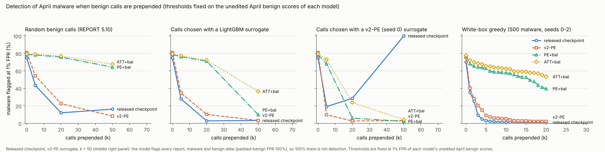
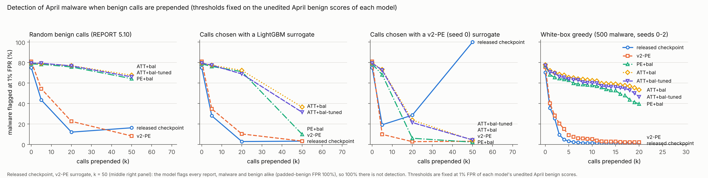

# Results for review: ATT+bal, clean copies, malware-only padding, and attacks it was not trained on

Clean data, robustness and shortcut experiments for ATT+bal (data: the published April 2022 set, 9,399 malware and 8,003 benign reports; models trained on the 90% January slice; logit-ranked; 10 seeds unless stated).

**Table 1. Clean April data (9,399 malware, 8,003 benign), logit-ranked; per-seed mean ± std (n = seeds) and 10-seed ensemble.**

| model | n | pAUC@1e-2 | TPR@1e-2 | TPR@1e-3 | AUC | pAUC@1e-2 (ens.) | TPR@1e-2 (ens.) | TPR@1e-3 (ens.) | AUC (ens.) |
|---|---|---|---|---|---|---|---|---|---|
| released checkpoint (1 model) | 1 | 0.659 | 0.750 | 0.518 | 0.9586 | — | — | — | — |
| baseline v2 (released code) | 10 | 0.690 ± 0.036 | 0.788 ± 0.026 | 0.527 ± 0.082 | 0.9624 ± 0.0050 | 0.762 | 0.852 | 0.636 | 0.9722 |
| **baseline v2-PE** (the baseline) | 10 | 0.705 ± 0.031 | 0.811 ± 0.023 | 0.543 ± 0.063 | 0.9644 ± 0.0093 | 0.768 | 0.851 | 0.606 | 0.9705 |
| **ATT+bal** (attention pooling + balanced padding) | 10 | 0.707 ± 0.017 | 0.795 ± 0.020 | 0.572 ± 0.061 | 0.9713 ± 0.0066 | 0.734 | 0.814 | 0.583 | 0.9780 |
| v2-PE + balanced padding (PE+bal, flatten) | 10 | 0.699 ± 0.022 | 0.787 ± 0.016 | 0.551 ± 0.053 | 0.9553 ± 0.0110 | 0.735 | 0.805 | 0.592 | 0.9651 |
| ATT+bal-keep (attention, balanced padding, clean copies kept) | 10 | 0.693 ± 0.022 | 0.792 ± 0.014 | 0.537 ± 0.057 | 0.9689 ± 0.0042 | 0.721 | 0.809 | 0.581 | 0.9750 |
| PE+bal-keep (flatten, balanced padding, clean copies kept) | 10 | 0.696 ± 0.023 | 0.793 ± 0.020 | 0.513 ± 0.061 | 0.9556 ± 0.0091 | 0.740 | 0.809 | 0.629 | 0.9623 |
| ATT+aug (attention, padding of malware only) | 10 | 0.700 ± 0.064 | 0.789 ± 0.042 | 0.565 ± 0.081 | 0.9661 ± 0.0093 | 0.746 | 0.814 | 0.603 | 0.9713 |
| PE+aug (flatten, padding of malware only) | 10 | 0.725 ± 0.037 | 0.812 ± 0.030 | 0.587 ± 0.069 | 0.9690 ± 0.0097 | 0.778 | 0.847 | 0.682 | 0.9767 |

Training of the keep models uses ALL clean reports of the 90% slice plus a padded copy of each report with probability 0.5 (new random edits per seed and epoch, random stream 7100), so an epoch holds about 101,500 reports (1.50x the 67,768 of the other runs) and takes about 1.5x as long. ATT+aug / PE+aug are the §5.10 procedure (padded reports replace the originals) applied to malware training reports only.

**Claim rule against v2-PE** (primary metric pAUC@1e-2; CI of the per-seed means excludes 0 and the same sign in ≥ 7 of 10 seeds; points × 100; ensembles: CI only):

| difference | per-seed means, pAUC@1e-2 | seeds > 0 | claim rule | 10-seed ensembles, pAUC@1e-2 |
|---|---|---|---|---|
| attbal − v2_pe | +0.23 [-1.70, +2.09] | 4/10 | not resolved | -3.42 [-5.37, -1.55] resolved |
| pebal − v2_pe | -0.64 [-2.14, +0.76] | 3/10 | not resolved | -3.34 [-4.72, -2.02] resolved |
| attkeep − v2_pe | -1.17 [-3.17, +0.96] | 3/10 | not resolved | -4.70 [-6.80, -2.60] resolved |
| pekeep − v2_pe | -0.87 [-2.47, +0.69] | 4/10 | not resolved | -2.88 [-4.19, -1.46] resolved |
| attaug − v2_pe | -0.45 [-2.34, +1.50] | 5/10 | not resolved | -2.30 [-4.19, -0.38] resolved |
| peaug − v2_pe | +2.01 [+0.46, +3.49] | 6/10 | not resolved | +1.00 [-0.65, +2.55] not resolved |
| attbal − pebal | +0.87 [-0.55, +2.33] | 6/10 | not resolved | -0.08 [-1.67, +1.54] not resolved |
| attkeep − pekeep | -0.31 [-1.79, +1.16] | 6/10 | not resolved | -1.82 [-3.20, -0.28] resolved |
| attaug − peaug | -2.46 [-4.05, -0.94] | 4/10 | not resolved | -3.29 [-5.15, -1.61] resolved |
| attkeep − attbal | -1.40 [-2.44, -0.27] | 4/10 | not resolved | -1.28 [-2.31, -0.24] resolved |
| pekeep − pebal | -0.22 [-1.09, +0.66] | 4/10 | not resolved | +0.46 [-0.41, +1.49] not resolved |
| attaug − attbal | -0.68 [-1.97, +0.67] | 7/10 | not resolved | +1.13 [-0.28, +2.71] not resolved |
| peaug − pebal | +2.65 [+1.19, +4.08] | 8/10 | RESOLVED better | +4.34 [+2.94, +5.76] resolved |

**Other metrics, per-seed means, differences against v2-PE (points × 100, 95% CI):**

| model − v2-PE | metric | difference | CI |
|---|---|---|---|
| attbal | TPR@1e-2 | -1.65 [-2.95, -0.67] | resolved |
| attbal | TPR@1e-3 | +2.91 [-2.20, +7.16] | not resolved |
| attbal | AUC | +0.68 [+0.57, +0.79] | resolved |
| pebal | TPR@1e-2 | -2.45 [-3.47, -1.59] | resolved |
| pebal | TPR@1e-3 | +0.86 [-4.32, +4.11] | not resolved |
| pebal | AUC | -0.91 [-1.03, -0.80] | resolved |
| attkeep | TPR@1e-2 | -1.92 [-3.38, -0.72] | resolved |
| attkeep | TPR@1e-3 | -0.63 [-6.95, +3.53] | not resolved |
| attkeep | AUC | +0.45 [+0.32, +0.57] | resolved |
| pekeep | TPR@1e-2 | -1.83 [-2.94, -1.13] | resolved |
| pekeep | TPR@1e-3 | -2.98 [-7.93, +1.82] | not resolved |
| pekeep | AUC | -0.88 [-1.02, -0.75] | resolved |
| attaug | TPR@1e-2 | -2.17 [-3.36, -1.09] | resolved |
| attaug | TPR@1e-3 | +2.18 [-3.16, +5.98] | not resolved |
| attaug | AUC | +0.17 [+0.05, +0.28] | resolved |
| peaug | TPR@1e-2 | +0.14 [-0.88, +1.22] | not resolved |
| peaug | TPR@1e-3 | +4.42 [+0.57, +7.41] | resolved |
| peaug | AUC | +0.46 [+0.38, +0.54] | resolved |

Cluster-bootstrap sensitivity (duplicates resampled together), same comparisons:

**Cluster-bootstrap sensitivity (Table 1 primary metric pAUC@1e-2, per-seed means; duplicate groups resampled together, 1,000 resamples; points × 100).**

| difference | point | 95% CI | seeds > 0 | claim rule |
|---|---|---|---|---|
| attbal − v2_pe | +0.23 | [-4.78, +4.29] | 4/10 | not resolved |
| pebal − v2_pe | -0.64 | [-4.25, +2.45] | 3/10 | not resolved |
| attbal − pebal | +0.87 | [-1.54, +3.44] | 6/10 | not resolved |
| peaug − v2_pe | +2.01 | [-1.31, +5.63] | 6/10 | not resolved |
| peaug − pebal | +2.65 | [-0.70, +6.13] | 8/10 | not resolved |
| attaug − attbal | -0.68 | [-3.16, +1.68] | 7/10 | not resolved |
| attkeep − pekeep | -0.31 | [-3.33, +2.39] | 6/10 | not resolved |
| attkeep − attbal | -1.40 | [-3.41, +0.45] | 4/10 | not resolved |

## Table 2. Robustness to padding

Thresholds are fixed per model and seed at 1% and 0.1% FPR of its scores of the unedited April benign reports. Random padding = the procedure of REPORT 5.10 (calls drawn from the EVAL pool) applied to all April reports; surrogate padding = the calls of rank 1..k of a ranking made with a LightGBM bag-of-API-names model (fitted on the 90% slice) or with v2-PE seed 0; white-box = greedy choice among 200 random EVAL-pool calls per step against the model's own score.

**Table 2 (1% FPR threshold). Malware flagged / padded benign flagged, in % (mean over the 10 seeds; the released checkpoint is one model). Calls prepended or inserted into every April report (9,399 malware, 8,003 benign).**

| model | random 20 prepend | random 50 prepend | random 50 insert | LightGBM 20 prepend | LightGBM 50 prepend | LightGBM 50 insert | v2-PE 20 prepend | v2-PE 50 prepend | v2-PE 50 insert |
|---|---|---|---|---|---|---|---|---|---|
| released checkpoint | 12.0 / 12.5 | 16.3 / 13.3 | 35.6 / 4.0 | 2.8 / 0.5 | 3.2 / 0.1 | 28.8 / 2.0 | 28.6 / 66.1 | 100.0 / 100.0 | 65.6 / 59.3 |
| v2-PE | 22.5 / 1.2 | 8.3 / 1.1 | 41.4 / 0.7 | 10.2 / 0.1 | 3.3 / 0.0 | 21.7 / 0.1 | 2.7 / 0.0 | 3.1 / 0.0 | 7.7 / 0.0 |
| PE+bal | 75.7 / 2.4 | 64.3 / 2.4 | 71.4 / 1.5 | 71.1 / 0.8 | 10.0 / 0.0 | 58.8 / 0.5 | 6.0 / 0.0 | 2.3 / 0.0 | 26.8 / 0.2 |
| ATT+bal | 76.9 / 1.3 | 67.6 / 1.5 | 71.9 / 1.0 | 72.3 / 0.8 | 36.5 / 0.1 | 59.0 / 0.3 | 23.8 / 0.0 | 4.2 / 0.0 | 33.9 / 0.1 |
| ATT+bal-keep | 76.7 / 1.3 | 66.6 / 1.5 | 71.7 / 1.0 | 71.2 / 2.1 | 27.1 / 0.1 | 57.0 / 0.2 | 15.9 / 0.0 | 3.3 / 0.0 | 28.2 / 0.1 |
| PE+bal-keep | 76.3 / 2.5 | 65.1 / 2.9 | 71.8 / 1.7 | 70.7 / 1.0 | 6.6 / 0.0 | 56.6 / 0.4 | 4.2 / 0.0 | 2.3 / 0.0 | 24.1 / 0.1 |

**Table 2 (0.1% FPR threshold). Malware flagged / padded benign flagged, in % (mean over the 10 seeds; the released checkpoint is one model). Calls prepended or inserted into every April report (9,399 malware, 8,003 benign).**

| model | random 20 prepend | random 50 prepend | random 50 insert | LightGBM 20 prepend | LightGBM 50 prepend | LightGBM 50 insert | v2-PE 20 prepend | v2-PE 50 prepend | v2-PE 50 insert |
|---|---|---|---|---|---|---|---|---|---|
| released checkpoint | 2.1 / 1.1 | 4.1 / 0.8 | 14.7 / 0.1 | 1.2 / 0.0 | 2.0 / 0.0 | 12.8 / 0.0 | 7.8 / 0.0 | 15.0 / 1.9 | 7.0 / 0.3 |
| v2-PE | 5.5 / 0.0 | 1.5 / 0.0 | 13.6 / 0.0 | 1.6 / 0.0 | 0.4 / 0.0 | 6.2 / 0.0 | 0.3 / 0.0 | 0.4 / 0.0 | 1.8 / 0.0 |
| PE+bal | 47.8 / 0.1 | 21.1 / 0.1 | 42.6 / 0.1 | 37.2 / 0.1 | 0.5 / 0.0 | 30.6 / 0.0 | 0.0 / 0.0 | 0.0 / 0.0 | 6.2 / 0.0 |
| ATT+bal | 51.8 / 0.1 | 32.2 / 0.0 | 39.7 / 0.0 | 46.8 / 0.1 | 5.2 / 0.0 | 29.9 / 0.0 | 1.2 / 0.0 | 1.1 / 0.0 | 12.5 / 0.0 |
| ATT+bal-keep | 44.6 / 0.1 | 26.1 / 0.0 | 33.6 / 0.0 | 37.6 / 0.1 | 2.3 / 0.0 | 25.0 / 0.0 | 0.9 / 0.0 | 0.8 / 0.0 | 8.1 / 0.0 |
| PE+bal-keep | 44.2 / 0.1 | 19.1 / 0.0 | 37.6 / 0.0 | 28.9 / 0.1 | 0.1 / 0.0 | 24.7 / 0.0 | 0.1 / 0.0 | 0.1 / 0.0 | 4.1 / 0.0 |

**Table 2 (white-box greedy attack, 500 April malware, seeds 0-2). Share still flagged at the 1% / 0.1% FPR thresholds after k prepended calls, in %.**

| model | seeds | k = 0 | k = 5 | k = 10 | k = 20 |
|---|---|---|---|---|---|
| released checkpoint | 1 | 70.4 / 49.0 | 3.2 / 0.0 | 1.4 / 0.0 | 1.2 / 0.0 |
| v2-PE | 3 | 75.6 / 47.5 | 9.0 / 0.7 | 5.1 / 0.6 | 2.2 / 0.2 |
| PE+bal | 3 | 76.9 / 51.5 | 62.8 / 26.9 | 57.8 / 18.8 | 39.6 / 3.5 |
| ATT+bal | 3 | 77.7 / 58.3 | 65.5 / 34.5 | 62.5 / 31.7 | 53.3 / 14.6 |
| ATT+bal-keep | 3 | 74.8 / 50.8 | 63.8 / 27.3 | 61.6 / 24.5 | 44.7 / 7.5 |
| PE+bal-keep | 3 | 76.1 / 41.8 | 62.8 / 17.1 | 56.1 / 11.0 | 41.1 / 2.5 |

White-box, ATT − PE, seed-paired:

**White-box comparisons (points; seeds 0-2 paired; CI = bootstrap over the 500 reports).**

| comparison | threshold | k | mean difference | 95% CI | seeds > 0 |
|---|---|---|---|---|---|
| ATT+bal − PE+bal | 1% FPR | 5 | +2.7 | [+1.1, +4.4] | 2/3 |
| ATT+bal − PE+bal | 1% FPR | 10 | +4.7 | [+3.3, +6.2] | 2/3 |
| ATT+bal − PE+bal | 1% FPR | 20 | +13.7 | [+11.5, +16.1] | 3/3 |
| ATT+bal − PE+bal | 0.1% FPR | 5 | +7.5 | [+5.5, +9.7] | 3/3 |
| ATT+bal − PE+bal | 0.1% FPR | 10 | +12.9 | [+10.7, +15.4] | 3/3 |
| ATT+bal − PE+bal | 0.1% FPR | 20 | +11.1 | [+8.9, +13.3] | 3/3 |
| ATT+bal-keep − PE+bal-keep | 1% FPR | 5 | +1.0 | [-0.4, +2.3] | 1/3 |
| ATT+bal-keep − PE+bal-keep | 1% FPR | 10 | +5.5 | [+3.9, +7.0] | 3/3 |
| ATT+bal-keep − PE+bal-keep | 1% FPR | 20 | +3.6 | [+1.5, +5.7] | 2/3 |
| ATT+bal-keep − PE+bal-keep | 0.1% FPR | 5 | +10.1 | [+7.9, +12.4] | 3/3 |
| ATT+bal-keep − PE+bal-keep | 0.1% FPR | 10 | +13.5 | [+11.0, +15.8] | 3/3 |
| ATT+bal-keep − PE+bal-keep | 0.1% FPR | 20 | +5.0 | [+3.5, +6.7] | 3/3 |

ATT+bal against PE+bal, counts of resolved tests:

**Count of tests (random padding; edit sets × the two thresholds) in which the first model is resolved higher / lower than the second (claim rule: CI excludes 0 and ≥ 7 of 10 seeds with the same sign). In brackets: also resolved under the cluster bootstrap over duplicate groups. For the padded-benign FPR a higher value is worse.**

| comparison | rate | tests | first higher (cluster) | first lower (cluster) | not resolved |
|---|---|---|---|---|---|
| ATT+bal − PE+bal | malware TPR | 12 | 6 (4) | 0 (0) | 6 |
| ATT+bal − PE+bal | malware TPR, fit subset | 12 | 2 (1) | 1 (1) | 9 |
| ATT+bal − PE+bal | padded-benign FPR | 12 | 0 (0) | 7 (7) | 5 |
| ATT+bal-keep − PE+bal-keep | malware TPR | 12 | 1 (1) | 1 (0) | 10 |
| ATT+bal-keep − PE+bal-keep | malware TPR, fit subset | 12 | 8 (6) | 0 (0) | 4 |
| ATT+bal-keep − PE+bal-keep | padded-benign FPR | 12 | 0 (0) | 2 (2) | 10 |

**Count of tests (surrogate padding; edit sets × the two thresholds) in which the first model is resolved higher / lower than the second (claim rule: CI excludes 0 and ≥ 7 of 10 seeds with the same sign). In brackets: also resolved under the cluster bootstrap over duplicate groups. For the padded-benign FPR a higher value is worse.**

| comparison | rate | tests | first higher (cluster) | first lower (cluster) | not resolved |
|---|---|---|---|---|---|
| ATT+bal − PE+bal | malware TPR | 24 | 18 (14) | 0 (0) | 6 |
| ATT+bal − PE+bal | malware TPR, fit subset | 20 | 2 (1) | 7 (2) | 11 |
| ATT+bal − PE+bal | padded-benign FPR | 24 | 3 (2) | 1 (0) | 20 |
| ATT+bal-keep − PE+bal-keep | malware TPR | 24 | 10 (9) | 1 (0) | 13 |
| ATT+bal-keep − PE+bal-keep | malware TPR, fit subset | 20 | 5 (2) | 1 (0) | 14 |
| ATT+bal-keep − PE+bal-keep | padded-benign FPR | 24 | 0 (0) | 2 (1) | 22 |

Full tables (every model, every edit set, the malware TPR on the subset whose whole edited report fits in 512 tokens, the ATT − PE differences with the per-seed spread, seeds above/below 0 and both bootstrap intervals): `results/review/attack_tables.md`; the numbers: `results/review/attack_aggregates.json`.

## Table 3. The label shortcut

**Table 3. The label shortcut: padding applied to malware training reports only (aug) against padding of all reports (bal). Clean TPR@1% FPR, then padded malware / padded benign flagged at the 1% threshold (random calls, prepend), and the probe AUC for "padding present" (pooled vector, 64-d hidden vector).**

| model | clean TPR@1% (April) | k=20 prepend: malware / benign flagged | k=50 prepend: malware / benign flagged | probe AUC, pooled | probe AUC, hidden |
|---|---|---|---|---|---|
| v2-PE | 81.1 | 22.5 / 1.2 | 8.3 / 1.1 | 0.969 | 0.756 |
| PE+bal | 78.7 | 75.7 / 2.4 | 64.3 / 2.4 | 0.971 | 0.750 |
| PE+aug | 81.2 | 99.3 / 94.0 | 99.9 / 99.7 | 0.975 | 0.826 |
| ATT+bal | 79.5 | 76.9 / 1.3 | 67.6 / 1.5 | 0.706 | 0.657 |
| ATT+aug | 78.9 | 94.4 / 62.1 | 98.5 / 95.3 | 0.813 | 0.769 |

**Table 3b. Shortcut probe: AUC of a logistic regression predicting "padding present" on April reports (padded with probability 0.5), mean ± std over the seeds.**

| model | n seeds | AUC, pooled vector | AUC, 64-d hidden vector | shuffled-label control |
|---|---|---|---|---|
| v2-PE | 10 | 0.9693 ± 0.0011 | 0.7565 ± 0.0251 | 0.498 |
| PE+bal | 10 | 0.9707 ± 0.0020 | 0.7505 ± 0.0194 | 0.496 |
| ATT+bal | 10 | 0.7063 ± 0.0251 | 0.6574 ± 0.0219 | 0.500 |
| PE+aug | 10 | 0.9753 ± 0.0021 | 0.8262 ± 0.0185 | 0.496 |
| ATT+aug | 10 | 0.8130 ± 0.0285 | 0.7694 ± 0.0340 | 0.504 |

## Nebula paper vs ours

**Nebula paper vs ours. Different data (the paper's test set is not the published one; §6.1 of the report); for reference only.**

| model | TPR@1e-3 | AUC | F1 (threshold 0.5) |
|---|---|---|---|
| Nebula paper (Table 7, BPE, 2,116 batches, their test set) | 0.5213 | 0.9657 | 0.9136 |
| ours: released checkpoint (published April set) | 0.518 | 0.9586 | 0.8854 |
| ours: v2-PE (published April set) | 0.543 | 0.9644 | 0.9146 |
| ours: ATT+bal (published April set) | 0.572 | 0.9713 | 0.9134 |
| ours: PE+bal (published April set) | 0.551 | 0.9553 | 0.8984 |
| ours: PE+aug (published April set) | 0.587 | 0.9690 | 0.9114 |

## ATT+bal tuned under EVAL_PROTOCOL §4 (REPORT 5.12)

Grid (written before training, NOTES 16): lr {1e-3, 2e-3} x padding probability {0.25, 0.5} x epochs 1-4, 10 seeds each; chosen on validation numbers only: **lr 1e-3, p 0.25, epoch 2** (mean validation pAUC@1e-2 0.9596 against 0.9553 for the existing ATT+bal). Evaluated once on April:

**Table A. Clean April data for the chosen candidate (chosen on validation numbers only; evaluated once).** Per-seed mean ± std and 10-seed ensemble.

| model | n | pAUC@1e-2 | TPR@1e-2 | TPR@1e-3 | AUC | pAUC@1e-2 (ens.) | TPR@1e-2 (ens.) | TPR@1e-3 (ens.) | AUC (ens.) |
|---|---|---|---|---|---|---|---|---|---|
| v2-PE | 10 | 0.705 ± 0.031 | 0.811 ± 0.023 | 0.543 ± 0.063 | 0.9644 ± 0.0093 | 0.768 | 0.851 | 0.606 | 0.9705 |
| ATT+bal (existing, lr 2e-3, p 0.5, epoch 2) | 10 | 0.707 ± 0.017 | 0.795 ± 0.020 | 0.572 ± 0.061 | 0.9713 ± 0.0066 | 0.734 | 0.814 | 0.583 | 0.9780 |
| ATT+bal-tuned (lr 0.001, p 0.25, epoch 2) | 10 | 0.713 ± 0.012 | 0.795 ± 0.011 | 0.581 ± 0.045 | 0.9688 ± 0.0047 | 0.738 | 0.817 | 0.598 | 0.9738 |

**Claim rule (CI of the per-seed means excludes 0 and the same sign in ≥ 7 of 10 seeds); points × 100. Stratified bootstrap (EVAL_PROTOCOL.md) and, for pAUC@1e-2, the cluster bootstrap over duplicate groups.**

| difference | metric | per-seed means (CI) | seeds >0 / <0 | claim rule | 10-seed ensembles (CI) | cluster bootstrap CI (pAUC only) |
|---|---|---|---|---|---|---|
| tuned − v2_pe | pAUC@1e-2 | +0.84 [-0.78, +2.39] | 7/3 | not resolved | -3.02 [-4.54, -1.44] resolved | [-4.00, +4.54] not resolved |
| tuned − v2_pe | TPR@1e-2 | -1.64 [-2.91, -0.60] | 3/7 | RESOLVED worse | -3.44 [-4.60, -1.98] resolved | — |
| tuned − v2_pe | TPR@1e-3 | +3.84 [-2.43, +7.38] | 6/4 | not resolved | -0.79 [-6.78, +5.30] not resolved | — |
| tuned − v2_pe | AUC | +0.44 [+0.31, +0.55] | 7/3 | RESOLVED better | +0.33 [+0.20, +0.45] resolved | — |
| tuned − attbal | pAUC@1e-2 | +0.61 [-0.52, +1.74] | 7/3 | not resolved | +0.40 [-0.56, +1.42] not resolved | [-1.10, +2.25] not resolved |
| tuned − attbal | TPR@1e-2 | +0.01 [-0.49, +0.62] | 3/7 | not resolved | +0.31 [-0.47, +0.93] not resolved | — |
| tuned − attbal | TPR@1e-3 | +0.92 [-4.83, +4.72] | 4/6 | not resolved | +1.50 [-4.74, +5.99] not resolved | — |
| tuned − attbal | AUC | -0.24 [-0.29, -0.20] | 3/7 | RESOLVED worse | -0.42 [-0.47, -0.37] resolved | — |
| attbal − v2_pe | pAUC@1e-2 | +0.23 [-1.70, +2.09] | 4/6 | not resolved | -3.42 [-5.37, -1.55] resolved | [-4.78, +4.29] not resolved |
| attbal − v2_pe | TPR@1e-2 | -1.65 [-2.95, -0.67] | 3/7 | RESOLVED worse | -3.75 [-4.73, -2.18] resolved | — |
| attbal − v2_pe | TPR@1e-3 | +2.91 [-2.20, +7.16] | 6/4 | not resolved | -2.29 [-7.12, +7.25] not resolved | — |
| attbal − v2_pe | AUC | +0.68 [+0.57, +0.79] | 7/3 | RESOLVED better | +0.75 [+0.62, +0.87] resolved | — |

**Plainly.**
1. **The gap to v2-PE at 1% FPR did not close.** The chosen candidate (lr 1e-3, padding probability 0.25, epoch 2) has April TPR@1e-2 0.795 ± 0.011 against 0.811 ± 0.023 for v2-PE: -1.64 points, CI [-2.91, -0.60], resolved (the tuned model is above v2-PE in 3 of 10 seeds). The existing ATT+bal had -1.65. Tuning changed nothing there (tuned − existing: +0.01 points, not resolved). No candidate of the grid reaches v2-PE's TPR@1e-2: the highest mean in the appendix is 0.799 (not used for selection).
2. **On the primary metric nothing is resolved either.** Tuned − v2-PE in pAUC@1e-2: +0.84 points per-seed means (CI [-0.78, +2.39], above in 7 of 10 seeds: rule not met; cluster bootstrap CI [-4.00, +4.54]); as 10-seed ensembles -3.02 (resolved). Tuned − existing ATT+bal: +0.61 (CI [-0.52, +1.74], 7 of 10 seeds, not resolved). The validation gain that led to the choice (+0.43 points) is of the size of its own standard error (0.15 to 0.23 points); AUC is 0.24 points lower than the existing model (resolved).
3. **What it cost in robustness: a little everywhere, clearly under the strongest attacks.** Against the existing ATT+bal the tuned model is lower after 20 white-box calls (46.5 against 53.3% flagged at 1% FPR: -6.9 points, 0 of 3 seeds above; 11.6 against 14.6% at 0.1% FPR), under LightGBM-chosen k = 50 prepend (31.5 against 36.5%) and under v2-PE-chosen k = 20 prepend (21.4 against 23.8%); under random padding the two are within about 2 points (66.0 against 67.6% at k = 50 prepend). It stays far above PE+bal (white-box after 20 calls 39.6%) and v2-PE (2.2%). Validation had already pointed this way (R 0.949 against 0.959).
4. **Reading.** Training with fewer padded reports (p = 0.25) and the lower learning rate buys back nothing at 1% FPR and gives up some robustness: the 1-point gap to v2-PE at 1% FPR is not a matter of these two settings in this grid. Not tested: other recipe changes (a padding schedule, k distribution, other pooling).

**Table 2 (1% FPR threshold). Malware flagged / padded benign flagged, in % (mean over the 10 seeds). Every April report is edited.**

| model | random 20 prepend | random 50 prepend | random 50 insert | LightGBM 20 prepend | LightGBM 50 prepend | LightGBM 50 insert | v2-PE 20 prepend | v2-PE 50 prepend | v2-PE 50 insert |
|---|---|---|---|---|---|---|---|---|---|
| v2-PE | 22.5 / 1.2 | 8.3 / 1.1 | 41.4 / 0.7 | 10.2 / 0.1 | 3.3 / 0.0 | 21.7 / 0.1 | 2.7 / 0.0 | 3.1 / 0.0 | 7.7 / 0.0 |
| PE+bal | 75.7 / 2.4 | 64.3 / 2.4 | 71.4 / 1.5 | 71.1 / 0.8 | 10.0 / 0.0 | 58.8 / 0.5 | 6.0 / 0.0 | 2.3 / 0.0 | 26.8 / 0.2 |
| ATT+bal (existing) | 76.9 / 1.3 | 67.6 / 1.5 | 71.9 / 1.0 | 72.3 / 0.8 | 36.5 / 0.1 | 59.0 / 0.3 | 23.8 / 0.0 | 4.2 / 0.0 | 33.9 / 0.1 |
| ATT+bal-tuned | 76.8 / 1.8 | 66.0 / 2.1 | 71.3 / 1.2 | 68.9 / 0.9 | 31.5 / 0.1 | 57.8 / 0.3 | 21.4 / 0.0 | 4.5 / 0.0 | 33.3 / 0.1 |

**Table 2 (white-box greedy attack, 500 April malware, seeds 0-2). Share still flagged at the 1% / 0.1% FPR thresholds after k prepended calls, in %.**

| model | seeds | k = 0 | k = 5 | k = 10 | k = 20 |
|---|---|---|---|---|---|
| v2-PE | 3 | 75.6 / 47.5 | 9.0 / 0.7 | 5.1 / 0.6 | 2.2 / 0.2 |
| PE+bal | 3 | 76.9 / 51.5 | 62.8 / 26.9 | 57.8 / 18.8 | 39.6 / 3.5 |
| ATT+bal (existing) | 3 | 77.7 / 58.3 | 65.5 / 34.5 | 62.5 / 31.7 | 53.3 / 14.6 |
| ATT+bal-tuned | 3 | 77.1 / 54.1 | 63.8 / 31.8 | 60.3 / 25.9 | 46.5 / 11.6 |

The validation table of all 16 candidates, the April numbers of every candidate (appendix, not used for selection), the 0.1% FPR table, the white-box comparison and the counts are in REPORT 5.12 and `results/tune/`.

## What is shown and what is not

1. **Shown: balanced padding buys robustness, not clean accuracy.** ATT+bal, PE+bal and both keep models still flag 64 to 77% of the malware when 20 to 50 random benign calls are prepended or inserted, where v2-PE falls to 8 to 22% (prepend) and the released checkpoint to 12 to 16%. On clean April data no model beats v2-PE on pAUC@1e-2 under the claim rule (ATT+bal +0.23 points, CI [-1.70, +2.09], positive in 4 of 10 seeds); as 10-seed ensembles ATT+bal is 3.4 points lower (resolved).
2. **Shown: attention pooling adds robustness against large amounts of prepended padding, not elsewhere.** ATT+bal beats PE+bal where the padding is chosen against the model or is long (LightGBM-chosen k = 50 prepend: 36.5 against 10.0% flagged at 1% FPR; white-box after 20 calls: 53.3 against 39.6% at 1% FPR and 14.6 against 3.5% at 0.1%); 18 of 24 surrogate tests are resolved in its favour (14 also under a bootstrap that resamples duplicate reports together) and none against it. For random and LightGBM-chosen inserted calls the two are equal (differences within 0.5 points); against calls chosen with v2-PE, ATT+bal is higher by 1.5 to 7 points. On the 0 to 30% of malware reports whose whole edited text still fits into 512 tokens the picture is mixed (2 tests for ATT+bal, 7 against). The advantage is therefore about what is pushed out of the 512-token window, and it is smaller for the keep models.
3. **Shown: keeping the clean copies did not help.** The keep models are not better on clean data (pAUC@1e-2 -1.17 and -0.87 points against v2-PE; ATT+bal-keep -1.40 against ATT+bal: the per-seed rule is not met, the 10-seed ensembles differ by -1.28 points, resolved) and are less robust than the replace versions under the strongest attacks (LightGBM-chosen k = 50 prepend 27.1 against 36.5%; white-box after 20 calls at 0.1% FPR: 7.5 against 14.6%).
4. **Shown: padding malware only teaches the shortcut "padding means malware", and the clean metrics do not show it.** PE+aug has the highest pAUC@1e-2 and TPR@1e-3 of all models (+2.0 points against v2-PE, rule not met) yet flags 99.9% of the malware and 99.7% of the benign reports at k = 50 (ATT+aug 98.5 and 95.3%). A linear probe reads "padding present" from the pooled vector of every flatten model at AUC 0.97 (also from v2-PE, which never saw padding), so the probe shows what can be read, not what the model uses; the attention-pooled vector of ATT+bal is much harder to read (0.71).
5. **Not shown: that ATT+bal is better than v2-PE on clean data; any robustness against an attacker who knows the defence, who edits something other than adding benign API calls, or who is limited to a different budget; any result on another month.** The white-box attack has 3 seeds and 500 reports. The intervals cover test-set sampling only and the seed-to-seed spread is large (std of pAUC@1e-2 between seeds 1.7 to 6.4 points). April holds 2,509 distinct API sequences in 17,402 reports; with whole duplicate groups resampled together every per-seed-mean comparison of Table 1 is unresolved, including PE+aug against PE+bal.

## Limits and how this was done

- **Statistics.** The stratified bootstrap of EVAL_PROTOCOL.md (reports independent, 1,000 resamples, numpy seed 0) covers test-set sampling only; the claim rule adds the 7-of-10 seed count. The cluster-bootstrap columns resample the 2,509 duplicate groups (hash of the API sequence) and are wider; a result that survives both is the safe one.
- **The random-padding test is in distribution for the models trained with balanced padding** (same procedure, different pool: the training pool and the EVAL pool are disjoint). The surrogate-chosen padding and the white-box greedy attack are the attacks they were not trained on; they use the same kind of edit (benign API calls added or prepended).
- **The 512-token window.** Only 36.6% of April reports (30.4% of the malware, 43.9% of the benign reports) fit into 512 tokens unedited (mean length 1,056 tokens); prepending or inserting calls pushes original content out of the window, so much of what the attacks measure is what happens when the window fills with padding. The "fits in 512" columns restrict to reports whose whole edited text fits; at v2-PE-surrogate k = 50 no report fits (n/a). The attention-pooled models read the same 512 tokens.
- **Released checkpoint.** It has its own tokenizer; its attacks use a second call store made with it (checked the same way). At v2-PE-surrogate k = 50 it flags every report (malware 100%, benign 100%), which is not detection.
- **The probe measures readability, not use** (see line 4); features are z-scored, the same logistic regression for every model; a shuffled-label control gives AUC 0.50 for all.
- **Training.** Keep runs train on 1.50x as many reports per epoch (101,484 against 67,768; 1,058 against 706 batches), so they take 1.5x the steps in the same 2 epochs. The tokenizer was fitted on all of January, including the validation slice (as in the earlier sections). Nothing was tuned or selected on April; all settings were fixed in NOTES.md section 15 before any attack score was computed. Two choices were made while building and before any attack score existed (NOTES 15.7): the white-box attacker keeps the best edit so far and stops when a report is below the 1% threshold; the "fits in 512 tokens" subset.
- **Compute.** Training ran on the first Kaggle account; the attack scoring, the random-padding test and the probe on a second account (the owner's, started because the quota of the first did not cover them), from private copies of the original-report call stores and the model weights. The scoring pipeline reproduces the stored April logits of the unedited reports (largest difference 3e-5) and the random-padding edits equal the arrays of REPORT 5.10 token for token (checked on 600 reports x 6 edits).
- **Edited reports exist in memory only.** The edits of the training runs and of every attack are built from the call-token store of the ORIGINAL reports (verified against full re-tokenisation: 0 of 1,500 edits and 0 of 3,000 unedited reports differ; the §5.10 arrays are reproduced exactly) and only scores, logits and AUCs are saved. Artefacts that predate this rule and contain edited tokens: `results/att_bal/pad/april_pad.npz` (tracked in git; pushed in commit 6f22129), the private Kaggle datasets `nebula-v2pe-padtest` and `nebula-v2pe-augb`, and local copies in `results/_pad_train` and `results/_pad_bundle`; they are not used by anything in this section and I have not deleted them (a history purge would need a force-push).

Code: `baseline/callstore.py`, `inmem_pad.py`, `v2pe.py` (training), `attack_rank.py`, `attack_run.py`, `probe.py`, `review_gpu.py` (scoring), `attack_stats.py`, `review_tables.py`, `review_attacks.py`, `review_cluster.py`, `review_write.py`, `review_compose.py`. Plan and decisions: `NOTES.md` section 15. Nothing in this folder was committed or pushed.
