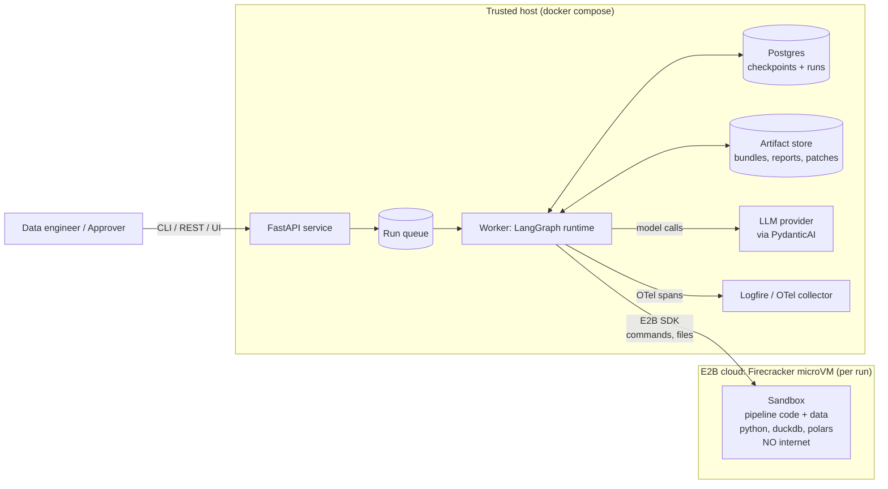
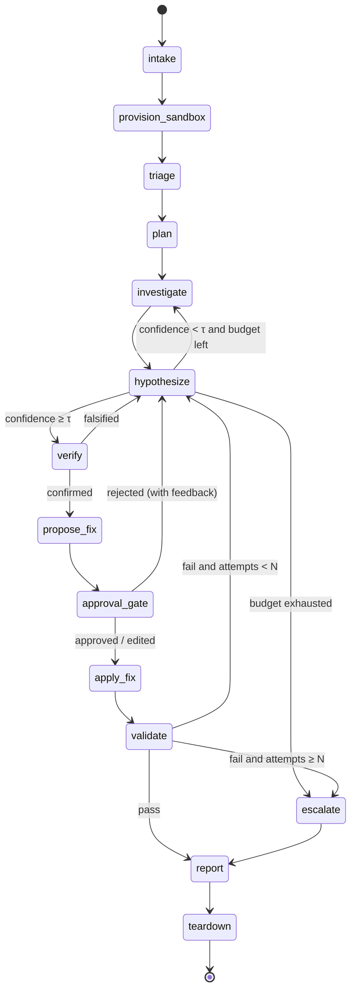
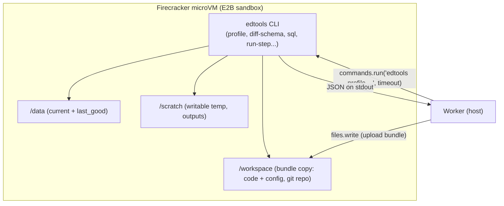
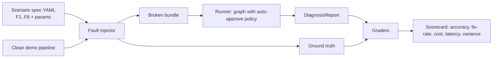

# ETL Doctor: High-Level Design (HLD)

| | |
|---|---|
| **Status** | Draft v0.1 |
| **Related** | [Requirements](01-requirements.md) · [Low-Level Design](03-low-level-design.md) |

---

## 1. Design principles

1. **The graph owns control flow; agents own reasoning.** LangGraph decides *what step
   comes next*: loops, approvals, budgets, retries. PydanticAI agents decide *what to
   think or do inside a step* and return typed output. No agent can skip a gate.
2. **Typed everything.** Every model output is a Pydantic model, every tool takes and
   returns Pydantic models, and graph state is a typed schema. Malformed output is
   retried, never passed downstream.
3. **The host is trusted, the sandbox is not.** Model calls, secrets, state and policy
   live on the host. Bundle code, data and model-written code only ever run inside an
   E2B Firecracker microVM with no network.
4. **Read freely, write only with approval.** Investigation tools are read-only.
   Mutating capabilities are granted only after an `interrupt()` approval, and only for
   that step.
5. **Every step is resumable.** State is checkpointed after each node. Side effects are
   idempotent and keyed by `run_id` + step.
6. **Measure, don't guess.** The eval harness and tracing are part of the product, not
   an afterthought.

## 2. System context



**Trust boundary:** the arrow from the worker into the sandbox. Only files and commands
cross it. No secrets cross it, and the sandbox cannot call back into the host or reach
the internet.

## 3. Component overview

| # | Component | Responsibility | Tech |
|---|---|---|---|
| C1 | **API service** | Intake, run lifecycle, approvals, SSE event stream | FastAPI, Pydantic |
| C2 | **CLI** | Thin client over the API, plus `eval` command | Typer |
| C3 | **Run worker** | Hosts the compiled LangGraph, executes runs, resumes interrupted ones | LangGraph, asyncio |
| C4 | **Orchestration graph** | State machine: triage → plan → investigate ⇄ hypothesize → verify → propose → approve → apply → validate → report | LangGraph `StateGraph` |
| C5 | **Agents** | Typed LLM reasoning units (Triage, Investigator, Fixer, Reporter) | PydanticAI `Agent` |
| C6 | **Tool layer** | Typed tools that the agents call. Each one runs a command in the sandbox and parses the result. | PydanticAI tools + sandbox client |
| C7 | **Sandbox provider** | Create/reuse/kill sandboxes, upload bundle, run commands, enforce timeouts | E2B SDK (prod), Docker (dev only) |
| C8 | **Sandbox template** | Prebuilt image: Python, DuckDB, Polars, pandas, pytest, the helper CLI `edtools` | E2B template (Dockerfile) |
| C9 | **Checkpointer** | Durable graph state, time travel, resume | `langgraph-checkpoint-postgres` |
| C10 | **Policy & budget guard** | Enforce token/USD/step/time caps and the tool allow-list per phase | Custom, wraps PydanticAI `UsageLimits` |
| C11 | **Artifact store** | Content-addressed storage for bundles, evidence blobs, patches, reports | Local FS / S3-compatible (MinIO) |
| C12 | **Observability** | Traces for nodes, model calls and tools; cost metrics | Pydantic Logfire (OTel) |
| C13 | **Eval harness** | Fault injector, scenario runner, graders, scorecard | pytest-style runner, LLM-judge agent |
| C14 | **Demo pipeline** | Small "orders" ETL used as the patient | Python + Polars + DuckDB |

## 4. The orchestration graph



| Node | Kind | What it does |
|---|---|---|
| `intake` | deterministic | Validate the bundle, compute hashes, initialise state and budgets |
| `provision_sandbox` | side effect (idempotent) | Create an E2B sandbox from the template (or reconnect by stored `sandbox_id`), upload the bundle |
| `triage` | LLM (small) | Classify the symptom and pick candidate failure classes |
| `plan` | LLM | Ordered investigation plan (list of intended checks) |
| `investigate` | LLM + tools (read-only) | PydanticAI tool loop: logs, profiles, schema diffs, SQL. Saves an `Evidence` record for each finding |
| `hypothesize` | LLM | Ranked `Hypothesis` list, each citing evidence IDs, with a confidence |
| `verify` | LLM + sandbox | Write and run a falsification check for the top hypothesis |
| `propose_fix` | LLM | `FixProposal`: unified diff, rationale, blast radius, rollback |
| `approval_gate` | **HITL `interrupt()`** | Pause; persist; wait for approve / reject / edit |
| `apply_fix` | side effect (sandbox only) | Apply the patch in the sandbox workspace |
| `validate` | deterministic + sandbox | Re-run the pipeline and tests; compare metrics with expectations |
| `escalate` | deterministic | Package partial findings for a human |
| `report` | LLM (small) | Render `DiagnosisReport` (JSON + Markdown) |
| `teardown` | side effect | Kill the sandbox, flush artifacts and metrics |

**Why the loop is in the graph rather than inside one big agent:** each pass through
investigate and hypothesize is a checkpoint. You can see it in traces, resume it, cap it
and replay it. Inside a node, PydanticAI runs a *bounded* tool loop (a few tool calls).
Across nodes, LangGraph runs the *strategic* loop. This two-level design is the main
harness-engineering idea in the project.

## 5. Agents (PydanticAI)

| Agent | Output type | Tools | Model tier |
|---|---|---|---|
| `TriageAgent` | `TriageResult` | none (gets log tail + bundle manifest in the prompt) | small/fast |
| `PlannerAgent` | `InvestigationPlan` | none | strong |
| `InvestigatorAgent` | `InvestigationStep` (findings + evidence) | read-only tools (§6) | strong |
| `HypothesisAgent` | `HypothesisSet` | none (reasons over evidence) | strong |
| `VerifierAgent` | `VerificationResult` | `run_python_check`, `run_sql` | strong |
| `FixerAgent` | `FixProposal` | `read_file`, `dry_run_patch` | strong |
| `ReporterAgent` | `DiagnosisReport` narrative fields | none | small/fast |
| `JudgeAgent` (eval only) | `JudgeScore` | none | strong, different family if possible |

Every agent gets a typed `Deps` object (sandbox handle, run context, budget guard,
evidence store) through PydanticAI dependency injection. That makes the agents
unit-testable with `TestModel`/`FunctionModel` and a fake sandbox.

## 6. Tool layer

Every tool is `async`, takes a Pydantic args model, runs **one** well-defined command in
the sandbox through a helper CLI (`edtools`, baked into the template), and returns a
**bounded** Pydantic result. Output is truncated and summarised, never raw dumps.

| Tool | Phase | Side effects | Purpose |
|---|---|---|---|
| `list_bundle` | all | none | Tree of files with sizes |
| `read_file` | all | none | Read a file slice (path allow-listed to `/workspace`) |
| `grep_logs` | investigate | none | Regex search over logs, returns matches with line numbers |
| `profile_dataset` | investigate | none | Per-column type, null %, distinct count, min/max, sample values, **inferred format patterns** |
| `diff_schema` | investigate | none | Current vs last-good: added/dropped/renamed (fuzzy) columns, type changes, format-pattern changes |
| `run_sql` | investigate, verify | none (DuckDB in read-only mode over files) | Ad-hoc analytical queries |
| `git_log` | investigate | none | Recent commits/diffs touching pipeline code |
| `run_pipeline_step` | investigate | writes only to `/scratch` | Re-run one step and capture the traceback |
| `run_python_check` | verify | writes only to `/scratch` | Run a short model-written check script (time and memory capped) |
| `dry_run_patch` | propose | none | `git apply --check` |
| `apply_patch` | **post-approval only** | modifies `/workspace` | Apply the approved diff |
| `run_pipeline` / `run_tests` | validate | writes to `/scratch/out` | Full re-run + test suite |

**Phase-scoped tool sets:** each agent is built with only the tools for its phase.
`apply_patch` is not registered on any agent. The deterministic `apply_fix` node calls
it, and only after `approval_gate` has passed. Even a fully prompt-injected model has no
way to call it.

## 7. Sandbox architecture (E2B / Firecracker)



- **One sandbox per run**, created in `provision_sandbox`. Its `sandbox_id` is stored in
  graph state so that any later node, including one after a resume, reconnects to it.
- **Lifetime:** the sandbox timeout is extended while the run is active. While waiting
  for approval the sandbox is **paused** if the provider supports pause/resume, or killed
  and re-provisioned on resume (the bundle and applied patches can be replayed from
  state, so this is safe).
- **No internet:** the sandbox is created with internet access disabled. All
  dependencies are in the template image.
- **No secrets:** no environment variables from the host are passed through. Model
  calls happen on the host only.
- **Resource caps:** CPU/RAM come from the template. Every command has a timeout, and
  output is truncated at the host.
- **Structured I/O:** `edtools` always prints one JSON document to stdout, so the host
  parses results instead of scraping text. This is more reliable and makes the results
  harder to inject into.
- **Dev fallback:** `DockerSandboxProvider` implements the same interface with
  `--network none`. It is clearly labelled *not a security boundary*.

## 8. Human-in-the-loop and checkpointing

```mermaid
sequenceDiagram
    participant W as Worker (LangGraph)
    participant PG as Postgres checkpointer
    participant API as API
    participant H as Approver
    W->>W: propose_fix → FixProposal
    W->>PG: checkpoint (state incl. proposal)
    W->>W: approval_gate: interrupt(ApprovalRequest)
    W-->>API: run.status = AWAITING_APPROVAL (event)
    API-->>H: SSE / CLI shows diff + rationale
    Note over W: Worker is free; no thread blocked
    H->>API: POST /runs/{id}/approval {decision: approve|reject|edit}
    API->>W: enqueue resume(run_id, decision)
    W->>PG: load latest checkpoint for thread_id=run_id
    W->>W: Command(resume=decision) → approval_gate returns decision
    W->>W: route → apply_fix / hypothesize
```

- **Checkpointer:** `AsyncPostgresSaver`, with `thread_id = run_id`. A checkpoint is
  written after every node, which gives crash recovery, pause/resume for approvals, and
  **time travel** (re-run from any earlier checkpoint, optionally with a different
  model) for debugging and evals.
- **Approval decisions are data:** `ApprovalDecision` is a Pydantic model with the
  approver identity, timestamp, decision, optional edited patch and feedback. It is
  stored in state and in the audit log.
- **Reject with feedback** routes back to `hypothesize` with the feedback added to the
  context, so the agent replans instead of starting over.

## 9. Guardrails and budgets

| Guard | Where enforced | On breach |
|---|---|---|
| Max model requests / tokens per agent call | PydanticAI `UsageLimits` | Agent raises; node records it and routes to `escalate` |
| Max USD per run | `BudgetGuard` (in state, checked before every LLM node) | Route to `escalate` |
| Max investigate⇄hypothesize iterations | Counter in state + conditional edge | Route to `escalate` |
| Max fix attempts | Counter in state | Route to `escalate` |
| Graph recursion limit | LangGraph `recursion_limit` | Hard stop (backstop for logic bugs) |
| Wall-clock per run | Worker watchdog | Cancel, checkpoint, `escalate` |
| Command timeout / output size | Sandbox provider | Tool returns typed `ToolError` to the agent |
| Path allow-list | Tool arg validators | Validation error back to the model |
| Untrusted content marking | Prompt builder wraps bundle content in tagged blocks | Instructions in data are ignored by policy |

## 10. Observability

- **Logfire** (OpenTelemetry) is instrumented for PydanticAI (model calls, tool calls,
  retries, token usage), FastAPI and custom spans per LangGraph node.
- Span attributes: `run_id`, `node`, `iteration`, `model`, `tokens_in/out`, `cost_usd`,
  `tool.name`, `sandbox.cmd_ms`.
- **Run timeline events** (also streamed over SSE): `node_started`, `tool_called`,
  `evidence_added`, `hypothesis_updated`, `awaiting_approval`, `validated`,
  `completed`.
- LangSmith/Langfuse can be added as an alternative trace sink. It is not required.

## 11. Evaluation harness



- **Graders:**
  (a) exact match on `failure_class` and `affected_columns`;
  (b) the fix actually validates (re-run in a fresh sandbox against held-out data);
  (c) an LLM judge scores the root-cause explanation against ground truth with a rubric;
  (d) safety assertions: no `apply_patch` without an approval record, no egress attempts
  succeeded.
- **Auto-approve policy** for evals is a pluggable `Approver` (auto, rule-based, or
  human). The interrupt mechanism stays the same and only the responder changes.
- Results are stored per `(git_sha, model, prompt_version)` so they can be compared.

## 12. Deployment view

| Env | Topology |
|---|---|
| **Local dev** | `docker compose`: api, worker, postgres, minio (optional). Sandbox = E2B (needs key) or Docker fallback |
| **Demo** | Same compose on a small VM, or Fly.io/Render. Sandbox = E2B. Logfire for traces |
| **CI** | Unit tests with `TestModel` + fake sandbox (no keys). Nightly job runs the eval suite with real model + E2B, posts the scorecard |

## 13. Key design decisions (ADR summary)

| # | Decision | Alternatives considered | Why |
|---|---|---|---|
| ADR-1 | LangGraph for orchestration, PydanticAI for agents | Only LangGraph (LangChain agents); only PydanticAI (pydantic-graph) | LangGraph gives mature checkpointing, `interrupt()` and time travel. PydanticAI gives the best typed outputs, DI and testability. Using both shows the split between control flow and reasoning. |
| ADR-2 | E2B (Firecracker microVM) as the sandbox | Docker, gVisor, Modal, local subprocess | MicroVM-level isolation, fast startup, a managed API, and pause/resume. Docker is kept only as an insecure dev fallback behind the same interface. |
| ADR-3 | Helper CLI (`edtools`) inside the sandbox returning JSON | Let the agent write arbitrary Python for everything | Deterministic, cheaper, easier to test, smaller injection surface. Free-form code is allowed only in `verify`. |
| ADR-4 | Mutating tools never registered on agents | Rely on the prompt or the approval check inside the tool | Structural guarantee. Prompt injection cannot reach a tool that does not exist. |
| ADR-5 | Postgres checkpointer | SQLite, Redis | Durable, concurrent, the same in dev and demo. SQLite is still allowed for unit tests. |
| ADR-6 | Evidence store with IDs that hypotheses must cite | Free-text reasoning | Makes hallucinations detectable and the reports auditable |
