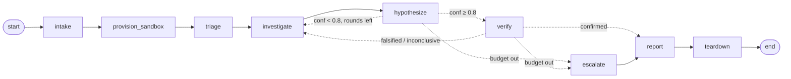

# Step 4 notes: LangGraph, checkpoints and budgets

What Step 4 builds: the investigation is no longer one long agent conversation. It is a
**state machine** whose nodes are small, typed steps (some call an LLM, some don't), whose
edges are decided by **plain Python on the state**, and whose state is **saved to SQLite
after every node**. You can kill the process and resume it; a run that runs out of budget
ends in an explicit **escalation** instead of an exception.



Run it:

```bash
make doctor  SCENARIO=f1_date_format MODE=silent                    # the full graph, tools in E2B
make doctor  SCENARIO=f1_date_format MODE=silent CRASH=hypothesize   # hard-kill before 'hypothesize'
make resume  RUN=run-...                                            # continues at 'hypothesize'
make history RUN=run-...                                            # every checkpoint, newest first
```

## Concepts, and where they live in the code

| Concept | One-line idea | In this repo |
|---|---|---|
| **Graph vs free-form agent** | A free agent decides everything (what to do next, when to stop). A graph puts the *control flow* in code and leaves only the *judgement inside each step* to the model. You get predictable paths, per-step budgets and models, and a place to put checks. | `graph/build.py` (edges), `graph/nodes.py` (routing functions) |
| **State** | One typed object holding everything the run knows. Nodes read it and return partial updates; they never mutate it. | `graph/state.py: RunState` |
| **Reducers** | How an update is merged into state. Default: replace. `evidence` uses list-append, so evidence is never rewritten; `usage` sums, so each node reports only its own spend. | `Annotated[list[Evidence], operator.add]`, `Annotated[Usage, operator.add]` |
| **Routing as pure functions** | `route_after_hypothesize(state) -> "verify" \| "investigate" \| "escalate"`. No LLM decides where to go next, and the functions are unit-testable in microseconds. | `nodes.py`, `tests/test_graph.py::test_route_*` |
| **Checkpointing** | After every node, the state is saved under the run's `thread_id`. Resume = load the latest checkpoint and continue from the `next` node. | `AsyncSqliteSaver` in `build.py` |
| **Durability modes** | `async` (default) writes checkpoints in the background: fast, but a `kill -9` can lose the last node. `sync` writes before starting the next node. We measured both: only `sync` survived `os._exit`. | `durability="sync"` in `_stream` |
| **Runtime context vs state** | Things that can't or shouldn't be saved (live sandbox handle, model objects, callbacks) go in the per-process *context*. State keeps only the `sandbox_id`, and the node reconnects after a resume. | `GraphContext`, `executor_for()` |
| **Time travel** | Every checkpoint is kept, so you can see the state before and after each node, or fork from an earlier one. | `etl-doctor history`, `history()` in `build.py` |
| **Budgets at three levels** | Per agent call (`UsageLimits`), per run (token budget, investigation and verification counts checked by the routers), and a last-resort `recursion_limit` on total node executions. | `Budget` in `state.py`, routers, `_config()` |
| **Escalation, not crash** | When budgets run out or verification keeps failing, the run *reports* that it couldn't conclude, with the best hypothesis and why. A human gets a useful handover, not a stack trace. | `escalate` node, `escalation_reason()` |
| **Verify by trying to falsify** | A separate step, with a narrower toolset, tries to *disprove* the top hypothesis. Only a hypothesis that survives is reported as diagnosed. | `verify` node, `prompts/verify.md` |
| **Context engineering across steps** | Each agent gets a compact view built from state (triage notes, findings, evidence summaries), not the full transcript of earlier calls, so input tokens per call stay bounded. | prompt assembly in `investigate` / `hypothesize` |
| **Deterministic guardrails on LLM claims** | If the code can check a claim cheaply, check it: cited evidence IDs must exist; an F3 (rename) claim must name a column that really differs across the file headers. | validators in `graph/agents.py` |
| **Serialization safety** | A checkpoint DB is input to the program. Only our own state types may be deserialized from it. | `_state_types()` → `allowed_msgpack_modules` |

## Things we learned building it

- **The first live run crashed in `verify`**: the verifier hit its tool budget and the
  exception escaped. Fix: a spent budget means "inconclusive", which the router handles.
  The same rule already applied to `investigate`.
- **The cheap model made the whole run more expensive.** Triage with gpt-oss-20b named the
  wrong suspect column (`status`), round 1 investigated healthy files, and the graph needed
  three rounds to recover. Measured on the 6 cases, the strong model picked the right column
  6/6 (vs 4/6) for the same ~5k tokens, so triage now uses the strong model. Optimise
  the whole pipeline, not each stage.
- **The loop does recover.** In that run, confidence went 0.5 → 0.3 → 0.9 across three
  rounds, and verification confirmed the right answer. Without the loop, round 1's 0.5
  would have been the final, wrong-ish answer.
- **A model contradicted itself** (class F3, statement about a date format). A one-line
  deterministic check on headers catches that class of error and sends it back.

## Likely interview questions

- *Why LangGraph instead of one agent with tools?* Control flow you can see, test and
  budget; a different model and toolset per step; durable state you can resume and
  inspect; and a natural place for human approval (Step 5 uses `interrupt()`).
- *What happens if the process dies mid-run?* The last completed node's state is in
  SQLite (`durability="sync"`). `resume` reloads it, reconnects to the same sandbox by ID
  (or creates a new one if it expired), and continues from the next node. Work already
  paid for (tokens, tool calls) isn't repeated.
- *Is a node re-run on resume safe?* The node that was running when it died runs again
  from the same input state. Our nodes are read-only (tools can't change anything), so
  re-running them is safe. Step 5's "apply fix" will need idempotency.
- *How do you stop runaway cost?* Limits per agent call, per run (tokens, rounds) and a
  recursion limit, with escalation as the defined outcome.
- *Why SQLite and not Postgres?* Same checkpointer interface and features; SQLite is one
  file with no server, which is right for a single-process PoC. Postgres is the production
  answer: concurrent workers, backups, retention.
