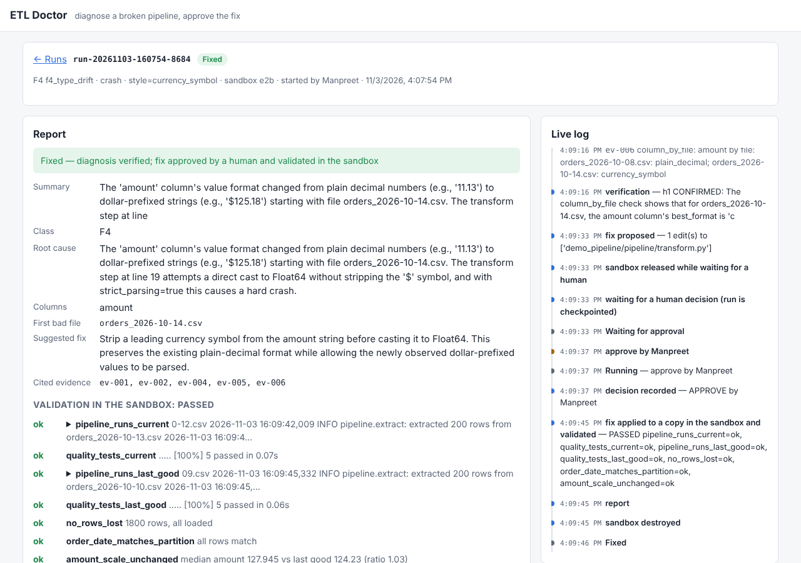

# Web UI and hosting notes

What was built: a browser UI over the **same checkpointed graph** the CLI drives. You can
pick a failure to inject and start a run, then watch every step and tool call live. When the
run stops at the approval gate you approve, reject (with feedback) or abort, and finally you
read the report: the validation checks, the validated patch, the audit trail, and the answer
key with the diagnosis graded against it.

```bash
make ui                                   # http://127.0.0.1:8000 (no login on localhost)
ETLDOC_UI_USERS=you:pw make ui            # with a login
make docker-build && make docker-run      # the hosting container, locally
```

```
browser ──HTTP (JSON)──► FastAPI ──► graph/build.py: start_run · decide · resume_run · history
   ▲                       │            (unchanged; the CLI uses the same functions)
   └──── SSE: live events ◄┘
                        /data/runs/<run_id>/  meta.json · events.jsonl · checkpoints.sqlite
                        /data/cases/<case>/   broken bundle + ground truth (built on demand)
```



The page itself is plain HTML, CSS and JS: no framework, no build step, about 650 lines.

## Concepts, and where they live in the code

| Concept | One-line idea | In this repo |
|---|---|---|
| **A run is a background task, not a request** | A run takes minutes and may wait hours for a human, so it can't live inside an HTTP request. The POST starts a task and returns the run ID; the browser can close. | `Runs.launch()` |
| **State comes from the checkpoint** | Status (running / waiting for approval / fixed / …) is read from the checkpoint, not kept in memory, so it is still right after a restart. Memory only knows which runs have a live task. | `Runs.status()` |
| **One SQLite file per run** | Concurrent runs never contend for one database file's write lock. Listing runs is listing directories. | `Runs.db()` |
| **Durable event log** | Each step and tool call is appended to `events.jsonl` as it happens. A viewer that arrives late, reloads or reconnects gets the history replayed, then live events. | `Runs.emit()`, `/events` |
| **SSE, not WebSockets** | Events only flow server → browser; actions are ordinary POSTs. Server-Sent Events are plain HTTP, pass through proxies, and the browser reconnects by itself sending `Last-Event-ID`, so nothing is lost or duplicated. | `/api/runs/{id}/events`, `EventSource` |
| **Recovery at startup** | A run that was mid-flight when the process died is `stopped`. With `ETLDOC_RESUME_ON_START=1`, the server resumes such runs when it starts. Tested by restarting the container mid-investigation: the run continued from its checkpoint to the approval gate. | `Runs.recover()` |
| **Decisions are checked against state** | A decision is accepted only while the run is waiting for one; a double click or a second reviewer gets 409. The applying step was already idempotent (Step 5). | `decision()` |
| **The approver is the login** | With auth on, the audit trail records the logged-in user and ignores any name in the request body. Tested: a body claiming "someone-else" was recorded as the logged-in user. | `who()` |
| **Untrusted content is rendered as text** | Logs, file contents and model output come from a broken system and could carry a prompt injection. If the page used `innerHTML`, an injected `<script>` or `` would run in the *reviewer's* browser, with the reviewer's approval rights. The page only sets text, and the CSP forbids inline script as a second layer. | `h()` in `app.js`, `SECURITY_HEADERS` |
| **CSRF** | The browser sends Basic-auth credentials automatically, so another site could make it POST an approval. Every POST must carry a custom header, which a cross-site form can't send without a CORS preflight that this server never allows. | `Guard`, `x-etldoc` header |
| **Denial of wallet** | Each run spends model tokens and sandbox time. Limits on concurrent runs and runs per day; the server refuses to listen on a public interface without a login. | `max_active_runs`, `max_runs_per_day`, `serve` |
| **No unsandboxed execution when hosted** | The `local` executor runs the pipeline and the model-written fix *on the server*. It is off unless `ETLDOC_ALLOW_LOCAL_SANDBOX=1`; hosted runs always use the E2B microVM. | `allow_local_sandbox` |
| **Secrets stay server-side** | API keys are environment variables (platform secrets), never sent to the page; `.dockerignore` keeps `.env` out of the image; the container runs as a non-root user. | `Dockerfile`, `.dockerignore` |

## How it was verified

- `tests/test_web.py` (offline, scripted model): start → approval → approve → fixed, through
  the HTTP API with a login. It covers:
  - CSRF refusal;
  - a rejection without feedback refused (422);
  - a second approval refused (409);
  - the approver taken from the login;
  - the answer-key grade;
  - patch download;
  - a run whose model fails is `stopped`, then resumed to the approval gate;
  - path traversal and unknown runs (404);
  - the daily cap (429).
- A real run in headless Chromium (Nemotron + MiniMax + E2B): F4 crash, started from the page,
  approved in the page, **fixed**; no console or CSP errors; no horizontal scroll at phone width.
- The Docker image, run as a host would run it: refuses to start exposed without a login;
  401 without credentials; the container restarted mid-run resumed the run by itself; after
  approval, the fix was validated in a fresh sandbox, failed, and was **not** reported as fixed.

## Hosting

What the app needs determines where it can live:

1. **An always-on process.** Runs are background tasks lasting minutes. A platform that
   freezes or kills the process between requests interrupts them.
2. **A persistent disk** for the SQLite checkpoints and run logs.
3. **Long-lived HTTP connections** for SSE.
4. **Secrets** (NVIDIA and E2B keys) and outbound HTTPS to both.
5. **A login and spending limits,** because every run costs money.

| Option | Fits? | Notes |
|---|---|---|
| **Fly.io** (one machine + volume) | **Yes, recommended** | Docker image as is, volume at `/data`, secrets via `fly secrets`, HTTPS included. Set auto-stop off (see `fly.toml`). Low single-digit dollars a month for a small machine; check current pricing. |
| Railway / Render (paid tier with a disk) | Yes | Same shape: container + volume + secrets. Render's free tier has no disk and sleeps when idle. |
| Hugging Face Spaces (Docker) | For a demo | Free CPU, easy to share. Without paid persistent storage, runs vanish on restart. Use the login (`ETLDOC_UI_USERS` as a Space secret) so strangers can't spend your credits. |
| Google Cloud Run | With changes | It scales to zero and by default only gives CPU while a request is in flight, which starves background tasks. It also has no local disk, so it needs CPU always allocated, min instances 1, and the Postgres checkpointer. |
| A small VM (EC2, a VPS) | Yes | Most control; you patch the OS, set up TLS (e.g. Caddy) and restarts yourself. |
| Vercel / Netlify functions | No | Function time limits and no disk; the run loop can't live there. |

**Deploying to Fly.io** (needs a Fly account; nothing here deploys automatically):

```bash
fly apps create <your-app-name>                 # and set app = "<your-app-name>" in fly.toml
fly volumes create etl_doctor_data --size 1 --region iad
fly secrets set NVIDIA_API_KEY=... E2B_API_KEY=... ETLDOC_UI_USERS=you:$(openssl rand -base64 18)
fly deploy
```

The E2B sandbox template (`etl-doctor-v2`) lives in your E2B account, so the hosted app uses it
with the same key. Logs: `fly logs`. The image is the same one tested above.

## The public showcase: a static replay site (GitHub Pages)

A live public demo costs money and needs a login; a static site costs nothing and can't be
abused. So the public link is a **replay**: real runs, recorded from the live system and
played back in the browser by the same UI code, with no server and no API keys.

```bash
uv run etl-doctor export out/web/runs/<run_id>   # -> site/runs/<run_id>.json (commit it)
make site-preview                                # http://127.0.0.1:8001
```

| Piece | How |
|---|---|
| What a recording holds | The run's event log, plus the **checkpoint history**: the state after every step, including each approval request the run paused on. Nothing new had to be recorded; durable execution already kept it. |
| Playback | `replaySource()` in `app.js` puts events and checkpoint frames on one clock (long waits capped at 6 s), and the run view reads from it instead of the server. The page stops at each approval gate and shows the decision the reviewer actually made. Seeking rebuilds the log. |
| One UI, two sources | `showRun(runId, source)`: `liveSource` (HTTP + SSE) or `replaySource` (a JSON file). The rendering code is shared, so the replay can't drift from the real UI. |
| What is not published | `export` drops sandbox IDs, local paths, the bundle manifest and full tool results (only one-line evidence summaries), and refuses to write a file containing an API key from the environment. Tested in `tests/test_web.py`. |
| Publishing | `.github/workflows/pages.yml` copies `site/` and the UI's `app.js`/`style.css` into `_site/` and deploys it on pushes to `main`. One-time setup: Settings → Pages → Source: GitHub Actions. |

The three recordings: a straightforward fix; **a reviewer rejecting two flawed fixes with
specific reasons** (a blanket comma replace that would break `1,234.56`, then a regex that
replaced the whole value) **and approving the third, which validated**; and a run that was
restarted mid-investigation, resumed itself, and whose approved fix failed validation and
was not reported as fixed.

## Where this design stops, and what production would change

This is deliberately **one process and one machine**: the task runner, the event wake-ups and
the SQLite files are all local. Scaling out means separating the pieces:

| Concern | PoC | Production |
|---|---|---|
| Graph state | SQLite file per run on a volume | Postgres checkpointer (`langgraph-checkpoint-postgres`) |
| Who runs the graph | a task in the web process | worker processes pulling from a queue; the API only enqueues |
| Live events | file + in-process wake-up | Postgres LISTEN/NOTIFY or Redis pub/sub, so any API replica can stream any run |
| Login | HTTP Basic, users in an env var | SSO via an identity-aware proxy (OIDC); roles: who may start runs, who may approve |
| Audit | approvals in the checkpoint | also an append-only audit store, exported to the org's log pipeline |
| Limits | per-server counters | per-user and per-team quotas and budgets |
| Inputs | built-in scenarios only | real incident bundles: uploads are untrusted files, so they only ever go into the sandbox |
| Observability | events.jsonl | traces per run (OpenTelemetry / LangSmith), token and cost metrics, alerts on escalations |

## Likely interview questions

- *How did you make the demo public without paying for or exposing the system?* A static
  replay of real recorded runs on GitHub Pages. The checkpoint history already had every
  intermediate state, so recording was an export, and the same UI code renders it.

- *Why not run the agent inside the HTTP request?* It takes minutes and may wait for a human
  for hours. Requests time out, browsers close, and deploys restart processes. The request
  starts a background task; the checkpoint makes the task survive all of that.
- *What happens if the server restarts mid-run?* The last completed step is in the
  checkpoint. The run shows as stopped; at startup the server resumes it (or a human clicks
  Resume). Its sandbox was released on shutdown, and resume creates a fresh one.
- *Why SSE instead of WebSockets or polling?* One-way updates, plain HTTP, and built-in
  reconnection with `Last-Event-ID`. Polling would work but is either slow or wasteful;
  WebSockets add a protocol for no benefit when actions are POSTs.
- *How can a prompt injection attack the UI?* A planted log line becomes model output or
  evidence text. Shown with `innerHTML`, it would run as script in the reviewer's browser and
  could click Approve. Defence: render text only, plus a CSP with no inline script.
- *Two reviewers click Approve at once?* Only the first is accepted, because a decision needs
  the run to be waiting. The second gets 409, and applying a patch is idempotent anyway.
- *Why one SQLite file per run?* No write-lock contention between concurrent runs, trivially
  listed and deleted. For more than one machine, switch to the Postgres checkpointer.
- *How do you stop a public demo from draining your API credits?* Login, concurrency and daily
  caps, no unsandboxed execution, and the server refusing to listen publicly without a login.
- *What would you change to run this for a whole company?* Workers + queue + Postgres, SSO
  with an approver role, per-team budgets, real bundle uploads kept inside the sandbox, and
  tracing per run.
