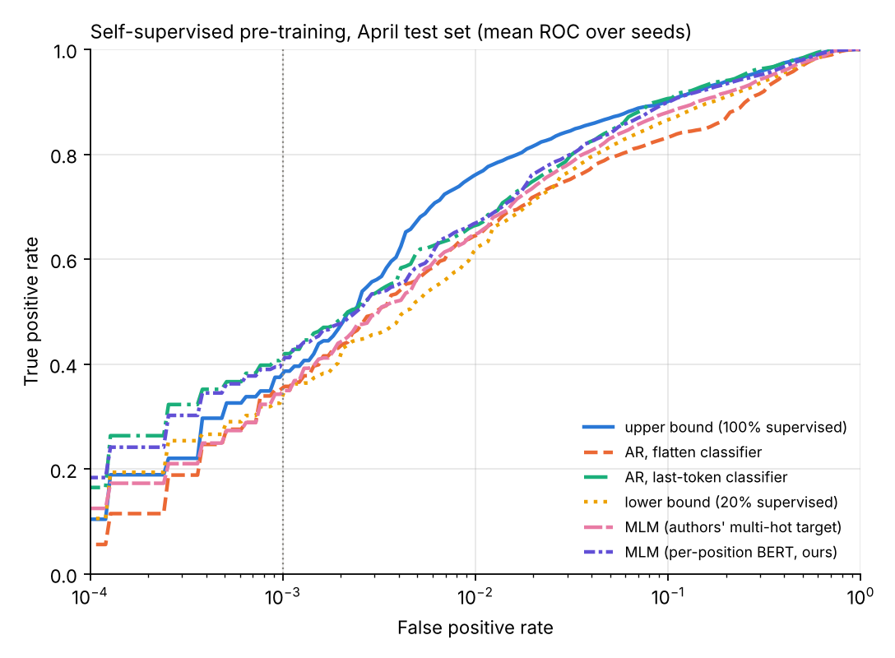
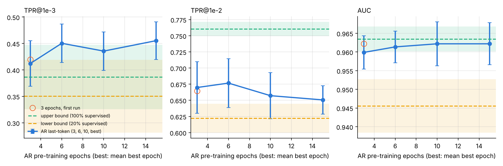
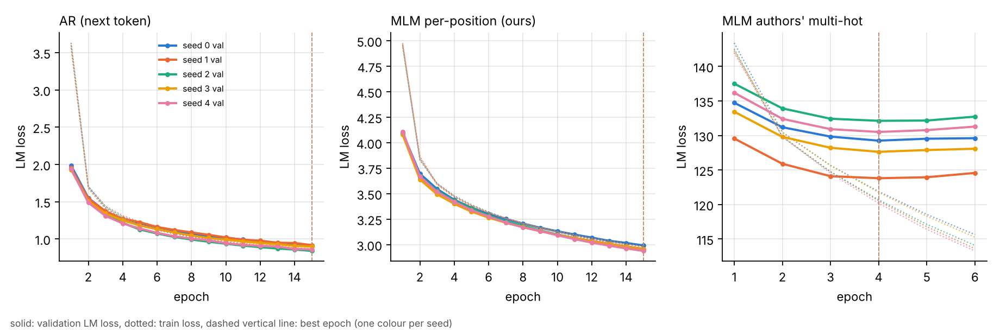
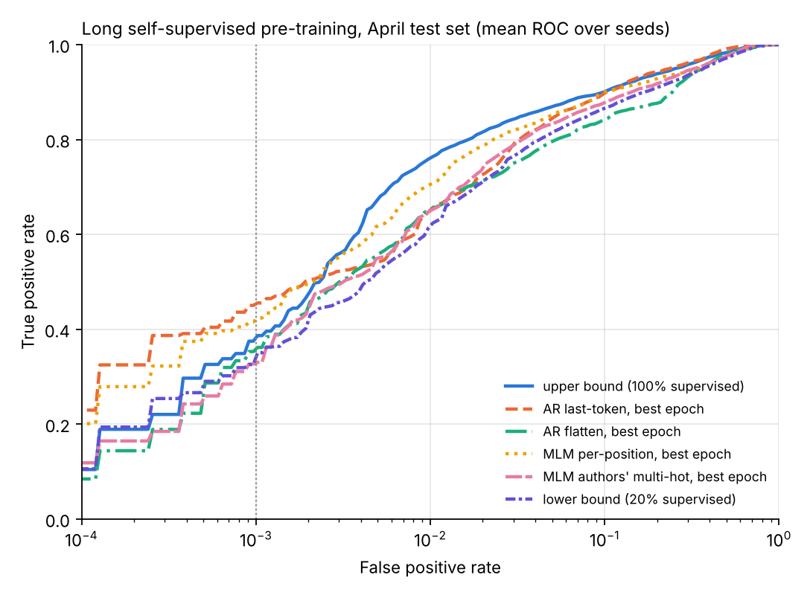
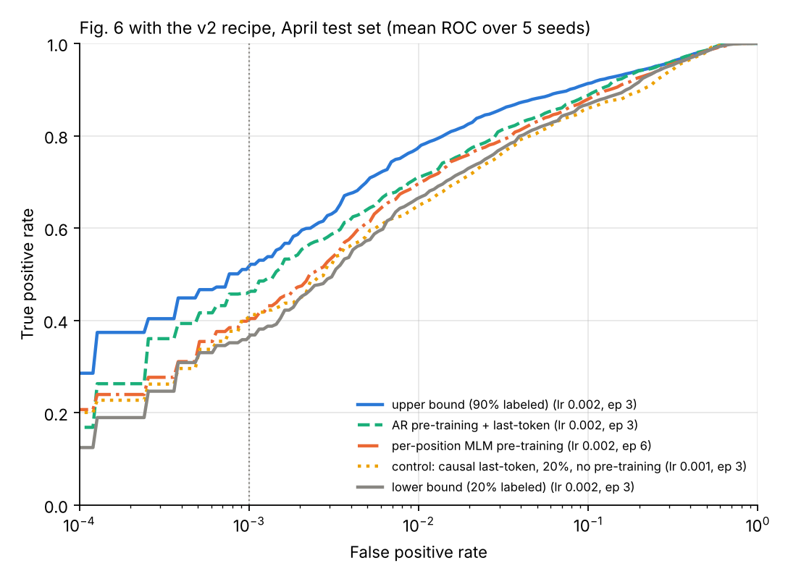
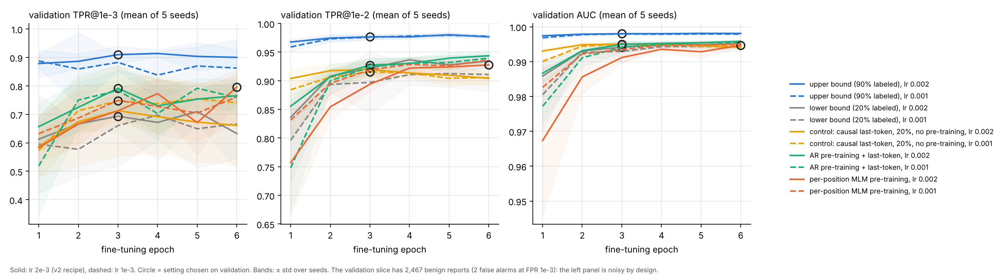
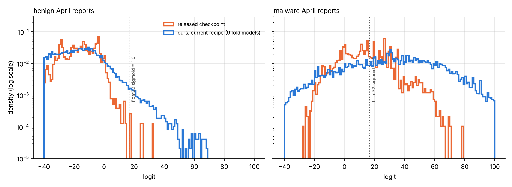
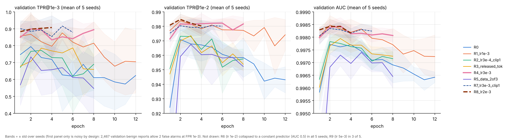
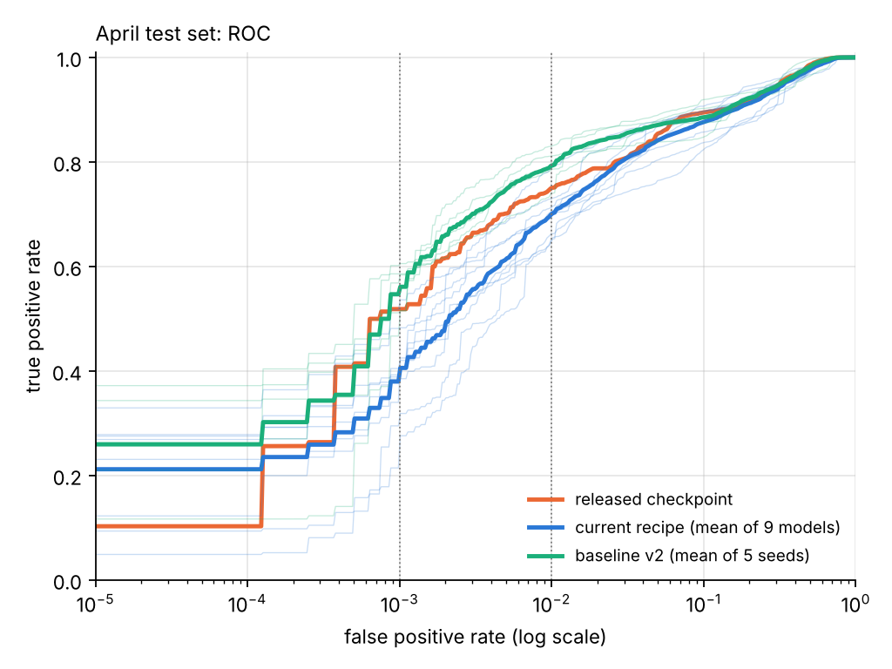

# Baseline reproduction: tables (generated by baseline/report.py)

## A. Detection (paper Table 7)

| run | fold models | batches / fold | test TPR @ FPR 1e-3 (logit-ranked) | same, literal float32 probabilities | test AUC | test F1 (thr 0.5) | test Acc (thr 0.5) | val F1 (thr 0.5) | GPU |
|---|---|---|---|---|---|---|---|---|---|
| **paper**, Nebula BPE | 3 | 2116 | 0.5213 |  | 0.9657 | 0.9136 | 0.9104 | 0.9847 | Quadro T2000 |
| ours, BPE time-matched (5 min/fold) | 9 | 5023 (4976–5081) | 0.4058 ± 0.0733 | 0.0000 ± 0.0000 | 0.9521 ± 0.0091 | 0.8967 ± 0.0170 | 0.8929 ± 0.0180 | 0.9839 ± 0.0012 | Tesla T4 |
| ours, BPE batch-matched | 9 | 2116 (2116–2116) | 0.4335 ± 0.0731 | 0.0000 ± 0.0000 | 0.9546 ± 0.0066 | 0.8967 ± 0.0132 | 0.8921 ± 0.0150 | 0.9837 ± 0.0016 | Tesla T4 |
| **paper**, Nebula Whitespace | 3 | 2159 | 0.5703 |  | 0.9664 | 0.9058 | 0.9053 | 0.987 | Quadro T2000 |
| ours, WS (pinned-repo cleaning) time-matched (5 min/fold) | 9 | 5017 (4941–5091) | 0.4086 ± 0.1134 | 0.0635 ± 0.1796 | 0.9553 ± 0.0112 | 0.8930 ± 0.0197 | 0.8932 ± 0.0178 | 0.9888 ± 0.0007 | Tesla T4 |
| ours, WS (pinned-repo cleaning) batch-matched | 9 | 2159 (2159–2159) | 0.4082 ± 0.0834 | 0.0000 ± 0.0000 | 0.9555 ± 0.0099 | 0.9047 ± 0.0050 | 0.9031 ± 0.0045 | 0.9864 ± 0.0026 | Tesla T4 |
| ours, WS (legacy cleaning) time-matched (5 min/fold) | 3 | 5027 (5025–5030) | 0.5773 ± 0.0218 | 0.1888 ± 0.2671 | 0.9601 ± 0.0040 | 0.9055 ± 0.0184 | 0.9045 ± 0.0169 | 0.9889 ± 0.0010 | Tesla T4 |
| ours, WS (legacy cleaning) batch-matched | 3 | 2159 (2159–2159) | 0.5295 ± 0.0504 | 0.1641 ± 0.2320 | 0.9584 ± 0.0030 | 0.9067 ± 0.0110 | 0.9036 ± 0.0115 | 0.9855 ± 0.0022 | Tesla T4 |

Mean ± std (population std, as the authors' CV code) over the fold models (3 per seed; seeds pooled). The TPR threshold comes from the test set itself (`get_tpr_at_fpr`, the authors' function). **Logit-ranked** is the headline number: after the float32 sigmoid, tens of benign reports tie with the top malware scores at exactly 1.0 (more than the 8 that FPR 1e-3 allows), so the literal procedure returns 0 for those models (an output-precision artifact, see NOTES.md §4).

| run | TPR@0.0001 | TPR@0.0003 | TPR@0.001 | TPR@0.003 | TPR@0.01 | TPR@0.03 | TPR@0.1 | F1 at the FPR-1e-3 threshold |
|---|---|---|---|---|---|---|---|---|
| bpe50k time | 0.2119 | 0.2590 | 0.4058 | 0.5566 | 0.7002 | 0.8048 | 0.8764 | 0.5731 |
| bpe50k batches | 0.2215 | 0.3153 | 0.4335 | 0.5832 | 0.7237 | 0.8280 | 0.8887 | 0.6007 |
| ws50k time | 0.1513 | 0.2400 | 0.4086 | 0.6006 | 0.7470 | 0.8312 | 0.8948 | 0.5700 |
| ws50k batches | 0.1833 | 0.2849 | 0.4082 | 0.5757 | 0.7198 | 0.8319 | 0.8866 | 0.5743 |
| ws50k_legacy time | 0.2486 | 0.3945 | 0.5773 | 0.6508 | 0.7894 | 0.8504 | 0.8931 | 0.7313 |
| ws50k_legacy batches | 0.2184 | 0.3570 | 0.5295 | 0.6742 | 0.7802 | 0.8577 | 0.8920 | 0.6906 |

### E. The authors' released models on our April test set

| model | TPR@1e-3 | AUC | F1 (0.5) | Acc (0.5) | AUC on January (they trained on ~70k of it) |
|---|---|---|---|---|---|
| released Nebula BPE | 0.5185 | 0.9586 | 0.8854 | 0.8857 | 0.9981 |
| released Nebula Whitespace, pinned-repo tokenizer | 0.0205 | 0.7401 | 0.7554 | 0.6974 | 0.7807 |
| released Nebula Whitespace, legacy cleaning (ours, inferred) | 0.2060 | 0.9247 | 0.8439 | 0.8494 | 0.9865 |

## B. Self-supervised pre-training (paper Sec. 4.5, Fig. 6)

| run | seeds | TPR @ FPR 1e-3 (mean ± std (min–max)) | TPR @ 1e-2 | TPR @ 1e-1 | AUC | F1 (0.5) |
|---|---|---|---|---|---|---|
| upper bound (100% supervised) | 5 | 0.3866 ± 0.0609 (0.293–0.469) | 0.7605 | 0.8998 | 0.9635 | 0.9085 |
| lower bound (20% supervised) | 5 | 0.3503 ± 0.0687 (0.275–0.457) | 0.6223 | 0.8658 | 0.9456 | 0.8845 |
| MLM (authors' multi-hot target) | 5 | 0.3496 ± 0.0345 (0.282–0.375) | 0.6476 | 0.8802 | 0.9505 | 0.8884 |
| MLM (per-position BERT, ours) | 5 | 0.4123 ± 0.0566 (0.332–0.476) | 0.6686 | 0.8990 | 0.9578 | 0.8835 |
| AR, flatten classifier | 5 | 0.3575 ± 0.0248 (0.324–0.395) | 0.6453 | 0.8319 | 0.9352 | 0.8452 |
| AR, last-token classifier | 5 | 0.4198 ± 0.0553 (0.326–0.494) | 0.6645 | 0.9061 | 0.9622 | 0.8862 |
| control: full attention, 20%, no pre-training | 5 | 0.3511 ± 0.0573 (0.302–0.457) | 0.6585 | 0.8433 | 0.9422 | 0.8513 |
| control: full attention, 100%, no pre-training | 5 | 0.4236 ± 0.0524 (0.333–0.491) | 0.7491 | 0.8421 | 0.9500 | 0.8757 |

Upper − lower at FPR 1e-3: 3.6 points (paper: about 15).
- AR, flatten classifier: 2.9 points below the upper bound, +0.7 against the lower bound.
- AR, last-token classifier: -3.3 points below the upper bound, +7.0 against the lower bound.
- MLM (authors' multi-hot target): 3.7 points below the upper bound, -0.1 against the lower bound.
- MLM (per-position BERT, ours): -2.6 points below the upper bound, +6.2 against the lower bound.

Validation LM loss per pre-training epoch (a model that guesses uniformly starts at ln V):

| pre-training | seed | val loss by epoch | ln V |
|---|---|---|---|
| mlm_theirs | 4 | 136.187 → 132.405 → 130.909 | 9.01 |
| mlm_theirs | 1 | 129.558 → 125.895 → 124.096 | 9.01 |
| mlm_theirs | 0 | 134.738 → 131.189 → 129.832 | 9.01 |
| mlm_theirs | 3 | 133.439 → 129.793 → 128.212 | 9.01 |
| mlm_theirs | 2 | 137.507 → 133.922 → 132.420 | 9.01 |
| mlm_bert | 4 | 4.106 → 3.670 → 3.519 | 9.01 |
| mlm_bert | 1 | 4.108 → 3.659 → 3.500 | 9.01 |
| mlm_bert | 0 | 4.096 → 3.696 → 3.546 | 9.01 |
| mlm_bert | 3 | 4.078 → 3.640 → 3.494 | 9.01 |
| mlm_bert | 2 | 4.092 → 3.674 → 3.529 | 9.01 |
| ar | 4 | 1.942 → 1.490 → 1.306 | 9.01 |
| ar | 1 | 1.950 → 1.538 → 1.371 | 9.01 |
| ar | 0 | 1.987 → 1.549 → 1.368 | 9.01 |
| ar | 3 | 1.928 → 1.510 → 1.340 | 9.01 |
| ar | 2 | 1.940 → 1.497 → 1.314 | 9.01 |

## B2. Longer self-supervised pre-training (follow-up to B)

Same tokens, seeds, 80/20 splits and fine-tuning as B (10 epochs on the labeled 20%); only the pre-training is longer (up to 15 epochs, early stop: patience 2, min delta 0.01 on the validation LM loss, best epoch restored). Upper bound, lower bound and the controls are the runs of B (not retrained). Logit-ranked TPR. 'best' = the epoch with the lowest validation LM loss.

### Absolute numbers (mean ± std over seeds, April test set)

| run | seeds | TPR@1e-3 (min–max) | same, literal float32 | TPR@1e-2 | AUC | F1 (0.5) |
|---|---|---|---|---|---|---|
| upper bound (100% supervised) | 5 | 0.387 ± 0.061 (0.293–0.469) | 0.000 ± 0.000 | 0.760 ± 0.011 | 0.9635 ± 0.0033 | 0.9085 ± 0.0027 |
| lower bound (20% supervised) | 5 | 0.350 ± 0.069 (0.275–0.457) | 0.060 ± 0.119 | 0.622 ± 0.022 | 0.9456 ± 0.0071 | 0.8845 ± 0.0053 |
| control: full attention, 100% | 5 | 0.424 ± 0.052 (0.333–0.491) | 0.000 ± 0.000 | 0.749 ± 0.037 | 0.9500 ± 0.0066 | 0.8757 ± 0.0118 |
| control: full attention, 20% | 5 | 0.351 ± 0.057 (0.302–0.457) | 0.195 ± 0.160 | 0.658 ± 0.074 | 0.9422 ± 0.0150 | 0.8513 ± 0.0261 |
| control: causal last-token, 20%, no pre-training | 5 | 0.392 ± 0.056 (0.305–0.460) | 0.392 ± 0.056 | 0.591 ± 0.040 | 0.9327 ± 0.0128 | 0.8521 ± 0.0275 |
| AR last-token, 3 epochs (first run) | 5 | 0.420 ± 0.055 (0.326–0.494) | 0.420 ± 0.055 | 0.665 ± 0.041 | 0.9622 ± 0.0062 | 0.8862 ± 0.0160 |
| AR flatten, 3 epochs (first run) | 5 | 0.358 ± 0.025 (0.324–0.395) | 0.000 ± 0.000 | 0.645 ± 0.026 | 0.9352 ± 0.0121 | 0.8452 ± 0.0194 |
| MLM per-position, 3 epochs (first run) | 5 | 0.412 ± 0.057 (0.332–0.476) | 0.091 ± 0.183 | 0.669 ± 0.022 | 0.9578 ± 0.0026 | 0.8835 ± 0.0173 |
| MLM authors' multi-hot, 3 epochs (first run) | 5 | 0.350 ± 0.034 (0.282–0.375) | 0.272 ± 0.138 | 0.648 ± 0.044 | 0.9505 ± 0.0063 | 0.8884 ± 0.0083 |
| AR last-token, epoch 3 (long run) | 5 | 0.412 ± 0.043 (0.331–0.452) | 0.412 ± 0.043 | 0.670 ± 0.040 | 0.9599 ± 0.0045 | 0.8898 ± 0.0157 |
| AR last-token, epoch 6 | 5 | 0.450 ± 0.036 (0.408–0.515) | 0.450 ± 0.036 | 0.677 ± 0.038 | 0.9614 ± 0.0042 | 0.8857 ± 0.0145 |
| AR last-token, epoch 10 | 5 | 0.436 ± 0.036 (0.380–0.495) | 0.436 ± 0.036 | 0.657 ± 0.036 | 0.9622 ± 0.0059 | 0.8891 ± 0.0116 |
| AR last-token, best epoch | 5 | 0.455 ± 0.035 (0.413–0.506) | 0.455 ± 0.035 | 0.651 ± 0.022 | 0.9622 ± 0.0056 | 0.8914 ± 0.0084 |
| AR flatten, best epoch | 5 | 0.362 ± 0.094 (0.219–0.516) | 0.000 ± 0.000 | 0.653 ± 0.024 | 0.9416 ± 0.0103 | 0.8586 ± 0.0080 |
| MLM per-position, best epoch | 5 | 0.424 ± 0.062 (0.335–0.497) | 0.000 ± 0.000 | 0.706 ± 0.044 | 0.9558 ± 0.0079 | 0.8906 ± 0.0079 |
| MLM authors' multi-hot, best epoch | 5 | 0.330 ± 0.032 (0.283–0.377) | 0.258 ± 0.130 | 0.651 ± 0.049 | 0.9520 ± 0.0063 | 0.8904 ± 0.0138 |

### Paired differences (same seed, same split) and bootstrap CIs

Per-seed differences: mean ± std over the 5 seeds, and in how many seeds the difference is positive. **Bootstrap**: 95% CI over the April test reports (1,000 stratified resamples, same resample for every run and seed), in points of TPR; **resolved** = the CI excludes 0. Two statistics: **per-seed mean** = the mean over the 5 seeds of each seed's own TPR (matches the per-seed columns); **ensemble** = the TPR of the seed-averaged score (mean logit over the 5 seeds), i.e. a 5-model ensemble. The ensemble lifts the low-FPR TPR of every run, the lower bound most, so its differences are smaller (or of opposite sign) than the per-seed ones. The bootstrap measures test-set sampling noise only; the seed std measures training noise.

**TPR@1e-3** (points; run − lower > 0 = better than the lower bound; upper − run > 0 = below the upper bound)

| run | run − lower, per seed | CI, per-seed mean | CI, ensemble | upper − run, per seed | CI, per-seed mean | CI, ensemble |
|---|---|---|---|---|---|---|
| **upper bound** (reference) | +3.6 ± 6.0 (3/5 > 0) | +3.6 [-2.6, +11.5] not resolved | -1.7 [-9.9, +8.4] not resolved |  |  |  |
| control: full attention, 100% | +7.3 ± 11.9 (4/5 > 0) | +7.3 [+3.5, +18.0] **resolved** | +7.3 [-2.0, +16.0] not resolved | -3.7 ± 9.4 | -3.7 [-12.8, +0.9] not resolved | -9.0 [-16.4, +5.3] not resolved |
| control: full attention, 20% | +0.1 ± 5.5 (3/5 > 0) | +0.1 [-4.7, +4.7] not resolved | -3.4 [-5.6, +8.2] not resolved | +3.5 ± 4.1 | +3.5 [-1.9, +11.4] not resolved | +1.7 [-8.4, +9.4] not resolved |
| control: causal last-token, 20%, no pre-training | +4.2 ± 11.6 (3/5 > 0) | +4.2 [+0.5, +10.7] **resolved** | +0.6 [-1.0, +5.3] not resolved | -0.6 ± 10.8 | -0.6 [-8.5, +6.7] not resolved | -2.4 [-11.3, +5.7] not resolved |
| AR last-token, 3 epochs (first run) | +7.0 ± 8.2 (4/5 > 0) | +7.0 [+3.1, +12.7] **resolved** | +12.8 [+4.0, +16.1] **resolved** | -3.3 ± 8.7 | -3.3 [-10.1, +4.0] not resolved | -14.5 [-22.2, +0.5] not resolved |
| AR flatten, 3 epochs (first run) | +0.7 ± 4.9 (3/5 > 0) | +0.7 [-4.0, +6.3] not resolved | +1.4 [-9.3, +13.1] not resolved | +2.9 ± 4.6 | +2.9 [-4.1, +11.5] not resolved | -3.1 [-14.9, +13.5] not resolved |
| MLM per-position, 3 epochs (first run) | +6.2 ± 4.1 (5/5 > 0) | +6.2 [+2.4, +12.1] **resolved** | +8.0 [+1.1, +14.5] **resolved** | -2.6 ± 2.2 | -2.6 [-9.2, +3.9] not resolved | -9.7 [-16.1, +3.5] not resolved |
| MLM authors' multi-hot, 3 epochs (first run) | -0.1 ± 5.1 (3/5 > 0) | -0.1 [-5.7, +7.1] not resolved | -6.0 [-10.6, +15.6] not resolved | +3.7 ± 5.3 | +3.7 [-2.9, +9.7] not resolved | +4.3 [-14.9, +12.4] not resolved |
| AR last-token, epoch 3 (long run) | +6.2 ± 5.8 (4/5 > 0) | +6.2 [+2.7, +12.2] **resolved** | +8.0 [+3.5, +16.3] **resolved** | -2.6 ± 6.8 | -2.6 [-9.7, +4.4] not resolved | -9.7 [-18.1, +0.7] not resolved |
| AR last-token, epoch 6 | +10.0 ± 5.0 (5/5 > 0) | +10.0 [+5.2, +14.5] **resolved** | +12.5 [+7.7, +16.0] **resolved** | -6.4 ± 4.5 | -6.4 [-12.3, +1.9] not resolved | -14.2 [-22.6, -4.8] **resolved** |
| AR last-token, epoch 10 | +8.5 ± 5.8 (4/5 > 0) | +8.5 [+5.1, +12.9] **resolved** | +5.8 [+4.1, +9.8] **resolved** | -4.9 ± 4.7 | -4.9 [-11.0, +2.3] not resolved | -7.6 [-16.6, +1.1] not resolved |
| AR last-token, best epoch | +10.5 ± 4.5 (5/5 > 0) | +10.5 [+6.9, +14.9] **resolved** | +4.9 [+3.2, +10.1] **resolved** | -6.9 ± 4.8 | -6.9 [-12.8, +1.0] not resolved | -6.7 [-15.6, +2.0] not resolved |
| AR flatten, best epoch | +1.1 ± 8.1 (3/5 > 0) | +1.1 [-3.6, +7.4] not resolved | +5.5 [-3.8, +15.3] not resolved | +2.5 ± 7.2 | +2.5 [-5.4, +10.9] not resolved | -7.2 [-15.8, +8.0] not resolved |
| MLM per-position, best epoch | +7.3 ± 9.5 (4/5 > 0) | +7.3 [+4.5, +12.9] **resolved** | +9.6 [+4.1, +20.1] **resolved** | -3.7 ± 9.9 | -3.7 [-10.6, +2.6] not resolved | -11.3 [-20.9, -3.4] **resolved** |
| MLM authors' multi-hot, best epoch | -2.0 ± 5.5 (3/5 > 0) | -2.0 [-6.9, +7.5] not resolved | -7.5 [-11.1, +13.1] not resolved | +5.6 ± 5.9 | +5.6 [-2.9, +10.7] not resolved | +5.8 [-12.0, +13.0] not resolved |

**TPR@1e-2** (points; run − lower > 0 = better than the lower bound; upper − run > 0 = below the upper bound)

| run | run − lower, per seed | CI, per-seed mean | CI, ensemble | upper − run, per seed | CI, per-seed mean | CI, ensemble |
|---|---|---|---|---|---|---|
| **upper bound** (reference) | +13.8 ± 1.2 (5/5 > 0) | +13.8 [+12.5, +16.9] **resolved** | +7.1 [+4.2, +9.1] **resolved** |  |  |  |
| control: full attention, 100% | +12.7 ± 3.2 (5/5 > 0) | +12.7 [+10.9, +15.9] **resolved** | +6.8 [+3.8, +9.2] **resolved** | +1.1 ± 3.2 | +1.1 [-0.5, +3.0] not resolved | +0.3 [-1.6, +1.8] not resolved |
| control: full attention, 20% | +3.6 ± 9.0 (3/5 > 0) | +3.6 [+2.1, +6.8] **resolved** | +2.4 [-0.8, +4.5] not resolved | +10.2 ± 8.1 | +10.2 [+8.3, +12.2] **resolved** | +4.7 [+2.6, +7.2] **resolved** |
| control: causal last-token, 20%, no pre-training | -3.1 ± 5.4 (2/5 > 0) | -3.1 [-4.6, +1.4] not resolved | -3.8 [-7.0, -0.9] **resolved** | +16.9 ± 4.6 | +16.9 [+13.7, +18.7] **resolved** | +10.9 [+8.2, +13.4] **resolved** |
| AR last-token, 3 epochs (first run) | +4.2 ± 5.6 (3/5 > 0) | +4.2 [+2.7, +7.6] **resolved** | +1.7 [-1.8, +3.9] not resolved | +9.6 ± 4.7 | +9.6 [+7.5, +11.5] **resolved** | +5.3 [+3.4, +8.3] **resolved** |
| AR flatten, 3 epochs (first run) | +2.3 ± 3.7 (4/5 > 0) | +2.3 [+0.9, +5.4] **resolved** | -2.0 [-5.0, +0.2] not resolved | +11.5 ± 3.0 | +11.5 [+9.5, +13.2] **resolved** | +9.0 [+7.0, +11.4] **resolved** |
| MLM per-position, 3 epochs (first run) | +4.6 ± 2.1 (5/5 > 0) | +4.6 [+3.3, +7.9] **resolved** | +4.9 [+1.7, +7.0] **resolved** | +9.2 ± 2.1 | +9.2 [+7.3, +10.9] **resolved** | +2.1 [+0.1, +4.3] **resolved** |
| MLM authors' multi-hot, 3 epochs (first run) | +2.5 ± 5.8 (4/5 > 0) | +2.5 [+1.1, +5.8] **resolved** | +1.5 [-1.1, +3.8] not resolved | +11.3 ± 5.1 | +11.3 [+9.2, +13.0] **resolved** | +5.6 [+3.1, +8.0] **resolved** |
| AR last-token, epoch 3 (long run) | +4.7 ± 5.6 (4/5 > 0) | +4.7 [+2.9, +7.9] **resolved** | -2.2 [-5.5, +0.9] not resolved | +9.1 ± 4.8 | +9.1 [+6.9, +11.5] **resolved** | +9.3 [+6.0, +12.0] **resolved** |
| AR last-token, epoch 6 | +5.4 ± 5.8 (4/5 > 0) | +5.4 [+3.7, +8.5] **resolved** | -1.2 [-4.5, +1.0] not resolved | +8.4 ± 4.8 | +8.4 [+6.6, +10.5] **resolved** | +8.2 [+6.1, +11.1] **resolved** |
| AR last-token, epoch 10 | +3.5 ± 5.4 (3/5 > 0) | +3.5 [+1.6, +6.5] **resolved** | -1.2 [-4.7, +0.9] not resolved | +10.3 ± 4.4 | +10.3 [+8.5, +12.6] **resolved** | +8.3 [+6.3, +11.2] **resolved** |
| AR last-token, best epoch | +2.8 ± 4.4 (3/5 > 0) | +2.8 [+0.2, +6.1] **resolved** | -5.9 [-8.7, -3.5] **resolved** | +11.0 ± 3.2 | +11.0 [+9.0, +14.4] **resolved** | +12.9 [+10.7, +14.8] **resolved** |
| AR flatten, best epoch | +3.1 ± 2.3 (4/5 > 0) | +3.1 [+1.1, +6.2] **resolved** | -2.5 [-5.4, +0.0] not resolved | +10.7 ± 2.0 | +10.7 [+9.1, +13.0] **resolved** | +9.6 [+7.3, +11.4] **resolved** |
| MLM per-position, best epoch | +8.3 ± 5.1 (5/5 > 0) | +8.3 [+7.1, +11.5] **resolved** | +5.9 [+3.1, +8.2] **resolved** | +5.5 ± 4.8 | +5.5 [+3.4, +7.2] **resolved** | +1.1 [-0.9, +2.9] not resolved |
| MLM authors' multi-hot, best epoch | +2.9 ± 6.0 (4/5 > 0) | +2.9 [+1.3, +5.7] **resolved** | +1.1 [-1.6, +2.9] not resolved | +10.9 ± 5.5 | +10.9 [+9.2, +13.2] **resolved** | +6.0 [+4.0, +8.2] **resolved** |

**AUC** (points, per seed)

| run | run − lower | upper − run |
|---|---|---|
| **upper bound** (reference) | +1.79 ± 0.51 (5/5 > 0) |  |
| control: full attention, 100% | +0.44 ± 1.22 (4/5 > 0) | +1.35 ± 0.80 |
| control: full attention, 20% | -0.33 ± 1.11 (2/5 > 0) | +2.13 ± 1.31 |
| control: causal last-token, 20%, no pre-training | -1.28 ± 0.87 (0/5 > 0) | +3.08 ± 1.03 |
| AR last-token, 3 epochs (first run) | +1.67 ± 0.70 (5/5 > 0) | +0.13 ± 0.42 |
| AR flatten, 3 epochs (first run) | -1.04 ± 1.47 (2/5 > 0) | +2.83 ± 1.39 |
| MLM per-position, 3 epochs (first run) | +1.22 ± 0.80 (5/5 > 0) | +0.57 ± 0.52 |
| MLM authors' multi-hot, 3 epochs (first run) | +0.49 ± 0.76 (4/5 > 0) | +1.30 ± 0.80 |
| AR last-token, epoch 3 (long run) | +1.43 ± 0.60 (5/5 > 0) | +0.36 ± 0.49 |
| AR last-token, epoch 6 | +1.58 ± 0.79 (5/5 > 0) | +0.21 ± 0.57 |
| AR last-token, epoch 10 | +1.66 ± 0.88 (5/5 > 0) | +0.13 ± 0.80 |
| AR last-token, best epoch | +1.66 ± 0.94 (5/5 > 0) | +0.13 ± 0.81 |
| AR flatten, best epoch | -0.40 ± 1.73 (3/5 > 0) | +2.19 ± 1.30 |
| MLM per-position, best epoch | +1.03 ± 1.03 (4/5 > 0) | +0.77 ± 0.99 |
| MLM authors' multi-hot, best epoch | +0.64 ± 0.58 (5/5 > 0) | +1.15 ± 0.57 |

Bootstrap point estimates and 95% CIs of the two bounds (TPR in %): upper bound (100% supervised): TPR@1e-3 per-seed mean 38.7 [32.7, 45.9], ensemble 44.3 [35.5, 52.6], TPR@1e-2 per-seed mean 76.0 [74.2, 78.0], ensemble 79.1 [77.0, 80.9]; lower bound (20% supervised): TPR@1e-3 per-seed mean 35.0 [30.2, 38.3], ensemble 46.0 [42.3, 47.7], TPR@1e-2 per-seed mean 62.2 [58.8, 64.0], ensemble 72.0 [69.6, 75.4].

### Is the gain from pre-training or from the architecture? AR last-token against the same model without pre-training

The AR last-token classifier is a causal full-attention model that reads the last non-pad token, not the chunked Nebula of the lower bound. Its architecture-matched lower bound is the same model fine-tuned on the same 20% **without** pre-training (extra control `lower_lasttoken`, seeds 0 to 4): TPR@1e-3 0.392 ± 0.056, TPR@1e-2 0.591 ± 0.040, AUC 0.9327 ± 0.0128. Differences (run − control), in points:

| run | TPR@1e-3 per seed | bootstrap CI (per-seed mean) | TPR@1e-2 per seed | bootstrap CI (per-seed mean) | AUC per seed |
|---|---|---|---|---|---|
| AR last-token, 3 epochs (first run) | +2.7 ± 7.7 (4/5 > 0) | +2.7 [-2.9, +7.0] not resolved | +7.3 ± 7.0 (5/5 > 0) | +7.3 [+4.3, +9.1] **resolved** | +2.9 ± 0.9 (5/5 > 0) |
| AR last-token, epoch 3 (long run) | +2.0 ± 8.8 (3/5 > 0) | +2.0 [-3.3, +6.8] not resolved | +7.9 ± 6.5 (5/5 > 0) | +7.9 [+4.4, +9.5] **resolved** | +2.7 ± 1.2 (5/5 > 0) |
| AR last-token, epoch 6 | +5.8 ± 7.6 (3/5 > 0) | +5.8 [-0.2, +9.1] not resolved | +8.6 ± 5.6 (5/5 > 0) | +8.6 [+5.2, +9.9] **resolved** | +2.9 ± 1.4 (5/5 > 0) |
| AR last-token, epoch 10 | +4.3 ± 7.5 (3/5 > 0) | +4.3 [-0.8, +7.4] not resolved | +6.6 ± 6.2 (5/5 > 0) | +6.6 [+3.1, +7.8] **resolved** | +2.9 ± 1.6 (5/5 > 0) |
| AR last-token, best epoch | +6.3 ± 8.3 (4/5 > 0) | +6.3 [+0.9, +9.4] **resolved** | +5.9 ± 3.5 (5/5 > 0) | +5.9 [+1.9, +7.7] **resolved** | +2.9 ± 1.7 (5/5 > 0) |

### Does longer pre-training help? Best epoch minus the 3-epoch run, same seed (points)

Paired per seed (same split, same fine-tuning); mean ± std over the 5 seeds, and in how many seeds the difference is positive. 'Best epoch' is the epoch with the lowest validation LM loss (the authors' MLM stopped early, see below).

| method | best epoch | TPR@1e-3 | TPR@1e-2 | AUC |
|---|---|---|---|---|
| AR last-token | 15–15 | +3.6 ± 7.8 (3/5 > 0) | -1.4 ± 3.6 (3/5 > 0) | -0.00 ± 1.13 (2/5 > 0) |
| AR flatten | 15–15 | +0.4 ± 9.0 (3/5 > 0) | +0.8 ± 2.0 (4/5 > 0) | +0.64 ± 1.38 (4/5 > 0) |
| MLM per-position (ours) | 15–15 | +1.1 ± 9.1 (2/5 > 0) | +3.7 ± 4.3 (4/5 > 0) | -0.20 ± 0.56 (2/5 > 0) |
| MLM authors' multi-hot | 4–4 | -1.9 ± 2.4 (2/5 > 0) | +0.4 ± 1.2 (3/5 > 0) | +0.15 ± 0.63 (2/5 > 0) |

### AR last-token: detection against pre-training length

| AR pre-training epoch | seeds | TPR@1e-3 | TPR@1e-2 | AUC |
|---|---|---|---|---|
| 3 (first run) | 5 | 0.420 ± 0.055 | 0.665 ± 0.041 | 0.9622 ± 0.0062 |
| 3 | 5 | 0.412 ± 0.043 | 0.670 ± 0.040 | 0.9599 ± 0.0045 |
| 6 | 5 | 0.450 ± 0.036 | 0.677 ± 0.038 | 0.9614 ± 0.0042 |
| 10 | 5 | 0.436 ± 0.036 | 0.657 ± 0.036 | 0.9622 ± 0.0059 |
| best (epochs 15–15, mean 15.0) | 5 | 0.455 ± 0.035 | 0.651 ± 0.022 | 0.9622 ± 0.0056 |

lower bound: TPR@1e-3 0.350 ± 0.069, TPR@1e-2 0.622 ± 0.022, AUC 0.9456 ± 0.0071.

upper bound: TPR@1e-3 0.387 ± 0.061, TPR@1e-2 0.760 ± 0.011, AUC 0.9635 ± 0.0033.

### Check: epoch 3 of the long run against the first run

Same procedure (same seed, split, RNG order); GPU kernels are not deterministic, so exact equality is not expected.

| seed | val LM loss ep 3 (first) | (long) | TPR@1e-3 (first) | (long) | TPR@1e-2 (first) | (long) | AUC (first) | (long) |
|---|---|---|---|---|---|---|---|---|
| 0 | 1.3677 | 1.3673 | 0.326 | 0.331 | 0.616 | 0.603 | 0.9531 | 0.9572 |
| 1 | 1.3706 | 1.3721 | 0.494 | 0.433 | 0.672 | 0.678 | 0.9652 | 0.9666 |
| 2 | 1.3141 | 1.3223 | 0.433 | 0.406 | 0.698 | 0.714 | 0.9584 | 0.9534 |
| 3 | 1.3403 | 1.3405 | 0.442 | 0.438 | 0.717 | 0.703 | 0.9632 | 0.9624 |
| 4 | 1.3064 | 1.3083 | 0.404 | 0.452 | 0.619 | 0.650 | 0.9713 | 0.9598 |

### Pre-training runs

| method | seed | epochs run | best epoch | stopped early | val loss, epoch 1 | last epoch | lowest | minutes |
|---|---|---|---|---|---|---|---|---|
| AR | 0 | 15 | 15 | no (reached the maximum) | 1.985 | 0.904 | 0.904 | 32 |
| AR | 1 | 15 | 15 | no (reached the maximum) | 1.953 | 0.917 | 0.917 | 32 |
| AR | 2 | 15 | 15 | no (reached the maximum) | 1.942 | 0.839 | 0.839 | 32 |
| AR | 3 | 15 | 15 | no (reached the maximum) | 1.928 | 0.896 | 0.896 | 32 |
| AR | 4 | 15 | 15 | no (reached the maximum) | 1.940 | 0.857 | 0.857 | 32 |
| MLM per-position | 0 | 15 | 15 | no (reached the maximum) | 4.096 | 2.992 | 2.992 | 25 |
| MLM per-position | 1 | 15 | 15 | no (reached the maximum) | 4.108 | 2.959 | 2.959 | 25 |
| MLM per-position | 2 | 15 | 15 | no (reached the maximum) | 4.092 | 2.947 | 2.947 | 25 |
| MLM per-position | 3 | 15 | 15 | no (reached the maximum) | 4.078 | 2.956 | 2.956 | 25 |
| MLM per-position | 4 | 15 | 15 | no (reached the maximum) | 4.106 | 2.939 | 2.939 | 25 |
| MLM authors' | 0 | 6 | 4 | yes | 134.738 | 129.601 | 129.243 | 5 |
| MLM authors' | 1 | 6 | 4 | yes | 129.558 | 124.568 | 123.801 | 5 |
| MLM authors' | 2 | 6 | 4 | yes | 137.507 | 132.723 | 132.119 | 5 |
| MLM authors' | 3 | 6 | 4 | yes | 133.439 | 128.071 | 127.628 | 5 |
| MLM authors' | 4 | 6 | 4 | yes | 136.187 | 131.282 | 130.502 | 5 |

## B3. Self-supervised pre-training with the baseline-v2 recipe (follow-up; REPRODUCTION_REPORT.md 5.2c)

#### Settings chosen on the validation slice (rule: NOTES.md 11.4)

| run type | lr | epoch | val TPR@1e-3 | val TPR@1e-2 | val AUC | val loss | cells tied | collapsed |
|---|---|---|---|---|---|---|---|---|
| upper bound (90% labeled) | 0.002 | 3 | 0.910 ± 0.013 (SE) | 0.977 | 0.9980 | 0.093 | 2 | none |
| lower bound (20% labeled) | 0.002 | 3 | 0.693 ± 0.026 (SE) | 0.922 | 0.9942 | 0.175 | 3 | none |
| control: causal last-token, 20%, no pre-training | 0.001 | 3 | 0.747 ± 0.032 (SE) | 0.916 | 0.9950 | 0.129 | 4 | none |
| AR pre-training + last-token | 0.002 | 3 | 0.791 ± 0.028 (SE) | 0.927 | 0.9950 | 0.107 | 3 | none |
| per-position MLM pre-training | 0.002 | 6 | 0.796 ± 0.020 (SE) | 0.928 | 0.9947 | 0.259 | 1 | none |

#### April test set at the chosen settings (logit-ranked; mean ± std over 5 seeds; bootstrap 95% CI of the per-seed mean)

| run | TPR@1e-3 | 95% CI (pts) | TPR@1e-2 | 95% CI (pts) | AUC | F1 (0.5) | TPR@1e-3 literal float32 |
|---|---|---|---|---|---|---|---|
| upper bound (90% labeled) | 0.522 ± 0.092 | [46.9, 57.0] | 0.772 ± 0.024 | [75.8, 79.0] | 0.9666 ± 0.0035 | 0.907 ± 0.003 | 0.336 ± 0.315 |
| lower bound (20% labeled) | 0.368 ± 0.075 | [33.9, 41.9] | 0.666 ± 0.028 | [64.9, 68.1] | 0.9530 ± 0.0096 | 0.873 ± 0.027 | 0.213 ± 0.197 |
| control: causal last-token, 20%, no pre-training | 0.412 ± 0.055 | [34.2, 43.8] | 0.650 ± 0.012 | [63.2, 66.5] | 0.9487 ± 0.0106 | 0.862 ± 0.013 | 0.412 ± 0.055 |
| AR pre-training + last-token | 0.463 ± 0.072 | [43.4, 52.6] | 0.711 ± 0.051 | [69.4, 72.1] | 0.9617 ± 0.0038 | 0.887 ± 0.010 | 0.388 ± 0.223 |
| per-position MLM pre-training | 0.404 ± 0.037 | [37.0, 45.2] | 0.696 ± 0.040 | [68.1, 71.1] | 0.9566 ± 0.0087 | 0.882 ± 0.019 | 0.000 ± 0.000 |

#### Paired per-seed differences in points (mean ± std over 5 seeds; positive in n of 5 seeds) and bootstrap 95% CI of the difference of the seed means

| difference | metric | per-seed mean ± std | seeds > 0 | bootstrap 95% CI [pts] |
|---|---|---|---|---|
| upper − lower | TPR@1e-3 | +15.3 ± 10.3 | 4/5 | +15.3 [+10.9, +18.7] **resolved** |
| upper − lower | TPR@1e-2 | +10.7 ± 4.5 | 5/5 | +10.7 [+9.7, +12.3] **resolved** |
| upper − lower | AUC | +1.36 ± 1.01 | 5/5 | +1.4 [+1.2, +1.5] **resolved** |
| AR − lower | TPR@1e-3 | +9.5 ± 4.0 | 5/5 | +9.5 [+6.1, +14.6] **resolved** |
| AR − lower | TPR@1e-2 | +4.5 ± 5.5 | 3/5 | +4.5 [+3.0, +5.7] **resolved** |
| AR − lower | AUC | +0.87 ± 0.89 | 3/5 | +0.9 [+0.7, +1.0] **resolved** |
| MLM − lower | TPR@1e-3 | +3.6 ± 7.1 | 3/5 | +3.6 [-0.6, +7.6] not resolved |
| MLM − lower | TPR@1e-2 | +3.1 ± 4.8 | 4/5 | +3.1 [+1.9, +4.3] **resolved** |
| MLM − lower | AUC | +0.36 ± 0.97 | 3/5 | +0.4 [+0.3, +0.5] **resolved** |
| AR − its causal control | TPR@1e-3 | +5.1 ± 10.3 | 2/5 | +5.1 [+3.0, +12.3] **resolved** |
| AR − its causal control | TPR@1e-2 | +6.1 ± 5.2 | 4/5 | +6.1 [+4.6, +7.4] **resolved** |
| AR − its causal control | AUC | +1.30 ± 0.81 | 5/5 | +1.3 [+1.2, +1.4] **resolved** |
| upper − AR | TPR@1e-3 | +5.8 ± 12.6 | 3/5 | +5.8 [-0.1, +9.5] not resolved |
| upper − AR | TPR@1e-2 | +6.2 ± 5.3 | 4/5 | +6.2 [+5.1, +8.1] **resolved** |
| upper − AR | AUC | +0.49 ± 0.33 | 5/5 | +0.5 [+0.4, +0.6] **resolved** |
| upper − MLM | TPR@1e-3 | +11.8 ± 11.0 | 5/5 | +11.8 [+6.7, +16.0] **resolved** |
| upper − MLM | TPR@1e-2 | +7.6 ± 2.7 | 5/5 | +7.6 [+6.5, +9.2] **resolved** |
| upper − MLM | AUC | +1.00 ± 0.62 | 5/5 | +1.0 [+0.9, +1.1] **resolved** |

(AUC differences are in points of AUC x 100.) Seed-ensemble flavour of the CI (mean logit over the 5 seeds) is in `bootstrap.json` (`ens`).

#### Appendix: the full grid on the April test set. **NOT used for selection** (every choice was made on the validation slice)

| run | lr | epoch | TPR@1e-3 | TPR@1e-2 | AUC | F1 (0.5) |
|---|---|---|---|---|---|---|
| upper bound (90% labeled) | 0.002 | 1 | 0.458 ± 0.090 | 0.746 ± 0.021 | 0.9674 ± 0.0060 | 0.898 ± 0.014 |
| upper bound (90% labeled) | 0.002 | 2 | 0.527 ± 0.079 | 0.776 ± 0.011 | 0.9677 ± 0.0076 | 0.905 ± 0.011 |
| upper bound (90% labeled) | 0.002 | 3 | 0.522 ± 0.092 | 0.772 ± 0.024 | 0.9666 ± 0.0035 | 0.907 ± 0.003 |
| upper bound (90% labeled) | 0.002 | 4 | 0.522 ± 0.044 | 0.776 ± 0.020 | 0.9673 ± 0.0055 | 0.913 ± 0.008 |
| upper bound (90% labeled) | 0.002 | 5 | 0.520 ± 0.097 | 0.786 ± 0.029 | 0.9671 ± 0.0035 | 0.914 ± 0.009 |
| upper bound (90% labeled) | 0.002 | 6 | 0.516 ± 0.064 | 0.799 ± 0.005 | 0.9683 ± 0.0018 | 0.909 ± 0.002 |
| upper bound (90% labeled) | 0.001 | 1 | 0.474 ± 0.037 | 0.712 ± 0.037 | 0.9586 ± 0.0093 | 0.897 ± 0.014 |
| upper bound (90% labeled) | 0.001 | 2 | 0.494 ± 0.123 | 0.780 ± 0.036 | 0.9610 ± 0.0103 | 0.908 ± 0.011 |
| upper bound (90% labeled) | 0.001 | 3 | 0.511 ± 0.034 | 0.785 ± 0.016 | 0.9622 ± 0.0043 | 0.909 ± 0.004 |
| upper bound (90% labeled) | 0.001 | 4 | 0.464 ± 0.100 | 0.788 ± 0.015 | 0.9603 ± 0.0062 | 0.907 ± 0.005 |
| upper bound (90% labeled) | 0.001 | 5 | 0.515 ± 0.098 | 0.780 ± 0.021 | 0.9677 ± 0.0050 | 0.912 ± 0.005 |
| upper bound (90% labeled) | 0.001 | 6 | 0.516 ± 0.070 | 0.787 ± 0.018 | 0.9647 ± 0.0087 | 0.914 ± 0.003 |
| lower bound (20% labeled) | 0.002 | 1 | 0.321 ± 0.054 | 0.558 ± 0.075 | 0.9363 ± 0.0154 | 0.849 ± 0.034 |
| lower bound (20% labeled) | 0.002 | 2 | 0.392 ± 0.051 | 0.640 ± 0.019 | 0.9535 ± 0.0085 | 0.872 ± 0.020 |
| lower bound (20% labeled) | 0.002 | 3 | 0.368 ± 0.075 | 0.666 ± 0.028 | 0.9530 ± 0.0096 | 0.873 ± 0.027 |
| lower bound (20% labeled) | 0.002 | 4 | 0.430 ± 0.060 | 0.661 ± 0.067 | 0.9532 ± 0.0111 | 0.888 ± 0.021 |
| lower bound (20% labeled) | 0.002 | 5 | 0.376 ± 0.067 | 0.642 ± 0.062 | 0.9474 ± 0.0175 | 0.872 ± 0.043 |
| lower bound (20% labeled) | 0.002 | 6 | 0.382 ± 0.068 | 0.622 ± 0.072 | 0.9522 ± 0.0209 | 0.869 ± 0.037 |
| lower bound (20% labeled) | 0.001 | 1 | 0.290 ± 0.116 | 0.456 ± 0.117 | 0.9069 ± 0.0349 | 0.768 ± 0.108 |
| lower bound (20% labeled) | 0.001 | 2 | 0.315 ± 0.073 | 0.576 ± 0.020 | 0.9435 ± 0.0089 | 0.876 ± 0.012 |
| lower bound (20% labeled) | 0.001 | 3 | 0.333 ± 0.119 | 0.614 ± 0.116 | 0.9477 ± 0.0158 | 0.890 ± 0.018 |
| lower bound (20% labeled) | 0.001 | 4 | 0.294 ± 0.061 | 0.655 ± 0.042 | 0.9508 ± 0.0046 | 0.890 ± 0.009 |
| lower bound (20% labeled) | 0.001 | 5 | 0.384 ± 0.063 | 0.640 ± 0.076 | 0.9528 ± 0.0078 | 0.896 ± 0.009 |
| lower bound (20% labeled) | 0.001 | 6 | 0.402 ± 0.084 | 0.627 ± 0.071 | 0.9531 ± 0.0130 | 0.895 ± 0.023 |
| control: causal last-token, 20%, no pre-training | 0.002 | 1 | 0.279 ± 0.034 | 0.588 ± 0.056 | 0.9522 ± 0.0069 | 0.849 ± 0.038 |
| control: causal last-token, 20%, no pre-training | 0.002 | 2 | 0.269 ± 0.086 | 0.606 ± 0.054 | 0.9532 ± 0.0074 | 0.866 ± 0.023 |
| control: causal last-token, 20%, no pre-training | 0.002 | 3 | 0.300 ± 0.103 | 0.614 ± 0.046 | 0.9474 ± 0.0038 | 0.870 ± 0.018 |
| control: causal last-token, 20%, no pre-training | 0.002 | 4 | 0.289 ± 0.094 | 0.601 ± 0.028 | 0.9438 ± 0.0047 | 0.867 ± 0.014 |
| control: causal last-token, 20%, no pre-training | 0.002 | 5 | 0.285 ± 0.083 | 0.609 ± 0.030 | 0.9408 ± 0.0088 | 0.862 ± 0.023 |
| control: causal last-token, 20%, no pre-training | 0.002 | 6 | 0.266 ± 0.077 | 0.584 ± 0.060 | 0.9338 ± 0.0096 | 0.865 ± 0.012 |
| control: causal last-token, 20%, no pre-training | 0.001 | 1 | 0.340 ± 0.044 | 0.581 ± 0.044 | 0.9550 ± 0.0040 | 0.853 ± 0.028 |
| control: causal last-token, 20%, no pre-training | 0.001 | 2 | 0.374 ± 0.079 | 0.640 ± 0.014 | 0.9537 ± 0.0075 | 0.875 ± 0.026 |
| control: causal last-token, 20%, no pre-training | 0.001 | 3 | 0.412 ± 0.055 | 0.650 ± 0.012 | 0.9487 ± 0.0106 | 0.862 ± 0.013 |
| control: causal last-token, 20%, no pre-training | 0.001 | 4 | 0.370 ± 0.071 | 0.627 ± 0.033 | 0.9452 ± 0.0122 | 0.855 ± 0.024 |
| control: causal last-token, 20%, no pre-training | 0.001 | 5 | 0.358 ± 0.059 | 0.608 ± 0.030 | 0.9388 ± 0.0124 | 0.853 ± 0.020 |
| control: causal last-token, 20%, no pre-training | 0.001 | 6 | 0.356 ± 0.064 | 0.615 ± 0.034 | 0.9364 ± 0.0115 | 0.857 ± 0.020 |
| AR pre-training + last-token | 0.002 | 1 | 0.347 ± 0.086 | 0.565 ± 0.057 | 0.9497 ± 0.0074 | 0.834 ± 0.024 |
| AR pre-training + last-token | 0.002 | 2 | 0.409 ± 0.071 | 0.670 ± 0.045 | 0.9577 ± 0.0064 | 0.876 ± 0.015 |
| AR pre-training + last-token | 0.002 | 3 | 0.463 ± 0.072 | 0.711 ± 0.051 | 0.9617 ± 0.0038 | 0.887 ± 0.010 |
| AR pre-training + last-token | 0.002 | 4 | 0.474 ± 0.056 | 0.718 ± 0.021 | 0.9612 ± 0.0063 | 0.896 ± 0.007 |
| AR pre-training + last-token | 0.002 | 5 | 0.434 ± 0.072 | 0.700 ± 0.017 | 0.9580 ± 0.0078 | 0.893 ± 0.007 |
| AR pre-training + last-token | 0.002 | 6 | 0.465 ± 0.109 | 0.708 ± 0.025 | 0.9611 ± 0.0065 | 0.898 ± 0.009 |
| AR pre-training + last-token | 0.001 | 1 | 0.225 ± 0.148 | 0.442 ± 0.102 | 0.9244 ± 0.0119 | 0.835 ± 0.031 |
| AR pre-training + last-token | 0.001 | 2 | 0.423 ± 0.046 | 0.633 ± 0.047 | 0.9578 ± 0.0055 | 0.857 ± 0.026 |
| AR pre-training + last-token | 0.001 | 3 | 0.444 ± 0.113 | 0.697 ± 0.039 | 0.9599 ± 0.0114 | 0.879 ± 0.025 |
| AR pre-training + last-token | 0.001 | 4 | 0.450 ± 0.094 | 0.690 ± 0.024 | 0.9621 ± 0.0071 | 0.894 ± 0.012 |
| AR pre-training + last-token | 0.001 | 5 | 0.423 ± 0.065 | 0.703 ± 0.045 | 0.9607 ± 0.0073 | 0.887 ± 0.017 |
| AR pre-training + last-token | 0.001 | 6 | 0.473 ± 0.033 | 0.724 ± 0.031 | 0.9573 ± 0.0117 | 0.887 ± 0.027 |
| per-position MLM pre-training | 0.002 | 1 | 0.309 ± 0.046 | 0.488 ± 0.036 | 0.8900 ± 0.0477 | 0.769 ± 0.055 |
| per-position MLM pre-training | 0.002 | 2 | 0.342 ± 0.140 | 0.579 ± 0.059 | 0.9302 ± 0.0234 | 0.851 ± 0.035 |
| per-position MLM pre-training | 0.002 | 3 | 0.318 ± 0.104 | 0.603 ± 0.042 | 0.9428 ± 0.0097 | 0.840 ± 0.043 |
| per-position MLM pre-training | 0.002 | 4 | 0.394 ± 0.061 | 0.657 ± 0.034 | 0.9515 ± 0.0090 | 0.865 ± 0.008 |
| per-position MLM pre-training | 0.002 | 5 | 0.431 ± 0.108 | 0.672 ± 0.041 | 0.9423 ± 0.0139 | 0.860 ± 0.016 |
| per-position MLM pre-training | 0.002 | 6 | 0.404 ± 0.037 | 0.696 ± 0.040 | 0.9566 ± 0.0087 | 0.882 ± 0.019 |
| per-position MLM pre-training | 0.001 | 1 | 0.285 ± 0.075 | 0.490 ± 0.068 | 0.9313 ± 0.0114 | 0.842 ± 0.029 |
| per-position MLM pre-training | 0.001 | 2 | 0.367 ± 0.065 | 0.603 ± 0.043 | 0.9409 ± 0.0037 | 0.849 ± 0.010 |
| per-position MLM pre-training | 0.001 | 3 | 0.361 ± 0.062 | 0.630 ± 0.046 | 0.9374 ± 0.0095 | 0.834 ± 0.039 |
| per-position MLM pre-training | 0.001 | 4 | 0.393 ± 0.043 | 0.622 ± 0.029 | 0.9477 ± 0.0092 | 0.869 ± 0.016 |
| per-position MLM pre-training | 0.001 | 5 | 0.400 ± 0.088 | 0.641 ± 0.081 | 0.9484 ± 0.0099 | 0.875 ± 0.019 |
| per-position MLM pre-training | 0.001 | 6 | 0.357 ± 0.061 | 0.641 ± 0.035 | 0.9521 ± 0.0119 | 0.881 ± 0.022 |

## F. Closing the gap to the released model: baseline v2 (follow-up; REPRODUCTION_REPORT.md 5.7)

| model | n | TPR@1e-3 | TPR@1e-2 | AUC | F1@0.5 | TPR@1e-3 literal float32 |
|---|---|---|---|---|---|---|
| released checkpoint (authors) | 1 | 0.518 | 0.750 | 0.9586 | 0.885 | 0.517 |
| ours, current recipe (A: lr 2.5e-4, 2/3 of January, fixed budget) | 9 | 0.406 ± 0.078 | 0.700 ± 0.045 | 0.9521 ± 0.0096 | 0.897 ± 0.018 | 0.000 ± 0.000 |
| **baseline v2** (lr 2e-3, 90% of January, 2 epochs) | 5 | 0.561 ± 0.043 | 0.793 ± 0.034 | 0.9602 ± 0.0051 | 0.893 ± 0.017 | 0.444 ± 0.252 |

Bootstrap 95% CI over the April test reports (1000 stratified resamples). `ps` = mean of the models' own values, `ens` = ensemble of the group's logits.

| group | statistic | TPR@1e-3 | TPR@1e-2 | AUC |
|---|---|---|---|---|
| released | ps | 0.518 [0.411, 0.616] | 0.750 [0.733, 0.764] | 0.9586 [0.9562, 0.9613] |
| released | ens | 0.518 [0.411, 0.616] | 0.750 [0.733, 0.764] | 0.9586 [0.9562, 0.9613] |
| current | ps | 0.406 [0.341, 0.446] | 0.700 [0.685, 0.716] | 0.9521 [0.9498, 0.9545] |
| current | ens | 0.569 [0.471, 0.648] | 0.812 [0.773, 0.827] | 0.9665 [0.9644, 0.9689] |
| v2 | ps | 0.561 [0.413, 0.633] | 0.793 [0.780, 0.812] | 0.9602 [0.9581, 0.9628] |
| v2 | ens | 0.658 [0.437, 0.698] | 0.852 [0.836, 0.861] | 0.9672 [0.9650, 0.9696] |

Paired differences (same resample):

| difference | statistic | TPR@1e-3 | TPR@1e-2 | AUC |
|---|---|---|---|---|
| v2 - released | ps | +0.043 [-0.141, +0.183] | +0.043 [+0.027, +0.066] **resolved** | +0.0016 [-0.0000, +0.0033] |
| v2 - current | ps | +0.155 [+0.051, +0.221] **resolved** | +0.093 [+0.080, +0.109] **resolved** | +0.0082 [+0.0065, +0.0097] **resolved** |
| released - current | ps | +0.113 [-0.004, +0.236] | +0.050 [+0.029, +0.068] **resolved** | +0.0066 [+0.0043, +0.0087] **resolved** |
| v2 - released | ens | +0.140 [-0.119, +0.256] | +0.102 [+0.084, +0.119] **resolved** | +0.0085 [+0.0068, +0.0103] **resolved** |
| v2 - current | ens | +0.089 [-0.107, +0.192] | +0.040 [+0.025, +0.076] **resolved** | +0.0007 [-0.0010, +0.0023] |
| released - current | ens | -0.051 [-0.187, +0.096] | -0.063 [-0.082, -0.021] **resolved** | -0.0078 [-0.0101, -0.0056] **resolved** |

Appendix: the full grid on the April test set. **Not used for selection** (every choice was made on the validation slice). Mean ± std over 5 seeds, logit-ranked.

| recipe | epoch (picked on validation) | val TPR@1e-3 | test TPR@1e-3 | test TPR@1e-2 | test AUC | test F1@0.5 |
|---|---|---|---|---|---|---|
| R0 | 2 | 0.794 ± 0.129 | 0.427 ± 0.105 | 0.757 ± 0.054 | 0.9543 ± 0.0103 | 0.887 ± 0.019 |
| R1_lr1e-3 | 2 | 0.867 ± 0.129 | 0.541 ± 0.060 | 0.813 ± 0.024 | 0.9670 ± 0.0077 | 0.919 ± 0.008 |
| R2_lr3e-4_clip1 | 2 | 0.766 ± 0.135 | 0.489 ± 0.054 | 0.779 ± 0.038 | 0.9545 ± 0.0085 | 0.893 ± 0.024 |
| R3_released_tok | 3 | 0.785 ± 0.127 | 0.449 ± 0.129 | 0.761 ± 0.060 | 0.9561 ± 0.0075 | 0.896 ± 0.017 |
| R4_lr3e-3 | 2 | 0.899 ± 0.042 | 0.483 ± 0.035 | 0.791 ± 0.029 | 0.9694 ± 0.0060 | 0.910 ± 0.011 |
| R5_data_2of3 | 2 | 0.734 ± 0.080 | 0.400 ± 0.074 | 0.703 ± 0.059 | 0.9502 ± 0.0100 | 0.872 ± 0.028 |
| R6_lr1e-2 | 1 | 0.000 ± 0.000 | 0.000 ± 0.000 | 0.000 ± 0.000 | 0.5000 ± 0.0000 | 0.701 ± 0.000 |
| R7_lr3e-3_clip1 | 5 | 0.916 ± 0.025 | 0.468 ± 0.096 | 0.776 ± 0.028 | 0.9592 ± 0.0049 | 0.892 ± 0.017 |
| R8_lr2e-3 | 2 | 0.898 ± 0.088 | 0.561 ± 0.043 | 0.793 ± 0.034 | 0.9602 ± 0.0051 | 0.893 ± 0.017 |
| R9_lr5e-3 | 4 | 0.367 ± 0.502 | 0.216 ± 0.307 | 0.295 ± 0.405 | 0.6707 ± 0.2360 | 0.775 ± 0.102 |

## C. Type classification (paper Table 9; "Table 12b" in the journal numbering)

| run | clean | backdoor | coinminer | dropper | keylogger | ransomware | rat | trojan | macro F1 | accuracy |
|---|---|---|---|---|---|---|---|---|---|---|
| **paper**, BPE | 0.853 | 0.855 | 0.630 | 0.285 | 0.130 | 0.742 | 0.368 | 0.683 |  |  |
| ours, bpe time-matched | 0.894 | 0.884 | 0.669 | 0.392 | 0.598 | 0.734 | 0.518 | 0.686 | 0.672 ± 0.010 | 0.789 ± 0.005 |
| ours, bpe batches-matched | 0.880 | 0.830 | 0.637 | 0.361 | 0.314 | 0.719 | 0.525 | 0.678 | 0.618 ± 0.019 | 0.761 ± 0.011 |
| **paper**, Whitespace | 0.824 | 0.832 | 0.621 | 0.462 | 0.118 | 0.652 | 0.185 | 0.649 |  |  |
| ours, ws time-matched | 0.870 | 0.847 | 0.627 | 0.203 | 0.201 | 0.713 | 0.223 | 0.671 | 0.544 ± 0.055 | 0.734 ± 0.028 |
| ours, ws batches-matched | 0.868 | 0.827 | 0.667 | 0.204 | 0.204 | 0.719 | 0.163 | 0.563 | 0.527 ± 0.019 | 0.728 ± 0.010 |
| ours, ws_legacy time-matched | 0.873 | 0.894 | 0.634 | 0.445 | 0.344 | 0.722 | 0.463 | 0.749 | 0.640 ± 0.008 | 0.770 ± 0.003 |
| ours, ws_legacy batches-matched | 0.867 | 0.875 | 0.668 | 0.399 | 0.232 | 0.780 | 0.444 | 0.746 | 0.626 ± 0.011 | 0.770 ± 0.009 |

Per-class F1 on the April test set, mean over the three fold models.

## D. Ablations

### Vocabulary size (paper Table 4, validation metrics)

| BPE vocabulary | val TPR@1e-3 | val AUC | val F1 | val Acc | test TPR@1e-3 | test AUC | test F1 |
|---|---|---|---|---|---|---|---|
| paper 5k | 0.8078 | 0.9965 | 0.9817 | 0.9753 |  |  |  |
| ours 5k | 0.661 ± 0.069 | 0.9964 ± 0.0002 | 0.9847 ± 0.0009 | 0.9793 ± 0.0012 | 0.367 ± 0.017 | 0.9574 ± 0.0063 | 0.8955 ± 0.0101 |
| paper 10k | 0.7834 | 0.9969 | 0.9839 | 0.9782 |  |  |  |
| ours 10k | 0.687 ± 0.174 | 0.9970 ± 0.0006 | 0.9848 ± 0.0021 | 0.9795 ± 0.0029 | 0.477 ± 0.045 | 0.9575 ± 0.0084 | 0.9068 ± 0.0091 |
| paper 30k | 0.8576 | 0.9977 | 0.9861 | 0.9811 |  |  |  |
| ours 30k | 0.719 ± 0.147 | 0.9969 ± 0.0010 | 0.9815 ± 0.0021 | 0.9749 ± 0.0029 | 0.426 ± 0.048 | 0.9496 ± 0.0102 | 0.8872 ± 0.0121 |
| paper 50k | 0.8383 | 0.9976 | 0.9856 | 0.9806 |  |  |  |
| ours 50k | 0.608 ± 0.090 | 0.9965 ± 0.0005 | 0.9839 ± 0.0012 | 0.9782 ± 0.0017 | 0.406 ± 0.073 | 0.9521 ± 0.0091 | 0.8967 ± 0.0170 |
| paper 70k | 0.8407 | 0.9977 | 0.9862 | 0.9814 |  |  |  |
| ours 70k | 0.584 ± 0.120 | 0.9963 ± 0.0004 | 0.9836 ± 0.0002 | 0.9778 ± 0.0003 | 0.373 ± 0.054 | 0.9564 ± 0.0113 | 0.8966 ± 0.0133 |

### Sequence length (paper Fig. 3c: F1 peaks at 512 under a fixed time budget)

| N | val F1 | test F1 | test TPR@1e-3 | test AUC | batches / fold |
|---|---|---|---|---|---|
| 64 | 0.9623 ± 0.0006 | 0.8587 ± 0.0175 | 0.307 ± 0.113 | 0.9334 ± 0.0112 | 23699 |
| 128 | 0.9792 ± 0.0017 | 0.8739 ± 0.0146 | 0.298 ± 0.164 | 0.9375 ± 0.0127 | 15737 |
| 256 | 0.9821 ± 0.0017 | 0.8821 ± 0.0160 | 0.415 ± 0.050 | 0.9458 ± 0.0063 | 9239 |
| 512 | 0.9839 ± 0.0012 | 0.8967 ± 0.0170 | 0.406 ± 0.073 | 0.9521 ± 0.0091 | 5023 |
| 1024 | 0.9849 ± 0.0007 | 0.8972 ± 0.0022 | 0.454 ± 0.094 | 0.9517 ± 0.0024 | 2624 |
| 2048 | 0.9833 ± 0.0006 | 0.8965 ± 0.0099 | 0.380 ± 0.050 | 0.9544 ± 0.0055 | 1331 |

### Tokenizer (paper Table 6, test metrics)

|  | TPR@1e-3 | AUC | F1 | Acc |
|---|---|---|---|---|
| paper Wordpunct | 0.554 | 0.963 | 0.9049 | 0.9041 |
| ours Wordpunct | 0.4800 ± 0.0435 | 0.9528 ± 0.0093 | 0.8965 ± 0.0220 | 0.8970 ± 0.0196 |
| paper Whitespace | 0.5703 | 0.9664 | 0.9068 | 0.9053 |
| ours Whitespace (pinned-repo cleaning) | 0.4086 ± 0.1134 | 0.9553 ± 0.0112 | 0.8930 ± 0.0197 | 0.8932 ± 0.0178 |
| ours Whitespace (legacy cleaning) | 0.5773 ± 0.0218 | 0.9601 ± 0.0040 | 0.9055 ± 0.0184 | 0.9045 ± 0.0169 |
| paper BPE | 0.5213 | 0.9657 | 0.9136 | 0.9104 |
| ours BPE | 0.4058 ± 0.0733 | 0.9521 ± 0.0091 | 0.8967 ± 0.0170 | 0.8929 ± 0.0180 |

