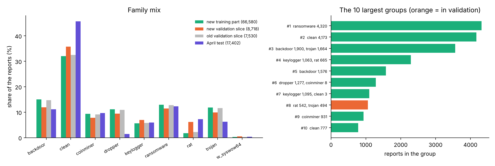

# Group-split validation slice (NOTES 21, Stage A, fold chosen by NOTES 21.3)

**In one sentence.** The old validation slice was a random 10% of January, so almost every validation report had an exact twin in the training part; the new slice is built from whole *groups* of reports that share an API sequence, so no group is on both sides. This is the result of Stage A (nothing is trained yet).

## How it was built

* **Group** = reports with the same `hash_apis` (the hash of the API-name sequence), joined with reports that have the same first 512 tokens, and with reports that have the same filtered call-name sequence (the last relation was added after the first run, see NOTES 21.1, because 0.9% of the validation reports of the first version still had an identical filtered call-name sequence in training; no model result was involved).
* **Split** = fold 9 of `StratifiedGroupKFold(10, shuffle, random_state 2026)` on the 9 family labels with these groups; the fold was chosen by the rule of NOTES 21.3 (below), after fold 0 was rejected. January has 6,771 `hash_apis` groups, 6,695 groups after the stricter grouping; 5,491 are in training and 1204 in validation.
* **Sizes:** training 66,580 reports, validation 8,718 (11.58%). Split hash `c3a2c99bbf5dc6ddc60697e7b9468bf8` (asserted in every later run by `baseline/groupsplit.py`; indices in `split.npz`).

## Checks

| check | result |
|---|---|
| Groups shared by training and validation (must be 0) | 0 |
| Validation reports whose `hash_apis` occurs in training (must be 0) | 0.0% |
| First-512-token sequences (old tokenizer) on both sides | 0 |
| First-512-token sequences (NEW tokenizer) on both sides | 0 |
| *for comparison:* old validation slice, reports whose `hash_apis` occurs in the old training part | 94.2% |
| *for comparison:* April reports whose `hash_apis` occurs in the new training part | 32.6% |

**Near-duplicates** (share of reports that have a training report within a normalised edit distance of the API-name sequence; distance = Levenshtein / longer length; exact computation between distinct sequences):

| distance <= | old validation vs old training | **new validation vs new training** | April vs new training |
|---|---|---|---|
| 0 | 94.3% | 0.0% | 32.7% |
| 0.01 | 94.7% | 16.7% | 43.2% |
| 0.05 | 96.1% | 56.6% | 63.4% |
| 0.1 | 97.0% | 62.1% | 74.7% |

Reading: exact twins are gone (0%), but **57% of the new validation reports still have a training report within 5% edit distance, about the same as April (63%)**; at 1% distance the new slice is much farther from training (17%) than April (43%). So the new slice is a strictly harder test than the old one and, in the 5% sense, about as close to training as April; April itself still has 33% exact twins.

## Counts per family

| family | training | validation | share in validation | old validation | April |
|---|---|---|---|---|---|
| backdoor | 10,022 | 1,039 | 9.4% | 1,106 | 1,940 |
| clean | 21,314 | 3,119 | 12.8% | 2,444 | 7,944 |
| coinminer | 6,208 | 683 | 9.9% | 689 | 1,684 |
| dropper | 7,422 | 821 | 10.0% | 824 | 252 |
| keylogger | 3,770 | 608 | 13.9% | 438 | 1,041 |
| ransomware | 8,629 | 998 | 10.4% | 963 | 2,139 |
| rat | 1,155 | 542 | 31.9% | 170 | 1,258 |
| trojan | 7,867 | 866 | 9.9% | 873 | 1,085 |
| windows_syswow64 | 193 | 42 | 17.9% | 23 | 59 |

**Largest groups:** 4,320 (ransomware 4,320, train); 4,173 (clean 4,173, train); 3,564 (backdoor 1,900, trojan 1,664, train); 2,292 (keylogger 1,063, rat 665, train); 1,576 (backdoor 1,576, train); 1,286 (dropper 1,277, coinminer 8, train). The largest group is 6.5% of the training part.

## Which fold, and why (NOTES 21.3)

Fold 0 was the first choice (fixed in NOTES 21 before anything was computed). It met the acceptance rules but was rejected: its largest group was 52% of the validation slice (58 groups), benign was 19% of it (January: 32.8%), and three families had fewer than 300 reports (ransomware 273, keylogger 192, rat 166). The owner then fixed a rule before it was applied, using data statistics only (no model, no April): a fold is a **candidate** if every family (clean, backdoor, coinminer, dropper, keylogger, ransomware, rat, trojan; windows_syswow64 is exempt, it has only 235 reports in January) has at least 300 validation reports AND its benign share (clean + windows_syswow64) is within 5 points of January's (32.8%, so 27.8% to 37.8%); among candidates take the smallest largest-group share, then more groups, then the lower fold number.

| fold | reports | share | benign share | groups | largest group share | smallest family | all families >= 300 | benign within 5 pt |  |
|---|---|---|---|---|---|---|---|---|---|
| 0 | 6891 | 9.2% | 19.2% | 58 | 52% | 166 | no | no |  |
| 1 | 5824 | 7.7% | 24.5% | 194 | 27% | 32 | no | no |  |
| 2 | 9010 | 12.0% | 15.4% | 77 | 48% | 29 | no | no |  |
| 3 | 6547 | 8.7% | 33.9% | 835 | 20% | 47 | no | yes |  |
| 4 | 7467 | 9.9% | 29.7% | 834 | 31% | 430 | yes | yes | **candidate** |
| 5 | 7467 | 9.9% | 34.1% | 980 | 15% | 46 | no | yes |  |
| 6 | 7467 | 9.9% | 40.2% | 1087 | 12% | 46 | no | no |  |
| 7 | 7467 | 9.9% | 42.6% | 1094 | 10% | 78 | no | no |  |
| 8 | 8440 | 11.2% | 49.7% | 332 | 49% | 46 | no | no |  |
| **9** | 8718 | 11.6% | 36.3% | 1204 | 12% | 542 | yes | yes | **candidate** |

Candidates: folds 4, 9. **Chosen: fold 9** (smallest largest-group share). The window uses January's computed benign share 32.8%; with the rounded 34% the candidates would be the same.

**The chosen slice:** 8,718 reports (11.6%), 1,204 groups, largest group 12.1% of the slice (a group of 1,056: rat 542, trojan 494), benign 36.3%. Near-duplicates within 1% edit distance: 16.7% (April 43.2%); within 5%: 56.6% (April 63.4%). Caveat: rat has 542 validation reports, and all of them (542) come from that one group; the training part has 1,155 rat reports (January has 1,697 in all).

## New tokenizer

BPE-50k refit on the 66,580 training reports only (no validation, no April), same settings as before (authors' `JSONTokenizerBPE`, vocabulary 50,000, authors' cleaning and stop words, pinned commit). All 92,700 reports re-tokenised; call-token store rebuilt with the new tokenizer. The old tokenizer files were not touched.

|  |  |
|---|---|
| pieces in the old / new vocabulary | 50,001 / 50,001 |
| pieces in both | 41,799 |
| pieces only in the old vocabulary | 8,202 |
| pieces only in the new vocabulary | 8,202 |
| pieces in both with the same id | 102 |
| reports whose first 512 tokens are identical (as pieces) in both tokenisations | 47.8% |
| token positions (first 512) with the same piece | 72.3% |
| median tokens per report, old / new | 1061 / 1061 |
| total number of tokens, change | +0.28% |

Kernel checks (all passed): labels and the number of calls of every report equal the old ones; the first 512 tokens of the new store equal the rows of the new `x_train` / `x_test` for all reports (differing: 0); full re-tokenisation equals the concatenation of the pieces for 3,000 random reports (differing: 0); kernel time 66.0 min.

## What came after Stage A

Stage B (choices on this slice) is in `stage_b/` (tables, loss curves, per-family numbers; NOTES 21.5 to 21.8), Stage C (both models retrained, one April evaluation each, old-split models next to them) in `stage_c/README.md`. Short version: on this slice no setting stands out (validation pAUC 0.41 to 0.49 for every candidate), and the models trained on the new training part score 7 to 12 points lower on April than the old-split models.

## Files

`split.npz`, `split_hash.json`, `split_summary.json` (all ten folds), `checks.json`, `tokenizer_compare.json`, `checks_gs_tokens.json`, `fig_family_composition.png`; code `baseline/groupsplit.py`, `gs_tokens.py`, `gs_compare.py`, `gs_report.py`; plan and amendment in NOTES.md section 21.
