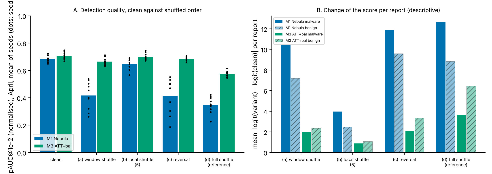
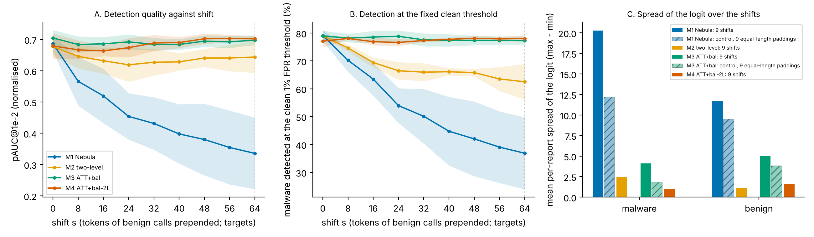

# Do the models use the order of the calls? Shuffle test and shift test (CPU, April, corrected tokenizer)

Pre-registered in `NOTES_ORDER.md` (committed before any score existed). Models: the final corrected-tokenizer models, stored weights, no training, no GPU. All 17,402 April reports; 10 seeds for M1 and M3, **3 seeds (0, 1, 2) for M2 and M4** (the two-level models are about 10 times slower on CPU; for 3 seeds "RESOLVED" needs the cluster interval to exclude 0 and all 3 seeds to have the same sign, and the intervals are wide). Primary metric: pAUC@1e-2 normalised (area up to FPR 0.01 divided by 0.01; chance 0.005). Everything runs on CPU in this container; no Kaggle kernel was started. April was used in many earlier scoring rounds, so it is not an untouched holdout. "RESOLVED" is used only for pAUC@1e-2 under the claim rule (cluster 95% interval over the 2,509 `hash_apis` groups excludes 0 and at least 7 of 10 seeds have the same sign); AUC, TPR and logit numbers are descriptive.

## Summary in plain English

- **M1 (Nebula) clearly uses order and position.** If the calls inside the first 512 tokens are put in random order (same calls, same place in the window), pAUC@1e-2 falls from 0.686 to 0.417 (-26.9 points, RESOLVED, all 10 seeds). Reversing the calls does the same (-27.1). Even a light local shuffle (groups of 5) costs 4.2 points (RESOLVED, but below the 5-point line). The score of a report moves by about 10 logit units on average.
- **M3 (ATT+bal) behaves mostly like a bag of calls, with a small order effect.** The same window shuffle costs 4.0 points (RESOLVED, cluster interval 1.8 to 6.7; it is under the 5-point line, so "in between" by the pre-registered rule), the local shuffle 0.4 points (not resolved; interval inside +-2 points, "bag-like"), the reversal 2.0 points (not resolved). The score moves by about 2 logit units, against about 10 for M1.
- **A full shuffle of the whole report (reference only) hurts both models more** (M1 -33.8, M3 -13.3), because it brings other calls into the window: this is the confounder the window-preserving shuffle removes. For M3 only about 4 of the 13.3 points of the full shuffle are reproduced by the window-preserving shuffle; the rest comes from which calls are in view, not from their order.
- **Shift test: M1 is very sensitive to where the report starts, M3 is almost flat.** Prepending only about 8 tokens of benign calls (one or two calls) lowers M1's pAUC by 12 points and its detection at the clean 1% threshold from 79.1% to 70.3%; at about 64 tokens it is 33.6 pAUC points and 36.9% detection. M3 loses 2.1 points at s of about 8 (RESOLVED) and then stays between -0.7 and -2.1 points for all larger shifts (not resolved); detection at the clean threshold stays at 77.3 to 78.8% (79.0% unshifted).
- **The shape of the M1 curve is a steady fall, not a pattern that repeats with the 64-token block.** So it is not a block-boundary effect in the narrow sense. M1 reacts to the whole report being moved (and to the extra calls and the loss of the last tokens of the window; the experiment moves all three together). The spread of M1's logit over the nine shifts (20.3 for malware) is larger than the spread over nine different paddings of the same length (12.2), so the shift itself matters beyond which calls were added; for M3 the numbers are 4.1 against 1.9.
- **Pre-registered verdicts.** Test 1 order sensitivity: M1 *order-sensitive* (window shuffle and reversal), local shuffle in between; M3 window shuffle and reversal *in between*, local shuffle *bag-of-calls-like*. Test 2: M1 *position-sensitive*; M3 *in between* (largest pAUC change 2.1 points, the "flat" line was 2.0; the detection change at the clean threshold is at most 1.7 points).
- **The two-level models (M2, M4; window 4,096 tokens; 3 seeds only).** M4 (balanced padding) is the least sensitive model on both tests: no drop under the window or local shuffle, flat shift curve. M2 (no padding) is in between M1 and M3: -5.6 points under the window shuffle (RESOLVED with 3 seeds) and 3 to 6 points under shifts (not resolved; its detection at the fixed clean threshold falls from 79% to 62%). Ordering by sensitivity to arrangement: M1 >> M2 > M3 >= M4 (descriptive; M2 and M4 have 3 seeds, so their intervals are wide). Details at the end of this file.
- **What this does not say.** "Order" for M1 cannot be separated from "absolute position": its flatten pooling and positional encoding tie every position to its own weights, so moving a call changes both. The tests say how much the score depends on arrangement, not which feature of the arrangement the model uses. Only reports with at least 2 calls inside the window can change (99.0% of the reports; median 80 calls in the 512 tokens).

## Checks (all passed; a failed check would have written `STOP.txt`)
- C1: the unedited reports rebuilt from the call store (clean set of Test 1 = shift 0 of Test 2) reproduce the stored April logits of every model and seed over all 17,402 reports: largest absolute difference 3.8e-5 (M1), 1.5e-5 (M3), 3.1e-6 (M2), 3.8e-6 (M4); limit 1e-4. The rebuilt 512-token rows equal the rows of `x_test` token for token (`checks_m*_test*.json`).
- C2: for every report and each of the variants (a), (b), (c): the same set of calls inside the window, the same sorted multiset of window tokens, the same total token count, identical tokens after the shuffled block (asserted in the loop; none failed).
- C3: the exact shift s of every report is the token length of the prepended calls, never above its target, and the prepended report's total length equals clean total + s (asserted for every report).
- The exact shifts: mean 7.88, 15.89, 23.89, 31.89, 39.89, 47.89, 55.89, 63.89 for the targets 8 to 64; 93.4 to 93.8% of the report-target cells hit the target exactly, the others fall short by 1 to 2 tokens (no call of that length in the pool). The exact s per report and target is in `scores_test2_*.npz` (`s_exact`).

## Test 1 - shuffle (April, all reports; window = first 512 tokens for M1 and M3, first 4,096 tokens for M2 and M4)
Variants: (a) the calls completely inside the window in random order (seeded in advance), (b) random order inside consecutive groups of 5 of those calls, (c) those calls in reverse order, (d) reference: all calls of the report in random order. In (a) to (c) the same calls stay in the window. Thresholds for TPR come from each variant's own benign scores. "Drop" = clean minus variant, in pAUC points; the interval is the cluster bootstrap (1,000 resamples, numpy seed 0).

| model | variant | pAUC@1e-2 | drop vs clean (points) | cluster 95% CI (points) | seeds down/up | AUC | TPR@1% (own thr) | mean abs logit change malware / benign | verdict |
|---|---|---|---|---|---|---|---|---|---|
| M1 Nebula | clean | 0.686 ± 0.026 |  |  |  | 0.9639 | 0.791 |  |  |
| M1 Nebula | (a) window shuffle | 0.417 ± 0.101 | +26.90 (RESOLVED) | [+17.74, +35.82] | 10/0 | 0.9229 | 0.516 | 10.468 / 7.190 | order-sensitive |
| M1 Nebula | (b) local shuffle (5) | 0.645 ± 0.038 | +4.15 (RESOLVED) | [+2.40, +5.90] | 10/0 | 0.9595 | 0.756 | 3.982 / 2.492 | in between / inconclusive |
| M1 Nebula | (c) reversal | 0.415 ± 0.126 | +27.10 (RESOLVED) | [+17.51, +37.84] | 10/0 | 0.8778 | 0.510 | 11.886 / 9.591 | order-sensitive |
| M1 Nebula | (d) full shuffle (reference) | 0.348 ± 0.058 | +33.83 (RESOLVED) | [+22.30, +44.37] | 10/0 | 0.9033 | 0.446 | 12.626 / 8.831 | reference |
| M2 two-level | clean | 0.677 ± 0.030 |  |  |  | 0.9706 | 0.790 |  |  |
| M2 two-level | (a) window shuffle | 0.621 ± 0.027 | +5.59 (RESOLVED) | [+1.17, +10.31] | 3/0 | 0.9675 | 0.765 | 0.854 / 0.496 | order-sensitive |
| M2 two-level | (b) local shuffle (5) | 0.661 ± 0.032 | +1.59 (not resolved) | [-0.74, +4.20] | 2/1 | 0.9698 | 0.779 | 0.390 / 0.256 | in between / inconclusive |
| M2 two-level | (c) reversal | 0.616 ± 0.042 | +6.13 (RESOLVED) | [+1.10, +11.88] | 3/0 | 0.9691 | 0.742 | 0.814 / 0.439 | order-sensitive |
| M2 two-level | (d) full shuffle (reference) | 0.629 ± 0.021 | +4.81 (RESOLVED) | [+0.45, +9.46] | 3/0 | 0.9678 | 0.765 | 0.858 / 0.487 | reference |
| M3 ATT+bal | clean | 0.705 ± 0.025 |  |  |  | 0.9693 | 0.790 |  |  |
| M3 ATT+bal | (a) window shuffle | 0.664 ± 0.027 | +4.03 (RESOLVED) | [+1.83, +6.67] | 10/0 | 0.9626 | 0.759 | 2.029 / 2.350 | in between / inconclusive |
| M3 ATT+bal | (b) local shuffle (5) | 0.701 ± 0.025 | +0.43 (not resolved) | [-0.09, +0.96] | 9/1 | 0.9680 | 0.786 | 0.884 / 1.071 | bag-of-calls-like |
| M3 ATT+bal | (c) reversal | 0.685 ± 0.015 | +1.96 (not resolved) | [-1.10, +5.57] | 9/1 | 0.9597 | 0.753 | 2.065 / 3.375 | in between / inconclusive |
| M3 ATT+bal | (d) full shuffle (reference) | 0.572 ± 0.021 | +13.33 (RESOLVED) | [+7.21, +19.87] | 10/0 | 0.9227 | 0.679 | 3.641 / 6.485 | reference |
| M4 ATT+bal-2L | clean | 0.679 ± 0.041 |  |  |  | 0.9704 | 0.771 |  |  |
| M4 ATT+bal-2L | (a) window shuffle | 0.679 ± 0.030 | +0.02 (not resolved) | [-3.36, +3.55] | 1/2 | 0.9557 | 0.781 | 0.533 / 1.026 | in between / inconclusive |
| M4 ATT+bal-2L | (b) local shuffle (5) | 0.679 ± 0.032 | +0.02 (not resolved) | [-1.26, +1.34] | 2/1 | 0.9677 | 0.777 | 0.208 / 0.390 | bag-of-calls-like |
| M4 ATT+bal-2L | (c) reversal | 0.636 ± 0.036 | +4.29 (not resolved) | [-3.39, +13.52] | 3/0 | 0.9570 | 0.733 | 0.796 / 0.935 | in between / inconclusive |
| M4 ATT+bal-2L | (d) full shuffle (reference) | 0.691 ± 0.031 | -1.18 (not resolved) | [-4.82, +2.63] | 1/2 | 0.9560 | 0.785 | 0.532 / 1.023 | reference |

AUC drops (descriptive; points of AUC): M1 (a) 4.1, (b) 0.4, (c) 8.6, (d) 6.1; M3 (a) 0.7, (b) 0.1, (c) 1.0, (d) 4.7. The logit scale differs between models (SD of the clean logits: M1 16.8 malware / 12.1 benign, M3 9.5 / 6.0), so the logit changes are also given relative to it, and by how many calls a report has in the window (`tables_test1_logits.md`): reports with fewer than 2 calls in the window cannot change (170 reports), the effect sits in the reports with 10 or more calls (15,134 reports).

| model | variant | share of reports whose order changed | mean abs logit change / SD of clean logits (malware / benign) | mean abs change by stratum of m (malware / benign): m<2 | 2<=m<10 | m>=10 |
|---|---|---|---|---|---|---|
| M1 Nebula | (a) window shuffle | 98.7% | 0.622 / 0.624 | 0.000 / 0.000 (n=170) | 2.687 / 1.653 (n=2098) | 11.452 / 8.223 (n=15134) |
| M1 Nebula | (b) local shuffle (5) | 98.7% | 0.239 / 0.210 | 0.000 / 0.000 (n=170) | 2.000 / 1.415 (n=2098) | 4.242 / 2.710 (n=15134) |
| M1 Nebula | (c) reversal | 99.0% | 0.691 / 0.817 | 0.000 / 0.000 (n=170) | 2.813 / 1.869 (n=2098) | 13.032 / 11.025 (n=15134) |
| M1 Nebula | (d) full shuffle (reference) | 98.7% | 0.748 / 0.760 | 0.000 / 0.000 (n=170) | 2.742 / 1.668 (n=2098) | 13.872 / 10.160 (n=15134) |
| M2 two-level | (a) window shuffle | 98.7% | 0.234 / 0.266 | 0.000 / 0.000 (n=170) | 0.574 / 0.416 (n=2098) | 0.893 / 0.518 (n=15134) |
| M2 two-level | (b) local shuffle (5) | 98.7% | 0.107 / 0.136 | 0.000 / 0.000 (n=170) | 0.451 / 0.355 (n=2098) | 0.386 / 0.244 (n=15134) |
| M2 two-level | (c) reversal | 99.0% | 0.223 / 0.237 | 0.000 / 0.000 (n=170) | 0.608 / 0.367 (n=2098) | 0.844 / 0.458 (n=15134) |
| M2 two-level | (d) full shuffle (reference) | 98.7% | 0.235 / 0.260 | 0.000 / 0.000 (n=170) | 0.602 / 0.410 (n=2098) | 0.895 / 0.507 (n=15134) |
| M3 ATT+bal | (a) window shuffle | 98.7% | 0.213 / 0.393 | 0.000 / 0.000 (n=170) | 1.113 / 1.553 (n=2098) | 2.151 / 2.519 (n=15134) |
| M3 ATT+bal | (b) local shuffle (5) | 98.7% | 0.093 / 0.180 | 0.000 / 0.000 (n=170) | 0.820 / 1.327 (n=2098) | 0.898 / 1.045 (n=15134) |
| M3 ATT+bal | (c) reversal | 99.0% | 0.216 / 0.568 | 0.000 / 0.000 (n=170) | 1.418 / 1.900 (n=2098) | 2.155 / 3.673 (n=15134) |
| M3 ATT+bal | (d) full shuffle (reference) | 98.7% | 0.381 / 1.090 | 0.000 / 0.000 (n=170) | 1.149 / 1.565 (n=2098) | 3.958 / 7.405 (n=15134) |
| M4 ATT+bal-2L | (a) window shuffle | 98.7% | 0.162 / 0.505 | 0.000 / 0.000 (n=170) | 0.381 / 0.462 (n=2098) | 0.555 / 1.136 (n=15134) |
| M4 ATT+bal-2L | (b) local shuffle (5) | 98.7% | 0.064 / 0.195 | 0.000 / 0.000 (n=170) | 0.283 / 0.361 (n=2098) | 0.201 / 0.401 (n=15134) |
| M4 ATT+bal-2L | (c) reversal | 99.0% | 0.241 / 0.461 | 0.000 / 0.000 (n=170) | 0.437 / 0.466 (n=2098) | 0.844 / 1.027 (n=15134) |
| M4 ATT+bal-2L | (d) full shuffle (reference) | 98.7% | 0.162 / 0.503 | 0.000 / 0.000 (n=170) | 0.388 / 0.453 (n=2098) | 0.552 / 1.133 (n=15134) |

## Test 2 - shift / block-boundary test (April, all reports)
Benign calls prepended (nested: the padding of a smaller shift is the front part of the padding of the next one), targets 0, 8, ..., 64 tokens, exact s recorded; calls drawn from the benign reports of the group-split validation slice. Detection is at the 1% FPR threshold of the unshifted benign scores of the same seed (the threshold stays fixed while s grows). The control is nine different paddings of the same length (target 32).

| model | s (target) | mean exact s | pAUC@1e-2 | diff vs s=0 (points) | cluster 95% CI | seeds down/up | AUC | malware detected at clean 1% threshold | benign false alarms at that threshold | mean logit change malware / benign |
|---|---|---|---|---|---|---|---|---|---|---|
| M1 Nebula | 0 | 0.0 | 0.686 ± 0.026 |  |  |  | 0.9639 | 79.1% | 1.00% |  |
| M1 Nebula | 8 | 7.88 | 0.566 ± 0.078 | -12.03 (RESOLVED) | [-16.57, -7.71] | 10/0 | 0.9524 | 70.3% | 1.35% | -5.791 / -0.166 |
| M1 Nebula | 16 | 15.89 | 0.519 ± 0.087 | -16.71 (RESOLVED) | [-22.85, -10.73] | 10/0 | 0.9390 | 63.5% | 1.18% | -8.341 / +1.542 |
| M1 Nebula | 24 | 23.89 | 0.454 ± 0.074 | -23.25 (RESOLVED) | [-31.93, -13.50] | 10/0 | 0.9275 | 54.0% | 0.92% | -11.196 / +1.643 |
| M1 Nebula | 32 | 31.89 | 0.431 ± 0.084 | -25.50 (RESOLVED) | [-34.39, -15.56] | 10/0 | 0.9211 | 50.1% | 0.86% | -12.919 / +1.604 |
| M1 Nebula | 40 | 39.89 | 0.398 ± 0.095 | -28.85 (RESOLVED) | [-39.15, -17.74] | 10/0 | 0.9100 | 44.8% | 0.77% | -14.703 / +2.059 |
| M1 Nebula | 48 | 47.89 | 0.380 ± 0.114 | -30.64 (RESOLVED) | [-40.99, -19.48] | 10/0 | 0.9082 | 42.0% | 0.70% | -15.414 / +2.514 |
| M1 Nebula | 56 | 55.89 | 0.354 ± 0.118 | -33.19 (RESOLVED) | [-43.48, -21.89] | 10/0 | 0.9067 | 39.1% | 0.73% | -16.218 / +2.339 |
| M1 Nebula | 64 | 63.89 | 0.336 ± 0.115 | -35.07 (RESOLVED) | [-45.81, -23.48] | 10/0 | 0.8992 | 36.9% | 0.83% | -16.831 / +2.238 |
| M2 two-level | 0 | 0.0 | 0.677 ± 0.030 |  |  |  | 0.9706 | 79.0% | 1.00% |  |
| M2 two-level | 8 | 7.88 | 0.646 ± 0.038 | -3.16 (n.r.) | [-7.88, +1.53] | 3/0 | 0.9633 | 74.7% | 0.83% | -0.530 / +0.039 |
| M2 two-level | 16 | 15.89 | 0.632 ± 0.041 | -4.54 (n.r.) | [-12.60, +2.24] | 3/0 | 0.9526 | 69.4% | 0.60% | -1.071 / +0.075 |
| M2 two-level | 24 | 23.89 | 0.619 ± 0.054 | -5.85 (n.r.) | [-15.68, +2.07] | 3/0 | 0.9479 | 66.5% | 0.56% | -1.379 / +0.064 |
| M2 two-level | 32 | 31.89 | 0.627 ± 0.043 | -5.03 (n.r.) | [-14.51, +2.49] | 3/0 | 0.9469 | 66.0% | 0.46% | -1.455 / +0.025 |
| M2 two-level | 40 | 39.89 | 0.628 ± 0.028 | -4.90 (n.r.) | [-16.14, +3.08] | 3/0 | 0.9469 | 66.1% | 0.44% | -1.552 / -0.015 |
| M2 two-level | 48 | 47.89 | 0.641 ± 0.029 | -3.66 (n.r.) | [-15.25, +4.48] | 3/0 | 0.9506 | 65.8% | 0.38% | -1.509 / -0.046 |
| M2 two-level | 56 | 55.89 | 0.641 ± 0.042 | -3.67 (n.r.) | [-14.70, +4.33] | 3/0 | 0.9545 | 63.5% | 0.31% | -1.503 / -0.074 |
| M2 two-level | 64 | 63.89 | 0.644 ± 0.050 | -3.36 (n.r.) | [-13.07, +4.14] | 2/1 | 0.9582 | 62.5% | 0.28% | -1.482 / -0.170 |
| M3 ATT+bal | 0 | 0.0 | 0.705 ± 0.025 |  |  |  | 0.9693 | 79.0% | 1.00% |  |
| M3 ATT+bal | 8 | 7.88 | 0.684 ± 0.026 | -2.10 (RESOLVED) | [-4.27, -0.33] | 10/0 | 0.9656 | 78.2% | 1.15% | -0.686 / +0.177 |
| M3 ATT+bal | 16 | 15.89 | 0.686 ± 0.022 | -1.88 (n.r.) | [-4.34, +0.19] | 8/2 | 0.9634 | 78.6% | 1.13% | -0.775 / +0.690 |
| M3 ATT+bal | 24 | 23.89 | 0.692 ± 0.024 | -1.26 (n.r.) | [-4.06, +1.75] | 8/2 | 0.9645 | 78.8% | 1.06% | -0.861 / +0.937 |
| M3 ATT+bal | 32 | 31.89 | 0.685 ± 0.020 | -2.03 (n.r.) | [-4.56, +0.25] | 8/2 | 0.9649 | 77.6% | 1.11% | -1.143 / +0.904 |
| M3 ATT+bal | 40 | 39.89 | 0.684 ± 0.017 | -2.08 (n.r.) | [-4.85, +0.24] | 9/1 | 0.9635 | 77.4% | 1.07% | -1.050 / +0.927 |
| M3 ATT+bal | 48 | 47.89 | 0.695 ± 0.019 | -1.01 (n.r.) | [-3.12, +1.12] | 7/3 | 0.9641 | 77.4% | 1.16% | -0.828 / +0.839 |
| M3 ATT+bal | 56 | 55.89 | 0.692 ± 0.020 | -1.26 (n.r.) | [-3.72, +1.00] | 8/2 | 0.9638 | 77.4% | 1.11% | -1.050 / +0.697 |
| M3 ATT+bal | 64 | 63.89 | 0.698 ± 0.015 | -0.70 (n.r.) | [-2.76, +1.46] | 6/4 | 0.9646 | 77.3% | 1.10% | -1.033 / +0.399 |
| M4 ATT+bal-2L | 0 | 0.0 | 0.679 ± 0.041 |  |  |  | 0.9704 | 77.1% | 0.99% |  |
| M4 ATT+bal-2L | 8 | 7.88 | 0.667 ± 0.030 | -1.25 (n.r.) | [-4.19, +0.84] | 3/0 | 0.9656 | 78.1% | 1.03% | -0.064 / +0.228 |
| M4 ATT+bal-2L | 16 | 15.89 | 0.663 ± 0.017 | -1.59 (n.r.) | [-6.82, +2.44] | 2/1 | 0.9596 | 76.9% | 0.97% | -0.165 / +0.345 |
| M4 ATT+bal-2L | 24 | 23.89 | 0.674 ± 0.031 | -0.55 (n.r.) | [-6.88, +4.29] | 2/1 | 0.9595 | 76.7% | 0.97% | -0.147 / +0.330 |
| M4 ATT+bal-2L | 32 | 31.89 | 0.689 ± 0.026 | +0.94 (n.r.) | [-4.06, +5.67] | 1/2 | 0.9595 | 77.3% | 1.01% | -0.072 / +0.358 |
| M4 ATT+bal-2L | 40 | 39.89 | 0.690 ± 0.018 | +1.07 (n.r.) | [-2.72, +4.81] | 1/2 | 0.9592 | 77.8% | 1.02% | -0.045 / +0.389 |
| M4 ATT+bal-2L | 48 | 47.89 | 0.702 ± 0.016 | +2.29 (n.r.) | [-1.33, +6.01] | 1/2 | 0.9587 | 78.2% | 1.05% | -0.026 / +0.435 |
| M4 ATT+bal-2L | 56 | 55.89 | 0.703 ± 0.012 | +2.37 (n.r.) | [-1.47, +6.24] | 1/2 | 0.9592 | 77.9% | 1.04% | -0.040 / +0.368 |
| M4 ATT+bal-2L | 64 | 63.89 | 0.702 ± 0.008 | +2.28 (n.r.) | [-1.74, +6.63] | 1/2 | 0.9602 | 78.1% | 1.09% | -0.025 / +0.327 |

("n.r." = not resolved.) Spread of every report's logit over the nine shifts (max - min; mean over reports and seeds) and the control:

| model | mean spread (max-min over the 9 shifts), malware / benign | median, malware / benign | mean spread / SD of clean logits, malware / benign | control: spread over 9 equal-length paddings (s about 32), malware / benign | pAUC range over s (points) [cluster CI] | verdict |
|---|---|---|---|---|---|---|
| M1 Nebula | 20.297 [17.912, 22.322] / 11.709 [10.180, 13.552] | 19.479 / 9.927 | 1.190 / 0.980 | 12.203 / 9.498 | 35.07 [23.48, 45.81] | position-sensitive |
| M2 two-level | 2.452 [1.771, 3.406] / 1.071 [0.897, 1.250] | 1.667 / 0.569 | 0.671 / 0.572 | not run | 5.85 [2.06, 16.80] | position-sensitive |
| M3 ATT+bal | 4.091 [3.616, 4.576] / 5.018 [4.573, 5.422] | 3.622 / 4.336 | 0.430 / 0.841 | 1.857 / 3.839 | 2.10 [1.60, 5.39] | in between |
| M4 ATT+bal-2L | 1.023 [0.788, 1.330] / 1.621 [1.460, 1.800] | 0.380 / 1.378 | 0.310 / 0.800 | not run | 3.95 [1.76, 9.48] | in between |

M1 minus M3: pAUC range +33.0 points [+20.4, +42.5]; spread malware +16.2 logit units [+13.9, +18.4]; spread benign +6.7 [+5.2, +8.4] (cluster 95% intervals). So M1 is clearly more sensitive than M3 on every one of the three measures; "RESOLVED" is not claimed for these two-model contrasts beyond the interval.

Reading of the shapes (descriptive): the nested shifts also change which calls are added and cut the last s tokens off the window, so a drop in a curve is "shift + extra calls + truncation" together. M1's steady fall with s (and its large spread against the equal-length control) shows a dependence on the absolute position of the report content that grows with the shift. M3's mean logit moves by about -1 for malware and about +0.9 for benign as soon as any padding is present and then stays there; there is no sign of a block-aligned pattern (the shift of exactly one block, s of about 64, has the smallest loss).

## Files
`order_tests.py` (scoring: builds every edited report in memory from the call store, checks, scores), `analyze.py` (metrics, bootstrap, tables, figures); `scores_test1_<model>.npz`, `scores_test2_<model>.npz` (logits per seed, call counts, exact s; no tokens); `checks_<model>_test<k>.json` (C1 differences, SHA-256 of the weight files used); `metrics_test1.json`, `metrics_test2.json`; `tables_*.md`; the two figures (colours and labels as `baseline/paper_figs.py`).

Reproduce (the weights and the call store are in the private Kaggle datasets `gs-fix-m1`, `gs-fix-w2-m2`, `gs-fix-w-m3`, `gs-fix-w-m4`, `gs-fix-inputs`, `nebula-groupsplit`; the authors' package at the pinned commit with `patches/`; torch CPU): `python results/order_tests/order_tests.py score --model m1 --test 1 --work <dir with in/>`, then `python results/order_tests/analyze.py --test 1 --models m1 m3`.

## M2 and M4 (two-level models, window 4,096 tokens, seeds 0 to 2 only; added after M1 and M3 were committed, as registered)
- **Test 1.** M2 (two-level, no padding in training) loses 5.6 points of pAUC under the window shuffle (RESOLVED, 3/3 seeds, cluster interval 1.2 to 10.3) and 6.1 under reversal (RESOLVED); the local shuffle costs 1.6 (not resolved). By the pre-registered rule M2 is "order-sensitive", but the effect is far smaller than for M1 (score changes of 0.2 to 0.3 SD of its logits, against 0.6 to 0.8 for M1); the full shuffle (reference) costs 4.8, about the same as the window shuffle, because 4,096 tokens already hold most calls of a report. M4 (two-level, balanced padding) shows no drop under the window shuffle (+0.0, not resolved, seeds 1 down / 2 up) or the local shuffle (+0.0, "bag-of-calls-like"), and -4.3 under reversal (not resolved; interval -3.4 to +13.5, so "in between / inconclusive"). The AUC of M4 does fall a little under the window shuffle (0.970 to 0.956, descriptive).
- **Test 2.** M4 stays flat: its pAUC changes between -1.6 and +2.4 points over all shifts (none resolved), detection at the clean threshold stays within 76.7 to 78.2% (77.1% unshifted), its logit spread (1.0 malware / 1.6 benign) is the smallest of the four models. M2 loses 3 to 6 points of pAUC (3 of 3 seeds down at most shifts, none resolved because there are only 3 seeds) and its detection at the fixed clean threshold falls from 79.0% to 62.5% at s of about 64, while its benign false alarms at that threshold fall from 1.0% to 0.3% (all its scores move down, so a fixed threshold loses malware). By the registered rule (some change larger than 5 points in pAUC or detection) M2 is "position-sensitive", though much less than M1; M4 is "in between" (largest pAUC change 2.4 points, 0.4 above the "flat" line). The equal-length control was not run for M2 and M4 (cost).
- **Across the four models (descriptive):** M1 depends most on the order and the position of the content; M2 a little; the two models trained with balanced padding (M3, M4) hardly at all. The comparison cannot say that the padding is the cause: the models also differ in architecture and in other ways, and M2/M4 have only 3 seeds.
