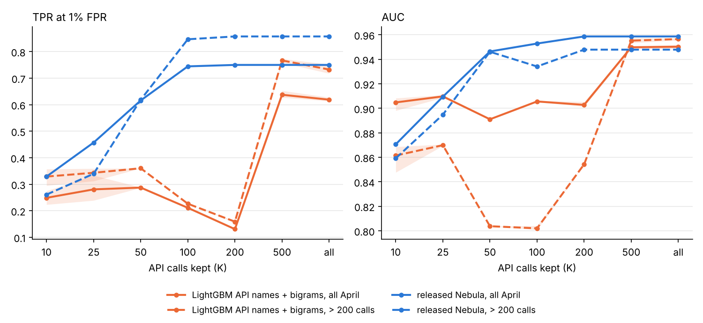

# Where the signal is: tables (generated by analyze_signal.py)

### 0. Validation split (January, grouped by API-name sequence)

`GroupShuffleSplit(test_size=0.1, random_state=0)` over the distinct `hash_apis` values of the January reports: 10% of the groups go to validation. `test` is April.

| side | groups (hash_apis) | reports | malware | largest group | groups of 1 report |
|---|---|---|---|---|---|
| train | 6,093 | 65,679 | 65.6% (43,114/65,679) | 4,312 | 3,738 |
| val | 678 | 9,619 | 78.1% (7,516/9,619) | 2,292 | 409 |
| test | 2,509 | 17,402 | 54.0% (9,399/17,402) | 864 | 1,628 |

April reports whose API-name sequence also occurs in January: 36.4% (6,329/17,402).

### 1. Simple baselines vs Nebula (April test set)

Features from Nebula's filtered reports. Bag of API names: 633 names, bigrams: 2,772 (both kept if seen in ≥ 20 January-train reports); field counts: 11 columns (records per field and per event type). LR: L2, `liblinear`, TF-IDF (sublinear tf) on the bag features, standardised dense features; C from {0.01, 0.1, 1, 10, 100} by group-weighted validation AUC. LightGBM: raw counts, fixed parameters, early stopping (100 rounds) on group-weighted validation log-loss, seeds 0/1/2: mean [min–max]. *Group-weighted*: each API-name sequence of the validation side counts once in total (weight 1 / group size), because one sequence covers 2,292 of the 9,619 validation reports. TPR thresholds come from the 8,003 April benign scores of each model; the 0.1% FPR threshold rests on 8 benign reports. FP = benign reports above the threshold (one number per seed). Fewer than 80 / 8 means ties at the threshold: a bag model gives every report with the same API names the same score.

Why group-weighted: with plain validation AUC, one run (API names + bigrams, seed 2) stopped after 1 tree (log `signal_baselines_auc_early_stop.log`). With plain validation log-loss, the prefix models of analysis 2 stopped after 16–48 trees: the 2,292-report group gets an uncertain score on short prefixes and its loss alone rises after ~20 trees, while the group-weighted loss keeps falling to ~500 trees (checked on January validation only; logs `signal_baselines_plain_logloss.log`, `signal_prefix_plain_logloss.log`). All LightGBM and LR choices in this study use the group-weighted validation metrics.

| model | AUC | TPR @1% FPR | TPR @0.1% FPR | seeds | val AUC (group-weighted) |
|---|---|---|---|---|---|
| released Nebula | 0.9586 | 75.0% (7,047/9,399; FP 80) | 51.7% (4,860/9,399; FP 7) | 1 (existing scores) | — |
| finetune_k8 | 0.9639 | 74.7% (7,018/9,399; FP 80) | 54.3% (5,101/9,399; FP 8) | 1 (existing scores) | — |
| frozen_k1 | 0.9590 | 75.8% (7,129/9,399; FP 80) | 47.8% (4,493/9,399; FP 8) | 1 (existing scores) | — |
| LR, length only | 0.6018 | 4.5% (424/9,399; FP 78) | 4.4% (417/9,399; FP 8) | deterministic (C=1) | 0.6793 |
| LightGBM, length only | 0.7574 [0.7529–0.7611] | 24.3% [24.2%–24.4%] (2,288/9,399; FP 80/80/80) | 11.5% [9.7%–14.8%] (1,083/9,399; FP 5/5/5) | 3 (iters 230, 169, 189) | 0.8245 [0.8233–0.8257] |
| LR, bag of API names | 0.8778 | 27.1% (2,550/9,399; FP 79) | 13.6% (1,277/9,399; FP 8) | deterministic (C=10) | 0.9259 |
| LightGBM, bag of API names | 0.9501 [0.9482–0.9520] | 62.9% [62.0%–63.9%] (5,916/9,399; FP 80/80/80) | 31.6% [29.2%–32.9%] (2,967/9,399; FP 5/7/7) | 3 (iters 604, 590, 569) | 0.9662 [0.9658–0.9666] |
| LR, API names + bigrams | 0.9252 | 39.6% (3,718/9,399; FP 80) | 29.2% (2,743/9,399; FP 8) | deterministic (C=10) | 0.9476 |
| LightGBM, API names + bigrams | 0.9502 [0.9483–0.9521] | 61.9% [61.3%–62.8%] (5,816/9,399; FP 79/79/80) | 35.0% [32.5%–36.5%] (3,292/9,399; FP 4/4/4) | 3 (iters 521, 520, 528) | 0.9679 [0.9673–0.9690] |
| LR, API names + field counts | 0.8775 | 30.7% (2,887/9,399; FP 80) | 13.0% (1,219/9,399; FP 8) | deterministic (C=10) | 0.9228 |
| LightGBM, API names + field counts | 0.9503 [0.9484–0.9512] | 58.2% [54.3%–60.4%] (5,468/9,399; FP 79/79/80) | 31.0% [29.2%–33.7%] (2,916/9,399; FP 7/7/6) | 3 (iters 509, 600, 685) | 0.9669 [0.9660–0.9676] |

Best on group-weighted January validation AUC: LR = `lr_api_bigram`, LightGBM = `lgbm_api_bigram`.

#### 1b. TPR at 1% FPR per family (April)

| model | backdoor (n=1,940) | coinminer (n=1,684) | dropper (n=252) | keylogger (n=1,041) | ransomware (n=2,139) | rat (n=1,258) | trojan (n=1,085) |
|---|---|---|---|---|---|---|---|
| released Nebula | 82.9% | 81.9% | 73.4% | 52.2% | 66.8% | 85.5% | 76.2% |
| finetune_k8 | 80.0% | 66.3% | 77.4% | 88.1% | 60.4% | 84.8% | 80.9% |
| frozen_k1 | 82.2% | 79.5% | 71.8% | 64.4% | 66.5% | 83.9% | 79.8% |
| LR, length only | 0.1% | 0.1% | 0.0% | 0.1% | 19.5% | 0.1% | 0.2% |
| LightGBM, length only | 53.6% [53.6%–53.7%] | 7.5% [7.5%–7.5%] | 4.6% [4.4%–5.2%] | 3.7% [3.0%–4.4%] | 32.7% [32.7%–32.7%] | 10.9% [10.9%–10.9%] | 21.7% [21.6%–21.9%] |
| LR, bag of API names | 51.3% | 18.4% | 57.5% | 8.2% | 23.7% | 0.6% | 46.2% |
| LightGBM, bag of API names | 82.7% [82.6%–82.8%] | 55.7% [54.2%–57.8%] | 51.5% [51.2%–52.0%] | 17.2% [16.9%–17.3%] | 59.9% [56.1%–65.8%] | 78.4% [78.2%–78.5%] | 73.4% [73.3%–73.6%] |
| LR, API names + bigrams | 77.2% | 24.8% | 62.7% | 13.3% | 29.0% | 12.5% | 67.4% |
| LightGBM, API names + bigrams | 77.6% [73.6%–83.5%] | 57.1% [56.2%–59.0%] | 51.6% [51.2%–52.0%] | 17.0% [16.8%–17.3%] | 58.4% [58.3%–58.4%] | 79.0% [77.9%–80.1%] | 73.6% [73.5%–73.7%] |
| LR, API names + field counts | 52.1% | 18.5% | 58.7% | 5.7% | 24.9% | 10.9% | 63.5% |
| LightGBM, API names + field counts | 82.6% [82.5%–82.7%] | 41.0% [39.4%–42.2%] | 51.3% [50.8%–52.4%] | 17.1% [16.8%–17.3%] | 50.5% [35.2%–58.8%] | 78.7% [78.5%–78.9%] | 73.4% [73.0%–73.6%] |

#### 1c. Released Nebula minus best LightGBM (`lgbm_api_bigram`, mean of 3 seeds), paired bootstrap

| metric | difference | 95% interval |
|---|---|---|
| AUC | +0.0082 | [+0.0054, +0.0109] |
| TPR @1% FPR | +11.7 pp | [+10.0 pp, +15.9 pp] |
| TPR @0.1% FPR | +16.4 pp | [-35.7 pp, +25.8 pp] |

#### 1d. Top 15 LightGBM features by gain (API names + bigrams, seed 0)

| feature | gain share |
|---|---|
| queryperformancecounter>isprocessorfeaturepresent | 43.4% |
| getprocaddress>getprocaddress | 12.0% |
| heapalloc>multibytetowidechar | 3.9% |
| getprocaddress | 3.9% |
| loadlibraryexw | 3.4% |
| loadlibraryexw>getprocaddress | 3.4% |
| getmodulehandlea | 1.9% |
| getsystemtimeasfiletime | 1.5% |
| initializecriticalsection | 1.4% |
| getprocaddress>getsysteminfo | 1.3% |
| sleep | 1.2% |
| getcurrentthreadid | 1.2% |
| __set_app_type>setunhandledexceptionfilter | 1.1% |
| registerclassexa | 1.1% |
| setlasterror>getlasterror | 1.1% |

(gain share is relative to the top 40 features.)

### 2. Prefix curve: how many API calls are needed?

#### 2a. How many API calls fit in Nebula's first 512 tokens (measured on the tokenized reports)

`calls fully inside 512` counts calls whose last token is at position < 512; `calls starting inside 512` counts calls whose first token is. For reports ≤ 512 tokens every call fits.

| reports | calls fully inside 512: median [p25–p75] | calls starting inside 512: median [p25–p75] | tokens before the API list: median [p25–p75] | tokens per call (median) |
|---|---|---|---|---|
| all reports (n=92,700) | 82 [25–97] | 83 [25–98] | 1 [1–8] | 5.41 |
| reports > 512 tokens (n=61,207) | 92 [82–100] | 93 [83–101] | 1 [1–11] | 5.34 |
| reports > 512 tokens, January (n=50,164) | 92 [83–100] | 93 [83–101] | 1 [1–11] | 5.30 |
| reports > 512 tokens, April (n=11,043) | 94 [81–100] | 95 [82–101] | 1 [1–1] | 5.41 |

#### 2b. Detection against the number of API calls kept (April; 6,857 reports have > 200 calls)

Only the `apis` list is cut to its first K calls; file, registry and network fields are kept. LightGBM is trained on January prefixes of the same length and early-stopped on the group-weighted validation log-loss (seeds 0/1/2). Released Nebula is only re-scored. Thresholds: from the April benign scores of all April reports at the same K (also for the > 200-call subset). Nebula is ranked by its logit (scores files hold logits). The last column is the same LightGBM on the January validation side (all reports): there, more calls always help.

| model | subset | K (calls) | AUC | TPR @1% FPR | TPR @0.1% FPR | malware caught @1% | Jan val AUC (group-weighted) |
|---|---|---|---|---|---|---|---|
| LightGBM API names + bigrams | all April (malware n=9,399) | 10 | 0.9048 [0.8981–0.9082] | 24.9% [22.3%–27.5%] | 16.1% [13.5%–18.7%] | 2,337 | 0.9013 [0.8947–0.9139] |
| LightGBM API names + bigrams | all April (malware n=9,399) | 25 | 0.9097 [0.9086–0.9109] | 28.1% [23.9%–33.3%] | 14.7% [13.3%–16.9%] | 2,637 | 0.8972 [0.8956–0.8988] |
| LightGBM API names + bigrams | all April (malware n=9,399) | 50 | 0.8910 [0.8908–0.8913] | 28.7% [28.7%–28.8%] | 18.9% [18.8%–19.0%] | 2,700 | 0.9271 [0.9259–0.9281] |
| LightGBM API names + bigrams | all April (malware n=9,399) | 100 | 0.9056 [0.9052–0.9063] | 21.1% [21.0%–21.2%] | 21.1% [21.0%–21.2%] | 1,984 | 0.9392 [0.9384–0.9401] |
| LightGBM API names + bigrams | all April (malware n=9,399) | 200 | 0.9028 [0.9014–0.9053] | 13.1% [12.8%–13.3%] | 13.1% [12.8%–13.3%] | 1,227 | 0.9550 [0.9543–0.9556] |
| LightGBM API names + bigrams | all April (malware n=9,399) | 500 | 0.9498 [0.9485–0.9505] | 63.7% [62.7%–65.3%] | 34.9% [34.2%–35.3%] | 5,990 | 0.9686 [0.9684–0.9690] |
| LightGBM API names + bigrams | all April (malware n=9,399) | all | 0.9502 [0.9483–0.9521] | 61.9% [61.3%–62.8%] | 35.0% [32.5%–36.5%] | 5,816 | 0.9679 [0.9673–0.9690] |
| LightGBM API names + bigrams | > 200 calls (malware n=4,312) | 10 | 0.8614 [0.8477–0.8686] | 32.9% [29.5%–35.7%] | 18.2% [14.8%–21.0%] | 1,418 | — |
| LightGBM API names + bigrams | > 200 calls (malware n=4,312) | 25 | 0.8699 [0.8694–0.8706] | 34.3% [31.2%–35.9%] | 17.5% [15.0%–21.0%] | 1,480 | — |
| LightGBM API names + bigrams | > 200 calls (malware n=4,312) | 50 | 0.8037 [0.8037–0.8038] | 36.0% [36.0%–36.0%] | 21.2% [21.2%–21.2%] | 1,553 | — |
| LightGBM API names + bigrams | > 200 calls (malware n=4,312) | 100 | 0.8020 [0.8009–0.8041] | 22.6% [22.6%–22.6%] | 22.6% [22.6%–22.6%] | 976 | — |
| LightGBM API names + bigrams | > 200 calls (malware n=4,312) | 200 | 0.8543 [0.8540–0.8544] | 15.9% [15.6%–16.2%] | 15.9% [15.6%–16.2%] | 685 | — |
| LightGBM API names + bigrams | > 200 calls (malware n=4,312) | 500 | 0.9552 [0.9533–0.9575] | 76.7% [75.9%–77.3%] | 47.1% [46.9%–47.2%] | 3,306 | — |
| LightGBM API names + bigrams | > 200 calls (malware n=4,312) | all | 0.9565 [0.9556–0.9572] | 73.2% [71.8%–75.1%] | 45.1% [41.3%–47.4%] | 3,158 | — |
| released Nebula | all April (malware n=9,399) | 10 | 0.8706 | 32.9% | 17.6% | 3,092 | — |
| released Nebula | all April (malware n=9,399) | 25 | 0.9094 | 45.7% | 19.8% | 4,296 | — |
| released Nebula | all April (malware n=9,399) | 50 | 0.9464 | 61.6% | 25.2% | 5,788 | — |
| released Nebula | all April (malware n=9,399) | 100 | 0.9528 | 74.4% | 51.3% | 6,996 | — |
| released Nebula | all April (malware n=9,399) | 200 | 0.9586 | 75.0% | 51.8% | 7,047 | — |
| released Nebula | all April (malware n=9,399) | 500 | 0.9586 | 75.0% | 51.8% | 7,047 | — |
| released Nebula | all April (malware n=9,399) | all | 0.9586 | 75.0% | 51.8% | 7,047 | — |
| released Nebula | > 200 calls (malware n=4,312) | 10 | 0.8592 | 26.1% | 13.5% | 1,125 | — |
| released Nebula | > 200 calls (malware n=4,312) | 25 | 0.8948 | 33.9% | 14.3% | 1,463 | — |
| released Nebula | > 200 calls (malware n=4,312) | 50 | 0.9461 | 61.9% | 19.5% | 2,667 | — |
| released Nebula | > 200 calls (malware n=4,312) | 100 | 0.9341 | 84.6% | 57.5% | 3,650 | — |
| released Nebula | > 200 calls (malware n=4,312) | 200 | 0.9479 | 85.7% | 58.7% | 3,696 | — |
| released Nebula | > 200 calls (malware n=4,312) | 500 | 0.9479 | 85.7% | 58.7% | 3,696 | — |
| released Nebula | > 200 calls (malware n=4,312) | all | 0.9479 | 85.7% | 58.7% | 3,696 | — |

### 3. Ablations of released Nebula (inference only)

Each change is applied to Nebula's filtered report, which is then tokenized and cut to 512 tokens as usual. Thresholds come from the benign scores of the changed reports; `crossed` uses the unmodified model's 1% FPR threshold and counts reports on the other side after the change (either direction). Metrics rank reports by Nebula's logit: the changed reports push hundreds of benign scores to exactly 1.0 in float32 (last column), and with the probability the 1% threshold would sit on that tie. Scores files hold logits; `mean |Δscore|` is on the probability scale. sigmoid(logit) of the unmodified reports reproduces `nebula_score_chunk0.npy` (max |diff| in the log). Removing arguments or return values deletes the key from every call (the key names are stopwords, so they produce no tokens either way).

#### 3a. Placeholder for hex values (chosen on January validation)

Candidates must be one known token (not `<unk>`, id 1) and not a hex value. Among them, the one that changes January-validation scores least under the address replacement is used: **`heap`**.

| candidate | pieces | ids | single known token | mean |Δscore| on Jan val (addr_ph) | Jan val AUC |
|---|---|---|---|---|---|
| addr | ▁addr | [38884] | True | 0.2930 | 0.7786 |
| value | ▁value | [29992] | True | 0.4212 | 0.7756 |
| mem | ▁mem | [543] | True | 0.3867 | 0.7899 |
| heap | ▁heap | [110] | True | 0.1755 | 0.8192 |
| ptr | ▁p tr | [357, 64] | False | — | — |
| handle | ▁ handle | [49966, 212] | False | — | — |
| buf | ▁ buf | [49966, 7721] | False | — | — |
| data | ▁data | [28198] | True | 0.3573 | 0.7457 |
| hex | ▁he x | [3383, 49967] | False | — | — |
| unk | ▁un k | [1760, 49981] | False | — | — |

#### 3b. Results

| set | change | AUC | TPR @1% FPR | TPR @0.1% FPR | ΔAUC | ΔTPR @1% | ΔTPR @0.1% | crossed the 1% threshold | mean \|Δscore\| | benign at p = 1.0 (float32) |
|---|---|---|---|---|---|---|---|---|---|---|
| April test | none (unmodified) | 0.9586 | 75.0% (7,047/9,399) | 51.8% (4,873) |  |  |  |  |  | 5 |
| April test | shuffle API call order (3 seeds) | 0.7139 [0.7109–0.7158] | 12.1% [11.8%–12.3%] (1,136) | 7.0% [6.6%–7.4%] (661) | -0.2448 [-0.2477–-0.2429] | -62.9 pp [-63.2 pp–-62.7 pp] | -44.8 pp [-45.2 pp–-44.5 pp] | 31.8% [31.6%–32.1%] (3,763 malware lost, 1,216 benign gained) | 0.334 [0.331–0.337] | 41 [31–53] |
| April test | remove all arguments | 0.7537 | 9.9% (933) | 8.1% (762) | -0.2049 | -65.0 pp | -43.7 pp | 28.8% (4,439 malware lost, 279 benign gained) | 0.281 | 5 |
| April test | remove return values | 0.9070 | 43.6% (4,095) | 24.6% (2,316) | -0.0517 | -31.4 pp | -27.2 pp | 15.7% (1,695 malware lost, 167 benign gained) | 0.185 | 7 |
| April test | address-like hex (≥ 0x10000) → placeholder | 0.6236 | 15.7% (1,472) | 6.3% (594) | -0.3351 | -59.3 pp | -45.5 pp | 33.4% (923 malware lost, 4,069 benign gained) | 0.370 | 25 |
| April test | all hex values → placeholder | 0.7672 | 2.4% (230) | 0.1% (10) | -0.1914 | -72.5 pp | -51.7 pp | 24.9% (2,169 malware lost, 1,398 benign gained) | 0.266 | 365 |
| April test | remove file, registry, network fields | 0.9543 | 73.0% (6,859) | 46.5% (4,374) | -0.0044 | -2.0 pp | -5.3 pp | 3.4% (354 malware lost, 9 benign gained) | 0.030 | 5 |
| April test | API names only | 0.6226 | 2.2% (204) | 2.1% (198) | -0.3361 | -72.8 pp | -49.7 pp | 35.1% (5,055 malware lost, 599 benign gained) | 0.358 | 198 |
| January validation | none (unmodified) | 0.9984 | 98.9% (7,437/7,516) | 78.9% (5,933) |  |  |  |  |  | 1 |
| January validation | shuffle API call order (3 seeds) | 0.8120 [0.8092–0.8148] | 33.1% [32.1%–33.9%] (2,488) | 24.1% [22.5%–26.5%] (1,813) | -0.1865 [-0.1892–-0.1836] | -65.9 pp [-66.9 pp–-65.1 pp] | -54.8 pp [-56.4 pp–-52.5 pp] | 32.5% [32.3%–32.7%] (2,739 malware lost, 367 benign gained) | 0.291 [0.288–0.294] | 4 [3–5] |
| January validation | remove all arguments | 0.8839 | 29.8% (2,238) | 19.5% (1,466) | -0.1145 | -69.2 pp | -59.4 pp | 29.4% (2,546 malware lost, 242 benign gained) | 0.223 | 4 |
| January validation | remove return values | 0.9446 | 61.2% (4,603) | 41.2% (3,096) | -0.0538 | -37.7 pp | -37.7 pp | 24.8% (2,325 malware lost, 38 benign gained) | 0.190 | 1 |
| January validation | address-like hex (≥ 0x10000) → placeholder | 0.8192 | 37.8% (2,841) | 26.5% (1,995) | -0.1792 | -61.1 pp | -52.4 pp | 19.0% (1,118 malware lost, 677 benign gained) | 0.175 | 9 |
| January validation | all hex values → placeholder | 0.7552 | 23.4% (1,756) | 5.9% (445) | -0.2433 | -75.6 pp | -73.0 pp | 34.0% (2,948 malware lost, 304 benign gained) | 0.350 | 29 |
| January validation | remove file, registry, network fields | 0.9845 | 92.3% (6,935) | 65.9% (4,952) | -0.0139 | -6.7 pp | -13.1 pp | 5.4% (508 malware lost, 4 benign gained) | 0.053 | 0 |
| January validation | API names only | 0.5561 | 18.0% (1,355) | 7.6% (568) | -0.4424 | -80.9 pp | -71.4 pp | 60.0% (5,311 malware lost, 432 benign gained) | 0.599 | 19 |

#### 3c. TPR at 1% FPR per family (April)

| model | backdoor (n=1,940) | coinminer (n=1,684) | dropper (n=252) | keylogger (n=1,041) | ransomware (n=2,139) | rat (n=1,258) | trojan (n=1,085) |
|---|---|---|---|---|---|---|---|
| none (unmodified) | 82.9% | 81.9% | 73.4% | 52.2% | 66.8% | 85.5% | 76.2% |
| shuffle API call order | 8.5% [7.4%–9.6%] | 3.5% [2.8%–4.1%] | 33.7% [32.9%–34.9%] | 2.4% [2.3%–2.7%] | 29.7% [29.2%–30.2%] | 2.0% [1.7%–2.1%] | 13.0% [12.4%–13.9%] |
| remove all arguments | 9.7% | 1.5% | 29.0% | 1.2% | 20.7% | 0.4% | 17.1% |
| remove return values | 60.4% | 30.6% | 56.7% | 29.3% | 52.1% | 26.9% | 46.9% |
| address-like hex (≥ 0x10000) → placeholder | 15.0% | 4.5% | 53.6% | 1.4% | 29.3% | 0.3% | 29.9% |
| all hex values → placeholder | 0.4% | 1.9% | 7.5% | 0.7% | 1.0% | 0.4% | 12.7% |
| remove file, registry, network fields | 70.9% | 81.9% | 73.4% | 54.9% | 67.8% | 86.0% | 75.2% |
| API names only | 0.4% | 1.5% | 24.6% | 1.3% | 1.1% | 0.2% | 6.4% |

### 4. Attribution: integrated gradients on 1,000 April reports

Stratified sample (seed 0): 500 malware (backdoor 72, coinminer 72, dropper 72, keylogger 71, ransomware 71, rat 71, trojan 71) and 500 benign. Method: integrated gradients on the output of Nebula's embedding layer, 128 steps (midpoint rule), target = Nebula's logit, attribution of a token = sum over the 64 embedding dimensions. Baseline = the embedding of the empty report `{'apis': []}` tokenized and padded. Completeness error |Σ attribution − (logit − baseline logit)|: median 0.0384, p95 0.2100 (mean |logit − baseline logit| = 27.79). Token categories come from tokenizing the report in pieces (exact for 1000/1000 reports; the rest are left out of 4a and 4c). Padding positions match the baseline's padding, so their attribution is zero by construction.

#### 4a. Share of total absolute attribution per category

| class | API name | address-like hex (≥ 0x10000) | small hex | string argument | field key | file/registry/network value | padding | other |
|---|---|---|---|---|---|---|---|---|
| malware (n=500) | 22.8% | 30.3% | 13.4% | 24.4% | 2.1% | 5.9% | 0.0% | 1.2% |
| malware: share of the 512 positions | 26.3% | 17.5% | 14.3% | 15.7% | 0.3% | 1.8% | 23.1% | 1.1% |
| malware: mean signed attribution per report (logit) | -9.18 | +8.65 | -3.84 | -2.98 | +2.47 | -4.23 | +0.00 | -0.69 |
| benign (n=500) | 24.7% | 31.8% | 22.0% | 18.4% | 0.7% | 1.4% | 0.0% | 1.1% |
| benign: share of the 512 positions | 23.6% | 11.4% | 24.6% | 9.2% | 0.2% | 0.3% | 29.6% | 1.0% |
| benign: mean signed attribution per report (logit) | -13.00 | -13.21 | -3.10 | -11.17 | +0.68 | -1.08 | +0.00 | +0.01 |

#### 4b. Share of absolute attribution per 64-token block (Nebula attends only inside these blocks)

| class | tokens 0–63 | tokens 64–127 | tokens 128–191 | tokens 192–255 | tokens 256–319 | tokens 320–383 | tokens 384–447 | tokens 448–511 |
|---|---|---|---|---|---|---|---|---|
| malware | 37.9% | 12.1% | 12.3% | 7.1% | 10.9% | 7.0% | 5.9% | 6.8% |
| benign | 37.7% | 13.6% | 14.5% | 7.6% | 9.1% | 5.8% | 4.5% | 7.3% |

#### 4c. Top 30 tokens by mean attribution (tokens with ≥ 50 occurrences in the sample)

| direction | token | category | occurrences | mean attribution | mean \|attribution\| |
|---|---|---|---|---|---|
| towards malware (highest mean) | `▁registry` | field key | 93 | +17.4730 | 17.4730 |
| towards malware (highest mean) | `▁0x7660` | small hex | 89 | +6.4271 | 6.4271 |
| towards malware (highest mean) | `▁0x1211f20` | address-like hex (≥ 0x10000) | 61 | +4.1111 | 4.1111 |
| towards malware (highest mean) | `▁0x599b5c` | address-like hex (≥ 0x10000) | 66 | +2.3074 | 2.8790 |
| towards malware (highest mean) | `▁0x7540` | small hex | 205 | +2.1054 | 2.1054 |
| towards malware (highest mean) | `▁0xfeee0009` | address-like hex (≥ 0x10000) | 191 | +2.0080 | 2.1762 |
| towards malware (highest mean) | `▁0x74e0` | small hex | 151 | +1.9644 | 1.9644 |
| towards malware (highest mean) | `▁0x4c4308` | address-like hex (≥ 0x10000) | 69 | +1.9213 | 1.9213 |
| towards malware (highest mean) | `▁gettickcount64` | string argument | 55 | +1.7413 | 2.2693 |
| towards malware (highest mean) | `▁0xfeee001d` | address-like hex (≥ 0x10000) | 157 | +1.5275 | 1.8410 |
| towards malware (highest mean) | `▁0xfeee005f` | address-like hex (≥ 0x10000) | 54 | +1.5033 | 1.5033 |
| towards malware (highest mean) | `585` | address-like hex (≥ 0x10000) | 675 | +1.4965 | 2.8846 |
| towards malware (highest mean) | `▁0x7300` | small hex | 153 | +1.4155 | 1.4155 |
| towards malware (highest mean) | `▁0x41de08` | address-like hex (≥ 0x10000) | 197 | +1.2980 | 1.4226 |
| towards malware (highest mean) | `▁getdateformatex` | string argument | 83 | +1.2448 | 1.2448 |
| towards malware (highest mean) | `▁0xfeee001a` | address-like hex (≥ 0x10000) | 187 | +1.2186 | 1.2253 |
| towards malware (highest mean) | `▁0xfeee0035` | address-like hex (≥ 0x10000) | 82 | +1.2040 | 1.2040 |
| towards malware (highest mean) | `▁0x41deb0` | address-like hex (≥ 0x10000) | 68 | +1.1555 | 1.1555 |
| towards malware (highest mean) | `▁0xfeee0040` | address-like hex (≥ 0x10000) | 81 | +1.1274 | 1.1274 |
| towards malware (highest mean) | `▁0x78` | small hex | 92 | +1.1143 | 1.7068 |
| towards malware (highest mean) | `▁2` | string argument | 493 | +1.0996 | 1.1355 |
| towards malware (highest mean) | `▁createfilea` | string argument | 76 | +1.0285 | 8.5990 |
| towards malware (highest mean) | `▁0x7810` | small hex | 264 | +1.0218 | 1.0253 |
| towards malware (highest mean) | `▁wininet` | API name | 53 | +0.9837 | 0.9837 |
| towards malware (highest mean) | `▁0xfeee0010` | address-like hex (≥ 0x10000) | 191 | +0.9054 | 1.0231 |
| towards malware (highest mean) | `ect` | string argument | 77 | +0.9051 | 1.0369 |
| towards malware (highest mean) | `▁gettempw` | string argument | 69 | +0.8916 | 1.5126 |
| towards malware (highest mean) | `▁getmain` | API name | 72 | +0.8881 | 0.9428 |
| towards malware (highest mean) | `▁0x7f00` | small hex | 53 | +0.8859 | 0.9464 |
| towards malware (highest mean) | `▁0xfeee0025` | address-like hex (≥ 0x10000) | 100 | +0.8349 | 3.7029 |
| towards benign (lowest mean) | `▁0x41de98` | address-like hex (≥ 0x10000) | 68 | -18.1404 | 18.1404 |
| towards benign (lowest mean) | `▁getsystemtimeasfiletime` | API name | 560 | -9.1841 | 9.6177 |
| towards benign (lowest mean) | `▁0x405d54` | address-like hex (≥ 0x10000) | 70 | -6.5198 | 6.5198 |
| towards benign (lowest mean) | `▁pf` | string argument | 320 | -6.1100 | 6.6226 |
| towards benign (lowest mean) | `▁0x1211fc0` | address-like hex (≥ 0x10000) | 178 | -6.0135 | 6.0135 |
| towards benign (lowest mean) | `▁isvalidlocalename` | string argument | 82 | -5.0974 | 5.0974 |
| towards benign (lowest mean) | `▁file` | field key | 89 | -4.0556 | 4.0919 |
| towards benign (lowest mean) | `▁0x70e0` | small hex | 55 | -3.7652 | 3.7652 |
| towards benign (lowest mean) | `▁0x41db74` | address-like hex (≥ 0x10000) | 70 | -3.7101 | 3.7101 |
| towards benign (lowest mean) | `▁0x1211fd4` | address-like hex (≥ 0x10000) | 179 | -3.5635 | 3.5785 |
| towards benign (lowest mean) | `▁key` | file/registry/network value | 338 | -3.1082 | 3.1082 |
| towards benign (lowest mean) | `▁0x7360` | small hex | 152 | -2.8631 | 2.8631 |
| towards benign (lowest mean) | `▁msvcr71` | API name | 64 | -2.5505 | 2.5505 |
| towards benign (lowest mean) | `▁tlssetvalue` | API name | 190 | -2.4603 | 2.8752 |
| towards benign (lowest mean) | `▁0x4700` | small hex | 480 | -2.3544 | 3.8672 |
| towards benign (lowest mean) | `▁getkeyboardtype` | API name | 50 | -2.2455 | 2.2455 |
| towards benign (lowest mean) | `▁createsymboliclinkw` | string argument | 83 | -2.1477 | 2.1477 |
| towards benign (lowest mean) | `▁queryperformancecounter` | API name | 576 | -2.0350 | 2.1163 |
| towards benign (lowest mean) | `▁0x4ac0` | small hex | 314 | -1.9802 | 2.0221 |
| towards benign (lowest mean) | `▁0x75a0` | small hex | 151 | -1.7878 | 1.7878 |
| towards benign (lowest mean) | `▁0x10000` | address-like hex (≥ 0x10000) | 75 | -1.7798 | 1.7857 |
| towards benign (lowest mean) | `▁createthreadpoolwait` | string argument | 83 | -1.7221 | 1.7981 |
| towards benign (lowest mean) | `▁isprocessorfeaturepresent` | API name | 378 | -1.6989 | 1.7842 |
| towards benign (lowest mean) | `▁0x7cd0` | small hex | 55 | -1.6788 | 1.6788 |
| towards benign (lowest mean) | `▁createsemaphoreexw` | string argument | 83 | -1.6453 | 1.6661 |
| towards benign (lowest mean) | `▁g` | file/registry/network value | 79 | -1.6072 | 1.6072 |
| towards benign (lowest mean) | `▁getversionexa` | API name | 171 | -1.6035 | 1.9421 |
| towards benign (lowest mean) | `▁0x7aa0` | small hex | 64 | -1.5731 | 1.5731 |
| towards benign (lowest mean) | `▁closethreadpooltimer` | string argument | 83 | -1.5249 | 1.5406 |
| towards benign (lowest mean) | `▁xmmi64` | string argument | 279 | -1.5001 | 1.5334 |

### 5. Drift breakdown (April)

Thresholds: each model's global April 1% FPR threshold (LightGBM: per seed, then mean [min–max]). AUC inside a cell needs ≥ 10 reports of each class. Cells with fewer than 30 reports: `n<30`. Stop reason = `stop_category(main_error)` (REPORT.md §9.4). Seen = the report's API-name sequence (`hash_apis`) occurs in some January report (train or validation side).

#### 5a. Composition: stop reasons in January and April

| stop reason | January malware | January benign | April malware | April benign |
|---|---|---|---|---|
| no error recorded | 41.6% (21,083/50,630) | 51.4% (12,676/24,668) | 26.5% (2,491/9,399) | 32.4% (2,592/8,003) |
| max_api_count (500-call cap) | 24.8% (12,540/50,630) | 9.0% (2,209/24,668) | 15.0% (1,410/9,399) | 8.4% (670/8,003) |
| unsupported API | 0.0% (0/50,630) | 0.9% (210/24,668) | 51.5% (4,844/9,399) | 52.1% (4,172/8,003) |
| invalid memory / CPU fault | 32.8% (16,614/50,630) | 38.2% (9,432/24,668) | 6.2% (580/9,399) | 6.0% (482/8,003) |
| emulator internal error | 0.8% (393/50,630) | 0.6% (141/24,668) | 0.8% (74/9,399) | 1.1% (87/8,003) |

#### 5b. Composition: April reports whose API-name sequence occurs in January

| April | seen in January | unseen | same API-name sequence also occurs in April with the other label |
|---|---|---|---|
| malware | 31.0% (2,914/9,399) | 69.0% (6,485/9,399) | 26.9% (2,532/9,399) |
| benign | 42.7% (3,415/8,003) | 57.3% (4,588/8,003) | 15.3% (1,221/8,003) |

#### 5c. By stop reason: TPR at 1% FPR (malware in the cell)

| cell | reports (malware / benign) | released Nebula | finetune_k8 | frozen_k1 | LR `lr_api_bigram` | LightGBM `lgbm_api_bigram` |
|---|---|---|---|---|---|---|
| no error recorded | 5,083 (2,491 / 2,592) | 74.0% | 70.4% | 73.0% | 51.7% | 72.6% [72.3%–73.0%] |
| max_api_count (500-call cap) | 2,080 (1,410 / 670) | 82.0% | 81.2% | 80.5% | 79.4% | 77.6% [74.0%–84.9%] |
| unsupported API | 9,016 (4,844 / 4,172) | 73.9% | 77.7% | 76.2% | 17.2% | 49.3% [49.0%–49.8%] |
| invalid memory / CPU fault | 1,062 (580 / 482) | 79.0% | 58.3% | 80.9% | 81.0% | 85.7% [85.7%–85.9%] |
| emulator internal error | 161 (74 / 87) | 9.5% | 27.0% | 21.6% | 6.8% | 37.8% [37.8%–37.8%] |

#### 5d. By stop reason: share of benign flagged (FPR)

| cell | reports (malware / benign) | released Nebula | finetune_k8 | frozen_k1 | LR `lr_api_bigram` | LightGBM `lgbm_api_bigram` |
|---|---|---|---|---|---|---|
| no error recorded | 5,083 (2,491 / 2,592) | 1.3% | 0.9% | 1.1% | 2.3% | 2.1% [2.0%–2.2%] |
| max_api_count (500-call cap) | 2,080 (1,410 / 670) | 0.9% | 0.3% | 1.0% | 0.1% | 0.4% [0.3%–0.4%] |
| unsupported API | 9,016 (4,844 / 4,172) | 0.8% | 1.0% | 0.9% | 0.5% | 0.4% [0.4%–0.4%] |
| invalid memory / CPU fault | 1,062 (580 / 482) | 0.6% | 1.5% | 1.2% | 0.2% | 1.1% [0.4%–1.5%] |
| emulator internal error | 161 (74 / 87) | 3.4% | 5.7% | 1.1% | 0.0% | 1.1% [1.1%–1.1%] |

#### 5e. By stop reason: AUC inside the cell

| cell | reports (malware / benign) | released Nebula | finetune_k8 | frozen_k1 | LR `lr_api_bigram` | LightGBM `lgbm_api_bigram` |
|---|---|---|---|---|---|---|
| no error recorded | 5,083 (2,491 / 2,592) | 0.9395 | 0.9571 | 0.9313 | 0.9423 | 0.9540 [0.9534–0.9548] |
| max_api_count (500-call cap) | 2,080 (1,410 / 670) | 0.9671 | 0.9533 | 0.9673 | 0.8781 | 0.9332 [0.9326–0.9337] |
| unsupported API | 9,016 (4,844 / 4,172) | 0.9689 | 0.9675 | 0.9767 | 0.9412 | 0.9586 [0.9555–0.9625] |
| invalid memory / CPU fault | 1,062 (580 / 482) | 0.9854 | 0.9844 | 0.9806 | 0.9658 | 0.9778 [0.9774–0.9782] |
| emulator internal error | 161 (74 / 87) | 0.8978 | 0.8729 | 0.8660 | 0.9427 | 0.8806 [0.8599–0.8948] |

#### 5f. By seen / unseen: TPR at 1% FPR (malware in the cell)

| cell | reports (malware / benign) | released Nebula | finetune_k8 | frozen_k1 | LR `lr_api_bigram` | LightGBM `lgbm_api_bigram` |
|---|---|---|---|---|---|---|
| seen in January | 6,329 (2,914 / 3,415) | 82.1% | 87.5% | 83.0% | 63.2% | 76.7% [74.3%–80.5%] |
| unseen | 11,073 (6,485 / 4,588) | 71.8% | 68.9% | 72.6% | 28.9% | 55.2% [54.8%–55.9%] |

#### 5g. By seen / unseen: share of benign flagged (FPR)

| cell | reports (malware / benign) | released Nebula | finetune_k8 | frozen_k1 | LR `lr_api_bigram` | LightGBM `lgbm_api_bigram` |
|---|---|---|---|---|---|---|
| seen in January | 6,329 (2,914 / 3,415) | 0.7% | 1.1% | 0.8% | 0.9% | 1.1% [1.1%–1.1%] |
| unseen | 11,073 (6,485 / 4,588) | 1.2% | 0.9% | 1.2% | 1.1% | 0.9% [0.9%–0.9%] |

#### 5h. By seen / unseen: AUC inside the cell

| cell | reports (malware / benign) | released Nebula | finetune_k8 | frozen_k1 | LR `lr_api_bigram` | LightGBM `lgbm_api_bigram` |
|---|---|---|---|---|---|---|
| seen in January | 6,329 (2,914 / 3,415) | 0.9865 | 0.9909 | 0.9883 | 0.9665 | 0.9737 [0.9724–0.9746] |
| unseen | 11,073 (6,485 / 4,588) | 0.9371 | 0.9392 | 0.9386 | 0.8881 | 0.9379 [0.9354–0.9395] |

#### 5i. By family: TPR at 1% FPR

| cell | reports (malware / benign) | released Nebula | finetune_k8 | frozen_k1 | LR `lr_api_bigram` | LightGBM `lgbm_api_bigram` |
|---|---|---|---|---|---|---|
| backdoor | 1,940 (1,940 / 0) | 82.9% | 80.0% | 82.2% | 77.2% | 77.6% [73.6%–83.5%] |
| coinminer | 1,684 (1,684 / 0) | 81.9% | 66.3% | 79.5% | 24.8% | 57.1% [56.2%–59.0%] |
| dropper | 252 (252 / 0) | 73.4% | 77.4% | 71.8% | 62.7% | 51.6% [51.2%–52.0%] |
| keylogger | 1,041 (1,041 / 0) | 52.2% | 88.1% | 64.4% | 13.3% | 17.0% [16.8%–17.3%] |
| ransomware | 2,139 (2,139 / 0) | 66.8% | 60.4% | 66.5% | 29.0% | 58.4% [58.3%–58.4%] |
| rat | 1,258 (1,258 / 0) | 85.5% | 84.8% | 83.9% | 12.5% | 79.0% [77.9%–80.1%] |
| trojan | 1,085 (1,085 / 0) | 76.2% | 80.9% | 79.8% | 67.4% | 73.6% [73.5%–73.7%] |

#### 5j. By family: AUC (family vs all 8,003 April benign)

| cell | reports (malware / benign) | released Nebula | finetune_k8 | frozen_k1 | LR `lr_api_bigram` | LightGBM `lgbm_api_bigram` |
|---|---|---|---|---|---|---|
| backdoor vs all benign | 9,943 (1,940 / 8,003) | 0.9577 | 0.9678 | 0.9604 | 0.9470 | 0.9465 [0.9463–0.9466] |
| coinminer vs all benign | 9,687 (1,684 / 8,003) | 0.9726 | 0.9691 | 0.9684 | 0.9118 | 0.9393 [0.9332–0.9484] |
| dropper vs all benign | 8,255 (252 / 8,003) | 0.9458 | 0.9678 | 0.9398 | 0.9464 | 0.9503 [0.9484–0.9520] |
| keylogger vs all benign | 9,044 (1,041 / 8,003) | 0.9640 | 0.9861 | 0.9787 | 0.8963 | 0.9101 [0.9048–0.9153] |
| ransomware vs all benign | 10,142 (2,139 / 8,003) | 0.9298 | 0.9464 | 0.9195 | 0.9247 | 0.9526 [0.9510–0.9535] |
| rat vs all benign | 9,261 (1,258 / 8,003) | 0.9842 | 0.9756 | 0.9864 | 0.9076 | 0.9825 [0.9823–0.9827] |
| trojan vs all benign | 9,088 (1,085 / 8,003) | 0.9634 | 0.9473 | 0.9731 | 0.9512 | 0.9704 [0.9696–0.9708] |

#### 5k. Stop reason × seen/unseen: TPR at 1% FPR

| cell | reports (malware / benign) | released Nebula | finetune_k8 | frozen_k1 | LR `lr_api_bigram` | LightGBM `lgbm_api_bigram` |
|---|---|---|---|---|---|---|
| no error recorded / seen in January | 2,409 (1,245 / 1,164) | 87.0% | 89.3% | 86.3% | 46.5% | 77.4% [75.7%–78.6%] |
| no error recorded / unseen | 2,674 (1,246 / 1,428) | 61.1% | 51.4% | 59.7% | 56.9% | 67.8% [66.8%–69.2%] |
| max_api_count (500-call cap) / seen in January | 1,460 (1,161 / 299) | 95.4% | 94.8% | 93.8% | 92.4% | 90.0% [85.5%–98.8%] |
| max_api_count (500-call cap) / unseen | 620 (249 / 371) | 19.3% | 17.7% | 18.5% | 18.9% | 20.2% [20.1%–20.5%] |
| unsupported API / seen in January | 1,694 (216 / 1,478) | 9.7% | 38.9% | 26.4% | 0.9% | 1.9% [1.9%–1.9%] |
| unsupported API / unseen | 7,322 (4,628 / 2,694) | 76.9% | 79.5% | 78.5% | 18.0% | 51.5% [51.2%–52.0%] |
| invalid memory / CPU fault / seen in January | 709 (268 / 441) | 67.2% | 90.3% | 71.3% | 69.8% | 74.6% [74.6%–74.6%] |
| invalid memory / CPU fault / unseen | 353 (312 / 41) | 89.1% | 30.8% | 89.1% | 90.7% | 95.3% [95.2%–95.5%] |
| emulator internal error / seen in January | 57 (24 / 33) | 4.2% | 50.0% | 33.3% | 4.2% | 100.0% [100.0%–100.0%] |
| emulator internal error / unseen | 104 (50 / 54) | 12.0% | 16.0% | 16.0% | 8.0% | 8.0% [8.0%–8.0%] |

#### 5l. Stop reason × seen/unseen: share of benign flagged

| cell | reports (malware / benign) | released Nebula | finetune_k8 | frozen_k1 | LR `lr_api_bigram` | LightGBM `lgbm_api_bigram` |
|---|---|---|---|---|---|---|
| no error recorded / seen in January | 2,409 (1,245 / 1,164) | 1.1% | 1.1% | 0.9% | 2.6% | 2.7% [2.7%–2.7%] |
| no error recorded / unseen | 2,674 (1,246 / 1,428) | 1.4% | 0.8% | 1.3% | 2.0% | 1.5% [1.3%–1.8%] |
| max_api_count (500-call cap) / seen in January | 1,460 (1,161 / 299) | 0.3% | 0.0% | 1.0% | 0.0% | 0.9% [0.7%–1.0%] |
| max_api_count (500-call cap) / unseen | 620 (249 / 371) | 1.3% | 0.5% | 1.1% | 0.3% | 0.0% [0.0%–0.0%] |
| unsupported API / seen in January | 1,694 (216 / 1,478) | 0.4% | 1.0% | 0.6% | 0.0% | 0.0% [0.0%–0.0%] |
| unsupported API / unseen | 7,322 (4,628 / 2,694) | 1.1% | 1.0% | 1.1% | 0.7% | 0.6% [0.6%–0.7%] |
| invalid memory / CPU fault / seen in January | 709 (268 / 441) | 0.5% | 1.6% | 0.7% | 0.2% | 0.2% [0.2%–0.2%] |
| invalid memory / CPU fault / unseen | 353 (312 / 41) | 2.4% | 0.0% | 7.3% | 0.0% | 10.6% [2.4%–14.6%] |
| emulator internal error / seen in January | 57 (24 / 33) | 3.0% | 6.1% | 3.0% | 0.0% | 3.0% [3.0%–3.0%] |
| emulator internal error / unseen | 104 (50 / 54) | 3.7% | 5.6% | 0.0% | 0.0% | 0.0% [0.0%–0.0%] |

#### 5m. Stop reason × seen/unseen: AUC

| cell | reports (malware / benign) | released Nebula | finetune_k8 | frozen_k1 | LR `lr_api_bigram` | LightGBM `lgbm_api_bigram` |
|---|---|---|---|---|---|---|
| no error recorded / seen in January | 2,409 (1,245 / 1,164) | 0.9904 | 0.9903 | 0.9920 | 0.9503 | 0.9633 [0.9614–0.9650] |
| no error recorded / unseen | 2,674 (1,246 / 1,428) | 0.8754 | 0.9063 | 0.8605 | 0.9342 | 0.9442 [0.9418–0.9469] |
| max_api_count (500-call cap) / seen in January | 1,460 (1,161 / 299) | 0.9975 | 0.9977 | 0.9966 | 0.9986 | 0.9985 [0.9983–0.9988] |
| max_api_count (500-call cap) / unseen | 620 (249 / 371) | 0.8500 | 0.7598 | 0.8238 | 0.3131 | 0.4295 [0.4264–0.4338] |
| unsupported API / seen in January | 1,694 (216 / 1,478) | 0.9278 | 0.9743 | 0.9446 | 0.8902 | 0.8882 [0.8874–0.8892] |
| unsupported API / unseen | 7,322 (4,628 / 2,694) | 0.9674 | 0.9611 | 0.9754 | 0.9368 | 0.9594 [0.9570–0.9608] |
| invalid memory / CPU fault / seen in January | 709 (268 / 441) | 0.9887 | 0.9937 | 0.9793 | 0.9384 | 0.9682 [0.9682–0.9682] |
| invalid memory / CPU fault / unseen | 353 (312 / 41) | 0.9569 | 0.9392 | 0.9570 | 0.9840 | 0.9829 [0.9824–0.9833] |
| emulator internal error / seen in January | 57 (24 / 33) | 0.9609 | 0.9583 | 0.9545 | 0.9848 | 1.0000 [1.0000–1.0000] |
| emulator internal error / unseen | 104 (50 / 54) | 0.8444 | 0.8111 | 0.8000 | 0.9359 | 0.8223 [0.7993–0.8456] |

#### 5n. Reference: the same baselines on January validation, by stop reason

Threshold from the January-validation benign scores. Released Nebula is not shown: it was probably trained on these January reports.

| model | stop reason | reports (malware / benign) | TPR at 1% FPR | AUC |
|---|---|---|---|---|
| lr_api_bigram | no error recorded | 3,401 (2,842 / 559) | 92.7% | 0.9897 |
| lr_api_bigram | max_api_count (500-call cap) | 976 (812 / 164) | 74.3% | 0.9817 |
| lr_api_bigram | unsupported API | 28 (0 / 28) | n<30 | n<30 |
| lr_api_bigram | invalid memory / CPU fault | 5,178 (3,833 / 1,345) | 28.6% | 0.9630 |
| lr_api_bigram | emulator internal error | 36 (29 / 7) | 0.0% | — |
| lgbm_api_bigram | no error recorded | 3,401 (2,842 / 559) | 67.6% [67.6%–67.6%] | 0.9801 [0.9755–0.9830] |
| lgbm_api_bigram | max_api_count (500-call cap) | 976 (812 / 164) | 94.4% [94.1%–94.6%] | 0.9907 [0.9859–0.9931] |
| lgbm_api_bigram | unsupported API | 28 (0 / 28) | n<30 | n<30 |
| lgbm_api_bigram | invalid memory / CPU fault | 5,178 (3,833 / 1,345) | 68.0% [27.7%–88.5%] | 0.9734 [0.9728–0.9744] |
| lgbm_api_bigram | emulator internal error | 36 (29 / 7) | 31.0% [0.0%–93.1%] | — |

### 6. Do data-flow links separate the classes?

Link = REPORT.md §8 definition (merged API list, address-like return value ≥ 0x10000 reused as a later argument; producer = first call that returned it). Link features: number of links, links per call, cross-chunk links, links leaving chunk 0, maximum link distance (calls), maximum chunk distance, and counts of the 20 most common producer→user pairs (API names without DLL, lower-case) in the January training side. LightGBM as in analysis 1 (early stopping on group-weighted validation log-loss), seeds 0/1/2.

#### 6a. Top 20 producer→user pairs (January train side)

| pair | links |
|---|---|
| loadlibrarya>getprocaddress | 1,132,658 |
| getmodulehandlea>getprocaddress | 428,474 |
| getmodulehandlew>getprocaddress | 284,976 |
| loadlibraryexw>getprocaddress | 174,483 |
| getmodulehandlew>loadstringw | 134,890 |
| getmodulehandlea>loadstringa | 80,388 |
| charnexta>charnexta | 67,476 |
| getprocaddress>encodepointer | 40,168 |
| heapalloc>heapfree | 20,967 |
| getprocaddress>decodepointer | 19,547 |
| encodepointer>decodepointer | 18,551 |
| charnextw>charnextw | 13,239 |
| getprocaddress>tlssetvalue | 10,077 |
| getdc>getdevicecaps | 10,019 |
| heapalloc>_lread | 8,991 |
| getdc>releasedc | 7,752 |
| virtualalloc>virtualfree | 7,699 |
| getmodulehandlea>getmodulefilenamea | 5,536 |
| getdc>getsystempaletteentries | 5,222 |
| getmodulehandlea>createwindowexa | 4,941 |

#### 6b. Link features by class (January train side)

| feature | malware median [p25–p75] | benign median [p25–p75] | AUC of the feature alone (Jan train) |
|---|---|---|---|
| n_links | 23.00 [2.00–87.00] | 9.00 [1.00–21.00] | 0.6349 |
| links_per_call | 0.09 [0.02–0.46] | 0.04 [0.02–0.15] | 0.5894 |
| n_cross_chunk_links | 0.00 [0.00–12.00] | 1.00 [0.00–3.00] | 0.4755 |
| max_link_distance_calls | 33.00 [4.00–114.00] | 103.00 [1.00–168.00] | 0.4300 |

#### 6c. Models (April test set)

| model | AUC | TPR @1% FPR | TPR @0.1% FPR | val AUC (group-weighted) |
|---|---|---|---|---|
| LightGBM, links only | 0.7755 [0.7687–0.7790] | 31.1% [29.7%–32.2%] (2,923/9,399; FP 78/80/80) | 24.0% [21.7%–25.2%] (2,253/9,399; FP 6/6/7) | 0.8414 [0.8409–0.8419] |
| LightGBM, length only | 0.7574 [0.7529–0.7611] | 24.3% [24.2%–24.4%] (2,288/9,399; FP 80/80/80) | 11.5% [9.7%–14.8%] (1,083/9,399; FP 5/5/5) | 0.8245 [0.8233–0.8257] |
| LightGBM, length + links | 0.8171 [0.8084–0.8276] | 31.4% [29.0%–34.2%] (2,950/9,399; FP 80/80/66) | 19.7% [16.9%–21.7%] (1,850/9,399; FP 8/6/8) | 0.9126 [0.9108–0.9136] |
| LightGBM, bag of API names | 0.9501 [0.9482–0.9520] | 62.9% [62.0%–63.9%] (5,916/9,399; FP 80/80/80) | 31.6% [29.2%–32.9%] (2,967/9,399; FP 5/7/7) | 0.9662 [0.9658–0.9666] |
| LightGBM, API names + links | 0.9404 [0.9345–0.9457] | 59.3% [58.9%–59.6%] (5,573/9,399; FP 80/80/80) | 34.4% [34.1%–34.7%] (3,236/9,399; FP 7/7/7) | 0.9668 [0.9656–0.9677] |
| LightGBM, API names + bigrams | 0.9502 [0.9483–0.9521] | 61.9% [61.3%–62.8%] (5,816/9,399; FP 79/79/80) | 35.0% [32.5%–36.5%] (3,292/9,399; FP 4/4/4) | 0.9679 [0.9673–0.9690] |
| LightGBM, API names + bigrams + links | 0.9454 [0.9435–0.9488] | 61.2% [61.0%–61.5%] (5,751/9,399; FP 80/80/76) | 35.0% [34.7%–35.4%] (3,287/9,399; FP 4/6/4) | 0.9688 [0.9685–0.9692] |

#### 6d. Paired bootstrap of the difference (mean score over the 3 seeds, 1,000 resamples)

| comparison | metric | difference | 95% interval |
|---|---|---|---|
| length + links − length only | AUC | +0.0605 | [+0.0543, +0.0668] |
| length + links − length only | TPR @1% FPR | +7.1 pp | [+1.1 pp, +8.5 pp] |
| length + links − length only | TPR @0.1% FPR | +6.2 pp | [+2.1 pp, +7.2 pp] |
| API names + links − bag of API names | AUC | -0.0091 | [-0.0101, -0.0082] |
| API names + links − bag of API names | TPR @1% FPR | -2.8 pp | [-13.7 pp, -1.5 pp] |
| API names + links − bag of API names | TPR @0.1% FPR | +5.0 pp | [+0.7 pp, +5.5 pp] |
| API names + bigrams + links − API names + bigrams | AUC | -0.0055 | [-0.0062, -0.0049] |
| API names + bigrams + links − API names + bigrams | TPR @1% FPR | -1.8 pp | [-2.4 pp, +1.3 pp] |
| API names + bigrams + links − API names + bigrams | TPR @0.1% FPR | -0.7 pp | [-1.9 pp, +2.7 pp] |

#### 6e. TPR at 1% FPR per family

| model | backdoor (n=1,940) | coinminer (n=1,684) | dropper (n=252) | keylogger (n=1,041) | ransomware (n=2,139) | rat (n=1,258) | trojan (n=1,085) |
|---|---|---|---|---|---|---|---|
| LightGBM, links only | 72.7% [72.5%–72.9%] | 19.2% [18.2%–19.9%] | 47.0% [46.8%–47.2%] | 6.4% [6.4%–6.4%] | 19.9% [13.8%–24.0%] | 22.9% [22.8%–23.0%] | 26.6% [26.3%–27.2%] |
| LightGBM, length only | 53.6% [53.6%–53.7%] | 7.5% [7.5%–7.5%] | 4.6% [4.4%–5.2%] | 3.7% [3.0%–4.4%] | 32.7% [32.7%–32.7%] | 10.9% [10.9%–10.9%] | 21.7% [21.6%–21.9%] |
| LightGBM, length + links | 65.2% [63.4%–66.3%] | 18.4% [17.6%–19.0%] | 46.4% [45.2%–47.6%] | 5.8% [5.8%–5.9%] | 20.7% [13.8%–24.8%] | 24.5% [21.5%–30.4%] | 41.4% [32.0%–57.2%] |
| LightGBM, bag of API names | 82.7% [82.6%–82.8%] | 55.7% [54.2%–57.8%] | 51.5% [51.2%–52.0%] | 17.2% [16.9%–17.3%] | 59.9% [56.1%–65.8%] | 78.4% [78.2%–78.5%] | 73.4% [73.3%–73.6%] |
| LightGBM, API names + links | 82.1% [82.1%–82.1%] | 39.4% [38.3%–40.6%] | 52.6% [50.8%–53.6%] | 17.2% [16.8%–17.4%] | 56.9% [56.2%–58.0%] | 79.9% [79.2%–80.4%] | 72.2% [71.7%–72.9%] |
| LightGBM, API names + bigrams | 77.6% [73.6%–83.5%] | 57.1% [56.2%–59.0%] | 51.6% [51.2%–52.0%] | 17.0% [16.8%–17.3%] | 58.4% [58.3%–58.4%] | 79.0% [77.9%–80.1%] | 73.6% [73.5%–73.7%] |
| LightGBM, API names + bigrams + links | 81.1% [81.0%–81.1%] | 39.2% [38.8%–40.0%] | 51.6% [50.8%–53.2%] | 17.1% [17.0%–17.2%] | 67.0% [66.5%–67.6%] | 79.7% [79.3%–80.5%] | 71.3% [70.8%–71.9%] |
